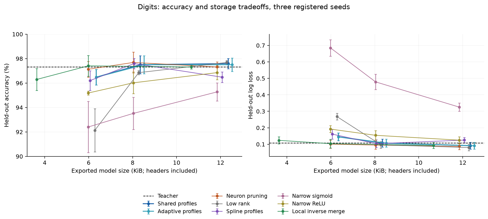
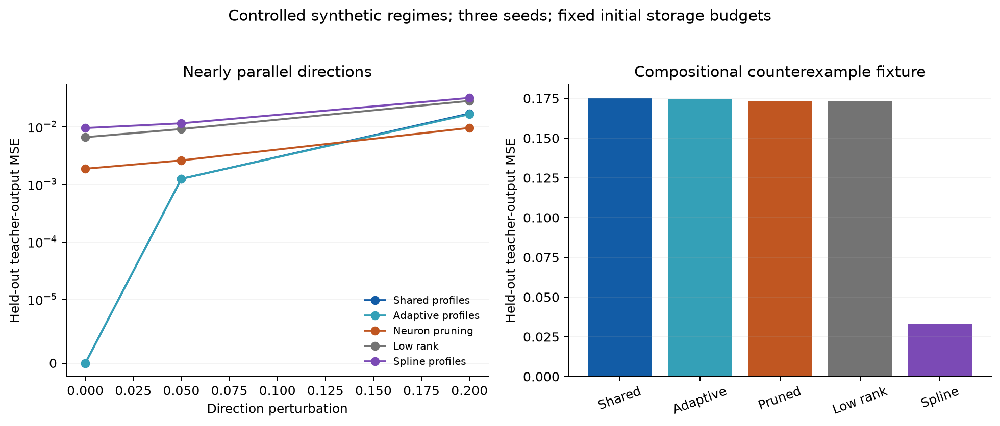

# Activation profile compression: completed evidence study

20 October 2026. The implementation and all studies finished within the
specified eight-hour maximum. The authoritative artifacts are the directories
ending in `_thread1`; earlier runs are retained for comparison.

**The proposed representation works as a compression mechanism. It did not
establish a competitive advantage over the conventional controls in this pilot.**
The selected profile model retained the teacher's mean digits accuracy in a
2.40-times-smaller exported file. Pruning and a local neuron-merging control
reached the required accuracy tolerance in smaller files. The prescribed
five-seed competitive confirmation therefore was not run.

**Follow-up clarification:** this headline result shares directions within one
hidden layer; it is widthwise compression. Its digits fine-tuning used labels,
not teacher-output distillation. The subsequent
[learning-dynamics and margin investigation](multi-bias-learning-and-margin.md)
also found that the main fits usually selected their final checkpoint while
validation loss was still falling. The fixed-budget results below remain
valid, but do not establish a comparison of converged optima.

A separate, registered diagnostic found that also sharing output directions
reduced profile file size by another 17–28% at the same three-seed mean
accuracy as its vector-profile controls. This is a component engineering
result, with conventional pruning/merging still competitive.

The [preceding mathematical and repository review](multi-bias-capacity-and-architecture.md)
records the starting motivation. Stable package APIs, the open multi-bias
paper, environments and existing frozen experiments were preserved. A
[machine-readable evidence summary](benchmarks/activation_profile_compression.json)
contains the gate, costs, replay counts and diagnostic results.

## 1. What was implemented and completed

The implementation is in the sibling lab's `activation_compression_research`
package. It supplies deterministic balanced conversion, ordinary-autograd
models, independent NumPy inference, exact rational error certificates,
validation-selected fitting, bounded profile growth/pruning, optimizer-state
migration, inference exports, process deadlines, strict resume checks and
source snapshots. The CLI supports every registered stage and independent
replay.

| Registered stage | Case bundles | Outcome |
|---|---:|---|
| Synthetic geometry and compositional control | 72 | All complete |
| Digits compression | 75 | All complete |
| Depth feasibility | 18 | All complete |
| Formal competitive confirmation | 0 | Candidate did not pass the comparator gate |
| **Registered total** | **165** | **All independently replayed** |

The registered matrix contains 150 fitted models and 95,400 optimizer updates.
The remaining case bundles are manufactured teachers. Every fit reached its
update limit; no fit cap, process timeout, allocation retry or failed case
occurred in the authoritative matrix.

Additional audits comprise 21 fresh-seed baseline bundles, 24 output-sharing
models, three stronger analytic controls, and 51 symmetry-diagnostic bundles.
Together with the registered matrix, **264 final model bundles were replayed**. An additional deployment
comparison evaluates the same fields with compact and pre-expanded weights.

Ten focused tests pass, covering analytic identities, gradients, growth and
pruning state migration, malformed exports, tampering, nonfinite parameters,
interruption, deadlines, resume refusal and runtime thread limits. GPU checks
also compare values and parameter gradients against CPU and the independent
same-function evaluator.

## 2. Registered digits results

Inputs are the bundled scikit-learn digits pixels scaled to [-1,1]. Each seed
uses stratified 1,077/360/360 training/validation/test splits. The teacher is a
64-unit sigmoid MLP. Settings and seeds were fixed before discovery test
metrics were used. Checkpoints and recipes were selected using validation only.

Values below are means over seeds 4001, 4003 and 4007. The dispersion is sample
standard deviation across seeds, not a confidence interval or significance test.

| Model | Accuracy | Mean log loss | Export bytes | Reduction from teacher |
|---|---:|---:|---:|---:|
| Teacher, 64 units | 97.31% ± 0.42 | 0.10808 | 20,528 | 1.00x |
| Shared profiles, 16 directions and 64 shifts | 97.50% ± 0.73 | 0.10749 | 8,548 | 2.40x |
| Adaptive profiles, 16 directions | 97.50% ± 0.73 | 0.10671 | 8,728 | 2.35x |
| Conventional pruning, 23 units | 97.69% ± 0.85 | 0.09516 | 8,228 | 2.49x |
| Conventional pruning, 16 units | 97.13% ± 0.64 | 0.10087 | 6,128 | 3.35x |
| Local inverse-activation merging, 16 units | 97.41% ± 0.85 | 0.10364 | 6,128 | 3.35x |
| Shared spline control, 16 directions | 97.59% ± 0.42 | 0.10337 | 8,259 | 2.49x |
| Low-rank control at the 16-direction profile budget | 96.85% ± 0.16 | 0.09655 | 8,476 | 2.42x |

All other settings, including eight/32 directions and narrow networks trained
from scratch, are retained. The size category used to budget a pruning control
is not its neuron count: the eight-direction profile budget accommodates an
ordinary 16-neuron network; the 16-direction budget accommodates 23 neurons.
Widths/ranks are rounded down to fit the stated payload budget, and actual
counts and artifact sizes are recorded.



The selected fixed profile passes the teacher-relative size and mean-accuracy
criteria. Its worst accuracy loss on one seed is 0.278 percentage points.
The mean paired log-loss ratio is 0.98796. The ratio of aggregate mean losses
is 0.99453; these are different averaging conventions. Seed 4007's individual
log loss increases by about 10.9%, so the result does not establish a uniform
per-seed log-loss improvement. The registered NLL gate uses the mean paired
ratio rather than a per-seed maximum.

The comparator gate fails: an eligible conventional model uses 6,128 bytes,
while the profile uses 8,548. Before test-based advancement was evaluated,
“useful advantage” was operationalized as at least 10% fewer bytes than the
smallest eligible conventional control. The profile is about 39.5% larger.
The small accuracy difference does not establish statistical superiority.

There was no post-test change to model settings or gates. Confirmation seeds
4013, 4019, 4021, 4027 and 4049 remain unused for competitive confirmation.

## 3. Synthetic conditions: where it works and where it struggles

The twelve-term teacher has four underlying directions and three shifts per
direction. Balanced conversion recovers the aligned field exactly. Perturbing
individual directions changes the approximation problem.

| Teacher regime | Shared profile MSE | Adaptive profile MSE | Pruning MSE | Low-rank MSE | Spline MSE |
|---|---:|---:|---:|---:|---:|
| Exactly aligned | 0 | 0 | 0.00186 | 0.00659 | 0.00950 |
| Direction perturbation 0.05 | 0.00124 | 0.00125 | 0.00260 | 0.00913 | 0.01148 |
| Direction perturbation 0.20 | 0.01699 | 0.01648 | 0.00956 | 0.02815 | 0.03171 |
| Compositional fixture | 0.17485 | 0.17471 | 0.17302 | 0.17303 | 0.03318 |

These are controlled fixtures, not discovered natural-data superiority.
The profiles help when different shifts genuinely share directions. They
lose that benefit as direction differences become important. On the
compositional fixture, the registered sigmoid fitting procedure struggles,
while the spline control does substantially better. This is a result about
that optimization procedure; it is not a proof that all profile models are
incapable of approximating the compositional teacher.



The original geometric bound ranks raw approximation errors well on the
controlled perturbations: descriptive Spearman correlation 0.983 across nine
cases. On the nine digits conversions it is only 0.158. The valid whole-box
bound is therefore not yet a useful general predictor of real-data quality.
Its pessimism and distribution mismatch are unresolved, rather than evidence
that the calculus identities are false.

## 4. Depth feasibility and a stronger analytic control

For real digits, the two-hidden-layer teacher and one-hidden-layer students give:

| Model | Mean accuracy | Mean log loss | Export bytes |
|---|---:|---:|---:|
| Deep sigmoid teacher, 64→32 | 97.13% | 0.11027 | 28,035 |
| Shallow shared profile, 16 directions | 96.85% | 0.14359 | 8,548 |
| Ordinary shallow sigmoid, 23 units | 97.59% | 0.11521 | 8,228 |

The profile reduces stored size but does not improve this tradeoff over the
ordinary shallow control. No global deep-teacher error certificate is claimed.
Both shallow controls receive a retained first-layer initialization and head
refit; the comparison does not privilege the profile with teacher information
while starting the other arm randomly.

The manufactured positive field is

\[
f(x)=2\sigma\{6[\sigma(3x_1)-1/2]\}-1.
\]

It contains a composition but depends on one known projection. Its eight-shift
profile achieves mean test MSE 1.298e-5. The initial full-input integer-width
ordinary control has MSE 0.00261, but that comparison leaves substantial unused
budget because a second full-input neuron would exceed the cap.

An independent audit adds a stronger conventional control: the same known
projection, six ordinary sigmoid units with independently trainable scalar
slopes, and a linear readout. It uses exactly the same 140 payload bytes and
achieves MSE 1.757e-4. The profile's error is about 13.5 times lower under this
fixed fitting recipe, rather than the approximately 201-fold ratio suggested
by the weaker first control. This remains a manufactured, initialization- and
optimizer-dependent neural comparison. It has not established superiority over
strong classical one-dimensional approximation methods or an optimal neural
approximation rate. The padded teacher's apparent storage ratio is excluded
from competitive promotion.

## 5. Adaptive growth, pruning and output sharing

Across the registered study, 56 of 72 proposed growth events were accepted.
One conservative pair-pruning proposal was attempted and accepted. At 16
projections, growth adds storage without changing mean held-out accuracy;
its small log-loss change is insufficient to establish an advantage. Successful
local gradient directions do not guarantee improved held-out performance.

The separate output-sharing diagnostic uses fresh seeds 5003, 5009 and 5011.
Every arm receives the same additional 600-step Adam budget with the same
validation-only checkpoint rule. It retains the ordinary vector-profile,
pruning and merging controls, so additional optimization is not credited only
to the new architecture.

| Exploratory model | Directions | Accuracy | Log loss | Export bytes |
|---|---:|---:|---:|---:|
| Vector profiles with extra fitting | 8 | 95.74% | 0.14272 | 6,500 |
| Scalar profiles sharing output directions | 8 | 95.74% | 0.14663 | 4,707 |
| Vector profiles with extra fitting | 16 | 97.22% | 0.09503 | 8,548 |
| Scalar profiles sharing output directions | 16 | 97.22% | 0.09434 | 7,075 |
| Conventional pruning with extra fitting | 16-neuron control | 97.59% | 0.08607 | 6,128 |
| Local merging with extra fitting | 16 | 97.41% | 0.09353 | 6,128 |

This establishes a small component result: output sharing saves 17.2% or 27.6%
relative to its corresponding vector profile, with equal three-seed mean
accuracy. It does not beat every conventional control. The diagnostic is
explicitly exploratory and cannot retroactively qualify the registered method.

The scalar implementation uses a derived dense incidence buffer to aggregate
terms. That buffer is not stored in the export, but it consumes runtime memory
and is disclosed in each result. File reduction must not be advertised as an
identical RAM or latency reduction. A deployment implementation can instead
expand coefficients once at load time, with its own memory/rounding tradeoff.

### A final diagnostic: group equivalent sigmoid orientations together

A sigmoid row has the exact symmetry

\[
C_j\sigma(w_j^\top x+b_j)
=C_j-C_j\sigma(-w_j^\top x-b_j).
\]

Ordinary Euclidean clustering of weight rows does not respect this symmetry.
The final separately registered diagnostic groups with distance
\(\min(\|w-v\|,\|w+v\|)\), updating biases, coefficients and offsets together.
Magnitudes are retained; this does not introduce free scalar slopes.

The analytic regression re-encodes an aligned teacher without changing its
function. Ordinary conversion then has MSE 0.10776, whereas symmetry-aware
conversion has float32 MSE 6.66e-14. The float64 identity and parameter gradients
agree. Independent replay checks exact row flips, rational offset-rounding
bounds and the subsequent compression bound. Thus this is a real limitation
of the original clustering heuristic; it does not invalidate the earlier
registered experiment, which used that heuristic as specified.

The fresh seeds are 6007, 6011 and 6029. Every arm has 600 updates and the same
validation selection rule. Mean results at 16 directions are:

| Exploratory method | Accuracy | Log loss | Export bytes |
|---|---:|---:|---:|
| Original vector profile | 97.13% | 0.10813 | 8,548 |
| Original local merging | 97.50% | 0.09457 | 6,128 |
| Symmetry-aware vector profile | 97.50% | 0.09730 | 8,548 |
| Symmetry-aware scalar profile | 97.41% | 0.09034 | 7,078 |
| Symmetry-aware local merging | 97.96% | 0.09290 | 6,128 |
| Pruning at scalar-profile payload budget | 97.22% | 0.09880 | 6,428 |
| Low-rank at scalar-profile payload budget | 97.04% | 0.09422 | 6,752 |

The eight-direction results and each seed are also retained. Symmetry-aware
vector sharing improves mean accuracy by 0.370 percentage points over ordinary
vector sharing on these three seeds. The same geometry also helps the local
merging control, which reaches 97.96% in 6,128 bytes. The geometric improvement
therefore is not exclusive to multi-bias profiles. The scalar profile is a
promising component but has not established a competitive overall win.
No formal confirmation or retrospective promotion is made from this diagnostic.

Activation affine symmetries have existing
[theory](https://arxiv.org/abs/2006.11727) and
[identifiability results](https://arxiv.org/abs/1906.06994).
The new evidence here concerns this implementation and these small experiments.

## 6. Deployment measurements and complete costs

All timings are sequential, one native CPU thread, float32, with resident
inputs, 50 warm-ups and three blocks of 200 calls. CUDA timings synchronize.
They measure the existing eager PyTorch implementations on this machine.

The stronger same-function control expands tied weights once at load time.
It uses the same compact model file but restores the full dense weight matrix
in RAM. This is stronger than materializing duplicated weights inside every
inference call. Both controls are retained.

| Evaluator | CPU batch 1 | CPU batch 128 | GPU batch 1 | GPU batch 128 |
|---|---:|---:|---:|---:|
| Compact shared projections | 14.24 μs | 52.65 μs | 40.09 μs | 40.75 μs |
| Same file, pre-expanded once at load | 9.29 μs | 26.26 μs | 24.07 μs | 23.85 μs |

Entries average the three seeds’ median block times. All three blocks are retained. No host-to-device transfer is included.

Fewer matrix multiplications do not guarantee lower latency at these small
sizes: indexing, additional elementwise work and GPU launch overhead remain.
The audit shows why a parameter/storage result is not automatically a speed
result. No general inference advantage is established.

The compact research module holds 7,976 parameter/buffer bytes; the
pre-expanded dense evaluator holds 19,240 parameter bytes. At batch 128 both
have a measured additional peak of 65,536 GPU bytes for activations and outputs
in this audit. The constant 64 sigmoid evaluations remain, explaining why
sharing directions need not reduce activation memory.

| Chosen recipe | Incremental process cost | Cold cost including teacher |
|---|---:|---:|
| Teacher alone | 4.91 s | 4.91 s |
| Fixed 16-direction profile | 4.71 s | 9.62 s |
| Adaptive 16-direction profile | 4.93 s | 9.84 s |
| Pruning, 16 units | 4.03 s | 8.94 s |
| Pruning, 23 units | 4.03 s | 8.94 s |
| Local merging, 16 units | 4.03 s | 8.94 s |
| Spline, 16 directions | 4.79 s | 9.70 s |
| Low-rank at 16-direction profile budget | 4.06 s | 8.97 s |

Costs include process startup, setup, conversion, fitting, export, inference measurement and independent replay. The fixed-plus-adaptive six-setting search costs 28.83 s per seed before its 4.91 s teacher. A three-setting pruning or merging search costs about 12.13 s per seed before the teacher. The complete registered digits stage takes 328.98 s; synthetic and depth stages take 295.10 s and 76.15 s. These stage counters measure execution, not the earlier human/agent derivation and implementation time. Implementation began at 06:26:04 UTC; all work is bounded by the eight-hour ceiling.

The table distinguishes a chosen recipe from search cost. Per-family validation
search explores all three sizes; the proposed portfolio explores fixed and
adaptive profiles. Complete portfolio and stage times are retained in the
artifacts. The full digits comparison includes all 75 bundles, rather than
charging only the selected fit. No training speedup follows from comparing
600 student updates with 1,500 teacher updates.

The largest registered training allocation is approximately 66.8 MiB, below
the approximately 2.5 GiB allocator limit. No batch fallback was needed.

## 7. Mathematical results and assumptions

### A real-function compression bound

On \(|x_i|\le r\), let retained student term \(k\) match teacher term \(j\).
Sigmoid has range [0,1] and Lipschitz constant 1/4. For each output, the
matched-term error is bounded by

\[
|C_{tj}|\min\!\left(1,
\frac{r\|w_j-v_{g(k)}\|_1+|b_j-b'_k|}{4}\right)
+|C_{tj}-C'_{k}|.
\]

Add the offset difference, \(|C_{tj}|\) for each removed original term, and
\(|C'_k|\) for every new term. This follows by adding and subtracting
\(C_{tj}\sigma(v_{g(k)}^\top x+b'_k)\) and applying the triangle inequality.
The constructor and independently organized checker use exact fractions of
stored dyadic parameters. Downstream fixed affine/activation tails propagate
coordinate bounds through absolute weights and Lipschitz constants.

The statement concerns real functions with the stored parameters. Floating-point
execution error, generalization error and global label preservation are separate
obligations. A valid but loose bound is retained as inconclusive for labels.

### Error from removing two profile terms

For shifts \(a<b\),

\[
\sup_z[\sigma(z-a)-\sigma(z-b)]=\tanh((b-a)/4).
\]

For arbitrary coefficients, use

\[
|c_1-c_2|\,\tanh(|b_1-b_2|/4)/2+|c_1+c_2|.
\]

This follows by decomposing into a difference and a sum of sigmoids. The
rational implementation uses \(\tanh t\le\min(1,t)\). Close biases alone
cannot justify pruning when coefficients or temperature make their effect large.

### Conditions for replacing directions and depth

On an open convex domain, a differentiable field factors through one unit
projection \(v^\top x\) exactly when all its output gradients lie in
\(\operatorname{span}(v)\). Integrating along a segment in a projection fiber
proves sufficiency. Connected fibers, not just local gradient identities,
are needed for a global factorization.

For square-integrable fields, conditional-expectation orthogonality gives

\[
\inf_{g\in\mathcal G_K}\mathbb E[(f-g(v^\top X))^2]
=\mathbb E[\operatorname{Var}(f\mid v^\top X)]
+\inf_{g\in\mathcal G_K}\mathbb E[(\mathbb E[f\mid v^\top X]-g(v^\top X))^2].
\]

These are separate costs: directions discarded and remaining profile complexity.
On a finite Boolean domain, an injective projection makes the unrestricted
first term zero; complexity, margins and precision still constrain the second.

For independent standard Gaussian \(X_1,X_2\), \(f=X_1X_2\) and a unit
projection \(Z=v_1X_1+v_2X_2\),

\[
\mathbb E[f\mid Z]=v_1v_2(Z^2-1),\qquad
\inf_g\mathbb E[(f-g(Z))^2]=1-2v_1^2v_2^2\ge1/2.
\]

This is a genuine one-projection obstruction, independent of training. Two
quadratic profiles nevertheless represent the product exactly through
\(((x_1+x_2)^2-(x_1-x_2)^2)/4\).

For Gaussian inputs, conditional Poincare additionally bounds discarded-field
variance by the corresponding discarded gradient energy. This is established
[active-subspace theory](https://arxiv.org/abs/1304.2070), including
[vector-valued extensions](https://arxiv.org/abs/1801.07922). It cannot be applied
to digits by silently assuming a Gaussian input distribution. An R-dimensional
retained function also need not be a sum of independent scalar profiles.

### Output rank is an additional resource

A vector profile is \(F(z)=C\phi(z)\), with distinct finite sigmoid shifts.
Those shifted functions are linearly independent: setting \(q=e^z\) turns
them into rational functions \(q/(q+a_j)\) with distinct poles. A vanishing
combination has zero residue at every pole, forcing all coefficients to vanish.

Consequently, **the minimum number of scalar profile outputs followed by a
linear readout needed to match this vector field exactly is rank(C)**.
Rank factorization proves sufficiency; independence proves necessity. Merge
coincident shifts first. A nonlinear downstream decoder changes the statement.
This is not a lower bound for merely matching hard classification labels.

For matching softmax probabilities, the relevant matrix is \(PC\), where
\(P=I-\mathbf1\mathbf1^\top/O\), because common logit shifts are irrelevant.
This motivates a task-aware output-sharing study; the present diagnostic uses
raw-logit factorization. The rank argument is elementary mathematics, with
novelty unestablished.

### Storage predicts feasible targets

Dense and shared-vector-profile payloads contain respectively

\[
H(d+O+1)+O,\qquad Rd+H(O+1)+O
\]

float scalars. With four-byte floats and I-byte group indices, sharing saves
\(4d(H-R)-IH\) bytes. If retained output coefficients dominate, increasing
profile complexity cannot deliver a large full-block reduction. In particular,
input-only sharing cannot reach a twofold payload reduction when \(O\ge d\).

Sharing one output direction per group changes the scalar count to
\(R(d+O)+2H+O\). This explains the tested scalar variant and identifies input
directions, output-profile rank and bias complexity as distinct resources.
The formulas are bookkeeping and rank factorization, not new mathematics or
hardware-speed guarantees.

## 8. Prior-art and claim classification

| Candidate | Classification | Supporting evidence / boundary |
|---|---|---|
| Shared projection plus scalar profile | Established representation; useful engineering | Exact aligned conversion and controlled approximation |
| Whole-box sigmoid error controller | Established Lipschitz mathematics, tested implementation | Exact rational replay; weak digits predictor |
| Function-preserving growth | Established principle, tested heuristic | 56 accepted events; no material accuracy gain here |
| Output-sharing scalar profiles | Architectural candidate | 17–28% file reduction relative to vector profiles; no full competitive win |
| Sigmoid symmetry-aware grouping | Established identity; useful heuristic correction | Exact re-encoding regression; gains also reproduced by merging |
| Cheap replacement of arbitrary depth | Unsupported general claim | Special positive fixture and explicit information-loss counterexamples |
| A new general theory or general speed advantage | Not established | No such claim follows from this small study |

Relevant sources include [neuron merging (NeurIPS 2020)](https://proceedings.neurips.cc/paper/2020/hash/0678ca2eae02d542cc931e81b74de122-Abstract.html),
the particularly close [October 2026 sigmoid merging preprint](https://arxiv.org/abs/2610.02559),
[adaptive spline activation theory](https://jmlr.org/papers/v20/18-418.html), and
[Net2Net](https://arxiv.org/abs/1511.05641). The local inverse-regression and spline
controls are clearly labelled local implementations, not official reproductions.
The targeted review does not establish mathematical novelty for the elementary
identities in this report.

## 9. Audit findings, corrections and retained limitations

- The main CLI originally configured one native thread correctly. Diagnostic
  import order could initialize NumPy/OpenBLAS before environment settings.
  Runtime limits now cover already-loaded pools, each case records them, and a
  regression reproduces and repairs the issue. Authoritative fresh runs apply
  that correction. Earlier outputs are preserved.
- The resource-controlled rerun reproduced **every stored array exactly** in 267 initial/final/control exports (1,503 arrays, including metadata). All 165 registered case records report one thread in every loaded native pool. The fix changes timing reliability, not model predictions.
- A development fixture exposed ill-conditioned head refitting and cancellation.
  Every method now uses the registered SVD threshold rcond=1e-6. Mathematical
  inference is independently checked in float64; actual accuracy is measured
  on float32 exports. The resulting float32 differences are recorded rather
  than reclassified as an architectural gain.
- A missing import was caught and fixed before registration. A later direct
  script launch lacked the package import path; the documented module launch
  succeeded, before any diagnostic models were produced. No numerical method
  or hyperparameter was changed to improve a held-out result.
- Both compact and pre-expanded same-function deployment controls were audited.
  The former per-call weight-expansion control is not treated as the strongest
  inference implementation.
- 108 initial/final functional certificates were independently replayed,
  including the scalar diagnostic's exact products of float32 factors. These
  products need at most 48 significand bits and are represented exactly in
  float64 before conversion to fractions. Tampered models/certificates are
  rejected in focused tests.
- The final lint audit has eight import-order findings and one B007 warning
  for a loop counter used after the loop. Other enabled lint checks pass.
  Frozen experimental sources retain these style findings so their registered
  hashes and direct replay remain intact.
- Official neuron-merging implementations were not installed; their mathematics
  and papers were reviewed. The study does not claim to outperform those
  published systems. MNIST/CIFAR and large-scale training are outside this
  fixed bundled-digits campaign.
- No formal theorem-prover build, global classification guarantee, general
  scientific-solver advantage or statistical superiority is claimed.

## 10. Reproduction and continuation decision

From `/home/vardan/dev/projects/omnibias_projects/omnibias-lab`:

```bash
/tmp/omnibias-geometry-comparators/bin/python -B -m pytest tests/test_activation_compression.py -q

/tmp/omnibias-geometry-comparators/bin/python -B -m activation_compression_research.run \
  --stage all --device cuda --output artifacts/activation_compression_fresh

/tmp/omnibias-geometry-comparators/bin/python -B -m activation_compression_research.run \
  --replay --output artifacts/activation_compression_20261020_thread1

/tmp/omnibias-geometry-comparators/bin/python -B -m reports.activation_compression_output_diagnostic \
  --replay --output artifacts/activation_compression_output_diagnostic_20261020_thread1

/tmp/omnibias-geometry-comparators/bin/python -B -m reports.activation_compression_analytic_control_audit \
  --replay --study artifacts/activation_compression_20261020_thread1 \
  --output artifacts/activation_compression_analytic_control_audit_20261020_thread1

/tmp/omnibias-geometry-comparators/bin/python -B -m reports.activation_compression_projective_diagnostic \
  --replay --output artifacts/activation_compression_projective_diagnostic_20261020_thread1
```

GPU commands require the verified outside-sandbox path on this host. Python
3.12.13/Torch 2.14.1+cu130 run on the NVIDIA T1200 with driver 595.91.07. The
existing comparator environment was preserved; it is not described as the
original paper environment. Registrations contain source/dependency and lockfile
fingerprints, actual thread pools, configurations and source snapshots. Resume
refuses mismatches. Archived source is needed to replay the earlier pre-fix runs.

Artifact families under `artifacts/` are:

```text
activation_compression_20261020_thread1
activation_compression_output_diagnostic_20261020_thread1
activation_compression_deployment_audit_20261020_thread1
activation_compression_analytic_control_audit_20261020_thread1
activation_compression_report_20261020_thread1
activation_compression_projective_diagnostic_20261020_thread1
```

They retain every model, initial conversion, certificate, split digest, selection
record, cost, rejected growth proposal, source snapshot and independent replay.
The lab's `docs/activation-compression-math-supplement.md` contains the extended
factorization, Gaussian, margin and softmax-quotient arguments. Figure sources
and PNG/SVG exports are retained with input/source hashes.

**Recommended continuation: start from a strong pruned or symmetry-aware
merged model and grow scalar profiles without changing its initial function.** This avoids forcing
important directions into means and avoids an output-rank approximation at
insertion. Keep its existing output directions, introduce cheap scalar profile
terms only when residual correlation supports them, and compare against the
unchanged pruning and symmetry-aware merging baselines at the same final byte budget. Include adaptive
spline controls and count all search and export costs.

This direction follows the surviving evidence: richer profiles help controlled
shared-direction fields, scalar output sharing reduces a real storage overhead,
and conventional pruning/merging supplies strong starting representations here.
A larger competitive study is justified only after this combined mechanism beats
that starting baseline on fresh data. The current work supplies tested building
blocks and a falsifiable next question; it does not establish a breakthrough.
