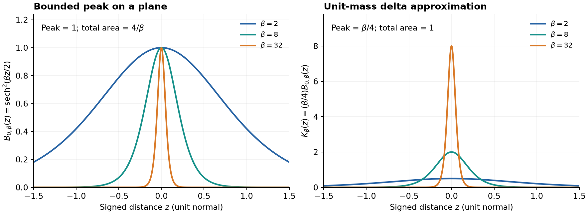
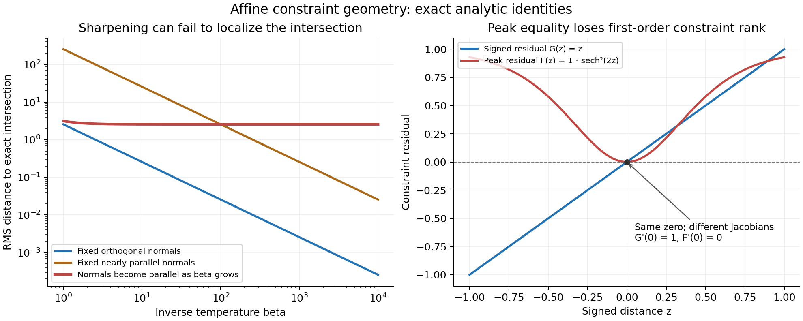
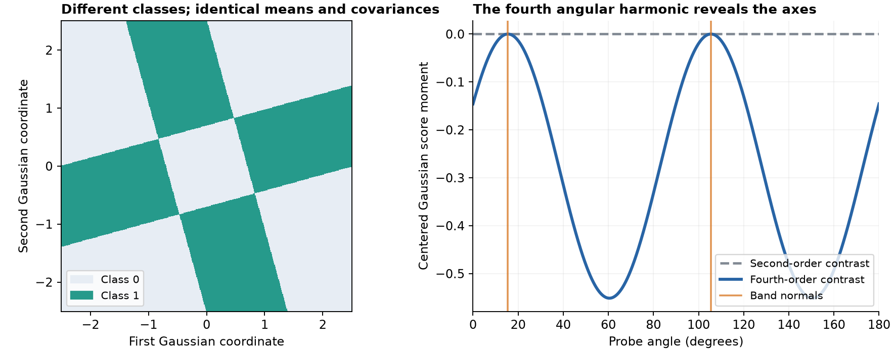
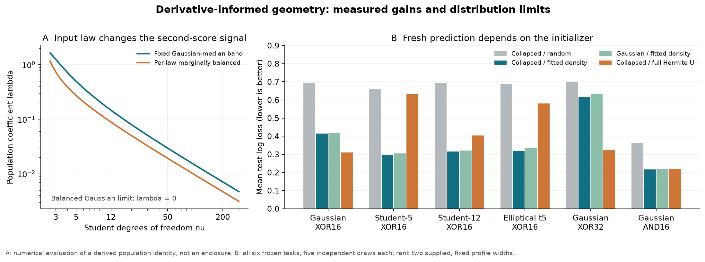

# Bias collapse and exact PDE solution families

Normalized bias collapse extracts activation derivatives. For a **linear,
constant-coefficient, homogeneous PDE system**, those derivatives can be combined
so that the equations hold identically. The new `ridge_system` primitives compute
these combinations using exact rational linear algebra, then evaluate them in a
Torch or JAX forward pass. Initial and boundary conditions remain separate
constraints.

This is an implementation of differential syzygies specialized to ridge profiles.
It is not a claim of a new general PDE theorem. Polynomial syzygies and arbitrary
potentials already appear in [Härkönen, Hirsch and Sturmfels, *Making Waves*,
Section 3](https://arxiv.org/abs/2111.14045). Broader solution representations underlie
[Härkönen, Lange-Hegermann and Raiţă, *Gaussian Process Priors for Systems of Linear
Partial Differential Equations with Constant Coefficients*](https://arxiv.org/abs/2212.14319).
The contribution here is a bounded compiler integrated with omnibias's raw
activation derivatives, including coupled equations of different derivative orders.
For composed networks, see [deep collapse and the chain rule](deep-bias-collapse.md).
For heat, Laplace and forcing, see [profile algebra and PDE identification](profile-pde.md).
The corrected equality interpretation is implemented in
[affine geometry](affine-geometry.md) and the
[calculus–geometry derivation](calculus-geometry-pilot.md), with
[replayed application results](calculus-geometry-results.md).

## Exact equality semantics before choosing an activation or loss

The intended primitive is an exact equality detector. The previous discussion
introduced a peak-normalized sigmoid derivative as one smooth model without
first deriving why that particular model should define the primitive. That
choice was an additional modeling assumption. Its algebra and measured results
remain valid for that choice; they do not identify every possible equality-locus
model with the same smooth peak. The following derivation begins with the exact
predicate and makes each subsequent representation explicit. It adds no new
numerical implementation or performance claim.

**A hyperplane, its residual, and its readout.** For w nonzero, define

\[
r(x)=w^Tx+b,\qquad H=\{x:r(x)=0\},\qquad E_H(x)=\mathbf1\{r(x)=0\}.
\]

The exact readout is one on H and zero everywhere else. The smooth residual
r carries information that E discards: orientation and distance. Multiplying
(w,b) by a nonzero scalar preserves H and E, so a geometric loss should account
for this freedom. With the Euclidean input metric, the signed distance is
d=r/\|w\| and the orthogonal projection is x-dw/\|w\|. Consequently

\[
L_H(x)=\frac12\operatorname{dist}(x,H)^2
=\frac{r(x)^2}{2\|w\|^2},\qquad
E_H(x)=1\iff L_H(x)=0.
\]

This loss preserves the exact equality set. For fixed w,b its derivatives are

\[
\nabla_xL_H=\frac{r}{\|w\|^2}w,\qquad
\nabla_x^2L_H=\frac{ww^T}{\|w\|^2}.
\]

The Hessian is the orthogonal projector onto the normal direction. Its kernel
is the tangent space of H. One unit gradient step in x is exactly projection
onto H. If the geometry is learned, the ambient parameter derivatives are

\[
\partial_bL_H=\frac{r}{\|w\|^2},\qquad
\nabla_wL_H=\frac{rx}{\|w\|^2}-\frac{r^2w}{\|w\|^4}.
\]

Require w nonzero; a unit-normal parameterization removes the scale freedom.
Allowing w=b=0 would turn every input into a positive equality and trivialize
positive-only fitting. All distance statements use a declared Euclidean metric;
feature rescaling changes that metric unless it is transformed accordingly.

**What a new loss can preserve.** A smooth loss can preserve an exact zero set
and supply useful derivatives, as L_H does. It cannot obtain those derivatives
from the binary readout alone: any loss of the form ell(E_H(x),y) is locally
constant off H. On H the readout is discontinuous in transverse directions.
Thus exact forward equality and residual-based training can coexist, but the
residual loss is not the ordinary derivative of the hard predicate.

L_H enforces positive equality constraints. A binary classifier also needs to
specify how negatives should be separated. For example, a margin m>0 for a negative
requires |d|>=m, which is a stronger condition than d nonzero and is a union of
two half-spaces. A continuous negative loss cannot be zero at every d nonzero
yet positive at d=0. A differentiable symmetric loss of d also has derivative
zero at d=0. These facts guide a subsequent choice of margins, orientation or
latent side assignments; they are not solved by naming a new loss. For fixed
nonzero affine r and an input distribution with an ambient density, H has
probability zero. Noisy classification therefore needs its own measurement or
feature-geometry model rather than an implicit replacement of exact equality.

**A derivative can define the exact hyperplane.** Let s_beta(z)=sigma(beta z)
for finite real z and beta>0. Direct differentiation gives

\[
s_\beta'=\beta s_\beta(1-s_\beta),\qquad
s_\beta''=\beta^2s_\beta(1-s_\beta)(1-2s_\beta).
\]

Because 0<s_beta<1,

\[
s_\beta''(z)=0\iff z=0,
\qquad s_\beta'(z)=\beta/4\iff z=0.
\]

Therefore the exact equality detector can be defined by either derivative
level set at finite temperature. The previous smooth peak
B_beta=4s_beta'/beta is one at precisely the required location, so
E_H=1{B_beta(r)=1} is also exact in real arithmetic. The final equality comparison
supplies its discontinuity; the smooth value B itself is not a binary readout.

Equivalent level sets need not give equivalent optimization geometry. The
residual q=s_beta'' has q'(0)=-beta^3/8, a simple zero. The residual
h=beta/4-s_beta' has
h(z)=beta^3 z^2/16+O(z^4), a double zero; minimizing h² creates a quartic flat
minimum. Conversely q tends to zero in both infinite tails, so minimizing q²
alone permits arbitrarily small losses far from the finite root. A regular
residual and a well-behaved global objective must be selected explicitly.
One exact map from derivatives to the signed coordinate is

\[
\frac{s_\beta''(z)}{\beta s_\beta'(z)}=-\tanh(\beta z/2),\qquad
z=-\frac2\beta\operatorname{artanh}
\left(\frac{s_\beta''(z)}{\beta s_\beta'(z)}\right).
\]

This is a real-arithmetic identity, not a recommendation to reconstruct an
already available affine residual through numerically saturated derivatives.

**Bias differentiation is normal-coordinate differentiation.** For a smooth
ridge u(x)=phi(w^T x+b), a multi-index alpha and n=w/\|w\|,

\[
\partial_b^k u=\phi^{(k)}(r),\qquad
D_x^\alpha u=w^\alpha\partial_b^{|\alpha|}u,\qquad
\partial_n^k u=\|w\|^k\partial_b^k u.
\]

Equivalently, the kth spatial derivative tensor is
phi^(k)(r) w^{tensor k}. These identities derive the geometry directly from
the chain rule. The weighted finite-difference limit in the next section
derives how bias shifts recover the bias derivatives. A derivative level set
is generally the union of parallel planes corresponding to all scalar roots;
one plane requires an appropriate unique-root or unique-level property.

The zero set alone does not retain all differential information. For example,
u(x)=x and v(x)=x+x³ have the same exact zero set, but u''=0 while v''=6x.
Thus an equality predicate by itself cannot determine which PDE the underlying
field satisfies. Residual values, derivatives and their compatibility must be
retained when making a calculus claim.

For integration, the measure must also be retained. A hyperplane has zero
ambient volume, so its pointwise indicator E_H induces the zero distribution
under Lebesgue integration. A nonzero surface measure is a different object:

\[
\int_{\mathbb R^d}f(x)\|w\|\delta(w^Tx+b)\,dx=\int_H f(x)\,dS(x).
\]

This follows by parametrizing the normal coordinate and its scale \|w\|.
The formula connects geometric surface integration with a distributional
operator; it does not identify the equality indicator with a Dirac delta.

**Intersections and a metric-aware loss.** For r(x)=Ax-b with A of full row rank,
M={x:Ax=b} is nonempty. Solving the minimum-distance constrained problem gives

\[
\Pi_M(x)=x-A^T(AA^T)^{-1}(Ax-b),\qquad
L_M(x)=\frac12(Ax-b)^T(AA^T)^{-1}(Ax-b).
\]

Indeed, the Lagrange equations for minimizing half the squared distance from
x are v-x+A^Tlambda=0 and Av=b; eliminating v gives
AA^Tlambda=Ax-b. Hence L_M is exactly half the squared distance to M and
vanishes exactly on the intersection. Its Hessian
A^T(AA^T)^(-1)A is an orthogonal projector: all nonzero eigenvalues are one.
This improves the normal-space conditioning of the raw residual loss, whose
Hessian is A^T A. It is invariant under invertible mixing of the equations:
replacing (A,b) by (SA,Sb), with S nonsingular, leaves the distance loss unchanged.
The improvement is bought by a matrix solve or factorization;
the inverse notation is not a proposal to form an explicit inverse or a proof
of a faster solver. This result is distinct from changing only temperature in
the log-cosh loss discussed later.

For nonlinear C² residuals r:R^d->R^m with full-row-rank Jacobian J at a feasible
point x*, the implicit-function theorem gives
\(T_{x_*}M=\ker J\) and \(N_{x_*}M=\operatorname{range}J^T\).
For constant positive-definite W,

\[
L=\tfrac12r^TWr,\quad
\nabla L=J^TWr,\quad
\nabla^2L=J^TWJ+\sum_i(Wr)_i\nabla^2r_i.
\]

At feasibility, the second term vanishes. The local choice
W(x)=(J(x)J(x)^T)^(-1) also has Hessian
J^T(JJ^T)^(-1)J at x*, since terms differentiating W contain a factor r.
Its loss is locally a distance approximation, not exact global distance for a
curved set. Rank loss invalidates this construction. Nonlinear residual losses
can have infeasible local minima: r=x³-3x+3 has a real root, but half r² has a
strict local minimum at x=1 with r=1 and second derivative 6.

**PDE geometry requires compatible derivatives.** Write the kth jet as
j^k u(x)=(x,u(x),D u(x),...,D^k u(x)). A PDE F(x,u,p_alpha)=0 defines a relation
in this space. Its solution is a field whose entire jet graph lies in that
relation, with initial/boundary conditions and the compatibility equations

\[
\partial_i u_\alpha=u_{\alpha+e_i}\quad(|\alpha|<k).
\]

These equations prevent treating derivative coordinates as independent
variables. For example, u'=u defines the plane p=u, but the section
(u(x),p(x))=(x,x) lies on that plane and fails p=u'. The genuine solution
family is u=C exp(x). Likewise u_x=0 and u_y=x cannot hold for a C² function
on an open set: the mixed partials would be zero and one. This is the
geometric theory of PDEs described, for example, in
[del Pino's lecture notes, Section 1.3](https://alvarodelpino.com/wp-content/uploads/2019/10/coimbra2018notes.pdf).
The compatibility condition is the missing requirement when an arbitrary
intersection in derivative coordinates is interpreted as a PDE solution.

For a homogeneous constant-coefficient linear operator
L=sum_{|alpha|=k} a_alpha D^alpha with symbol P(w)=sum a_alpha w^alpha,
the ridge identities give L phi(r)=P(w) phi^(k)(r). Thus P(w)=0 supplies
entire exact ridge solution families, such as phi(x+ct) for the wave equation.
Mixed derivative orders give a sum of different profile derivatives instead.
The exact bounded matrix construction below treats those scoped coupled
systems. With fixed basis functions and a linear PDE, coefficient equations
are linear; nonlinear terms or learned basis geometry generally introduce
nonlinear equations. Jet-space intersections alone do not remove them.

For a selected solution of r(x(theta),theta)=0 with square invertible J_x,
dx/dtheta=-J_x^(-1)J_theta. In particular, Ax=b gives
dx=A^(-1)(db-dA x). These are useful solution derivatives even when each
equation is linear in x. An underdetermined system additionally needs a
solution-selection rule. An LP additionally needs its inequalities and objective.
Characterizing an optimum through KKT conditions also requires dual feasibility,
stationarity and complementary slackness. Equality geometry supplies only part
of those conditions.

The resulting order of work is: define the exact readout, derive a regular
residual from the proposed collapse operation, choose an invariant loss,
state rank/integrability assumptions, and identify a supported application.
Only then can an implementation or advantage comparison test that definition.
The previous smooth-band experiments remain tests of their particular models.

## What actually collapses

For a continuous activation, the unnormalized expression

\[
\phi(z+b_1)-\phi(z+b_2)\longrightarrow 0
\qquad (b_1\longrightarrow b_2).
\]

It does not become a function supported on a hyperplane. For differentiable
activations the normalized difference converges to \(\phi'(z+b)\). More generally,
for \(r\geq1\), the centered difference

\[
C_{r,h}\phi(z)=\frac{1}{h^r}\sum_{j=0}^r
(-1)^{r-j}\binom rj\phi\bigl(z+(j-r/2)h\bigr)
\longrightarrow\phi^{(r)}(z).
\]

Thus \(r+1\) biases extract derivative order \(r\) **with these weights and
normalization**. The number of biases alone does not establish this limit.

Repeated application of the fundamental theorem of calculus gives the useful
error formula

\[
C_{r,h}\phi(z)=\mathbb E\left[\phi^{(r)}
\left(z+h\sum_{i=1}^r U_i\right)\right],
\qquad U_i\sim\operatorname{Uniform}[-1/2,1/2]
\]

with independent \(U_i\). Since their sum has mean zero and variance \(r/12\),
Taylor's theorem yields

\[
|C_{r,h}\phi(z)-\phi^{(r)}(z)|
\leq \frac{rh^2}{24}
\sup_{|s-z|\leq r|h|/2}|\phi^{(r+2)}(s)|.
\]

This bound assumes \(\phi\in C^{r+2}\) on that interval and concerns exact
arithmetic. Floating-point cancellation grows as the bias spacing shrinks. The
implementation below evaluates the collapsed derivative formulas directly,
without choosing a tiny bias spacing.

## The mapping from bias derivatives to a PDE system

Let \(u\) have \(n\) components and let a system of \(m\) equations be

\[
A(D)u=0,\qquad A(D)=\sum_\alpha A_\alpha D^\alpha,
\qquad A_\alpha\in\mathbb Q^{m\times n}.
\]

Here \(p\) is the maximum derivative order in the original PDE, before any
cancellation on restriction. The stored `RidgeSystem.order` can be smaller;
it does not by itself specify the smoothness needed to evaluate the original PDE.

For a fixed nonzero normal \(w\in\mathbb Q^d\), define

\[
B_k(w)=\sum_{|\alpha|=k}A_\alpha w^\alpha,
\qquad A_w(s)=\sum_{k=0}^{p}B_k(w)s^k.
\]

Take a vector polynomial \(Q(s)=\sum_{j=0}^{r}q_js^j\). It specifies a vector
of collapsed neurons sharing the same normal and bias:

\[
u_{Q,\phi,b}(x)=\sum_{j=0}^{r}q_j\phi^{(j)}(w\cdot x+b).
\]

**Exact criterion.** This field solves the system for every
\(\phi\in C^{p+r}(\mathbb R)\) and every bias \(b\) if and only if

\[
A_w(s)Q(s)=0.
\]

**Proof.** The chain rule gives
\(D^\alpha\phi^{(j)}(w\cdot x+b)=w^\alpha\phi^{(j+|\alpha|)}(w\cdot x+b)\).
Consequently,

\[
A(D)u_{Q,\phi,b}=
\sum_{\ell=0}^{p+r}
\underbrace{\left(\sum_{k+j=\ell}B_k(w)q_j\right)}_{R_\ell}
\phi^{(\ell)}(w\cdot x+b).
\]

If all \(R_\ell\) vanish, the residual vanishes. Conversely, fix an argument
\(z_0\) and choose \(\phi(z)=(z-z_0)^\ell/\ell!\). Its finite derivative
vector at \(z_0\) isolates \(R_\ell\), so validity for every smooth profile
forces each coefficient to vanish. This proof requires finite smoothness,
not analyticity.

The compiler constructs the finite matrix
\(T_{(\ell,e),(j,c)}=B_{\ell-j}(w)_{e,c}\), interpreting missing coefficients
as zero, and returns its rational nullspace. This is **all vector polynomials
of degree at most the requested bound** in the right kernel. It is a vector-space
basis, not a minimal generating basis over the polynomial ring: increasing the
bound can return derivative shifts of earlier solutions.

With restricted order \(p_w\), this matrix has \(m(p_w+r+1)\) rows and
\(n(r+1)\) columns. Once the normal has been substituted, its size does not
grow with the spatial dimension. Dense rational elimination can still be
expensive, especially when coefficient numerators and denominators grow.
Finding suitable normals remains a separate problem.

`RidgeBudget` limits orders, matrix allocation, elimination work and coefficient
bit growth. Refusal is distinct from an empty kernel. Compact Laplacian powers
are restricted using \((\sum_i w_i^2)^q s^{2q}\), without expanding a mixed jet.

## A coupled wave system

Use coordinates \((t,x)\) and fields displacement \(u\), velocity \(v\) and
strain \(r\):

\[
v-u_t=0,\qquad r-u_x=0,\qquad v_t-4r_x=0.
\]

For \(w=(2,1)\),

\[
A_w(s)=\begin{pmatrix}-2s&1&0\\-s&0&1\\0&2s&-4s\end{pmatrix},
\qquad Q(s)=\begin{pmatrix}1\\2s\\s\end{pmatrix}.
\]

There is no nonzero constant vector in this polynomial kernel. Allowing one
bias derivative produces
\((u,v,r)=(\phi,2\phi',\phi')(2t+x+b)\), which satisfies all three equations
for any sufficiently smooth activation. This is a precise sense in which
activation substitution preserves the equations; it does not preserve the
values of the fields or their boundary data.

```python
from fractions import Fraction
from omnibias.core.operator_spec import OperatorSpec
from omnibias.core.ridge_system import RidgeSystem

identity = OperatorSpec.mixed((0, 0))
dt = OperatorSpec.mixed((1, 0))
wave = (
    (OperatorSpec.polynomial({(1, 0): -1}), identity, None),
    (OperatorSpec.polynomial({(0, 1): -1}), None, identity),
    (None, dt, OperatorSpec.polynomial({(0, 1): -4})),
)
system = RidgeSystem.from_operators(wave, (2, 1))
assert system.kernel_basis(max_degree=0) == ()
pack, = system.kernel_basis(max_degree=1)
assert pack.coefficients == (
    (Fraction(1), Fraction(0), Fraction(0)),
    (Fraction(0), Fraction(2), Fraction(1)),
)
assert all(value == 0 for row in system.residual_coefficients(pack) for value in row)
# A noncharacteristic direction has no arbitrary-profile polynomial pack.
assert RidgeSystem.from_operators(wave, (3, 1)).kernel_basis(max_degree=3) == ()
```

Evaluate the field in a forward pass. Biases and scalar mixture coefficients
remain trainable; the rational normal is fixed by the algebraic construction.
The backend module has the same `ridge_solution` API in Torch and JAX.
It supports `sigmoid`, `tanh`, `softplus`, `gaussian`, `exp`, `sin`, `cos`, `sinh`
and `cosh`. Manually constructing a `RidgeSyzygy` validates its metadata only;
check its `residual_coefficients` against the system before treating it as a
solution. The tensor evaluator does not independently verify PDE membership.

```python
import torch
from omnibias.torch.ridge_system import ridge_solution

points = torch.tensor([[0.1, 0.2], [0.3, 0.7]], dtype=torch.float64)
bias = torch.tensor(0.2, dtype=points.dtype, requires_grad=True)
field = ridge_solution(points, pack, bias, activation="tanh")
assert field.shape == (2, 3)
field.square().sum().backward()
assert bias.grad is not None and torch.isfinite(bias.grad)
```

## Solving initial and boundary data in a supported family

A superposition of these atoms still satisfies the PDE. Opposite wave directions
with sine profiles can also enforce \(u(t,0)=u(t,\pi)=0\) and \(v(0,x)=0\)
identically. Only the initial displacement amplitudes then need to be fitted.
The following small manufactured example recovers

\[
u(t,x)=\sin(x)\cos(2t)+\tfrac13\sin(3x)\cos(6t).
\]

It solves the stated initial-boundary problem because these data lie in the
chosen finite span. There is no claim that an arbitrary boundary problem lies
in such a span, or that this improves on a Fourier solver for this example.

```python
def standing_feature(points, frequency):
    right, = RidgeSystem.from_operators(
        wave, (2 * frequency, frequency)
    ).kernel_basis(max_degree=1)
    left, = RidgeSystem.from_operators(
        wave, (-2 * frequency, frequency)
    ).kernel_basis(max_degree=1)
    # Normalize displacement amplitude independently of nullspace pivot choices.
    right_scale = float(right.coefficients[0][0])
    left_scale = float(left.coefficients[0][0])
    return 0.5 * (
        ridge_solution(points, right, activation="sin") / right_scale
        + ridge_solution(points, left, activation="sin") / left_scale
    )

xs = torch.linspace(0, torch.pi, 17, dtype=torch.float64)
initial_points = torch.stack((torch.zeros_like(xs), xs), dim=-1)
frequencies = (1, 3)
design = torch.stack(
    [standing_feature(initial_points, k)[:, 0] for k in frequencies], dim=-1
)
initial_displacement = torch.sin(xs) + torch.sin(3 * xs) / 3
amplitudes = torch.linalg.lstsq(design, initial_displacement).solution
assert torch.allclose(amplitudes, xs.new_tensor([1, 1/3]), atol=2e-14, rtol=0)

ts, grid_xs = torch.meshgrid(
    torch.linspace(0, 1, 9, dtype=xs.dtype), xs, indexing="ij"
)
grid = torch.stack((ts, grid_xs), dim=-1)
features = torch.stack([standing_feature(grid, k) for k in frequencies], dim=-1)
solution = features @ amplitudes
expected = torch.sin(grid_xs) * torch.cos(2 * ts)
expected += torch.sin(3 * grid_xs) * torch.cos(6 * ts) / 3
assert torch.max(torch.abs(solution[..., 0] - expected)) < 2e-14
assert torch.max(torch.abs(solution[:, [0, -1], 0])) < 2e-14
assert torch.max(torch.abs(solution[0, :, 1])) < 2e-14
```

Independent tests differentiate the resulting field to check all three PDE
residuals, compare with analytic fields, and test Torch/JAX values and parameter
gradients. The rational compiler proves finite coefficient identities; it is not
a Lean proof or a floating-point enclosure. Tensor conversion and derivative
evaluation introduce ordinary numerical error.

## Limits and other consequences

- **An empty kernel is a restricted conclusion.** For heat,
  \(\partial_t-\partial_x^2\) at \(w=(1,1)\) reduces to \(s-s^2\).
  Its polynomial right kernel is zero although \(e^{t+x}\) solves the PDE.
  Exponential-specific modes, polynomial profiles and complex characteristics
  require different searches; the compiler does not report them as impossible.
- **Elliptic equations expose the limitation of real normals.** The Laplacian
  reduces to \(\|w\|^2s^2\). For nonzero real \(w\) it has no nonzero
  polynomial multiplier annihilating every profile, although affine profiles
  are harmonic. Intersecting hyperplanes alone cannot supply general harmonic
  solutions.
- **Training must preserve the constraint.** Bias changes and scalar sums of
  constrained atoms preserve the system. Arbitrary changes to normals,
  componentwise readout matrices or nonlinear composition generally do not.
  Directions and operator coefficients currently accept rational real values;
  complex and floating-point rank decisions are outside this API.
- **Finite spacing is a separate approximation.** Replacing each derivative in
  a pack by its own finite-difference estimate usually breaks exact cancellation.
  Bias translations or differences of the entire constrained vector field do
  preserve the PDE, because translation in bias commutes with the operator.
- **Integration commutes under regularity assumptions.** A finite bias integral
  of constrained atoms remains constrained when differentiation under the
  integral is justified. In particular,
  \(\int_a^b\phi'(w\cdot x+s)\,ds=\phi(w\cdot x+b)-\phi(w\cdot x+a)\).
  This does not construct an inverse PDE operator or a universally faster optimizer.
- **Hyperplane intersections need rank conditions.** A square affine system
  \(Mx+c=0\) has the differentiable solution \(x=-M^{-1}c\) while \(M\)
  stays invertible. Inconsistent systems have no intersection, underdetermined
  systems need a selection rule, and rank changes can destroy smooth dependence.
  Differentiable constraint geometry alone does not establish PDE solvability.
- **Dirac localization needs a different limit.** For sigmoid,
  \(\beta\sigma'(\beta z)\to\delta(z)\) distributionally as
  \(\beta\to\infty\). Normalized bias collapse alone gives \(\sigma'(z)\).
  ReLU's first derivative is a step and its second derivative is a Dirac
  distribution; discarding that singular term is not classical differentiation.
  For nonzero \(w\), \(\delta(w\cdot x+b)\) integrates a test function over
  the hyperplane with factor \(1/\|w\|\). Distributional fields require a
  different evaluator from the smooth tensor API here.

Variable coefficients, nonlinear PDEs, finding suitable normals, completeness,
boundary solvability, conditioning and performance against established solvers
remain additional problems. The executable result establishes a specific exact
solution-family construction, not that previously unsolved PDEs become trivial.

## Planar interfaces without discarding their singular derivatives

`core.ridge_distribution` extends the exact operator action to the profiles
\(T_j(z)=z_+^j/j!\) for \(j\ge1\), \(T_0=H\), and
\(T_{-k-1}=\delta^{(k)}\). Distributionally,
\(D_zT_j=T_{j-1}\) for every integer index. Applying a matrix polynomial
therefore shifts indices and multiplies rational coefficient vectors, including
all singular terms. For example,

\[
\Delta (w\cdot x+b)_+=\|w\|^2\delta(w\cdot x+b).
\]

This is classical distributional ridge calculus, as in
[Unser, *Ridges, Neural Networks, and the Radon Transform*](https://jmlr.org/papers/v24/22-0227.html).
Neural methods for singular interface sources also predate this implementation;
see [Lai et al., *A Shallow Ritz Method for Elliptic Problems with Singular Sources*](https://arxiv.org/abs/2107.12013).
The interface adds an exact finite operator representation and paired weak
evaluators. It does not claim new distribution theory or a solved boundary problem.

```python
from omnibias.core.ridge_distribution import RidgeDistribution

relu_sheet = RidgeDistribution((3, 4), ((1, (1,)),))
laplacian = RidgeSystem.from_operators(((OperatorSpec.laplacian(),),), (3, 4))
source = relu_sheet.apply(laplacian)
assert source.regular_terms == ()
assert source.singular_terms == ((-1, (Fraction(25),)),)
# Differentiating the sheet source twice again retains delta'', not zero.
assert source.apply(laplacian).terms == ((-3, (Fraction(625),)),)
# A previously compiled homogeneous kernel also accepts a singular profile.
wave_distribution = RidgeDistribution.from_syzygy(pack, profile_index=-1)
assert wave_distribution.apply(system).terms == ()
```

Negative-index terms have no point-value evaluator. Their tensor interface
measures them against normalized, full-space Gaussian test functions. For a
probe \(N(\mu,\Sigma)\), pass projected mean \(w\cdot\mu\) and variance
\(w^T\Sigma w>0\). The pullback convention already includes the coarea
normalization: a unit-normal source and a source with normal \(5n\) do not
have the same strength.

```python
from omnibias.torch.ridge_distribution import gaussian_weak

means = torch.tensor([-0.3, 0.2], dtype=torch.float64)
bias = torch.tensor(0.1, dtype=torch.float64, requires_grad=True)
weak_source = gaussian_weak(source, means, 25.0, bias)
expected = 5 / (2 * torch.pi)**0.5 * torch.exp(-(means+bias)**2 / 50)
assert torch.allclose(weak_source[:, 0], expected)
weak_source.square().sum().backward()
assert bias.grad is not None and torch.isfinite(bias.grad)
```

The JAX twin has the same arguments and supports `jit`, `vmap` and parameter
gradients. The weak recurrence uses truncated Gaussian moments for regular
profiles and shared Hermite polynomials for Dirac derivatives. These are analytic
real-arithmetic formulas evaluated numerically: they are not outward-rounded
certificates. Extreme tails, high orders and tiny variances can lose accuracy
or overflow; regular Gaussian moments can cancel. Nonpositive/nonfinite
variances produce NaNs. Products of singular distributions, arbitrary surfaces,
bounded-domain Gaussian integrals and boundary conditions are not supplied.

## Controlled collapse of nearly coincident sources

For planes sharing a normal, replace
\(\sum_i a_i\delta(w\cdot x+b+s_i)\) by

\[
\sum_{k=0}^{K}\left(\sum_i a_i\frac{s_i^k}{k!}\right)
\delta^{(k)}(w\cdot x+b).
\]

This is an approximation to the **weak measurements**, not to point values or
to the recoverability of each original source. Let every Gaussian probe have
projected standard deviation at least \(\sigma>0\), and set \(r=K+1\).
Taylor's theorem gives the uniform-in-mean bound

\[
|\text{original pairing}-\text{collapsed pairing}|
\le \frac{C_r}{2\sigma^{r+1}}\sum_i\frac{|a_i||s_i|^r}{r!},
\qquad C_r=\prod_{\substack{1\le j\le r\\j\;\mathrm{odd}}}j.
\]

For even r, the Fourier Gaussian moment bounds the r-th density derivative
by \((r-1)!!/(\sqrt{2\pi}\sigma^{r+1})\). Cauchy-Schwarz between adjacent
even moments gives the odd-r bound. Replacing \(1/\sqrt{2\pi}\) by \(1/2\)
makes the upper bound rational. `collapse_dirac_cluster` computes the moments
and this analytic bound exactly from rational operands, within `RidgeBudget`.
Backend conversion and arithmetic rounding are separate errors.

```python
from omnibias.core.ridge_distribution import collapse_dirac_cluster

collapsed = collapse_dirac_cluster(
    (1,), (-Fraction(1, 100), Fraction(1, 100)), (1, 1),
    max_order=3, min_probe_std=Fraction(1, 5),
)
assert collapsed.field.terms == ((-3, (Fraction(1, 10000),)), (-1, (Fraction(2),)))
assert collapsed.weak_error_bound == Fraction(1, 256000)
```

The derivative distribution is generally signed and is not a probability
density. Changing to moment coordinates does not restore information lost when
sources become indistinguishable. Collisions, finite differences and confluent
coordinates already feature in
[Batenkov and Yomdin, *Geometry and Singularities of the Prony Mapping*](https://arxiv.org/abs/1301.1336).

An untimed manufactured experiment is reproducible with:

```bash
uv run --no-sync python benchmarks/ridge_interface_identification.py \
  --output artifacts/ridge_interface_identification.json
```

The [recorded CPU float64 experiment](benchmarks/ridge_interface_identification.json)
uses 81 Gaussian probes for a single planar source and 121 separate probes for
evaluation. Five starts recover angle, offset and strength with maximum
parameter error below \(3.8\times10^{-9}\); held-out relative measurement error
is below \(5.6\times10^{-9}\). A direct Gaussian-density control agrees with
the library. This verifies a noiseless local inverse example, not superiority
to another inference method or global convergence.

For two equally weighted sources and probe width 0.18, the dimensionless
location/strength Jacobian has condition number approximately \(1.59\times10^8\)
at separation 0.001 and becomes rank-deficient at coincidence. The four-column
scaled derivative-moment design has condition number 3.63 on these probes.
Those columns estimate different coordinates; the second number is not a
claim of stable recovery of the two original source positions. Cubic
degeneration is visible in the Taylor combination

\[
g(z+s)-g(z-s)-s\bigl(g'(z+s)+g'(z-s)\bigr)
=-\frac23s^3g'''(z)+O(s^5).
\]

At separation 0.001 the four-moment approximation's sampled maximum measurement
error is \(3.30\times10^{-11}\), within the rational analytic bound
\(1/24186470400\). No speed advantage, noisy-data robustness, complete PDE
solution, or mathematical novelty is established by this experiment.

## Collapse must control the PDE solution norm

A small Gaussian weak-measurement error does not automatically control a PDE
solution in maximum norm. For a particularly simple complete problem, take

\[
-u_h''=\delta_{c-h}+\delta_{c+h},\qquad u_h(0)=u_h(1)=0,
\quad 0<c-h<c+h<1.
\]

The fourth-order weak source approximation is
\(2\delta_c+h^2\delta_c''\). Its Dirichlet Poisson inverse is
\(2G(\cdot,c)-h^2\delta_c\), which is a distribution, not an ordinary
finite-valued field. Omitting its singular term gives \(2G(\cdot,c)\);
the resulting maximum-norm solution error is **exactly h**, even though
Gaussian weak source errors can be fourth order. This is a regularity/norm
issue, not a failure of the weak Taylor bound.

`core.poisson_sources` provides a different, operator-specific controller for
positive point forces. On a rational interval \([a,b]\), the exact Green kernel
for \(-u''=f\) with zero Dirichlet data is

\[
G(x,s)=\min(x,s)-a-\frac{(x-a)(s-a)}{b-a}.
\]

Let a positive source cluster have masses \(m_i\), positions \(s_i\), total
mass \(M\), and barycenter \(c=\sum_i m_i s_i/M\). Its merged solution minus
the original solution is

\[
e(x)=MG(x,c)-\sum_i m_iG(x,s_i).
\]

The affine term in s cancels because mass and first moment are preserved.
Outside the cluster hull, e is zero. Inside the hull it is nonnegative,
nondecreasing up to c and nonincreasing after c. Therefore

\[
\boxed{\|e\|_\infty=e(c)=\frac12\sum_i m_i|s_i-c|.}
\]

The bound is sharp for the fully specified source problem and independent of
the interval length except through the physical source positions. Adding the
same smooth forcing or affine boundary lift to both solutions leaves their
difference unchanged. Source masses must be strictly positive; signed forces
do not satisfy the same monotonicity argument.

For contiguous blocks of sorted source positions, the individual error
supports are disjoint. The complete solution discrepancy is thus the **maximum**
block error, rather than their sum. A block's error cannot decrease when
extended at either end. Taking the longest admissible prefix greedily minimizes
the number of contiguous, mass-and-barycenter-preserving blocks at a requested
maximum error: any competing first block ends no later, and trimming already
covered points from its subsequent blocks cannot increase their errors.
This does not prove optimality among all splines or all possible source models.

```python
from omnibias.core.poisson_sources import PositivePoissonSources, compress_poisson_sources

h = Fraction(1, 100)
forces = PositivePoissonSources((Fraction(1, 2)-h, Fraction(1, 2)+h), (1, 1))
merged = compress_poisson_sources(forces, tolerance=h)
assert merged.verify()
assert merged.compressed.points == (Fraction(1, 2),)
assert merged.max_error == h
assert merged.compressed.value(Fraction(1, 2))-forces.value(Fraction(1, 2)) == h
assert merged.compressed.value(0) == merged.compressed.value(1) == 0
assert merged.compressed.value(Fraction(1, 4)) == forces.value(Fraction(1, 4))
```

Normalization sorts and combines coincident sources. Prefix masses and first
moments support exact Green evaluation. The merge uses a monotone split pointer,
with O(N) rational operations after normalization; replay takes O(K log N)
search comparisons for K blocks. These are arithmetic counts, not bounds on
bit complexity or runtime. `SourceBudget` limits counts, work estimates and
rational coefficient sizes.

`verify()` independently replays coverage, masses, barycenters, sharp errors and
maximal-prefix choices. Its guarantee uses the analytic Green identity above;
it is not a theorem-prover build or an enclosure of NumPy/Torch/JAX rounding.
The result concerns a one-dimensional scalar positive-source Dirichlet problem.
It does not establish an arbitrary multidimensional interface solver.

This connects to classical convex piecewise-linear approximation; for example,
[*Optimal approximation of convex curves by functions which are piecewise linear*](https://www.sciencedirect.com/science/article/pii/0022247X75900955).
The implementation and its restricted optimality argument are not presented as
a newly invented connection between PDEs and linear algebra.

The single-cluster expression is also half the mass times the Wasserstein-1
distance from the normalized cluster measure to its barycenter atom. Replacing
clusters by conditional means is a classical convex-order contraction; see
[*Quantization and martingale couplings*](https://arxiv.org/abs/2012.10370).
This identifies an existing mathematical framework for the connection.

The complete Poisson pilot lives in the sibling `omnibias-lab` repository.
Using that repository's locked environment, run:

```bash
uv run python -m pde.source_compression --output artifacts/source_compression.json
```

The [recorded six-case CPU pilot](benchmarks/poisson_source_compression.json)
compares the new merge with exact Green-function interpolation, interface-fitted
P1 finite elements, accuracy-selected uniform P1 elements, and classical adaptive
Green-spline interpolation. All methods include the same nonzero Dirichlet lift.
Accuracy uses every relevant spline knot, with separate 70-digit checks of the
classical reference. Setup includes replay, and nine warm-query samples are recorded;
representation node counts consistently include both boundary nodes.

| Original forces | Distribution | Target max error | Merged forces | Merged spline nodes | Classical adaptive nodes |
| ---: | --- | ---: | ---: | ---: | ---: |
| 4,096 | uniform | 1e-3 | 16 | 18 | 17 |
| 4,096 | uniform | 1e-4 | 51 | 53 | 65 |
| 4,096 | clustered | 1e-3 | 4 | 6 | 9 |
| 4,096 | clustered | 1e-4 | 12 | 14 | 18 |

The certificate-producing pipeline is **10.5–30.8 times slower** for one solve
than the fastest classical control in these six cases. Warm-query sample ranges
overlap in every case, so no amortized speed advantage is established. The
classical adaptive representation is already compact. This is a negative result
for the measured pipeline speed hypothesis, alongside a working exact
solution-error controller. The [20 October re-audit](unification-research-audit.md)
clarifies that these are not equal-assurance timings: the candidate includes
exact rational construction and replay, while the controls use floating
builders and floating error checks. The measurements do not establish an
intrinsic speed disadvantage of source compression; matching certificate and
replay obligations remains an unperformed comparison.
The rational bound concerns the represented mathematical solutions; floating
array evaluation is not enclosed. No general PDE or novelty claim follows.

## A hyperplane peak, a slab decision and an exact equality are different objects

The following is one particular smooth profile, not the definition of the
exact equality readout derived above. Set
\(z=w\cdot x+b\), \(u=\beta h\), \(v=\beta z\), with \(h\ge0\), \(\beta>0\).
The peak-normalized sigmoid difference is

\[
B_{h,\beta}(z)=\frac{\sigma(v+u)-\sigma(v-u)}{\tanh(u/2)}
=\frac{1+\cosh u}{\cosh v+\cosh u},\qquad h>0.
\]

Its attained zero-spacing extension is
\(B_{0,\beta}(z)=4\sigma(v)\sigma(-v)=\operatorname{sech}^2(v/2)\).
It is one exactly at z=0 and positive away from the plane. Thus it provides a
smooth **peak on** a hyperplane, not a smooth function **supported on** it.
The corresponding hard classifier \(\mathbf1\{B=1\}=\mathbf1\{z=0\}\) is
discontinuous. For any threshold \(0<\tau<1\), the positive decision set is
a slab of half-width

\[
r_\tau=\frac1\beta\operatorname{arcosh}
\left(\frac{1+(1-\tau)\cosh(\beta h)}{\tau}\right).
\]

Even at h=0 this width is positive for finite beta. In contrast, taking beta
to infinity at h=0 converges pointwise to the equality indicator. Its integral
is \(4/\beta\), so its distributional limit is zero. Multiplying by
\(\beta/4\) instead produces a unit-mass approximate delta. This divergent
amplitude is essential; a bounded equality indicator and a Dirac distribution
cannot be substituted for one another. In d dimensions, a nonzero normal adds
the coarea factor \(1/\|w\|\) to the plane-supported delta measure.



The figure uses unit normals and areas over the entire real line. Its source
is `omnibias-lab/tabular/geometry_figure.py`; it illustrates the analytic
normalizations, not a measured classification advantage.

The Torch/JAX `confluence.normalized_sigmoid_band` kernels evaluate the smooth
function using
\(\exp(\log\sigma(u+v)+\log\sigma(u-v)-2\log\sigma(u))\).
This avoids division by vanishing spacing and direct sigmoid subtraction.
An independent high-precision cosh-ratio oracle, parameter gradient checks,
zero-width curvature and high spatial derivatives test the implementation.
It is not an outward-rounded enclosure or a new hard-predicate derivative.
Symmetry implies \(\partial_hB(0)=0\); a gradient optimizer initialized at
exactly h=0 cannot learn a positive width from that first derivative alone.

There is also a direct loss interpretation. If the collapsed response itself
is used as a positive-class probability, positive-label cross entropy becomes
\(-\log B_{0,\beta}(z)=2\log\cosh(\beta z/2)\). Its gradient is
\(\beta\tanh(\beta z/2)\): quadratic near the plane and asymptotically linear
far from it. This is the classical log-cosh robust loss, with a geometric
interpretation as penalizing signed plane distance when w is normalized.
The negative-label loss is \(-2\log|\tanh(\beta z/2)|\), which diverges on the
plane. Neither loss differentiates the exact equality predicate; both optimize
the smooth peak. This gives a concrete loss family to compare, without implying
that the family or its robust-regression mechanism is new. An existing packaged
log-cosh loss is documented in [Keras](https://keras.io/api/losses/regression_losses/#logcosh-class).

## Intersections: mass, conditioning and a lost constraint Jacobian

The proposed interpretation, "one exactly on the plane and zero elsewhere,"
becomes precise only after distinguishing a peak, an equality predicate and a
surface measure. The first derivative supplies a useful positive kernel;
higher activation derivatives are generally signed and do not inherit this
probability interpretation.

For half-spacing h>0 define the **mass-normalized**, rather than peak-normalized,
sigmoid difference

\[
K_{h,\beta}(z)=\frac{\sigma(\beta(z+h))-\sigma(\beta(z-h))}{2h}.
\]

At h=0 its continuous extension is
\(K_{0,\beta}(z)=\beta\sigma(\beta z)\sigma(-\beta z)\).
By integrating the logistic density over [-h,h], this is exactly the density
of independent \(U+L\), where \(U\sim\operatorname{Uniform}[-h,h]\) and
\(L\sim\operatorname{Logistic}(0,1/\beta)\). Thus its mean is zero and its
variance is

\[
v=\frac{h^2}{3}+\frac{\pi^2}{3\beta^2}.
\]

This distribution is existing mathematics: [Weiß's 2025 review of mollified
uniform distributions](https://wires.onlinelibrary.wiley.com/doi/full/10.1002/wics.70016)
gives the difference-of-logistic-CDF density and the convolution construction.
The two parameters control different sources of spread. Sending beta to
infinity at a fixed positive spacing retains a uniform slab; both h→0 and
beta→infinity are needed for this unit-mass family to approach a delta.

**Intersections need a Jacobian factor.** For a fixed full-row-rank matrix
W in R^(m×d), m≤d, put M={x:Wx=b}. The coarea formula gives

\[
\int \varphi(x)\delta(Wx-b)\,dx
=\frac{1}{\sqrt{\det(WW^T)}}\int_M\varphi(x)\,dH^{d-m}(x).
\]

Here phi is a compactly supported test function. Replacing each scalar delta
by K gives the corresponding weak limit as its spacing vanishes and its
temperature grows. The Gram determinant records the angles and lengths of
the normals. Dependent rows invalidate this full-row-rank formula. If m<d,
the product alone has infinite total ambient mass: a prior, bounded domain
or a specified surface integral is still needed. The coarea relationship is
also used explicitly in [Neural SHAKE (2025)](https://link.springer.com/article/10.1186/s13321-025-01053-w)
for constrained neural differential equations.

For square nonsingular W, the density

\[
q(x)=|\det W|\prod_{i=1}^d K_{h,\beta}((Wx-b)_i)
\]

is normalized. If epsilon has independent K-distributed coordinates, then
\(X=W^{-1}b+W^{-1}\epsilon\). Consequently

\[
\mathbb E X=x_*=W^{-1}b,\qquad
\operatorname{Cov}(X)=vW^{-1}W^{-T},\qquad
\mathbb E\|X-x_*\|^2=v\|W^{-1}\|_F^2.
\]

These identities follow from change of variables and independence. They show
what a smooth intersection represents, and expose its conditioning. They do
not avoid computing a linear solve: the mean is already obtained by solving
Wx=b. For a C² test function with globally bounded Hessian norm H, Taylor's
theorem and the zero-mean perturbation give
\(|\mathbb E\varphi(X)-\varphi(x_*)|\le Hv\|W^{-1}\|_F^2/2\).

For a prescribed RMS distance eta, the analytic temperature rule is

\[
\beta\ge\pi\sqrt{
\frac{\|W^{-1}\|_F^2}{3\eta^2-h^2\|W^{-1}\|_F^2}},
\qquad 3\eta^2>h^2\|W^{-1}\|_F^2.
\]

The denominator condition is a spacing floor. This is a real-arithmetic
rule; the prototype's numerical evaluation is not an outward enclosure.
W must remain fixed for the usual concentration statement. For example,

\[
W_\beta=\begin{pmatrix}1&0\\1&1/\beta\end{pmatrix},\quad b=0,\quad h=0
\quad\Longrightarrow\quad
\mathbb E\|X\|^2=\frac{\pi^2}{3}(2+\beta^{-2}).
\]

Both row lengths approach one, but the normals become parallel. Increasing
temperature does not concentrate the represented solution at zero: its RMS
distance tends to \(\pi\sqrt{2/3}\), about 2.5651. A learned geometry can
therefore defeat a temperature-only schedule.

**The peak itself loses first-order constraint rank.** Although
\(B_{0,\beta}(z)=1\) has exactly the solution z=0, its derivative at zero
vanishes. The residual \(F(x,\theta)=1-B_{0,\beta}(x-\theta)\) satisfies
\(F_x=F_\theta=0\) at x=theta, while its unique solution has
\(dx_*/d\theta=1\). The ordinary implicit-function formula cannot use that
zero Jacobian. Keeping the signed residual G=x-theta instead gives
G_x=1 and G_theta=-1. Encoding equality by a smooth peak does not automatically
preserve the regularity needed for an equation-solving layer.
This does not prevent using the peak to define a loss: its second derivative
at the solution is beta²/2, and a loss Hessian can retain the missing rank.
The distinction is between a loss and a regular residual map for implicit
differentiation.

There is a constructive convex formulation for several fixed affine equations.
Let \(r=Ax-b\) and multiply their zero-spacing peaks. Maximizing the product
is equivalent to minimizing

\[
F_\beta(x)=-\log\prod_i B_{0,\beta}(r_i)
=2\sum_i\log\cosh(\beta r_i/2),
\qquad
\nabla^2F_\beta(x)=\frac{\beta^2}{2}
A^T\operatorname{diag}\!\left(\operatorname{sech}^2(\beta r_i/2)\right)A.
\]

For fixed full-column-rank A and finite beta>0, this is a strictly convex,
coercive log-cosh regression problem with a unique minimizer. If Ax=b is
consistent, that minimizer is the ordinary linear-system solution; its Hessian
there is beta² A^T A/2. The condition number at that point is therefore the
square of A's spectral condition number, independently of temperature. Using
the loss Hessian recovers the rank missing from the peak's scalar residual,
but does not improve the underlying linear solve's conditioning. Inconsistent
equations give a smooth robust-regression problem instead of an exact common
intersection. Learning A jointly with x generally loses convexity because
Ax becomes bilinear in the learned variables. This is classical convex
M-estimation expressed through the proposed geometry, not a new LP algorithm.



The plot illustrates the identities above at h=0 in two dimensions and the
scalar peak residual at beta=4. It is not a measured performance comparison.
Its source is `omnibias-lab/tabular/constraint_geometry_figure.py`.

The unshipped lab prototype `tabular/constraint_geometry.py` and its
[replayable audit](benchmarks/constraint_intersection_audit.json) check 48
affine configurations, nine independent high-precision mass/moment integrals,
five degenerating-normal cases and parameter gradients against an independent
high-precision expression. Twenty-three focused tests pass. The implementation
is a bounded CPU binary64 experiment; it refuses non-square matrices and
singular or excessively ill-conditioned systems. Its returned values are not
rigorous floating-point enclosures. There is no measured speed, predictive
advantage, new LP complexity bound or novelty claim.

## What the geometry does and does not make linear

1. **Fitting one plane.** Minimize
   \(\sum_i(w\cdot x_i+b)^2\) subject to \(\|w\|=1\). Eliminating b centers
   the data, and w is a smallest-eigenvalue eigenvector of its covariance.
   This is total least squares/PCA. Without normalization, w=b=0 is a trivial
   minimizer. A repeated smallest eigenvalue does not identify a unique normal
   or a unique eigenvector gradient. Multiple unknown planes and unknown point assignments produce
   a different, generally nonconvex problem.
2. **A linear program.** Once a nonsingular active set B is known,
   \(x=A_B^{-1}b_B\) follows by linear algebra. An LP solver must still find
   an optimal feasible active set using *inequalities* and the objective.
   Encoding individual equality planes does not solve that task or establish
   a smaller complexity bound. LP itself already has polynomial-time algorithms.
3. **Differentiating a system.** For nonsingular A(theta),
   \(dx=A^{-1}(db-dA\,x)\), obtained by differentiating Ax=b. No explicit
   inverse is needed computationally. Solutions are not necessarily constant
   with respect to learned matrix entries or right-hand sides. With fixed A,b,
   an LP's unique vertex is locally constant with respect to cost c while its
   active set is unchanged. Active-set changes can be nonsmooth. Regularization
   changes this solution map and must be named, rather than attributed to
   differentiation of the original hard decision.
4. **A PDE discretization.** Fixed features and a linear PDE lead to a linear
   coefficient problem. Nonlinear PDEs, learned feature geometry, source/boundary
   data and discretization error remain. A finite intersection of residual-zero
   sets does not establish a solution on the full domain. For example,
   \(\Delta\phi(w\cdot x+b)=\|w\|^2\phi''(w\cdot x+b)\): a single non-affine,
   real ridge profile with nonzero w cannot be harmonic everywhere. The exact
   polynomial-kernel criterion above identifies supported coupled systems;
   it does not assert arbitrary PDE solvability by intersecting planes.

There is a legitimate PDE-to-LP construction within this scope. For fixed
features phi_j and a linear PDE operator L, write u=sum_j a_j phi_j and
C_ij=(L phi_j)(x_i) at collocation points x_i. Minimizing the largest sampled
residual, with linear boundary data Ba=g, is exactly

\[
\min_{a,t}t\quad\text{subject to}\quad
-t\mathbf1\le Ca-f\le t\mathbf1,\quad Ba=g,\quad t\ge0.
\]

This is classical linear minimax approximation. Bias-derived features can
supply the columns of C, but do not change the LP's nature. A uniform PDE
error certificate additionally needs residual control between collocation
points and an applicable stability estimate. For example, the boundary-zero
polynomial u=x(1-x)(x-1/2) satisfies u''(1/2)=0 but does not solve u''=0 on
[0,1]. A finite residual intersection is insufficient. A nonlinear term such
as u u_x introduces products a_j a_k; introducing independent lifted variables
for those products requires consistency constraints and does not make the
original problem linear.

These connections have existing implementations and literature:
[PyTorch's differentiable linear solve](https://docs.pytorch.org/docs/stable/generated/torch.linalg.solve.html),
[cvxpylayers](https://github.com/cvxgrp/cvxpylayers), and
[local extreme-learning-machine PDE methods](https://arxiv.org/abs/2012.02895).
The first supports differentiating matrix solves; the second exposes parametrized
convex optimization layers; the third learns fixed-network output weights by
linear/nonlinear least squares. The detailed PDE syzygy references appear at
the start of this page. This is a useful synthesis, not evidence of a new branch
of mathematics.

For tabular learning, the adjacent `omnibias-lab/tabular/band_pilot.py` freezes a
three-seed, three-trial comparison with Gaussian ridge features, an ordinary
ReLU MLP, the official TabM package, QDA, LightGBM and CatBoost. It separates
training preprocessing, validation selection and held-out evaluation. Its
small CPU TabM configuration and limited search are explicitly recorded.
An ordinary Torch same-function control agrees exactly through six optimizer
steps, including gradients, at positive and zero widths. Any predictive benefit
must therefore be an architecture/training result; it cannot follow from
relabeling the same smooth function as collapse. The experiment is a pilot,
not a general tabular-superiority or mathematical-novelty claim.

The [completed frozen pilot](benchmarks/tabular_band_pilot.json) records 378
trial attempts and 126 selected-model test evaluations. Mean held-out log loss
over three split seeds is:

| Dataset | Band | Gaussian ridge | ReLU MLP | TabM (small) | LightGBM | CatBoost |
| --- | ---: | ---: | ---: | ---: | ---: | ---: |
| Oblique slab | 0.303207 | 0.261584 | 0.267643 | 0.217202 | 0.395366 | 0.351654 |
| XOR of slabs | 0.508984 | 0.312166 | 0.346750 | 0.361583 | 0.637865 | 0.598805 |
| Axis tree | 0.287719 | 0.254191 | 0.223032 | 0.136723 | 0.129361 | 0.129561 |
| Breast Cancer | 0.094130 | 0.091344 | 0.117303 | 0.099244 | 0.104004 | 0.110766 |
| Banknote | 0.002156 | 0.000457 | 0.000185 | 0.001658 | 0.029606 | 0.010065 |
| Spambase | 0.186833 | 0.190068 | 0.192676 | 0.153269 | 0.126797 | 0.125986 |

The band model is best on none of these dataset means. Breast Cancer is close;
the ordering is descriptive, not a significance claim. Four neural models all
reach 100% accuracy on all three Banknote test splits, so accuracy there does
not distinguish them. The zero-width band trial is selected 4/18 times.
Six unregularized QDA trials fail on covariance rank (Breast Cancer and Spambase);
those failures are retained and regularized alternatives complete all selections.

These are overlapping random splits, three trials per method and unequal
compute budgets. TabM uses a deliberately small CPU configuration, not its
recommended default. Fit times are exploratory: a confluence regression suite
overlapped the initial synthetic runs, so no comparative speed claim is made.
This pilot neither establishes superiority nor rules out a different band
architecture. It does not evaluate every existing omnibias-tab tree/boosting
pipeline. It provides no evidence for a collapse-specific advantage in the
tested architecture and search protocol.

## Temperature, intrinsic objectives and a measurable hardening gap

An analytic smooth objective is a legitimate training objective. That does not
make it identical to the hard metric computed after a discontinuous decision.
For binary labels y and independent predictions \(Z_i\sim\mathrm{Bernoulli}(p_i)\),
soft accuracy \(n^{-1}\sum_i[y_ip_i+(1-y_i)(1-p_i)]\) equals expected hard accuracy.
But the often-used soft F1, \(2\sum_i y_ip_i/(P+\sum_i p_i)\), is a ratio of
expectations, not in general expected hard F1. With y=(1,0), p=(1/2,1/2), soft
F1 is 1/2, whereas enumerating the four equally probable prediction vectors
gives expected hard F1 \((0+1+0+2/3)/4=5/12\). An exact multilinear extension
would recover the latter expectation; that is still an extension to randomized
decisions, not the derivative of hard F1 of thresholded p.

There is a concrete, testable connection to margins. For p_i=sigma(beta*z_i),
h_i=1{z_i>=0} and \(E=\sum_i|p_i-h_i|=\sum_i\sigma(-\beta|z_i|)\),

\[
|\mathrm{accuracy}_{soft}-\mathrm{accuracy}_{hard}|\le E/n,
\qquad
|F1_{soft}-F1_{hard}|\le\min(1,2E/P),\quad P=\sum_i y_i>0.
\]

For F1, write its denominator as P+sum(p). Each coordinate derivative has
absolute value at most 2/P throughout the unit cube; integrate along the
segment from h to p. A positive minimum margin m gives E<=n*exp(-beta*m).
This is an analytic comparison on the specified finite labels and logits,
not a population generalization theorem or an enclosure of floating arithmetic.
It suggests optimizing a soft objective together with a margin/conditioning
target and then reporting the actual hardening gap. It does not establish a
new differentiable decision method. It also explains why class imbalance and
near-zero margins must be recorded rather than hidden by an annealing schedule.

Packaged precedents include [AlgoVision](https://github.com/Felix-Petersen/algovision)
for relaxed program control flow and
[cvxpylayers](https://github.com/cvxpy/cvxpylayers) for learned convex solution maps.
[Eban et al.](https://proceedings.mlr.press/v54/eban17a.html) study scalable training
for precision/recall-related objectives. These are executable implementations or
specific objective methods, not just the observation that annealing is old.
A proposed improvement must name its distinct function, theorem or measured
benefit against the relevant implementation.

[EXACT](https://github.com/tinkoff-ai/exact) supplies an explicit PyTorch
implementation of expected-accuracy optimization; its
[2022 preprint](https://arxiv.org/abs/2205.09615) introduces stochastic outputs
and optimizes their expected accuracy. This is a direct packaged precedent
for the proposed metric-training interpretation. An expected metric of a
stochastic predictor and the hard metric of its deterministic argmax remain
different functions. [Jansche (2005)](https://aclanthology.org/H05-1087/)
also trains logistic models for F-measure, using an approximation expressed
through expected confusion counts. Neither title alone establishes equality
between soft F1 and the exact expectation; the explicit counterexample above
still applies. Exact expected-metric evaluation, numerical stability and the
deterministic deployment gap are distinct questions for a future comparison.

## Higher-order information can reveal geometry that covariance misses

There is a concrete version of the proposed hidden-geometry idea. Let X be a
standard Gaussian vector and u,v orthonormal normals. Choose a=Phi^-1(3/4),
so each band has probability 1/2, and define q(t)=2*1{|t|<a}-1. For the XOR
of the two band memberships,

\[
Y-\tfrac12=-\tfrac12 q(u\cdot X)q(v\cdot X).
\]

Both classes have zero mean and identity covariance. Thus population SAVE and
the first two conditional moments carry no information about the two normals.
This does not say that every finite-sample algorithm using covariance estimates
is blind: fluctuations can contain higher-order information. But a fourth-order
Gaussian Hermite moment is nonzero:

\[
c=\mathbb E[(Y-\tfrac12)H_2(u\cdot X)H_2(v\cdot X)]
=-8a^2\varphi(a)^2,
\quad H_2(t)=t^2-1.
\]

The identity follows from E[q]=0 and
E[q(G)H2(G)]=-4a*phi(a). Independent sign-flip noise of rate eta multiplies
c by 1-2eta. The fourth Gaussian score tensor, contracted twice with r, has
range span(u,v); its matrix in that basis is

\[
C_r=c\begin{pmatrix}
(r\cdot v)^2&2(r\cdot u)(r\cdot v)\\
2(r\cdot u)(r\cdot v)&(r\cdot u)^2
\end{pmatrix}.
\]

For nonzero projections onto both normals, its determinant is
-3*c^2*(r.u)^2*(r.v)^2, so its range is exactly two-dimensional. Spectral
linear algebra can therefore recover the relevant **subspace** in this
population model. It does not yet identify the individual normals. In an
orthonormal frame of that subspace, the directional fourth moment is
T(theta)=(3c/4)*(1-cos(4*(theta-theta0))). Its fourth angular Fourier phase
locates the axes modulo pi/4. An eight-direction grid contains the true normals
despite that ambiguity. This statement assumes exact population moments;
estimating them from noisy finite data is a separate numerical/statistical task.

The pattern extends to m independent balanced band bits. For
Y=(1-product_j q(Z_j))/2, every Hermite moment of total degree below 2m vanishes;
the first nonzero raw moment is

\[
\mathbb E[(Y-\tfrac12)\prod_{j=1}^mH_2(Z_j)]
=-\tfrac12[-4a\varphi(a)]^m.
\]

Proof: independence factors each mixed moment. A zero exponent in any coordinate
contributes E[q]=0; an odd exponent contributes zero by symmetry. Therefore all
m coordinates need at least degree two. These are raw Hermite inner products;
ordinary series coefficients additionally divide by the multi-index factorial.

This also exposes a cost. With known independent Gaussian coordinates and exact
population centering, the single-observation moment estimator has second moment
2^(m-2), because (Y-1/2)^2=1/4 and E[H2(G)^2]=2. Its variance is that quantity
minus the squared signal. Keeping this estimator's relative sampling error fixed
requires sample counts growing like [2/(-4a*phi(a))^2]^m (about 2.72^m), even
before unknown-direction estimation. This is a statement about this estimator,
not an information-theoretic lower bound for all learning algorithms. Sample
whitening and fitted centering add dependencies not covered by that calculation.
Exact high-order neural derivatives do not remove these statistical issues.

The adjacent lab's frozen `tabular/spectral_ridge.py` study compares random,
random-plane, SAVE, fourth-score and fourth-score/phase initializations. Every
initializer uses training rows only. Collapsed sech-squared and Gaussian profiles
have matched initial half-maximum width, identical parameter counts and identical
head initialization. Learned-width band/Gaussian, MLP, TabM, QDA, LightGBM and
CatBoost controls are trained on fresh synthetic draws, Ionosphere and Sonar.
The full protocol, exact-population proof and first independent checks are in
`omnibias-lab/tabular/SPECTRAL.md`. No planted direction enters training.

This is established territory, not evidence of a newly invented calculus:
[score-function features](https://arxiv.org/abs/1412.6514),
[sufficient dimension reduction software](https://www.jstatsoft.org/article/view/v007i01),
[fourth moments in ICA](https://arxiv.org/abs/1406.4765), and
[Gaussian multi-index models with spectral Hermite estimators](https://arxiv.org/abs/2506.05500)
provide close precedents. The last paper studies stronger spectral U-statistic
estimators; the initial pilot uses a simpler squared-contraction kernel.
The follow-up below implements the fuller estimator. The useful research question here is
whether the geometry improves a complete learning workflow and whether a gain
survives an equally initialized conventional profile.



The figure shows the analytic population rule, cropped in the first panel;
the covariance statement integrates over the full Gaussian distribution. The
benchmark adds independent 3% label noise. Figure source is the lab's
`tabular/spectral_figure.py`, not fitted or test predictions.

The [completed spectral pilot and baseline supplement](benchmarks/spectral_ridge_pilot.json)
retain 819 trial attempts. The frozen 765-trial matrix has 249 successful
selected-model evaluations and six failed selections (21 failed trial attempts).
The separately declared 54-trial baseline supplement supplies 18 successful
evaluations. It removes training-constant columns for TabM on Ionosphere and
uses official eigen-solver QDA shrinkage on all tasks. Original failures remain;
these are additional comparators, not rewritten original records.

| Dataset | Collapsed, random | Collapsed, score4 + phase | Matched Gaussian, score4 + phase | Best other tested recipe |
| --- | ---: | ---: | ---: | --- |
| Fresh slab | 0.281144 | 0.234775 | 0.236077 | TabM: 0.225304 |
| Balanced XOR | 0.443425 | 0.249009 | 0.251942 | MLP: 0.282399 |
| Fresh axis rule | 0.424574 | 0.349020 | 0.373119 | LightGBM: 0.151605 |
| Ionosphere | 0.245552 | 0.248331 | 0.243881 | TabM with constant removal: 0.202335 |
| Sonar | 0.384057 | 0.390552 | 0.555873 | TabM: 0.365011 |

Entries are mean test log loss over three overlapping splits. On balanced XOR,
the mean profile gap is 0.002933, and the Gaussian wins one of the three paired
splits. The initialization effect is much larger than that profile difference.
The fourth-score method's mean planted-subspace sine error is 0.1779 versus
0.9774 for SAVE. Planted normals are post-run diagnostics only. This supports
the stated higher-moment mechanism in this experiment, not a new calculus or
a general advantage for collapsed neurons. Full-size TabM, kernel SVM, RealMLP
and the stronger Hermite U-statistic estimators are not covered by this pilot.

## Full Hermite estimators, fresh data and an independent implementation opportunity

The [follow-up learning study](benchmarks/hermite_ustat_study.json) implements
one stage of Algorithm 1 in Damian, Lee and Bruna, with normalized
\(h_4=\mathrm{He}_4/\sqrt{24}\), rank two and a binary-label RBF kernel of
bandwidth one. It also tests scalar sign labels, which are another instance
of that paper's framework, not an omnibias invention. It does not reproduce
the sequential Algorithm 2 or establish the paper's finite-sample guarantees.

Writing \(\Phi_i\) for the \(d\times d^3\) unfolding of \(h_4(x_i)\),
\(t_i=2y_i-1\) and \(F=n^{-1}\sum_i t_i\Phi_i\), the sign-label estimate is

\[
U_t=\frac{n^2FF^T-\sum_i\Phi_i\Phi_i^T}{n(n-1)}.
\]

The subtraction removes the same-observation sampling terms; it is not a
floating-point error correction. A finite U matrix can be indefinite. The
estimator uses the largest algebraic eigenvalues without PSD clipping. For
binary labels, the RBF kernel decomposes as
\(K_{ij}=\alpha+\beta t_it_j\), with
\(\alpha=(1+e^{-1/2})/2\) and \(\beta=(1-e^{-1/2})/2\).
The associated matrix is \(\alpha U_1+\beta U_t\).

The frozen protocol has four tasks and three independent data-generation
seeds, with fresh validation/test observations and 3% label noise. Every
selected model completes: 168 test evaluations. Three high-C SVM trials fail
to converge and remain recorded. Known Gaussian mean/covariance are supplied;
no sample whitening or planted direction enters training. The Student-t task
deliberately violates the Gaussian score assumptions and lacks eighth moments.

| Task | Direct rule, scalar V | Direct rule, scalar U | Collapsed, RBF-U initialization | Matched Gaussian, same initialization | Ordinary MLP |
| --- | ---: | ---: | ---: | ---: | ---: |
| Gaussian XOR, D=8 | 0.394672 | 0.374894 | 0.305718 | 0.316040 | 0.373056 |
| Gaussian XOR, D=32 | 0.644811 | 0.570745 | 0.675416 | 0.679072 | 0.694190 |
| Gaussian AND, D=16 | 0.367394 | 0.336067 | 0.239593 | 0.243305 | 0.290090 |
| Student-t XOR, D=16 | 0.689651 | 0.686379 | 0.659328 | 0.696874 | 0.459740 |

Entries are mean test log loss. The direct learner is supplied a rank-two,
symmetric two-band grammar: it selects 24 angle/quantile partitions and learns
four cell probabilities. It is not arbitrary symbolic discovery. Neural/SVM
models receive three trials, so tuning and model assumptions differ. SAVE
plus the direct rule is better than the fourth-order direct rules on AND
(0.270306). On D=32 XOR, scalar U improves mean subspace sine error from
0.4442 to 0.2896 relative to V. The RBF variant adds constant-label sampling
noise and is weaker here. Neural training uses only the RBF initializer; it
does not test the stronger scalar-U initializer. No generic advantage for
collapsed profiles follows, and the ordinary MLP wins the Student-t case.

There is a separable engineering result. The same fourth-Hermite matrix can
be formed without storing a fourth tensor. For \(s=x\cdot z\) and
\(u=\|x\|^2+\|z\|^2\), the unnormalized pair contraction is

\[
\begin{aligned}
G_4(x,z)={}&[s^3+3(d+6-u)s]xz^T\\
&-3\bigl(s^2+d+4-u\bigr)(xx^T+zz^T)+6s\,zx^T\\
&+3[s^2+d+2-u]I.
\end{aligned}
\]

Thus \(U=\sum_{i\ne j}K_{ij}G_4(x_i,x_j)/(24n(n-1))\).
The polynomial follows from the Gaussian Hermite generating kernel. This is
an algebraically equivalent representation, not a different statistical method.
Blocking the sample pairs costs \(O(n^2d+nd^2)\) arithmetic and
\(O(bn+d^2)\) auxiliary storage beyond the input, for block size b.

The [complete timing record](benchmarks/hermite_pair_kernel.json) retains the
original grid and a separately frozen stronger-control supplement. The latter
adds a tensor control computing only unique sorted fourth moments and sparse
Wick corrections, avoiding redundant quadratic-feature Gram entries. At each
row, the fastest measured tensor implementation is the comparator.

| N | D | Sign-label tensor/pair median | RBF-label tensor/pair median |
| ---: | ---: | ---: | ---: |
| 256 | 8 | 0.502 | 0.830 |
| 2,048 | 8 | 0.025 | 0.039 |
| 256 | 16 | 1.706 | 3.110 |
| 2,048 | 16 | 0.092 | 0.188 |
| 256 | 32 | 10.301 | 16.291 |
| 2,048 | 32 | 0.586 | 1.104 |
| 256 | 64 | 102.018 | 149.929 |
| 2,048 | 64 | 4.640 | 8.580 |

Ratios above one favor the pair implementation. At N=2,048,D=64, it takes
48.1/53.4 ms versus 223.1/458.6 ms for the best tensor controls. At the same N
and D=8 it is 39.4/25.9 times slower. These are CPU float64 matrix-formation
times, one BLAS thread, two warmups and twelve distinct perturbed runtime inputs
per row, with balanced interleaving. Maximum relative Frobenius disagreement
is 4.74e-14, a numerical check rather than an enclosure. The high-D/small-N
ratios do not establish enough samples for useful recovery. No GPU, gradient,
compilation, learning-accuracy, memory-ratio or new-mathematics claim follows.
The NumPy-only pair kernel is useful independently of the omnibias package stack.

## Partial traces and input-density scores: a cheaper question, still open empirically

There is an additional concrete link between high derivatives and matrix
geometry. For r=||x||^2,

\[
\operatorname{Tr}_{3,4}\mathrm{He}_4(x)
=(r-d-4)xx^T+(d+2-r)I.
\]

For m balanced independent Gaussian band bits, put
\(t=2Y-1=-\prod_jq(w_j\cdot X)\), with orthonormal normals. Every degree below
2m vanishes as above. Let \(T=\mathbb E[t\,\mathrm{He}_{2m}(X)]\). Contracting
m-1 disjoint pairs gives

\[
\operatorname{Tr}^{m-1}T
=(m-1)!\,c_m P_{\operatorname{span}(w_1,\ldots,w_m)},
\qquad c_m=-[-4a\varphi(a)]^m.
\]

Each surviving tensor entry has two occurrences of every latent coordinate;
the contractions assign the remaining m-1 coordinates to their pairs in
(m-1)! ways. Independent flip noise multiplies this matrix by 1-2eta.
Consequently a matrix can reveal the population subspace for this special
even-band parity family. This does not apply to every multi-index target:
partial traces can erase the signal for other functions. It gives neither
the individual normals nor a finite-sample guarantee or arbitrary PDE solver.

For a radial input density \(p(x)=\psi(r)\), density-aware alternatives are
\(\nabla^2p/p\) and \(\nabla^2\Delta p/p\). The latter has form
\(A(r)xx^T+B(r)I\), with

\[
A=16r\psi''''/\psi+8(d+4)\psi'''/\psi,
\qquad B=8r\psi'''/\psi+4(d+2)\psi''/\psi.
\]

These are Stein-score and partial-trace constructions. Existing work on
[principal Hessian directions](https://doi.org/10.1080/01621459.1992.10476258),
[score-function features](https://arxiv.org/abs/1412.6514) and
[generalized pHd for elliptical inputs](https://doi.org/10.1016/j.jmva.2018.07.006)
is directly relevant. Smooth integration-by-parts conditions or a justified weak
interpretation are needed; discontinuous labels alone do not justify swapping
arbitrary derivatives and expectations.

An explicitly post-study, training-only probe evaluates 48 combinations of
case/seed, degree two/four and Gaussian/Student-5 score law. It uses known
input-density parameters and scores no validation/test predictions. On the
Student-t task, mean subspace sine error is 0.9798 for Gaussian degree four,
0.2288 for Student-5 degree two and 0.2898 for Student-5 degree four. Every
radial option fails D=32 XOR at this sample size (errors at least 0.987).
Mismatched Student scores on Gaussian inputs are merely exploratory weightings,
not unbiased Gaussian score estimates. Independent density-autodiff oracles
and the Gaussian tensor trace check pass. All 45 focused tests for this follow-up
pass. These diagnostics make no held-out prediction claim. The subsequent
fresh-data study below tests training-estimated density parameters.

## The informative derivative order depends on the input law

The radial probe suggests a precise population calculation. Let X have a
covariance-I spherical Student distribution with nu>2 degrees of freedom, let
u,v be orthonormal, and define

\[
q_a(s)=2\mathbf1\{|s|<a\}-1,\qquad
t(X)=-q_a(u^TX)q_a(v^TX),\qquad a>0.
\]

For the actual input density p, its second score satisfies

\[
\mathbb E\left[t(X)\frac{\nabla^2p(X)}{p(X)}\right]
=\lambda_\nu(a)(uu^T+vv^T).
\]

This is an explicit application of the established second-order Stein
dimension-reduction mechanism. It is not evidence of a newly invented
calculus. No smooth-label assumption is needed for this particular identity:
one can integrate the smooth density derivatives against the bounded band
indicator directly, using their boundary values.

Here is a closed expression. Put c=nu-2, k=nu+1,
\(s=\sqrt{c/\nu}\), \(q=a\sqrt{k/(c+a^2)}\), and
\(p_1(a)=f_\nu(a/s)/s\), where f_nu and F_nu are the ordinary standard
Student PDF and CDF. Then

\[
\lambda_\nu(a)=\frac{4a p_1(a)}{c+a^2}
\left\{k\bigl(4F_k(q)-3\bigr)+4q f_k(q)\right\}.
\]

To see this, rotate u,v to the first two coordinates. Integrating a derivative
in any remaining coordinate gives zero; parity removes the off-diagonal
entries, and exchangeability makes the first two diagonal entries equal.
Their common value is

\[
-4\left\{2\int_{-a}^a\partial_1p_2(a,y)\,dy-p_1'(a)\right\}.
\]

The conditional law of X2 given X1=x has Student degree k and scale
\(\sqrt{(c+x^2)/k}\). Differentiate
\(p_1(x)\Pr(|X_2|<a\mid X_1=x)\) with respect to x, keeping the band
threshold a fixed, to obtain the formula. This two-dimensional marginal
calculation works in every ambient dimension d>=2.

For the fixed Gaussian-median threshold a=Phi^-1(3/4), ordinary numerical
evaluation gives lambda_5=0.496840 and lambda_12=0.146732. In the independent
Gaussian limit the coefficient is instead
\(4a\varphi(a)(4\Phi(a)-3)=0\). Fourth-order Gaussian information can therefore
be necessary for this balanced example even though a second-order Student
score carries its plane geometry.

This is not solely a change in marginal band balance. If each Student band
uses its own marginal median threshold
\(a_\nu=\sqrt{(\nu-2)/\nu}\,F_\nu^{-1}(3/4)\), both band bits are marginally
balanced, and numerical values are still lambda_5=0.273255 and
lambda_12=0.088954. Those bits remain dependent through the shared radial
scale. Independent label flips multiply every coefficient by 1-2eta.

The approach to the Gaussian case also quantifies a weakness. For fixed
a=Phi^-1(3/4), expanding the Student density/CDF gives

\[
\lambda_\nu(a)=
\frac{12a^2\varphi(a)^2(3-a^2)}{\nu}+O(\nu^{-2}).
\]

Using the per-law balanced threshold a_nu replaces 12 with 8. Thus the
second-order signal can become arbitrarily weak as the input approaches a
Gaussian law. Nonzero population rank alone does not establish useful sample
complexity. Nine independent boundary-integral and asymptotic checks pass in
the lab's `test_radial_parity_theory.py`; these are numerical regression checks,
not outward-rounded coefficient enclosures or a formal proof build.

The broader mechanism has precedents in
[non-Gaussian multi-index estimation using second-order Stein scores (2017)](https://papers.nips.cc/paper_files/paper/2017/hash/4db0f8b0fc895da263fd77fc8aecabe4-Abstract.html).
[Generalized Stein SDR (August 2026)](https://arxiv.org/abs/2608.15121)
also estimates predictor scores and uses cross-moment geometry; its
first-order, multivariate-response procedure is different from this particular
symmetric scalar-label calculation. Novelty of the worked special-case formula
has not been established. The useful research lesson is to select derivative
order together with the input-density model and then test the resulting
prediction workflow on fresh data.

## Fresh confirmation with fitted density and matched profiles

The [complete fitted-density study](benchmarks/density_geometry_study.json)
has 510 successful selected-model test evaluations on six synthetic tasks,
with five independent fresh draws each. There are 5,040 candidate rule
partitions and 810 neural/MLP/boosting fit trials; no fit trial or selection
fails. The separate smoke seed is excluded. The lab's frozen
`tabular/DENSITY.md` protocol and generated `tabular/DENSITY_RESULTS.md` report
retain all cases, warnings, source/dependency hashes and individual outcomes.

Each training half fits its location, empirical scatter and radial density,
then scores only the opposite half. Training BIC selects Gaussian or a bounded
Student fit with learned degrees of freedom and variance. The resulting matrices
are mapped into common coordinates before eigendecomposition. The hidden law,
tail parameter, mixing matrix and normal are never supplied. Rank two and a
symmetric two-band grammar remain supplied assumptions. Validation chooses the
fitted-score order and training trial; test data do not enter those choices.

| Task | Collapsed, random | Collapsed, fitted density | Matched Gaussian, fitted density | Collapsed, full Hermite U |
| --- | ---: | ---: | ---: | ---: |
| Gaussian XOR, D=16 | 0.695480 | 0.413888 | 0.416822 | 0.310561 |
| Student-5 XOR, D=16 | 0.657564 | 0.298421 | 0.305612 | 0.634383 |
| Student-12 XOR, D=16 | 0.694259 | 0.315291 | 0.320931 | 0.404314 |
| Elliptical Student-5 XOR, D=16 | 0.688282 | 0.319503 | 0.334220 | 0.579819 |
| Gaussian XOR, D=32 | 0.696689 | 0.616454 | 0.633025 | 0.322363 |
| Gaussian AND, D=16 | 0.361859 | 0.215876 | 0.218336 | 0.218212 |



The figure combines numerical evaluation of the population coefficient with
the complete six-task mean log losses. It shows no confidence intervals or
finite-sample theorem. Source: the lab's `tabular/density_figure.py`.

Entries are mean test log loss. On Student-5 XOR, fixed-threshold accuracy is
88.95% for collapsed/fitted density, 88.59% for its equally initialized Gaussian
profile and 84.36% for the tested MLP. Full Gaussian-score U initialization is
poor on this heavy-tailed input. On Gaussian D=32 XOR, the fuller U estimator
is substantially stronger than the cheaper fitted radial scores; its ordinary
Gaussian-profile model also reaches log loss 0.326376. A correct density-family
choice does not guarantee the best moment representation.

All sixty cross-fit density selections match the generating family, with mean
Student estimates near the hidden nu values 5,12,5. Student-5 degree-two geometry
error is 0.2227 for fitted density versus 0.9925 for a fitted Gaussian score.
The corresponding Student-5 adaptive direct-rule log loss is 0.4779, versus
0.6840 for the Gaussian fourth-score rule. These support the density-aware
geometry mechanism in the tested class, not a general estimator theorem.

There is also positive profile evidence: collapsed sech-squared models have
lower mean log loss in all eighteen case/initializer comparisons, winning
73/90 paired draws. With fitted-density initialization, they win 27/30 pairs;
mean gaps are 0.00246-0.01657. These fixed-width profiles have matched FWHM,
parameter counts, starting normals/centers, head seeds and training grids.
The initialization effect is substantially larger. The follow-up below tests
learned bandwidths, other conventional bell shapes and a kernel classifier on
the same estimated plane. The sech-squared
function can be evaluated with ordinary tensor operations; a profile advantage
alone would not establish a collapse-specific differentiation mechanism.

LightGBM and CatBoost controls, the complete per-draw paired differences, hard
metrics and failures are in the snapshot. This synthetic, rank-two, restricted
grammar study makes no general GBM/TabM superiority, arbitrary symbolic
discovery, exact unbiasedness, time-to-target, certification or mathematical
novelty claim. The thirty data draws are independent; comparisons within each
draw share data and cannot count as additional independent replications.
Model assumptions and the predeclared validation search remain part of the recipe. The 36 focused
derivative, coordinate, fold-separation, data-generation and coefficient checks
pass; no whole-repository clean-test claim follows.

## Stronger profile controls change the interpretation

The [complete stronger-control study](benchmarks/profile_controls_study.json)
uses thirty new independent data draws with the same six generators. It records
360 successful selected-model evaluations, 1,170 classifier fit attempts and
2,160 geometry-selection rule partitions, with no failed fit trial. All
methods share the validation-selected plane from full Hermite U or fitted
second/fourth scores. The frozen lab protocol is `tabular/PROFILES.md`;
the generated report is `tabular/PROFILE_RESULTS.md`.

| Task | Fixed collapsed | Learned collapsed | Learned Gaussian | Learned Laplace | Learned sech |
| --- | ---: | ---: | ---: | ---: | ---: |
| Gaussian XOR, D=16 | 0.315840 | 0.306229 | 0.311300 | 0.297678 | 0.301688 |
| Student-5 XOR, D=16 | 0.313098 | 0.308202 | 0.306923 | 0.303060 | 0.305468 |
| Student-12 XOR, D=16 | 0.314055 | 0.308216 | 0.306783 | 0.298728 | 0.307631 |
| Elliptical Student-5 XOR, D=16 | 0.320151 | 0.314927 | 0.314106 | 0.307077 | 0.313068 |
| Gaussian XOR, D=32 | 0.334851 | 0.323280 | 0.325546 | 0.313226 | 0.321071 |
| Gaussian AND, D=16 | 0.211910 | 0.208848 | 0.209088 | 0.202082 | 0.207255 |

Entries are mean test log loss over five draws. Learned Laplace has the lowest
mean on all six tasks and beats learned collapsed in 29/30 paired draws.
Learned collapsed has lower means than learned Gaussian on three tasks and
higher means on three. Width learning improves the collapsed mean on every
task. Thus the earlier consistent fixed-Gaussian edge does not establish a
unique collapse-profile advantage.

All learned profiles share initial height/FWHM, feature count, trainable
parameter count, head seeds and training grid. Their 32 widths have smooth
bounds at 1/16 to 16 times the starting width. Fixed controls retain their
previous exact implementations. An ordinary PyTorch expression for the
logistic bell matches the omnibias expression in values, gradients and twenty
AdamW updates in the focused test. The function is also a scaled
[ordinary logistic density](https://docs.scipy.org/doc/scipy/reference/generated/scipy.stats.logistic.html).
These are choices of feature profile, not different derivatives of a hard
equality indicator.

Projected MLP, LightGBM, CatBoost and nine-trial RBF SVM controls use the same
two-dimensional plane and remain weaker on the XOR tasks. The ridge models
can refine their normals using full input coordinates and retain a raw-input
skip; the plane controls cannot. This leaves useful evidence for the complete
geometry/refinement recipe, without isolating the effect of refinement from
capacity or optimization. It does not demonstrate broad real-data tabular
superiority. All SVM and boosting deprecation warnings remain in the raw output.
Twenty-seven focused profile-oracle, gradient, width, equivalence, leakage and
failure-retention checks pass. There is no timing, memory or novelty claim.

## Expected F1: an explicit variance bridge and a classical LP connection

The [metric-expectation audit](benchmarks/metric_expectation_audit.json) separates
soft F1, exact expected randomized F1, and deterministic thresholded F1.
[Jansche (2007), Sections 1.3 and 3](https://aclanthology.org/P07-1093/)
explicitly computes the expectation under independent Bernoulli outputs and
discusses smooth training. The exact-expectation idea is therefore prior art.
The local temperature-collapse paper's `metric_loss` computes soft F1 plus
regularization; its BCE control also tunes a validation threshold. Neither an
exact-expected-F1 novelty claim nor a fixed-threshold-only BCE comparison is
supported by that code.

For fixed binary labels y and independent predictions Zi~Bernoulli(pi), let
P=sum(y)>0, A=sum(yi Zi), K=sum(Zi), a=E[A], mu=E[K], b=P+mu,
V=sum pi(1-pi), C=sum yi*pi(1-pi), and S=2a/b. Then

\[
E[F1]=S-\frac{2C}{b^2}
+\frac{2}{b^2}E\left[\frac{A}{P+K}(K-\mu)^2\right].
\]

This follows from the exact identity
\(1/(b+\delta)=1/b-\delta/b^2+\delta^2/(b^2(b+\delta))\), with
delta=K-mu. Since 0<=A/(P+K)<=1/2,

\[
L=S-\frac{2C}{b^2}\le E[F1]\le
S+\frac{V-2C}{b^2}=U.
\]

The midpoint \(M=S+(V/2-2C)/b^2\) has the uniform value guarantee

\[
|E[F1]-M|\le\frac{V}{2b^2}\le\frac1{8P},
\qquad |E[F1]-S|\le\frac1{2P}.
\]

Use V<=mu and mu/(P+mu)^2<=1/(4P) for the final inequalities. The O(n)
formulas are smooth in p. A global maximizer of M on a fixed feasible family
has expected-F1 regret at most 1/(4P); this requires global optimization and
does not describe the convergence of a neural optimizer. The midpoint need
not be pointwise closer than S. These are value-fidelity statements, not
gradient, deterministic-deployment or generalization guarantees.

The lab prototype computes rational endpoints exactly for supplied rational
probabilities, including exact binary-float values. This encloses the expected
metric conditional on those inputs and independence; it does not enclose the
preceding neural/sigmoid calculation or constitute a formal proof build.
Ordinary tensor endpoints remain numerical evaluations, not directed intervals.
Empty-positive F1 is explicitly defined as zero, with zero probability gradient.

A second reference uses the generating-function integral

\[
E[F1]=2\int_0^1 t^P\sum_i y_ip_i
\prod_{j\ne i}(1-p_j+p_jt)\,dt.
\]

The integrand has degree at most P+n-1, so ceil((P+n)/2) Gauss-Legendre nodes
are algebraically exact. Numerical nodes, log products and floating arithmetic
are still approximate. The 810-case float32/float64 audit, up to n=1,024,
compares the actual cast inputs with an independent count-convolution oracle.
Maximum absolute disagreement is 1.36e-5 in float32 and 3.23e-11 in float64;
all declared gates pass. Thirteen focused checks include exhaustive rational
small cases, independent discrete probability derivatives, parameter gradients,
endpoint conventions, resource refusals and a linear-constraint counterexample.
No model-training or speed advantage is measured by this audit.

There is a precise LP relationship. For a polytope Ap<=d with 0<=p<=1,
maximizing S is linear-fractional programming. The classical
[Charnes-Cooper transformation (1962)](https://doi.org/10.1002/nav.3800090303),
s=1/(P+sum p), q=s*p, gives

\[
\max 2y^Tq\quad\text{subject to}\quad
Aq\le ds,\quad 0\le q\le s,\quad Ps+\mathbf1^Tq=1.
\]

A verified LP upper bound combines with the variance bound to control
the optimum expected F1 on that specified feasible set. The lab now implements
and audits that composition, as detailed below. The exact expected metric
is not generally this LP: for y=(1,0), p1=9/10+t, p2=3t, 0<=t<=1/10,
it equals 9/10+t/10-t^2 and has an interior optimum at t=1/20, while S is
maximized at t=0. A neural parameterization p=sigmoid(Xw) imposes additional
nonlinear feasibility constraints, so the independent-p LP is only a relaxation
of optimization over neural weights.

The variance enclosure and its composition are worked deductions whose
novelty has not been established. The learning comparison below uses strong
BCE-plus-validation-threshold controls and a frozen small-positive regime;
minibatch and global expected F1 are different objectives. The numerical audit
alone does not supply learning evidence.

## Replayed LP bounds for expected randomized F1

The [76-case LP/metric audit](benchmarks/metric_lp_audit.json) implements the
classical transformation above with inequality constraints, equality constraints
and probability boxes. HiGHS proposes multipliers and a point. The lab checks
the probability point with exact rational arithmetic and reuses
`omnibias.convex.lp_dual_lower_bound` for the directed interval dual bound.
Replaying the resulting certificate does not call the optimizer. Exact active
constraint reconstruction uses the core's bounded rational affine solver when
simple rationalization is not exactly feasible. Reconstruction has explicit
entry, work, intermediate bit and candidate-basis budgets.

Inputs are integers, rational strings or `Fraction` values, with 1<=n<=32 and
P>0. Each transformed row is multiplied by a positive common denominator and
reduced by an integer gcd. Coefficients beyond the exact binary64 integer budget
are refused. This prevents silently certifying a rounded version of rational
constraints such as thirds. Every feasible transformed point satisfies
0<=q_i,s<=1, which supplies the finite outer box required by the residual
correction. A numerical infeasibility result is retained as an unverified
refusal, not converted into a proof of infeasibility.

There is a smaller one-sided correction than the earlier absolute-error bound.
Write m=n-P, and let mu0, V0 and V1 be the sum of negative-class probabilities,
negative-class variances and positive-class variances. For m>0,

\[
E[F1]-S \le \frac{V_0-V_1}{(P+\mu)^2}
\le \frac{\mu_0-\mu_0^2/m}{(P+\mu_0)^2}
\le \frac{m}{4P(P+m)}.
\]

The middle inequality uses Jensen's inequality on p(1-p); the final maximum
occurs at mu0=mP/(m+2P). When m=0, E[F1]<=S. Probability boxes also bound the
numerator and denominator of the first expression and can give a smaller,
sometimes negative, correction. These deductions do not establish novelty or
an optimal bound. Together with the monotonicity of expected F1 in each
positive/negative probability, they give the certificate below, writing
J(p)=E[F1] for the expected randomized metric:

\[
J(p_{\rm feasible})\le \max_{p\in\mathcal P}J(p)
\le \min\{1,\ S_{\rm upper}+\eta,\ J(p_{\rm box\ corner})\}.
\]

Here the corner uses upper bounds for positive labels and lower bounds for
negative labels; it need not satisfy the additional coupling constraints.
The witness and corner expectations use exact rational count convolution.
The guarantee concerns fixed labels and independent randomized predictions on
the specified probability polytope. It does not enclose upstream sigmoid
evaluation, establish deterministic deployment performance, or show that the
LP witness is realizable by a particular neural network. In particular, that
witness need not be a lower bound on optimization over neural weights.

All 76 cases replay and contain their known exact optima where those are
available. Fourteen unconstrained and 28 fixed-probability calibration cases
have zero expected-optimum gap. The 28 nontrivial coupled polytopes have gaps
from 0.00338 to 0.22435 (mean 0.07017); their exact global expected optima are
unknown. Six two-variable line problems have analytic expected optima and
gaps from 0.09169 to 0.27778. All six returned LP witnesses fall below their
expected optimum; one has a constant soft objective and five have a unique
soft optimum at an endpoint. This retains the distinction between bounding
an expected metric and solving its global optimization problem. No learning,
gradient or performance advantage is measured. Forty new focused tests cover
independent exact dual corrections, exhaustive small expectation references,
reconstruction, input budgets, tampering, optimizer-free replay and checkpoint
guards; the existing thirteen expectation tests also pass.

Exact expected-utility training has prior art in
[Jansche's 2005 logistic-regression paper](https://aclanthology.org/H05-1087/)
and [2007 framework](https://aclanthology.org/P07-1093/). The LP verification
method predates omnibias as well: see
[Neumaier and Shcherbina (2004)](https://doi.org/10.1007/s10107-003-0433-3).
The bounded composition and replay checks are experimental engineering;
novelty of the variance formulas remains unchecked.

### LP certificate soundness repair

Building the bridge exposed an unsound equality check in
`omnibias.convex.certify_lp_optimum`. An interval residual containing zero
does not prove that the supplied point satisfies an equality. For example,
minimize x subject to

\[
x+10^{16}y-10^{16}z=1,\quad y=z=1,\quad (x,y,z)\in[0,2]^3.
\]

The true optimum is exactly one. The earlier check accepted (0,1,1), whose
equality residual enclosure overlaps zero through cancellation, and returned
an upper bound near zero. The repaired check proves equalities using exact
rational arithmetic on the converted binary64 data. It refuses merely nearby
points and retains exactly feasible points. Inequalities still use conservative
directed interval checks. LP residual diagnostics now use interval arithmetic
too, and incomplete equality matrix/right-hand-side pairs are refused.

The certificate is for the supplied arrays after binary64 conversion; the lab's
integer scaling is what additionally preserves its original rational problem.
All 92 convex-package tests pass, including ten new cancellation and refusal
regressions. The changed certificate module also passes strict type checking.
The QP documentation has been corrected: its norm-based enclosure can remain
conservative even at an optimum, so a small solver residual does not imply a
tight objective bound.

## Rare-positive learning: exact expectation does not establish an advantage

The [frozen learning study](benchmarks/metric_learning_study.json) compares
ordinary BCE, class-weighted BCE, soft F1, the variance midpoint, the variance
lower bound and exact expected randomized F1 in the same linear-logit model.
Training is full-batch float64 L-BFGS-B. Each metric method starts from the BCE
fit at the same L2 penalty; all methods tune their deterministic threshold on
validation data. The penalties are 1e-4, 1e-2 and 1. Class-weighted BCE has nine
validation candidates (weights 1, sqrt(31), 31), including reused ordinary BCE
fits, versus three candidates for each metric method. Equal model families do
not imply equal tuning or compute budgets.

Every split has prevalence 1/32. Four Gaussian cases have eight raw features,
weak or strong class separation, and either 128 training rows/four positives
or 512 rows/16 positives. Banknote and Spambase are explicitly constructed
rare-class subsamples, with 128 training rows/four positives. Source examples
are disjoint within a seed; real-data seeds overlap and are not independent
datasets. Scaling is fitted on training rows only. Five fresh seeds give 180
selected test evaluations, 720 trial records and 630 actual optimizer fits;
90 weight-one BCE records are reused. All fits report numerical convergence,
with no recorded warnings. This does not prove global optimality of the
nonconvex metric objectives.

Mean held-out deterministic F1 after validation selection:

| Case | BCE | Weighted BCE | Soft F1 | Midpoint | Lower bound | Expected F1 |
| --- | ---: | ---: | ---: | ---: | ---: | ---: |
| Gaussian weak, n=128 | .1608 | .1518 | .1432 | .1233 | .1361 | .1432 |
| Gaussian strong, n=128 | .4109 | .4125 | .3947 | .3902 | .3804 | .3949 |
| Gaussian weak, n=512 | .1829 | .1962 | .1004 | .1561 | .1365 | .1237 |
| Gaussian strong, n=512 | .5162 | .4997 | .4864 | .4880 | .4779 | .4864 |
| Banknote subsample | .8959 | .8885 | .8959 | .8959 | .8849 | .8959 |
| Spambase subsample | .4656 | .4656 | .4412 | .4419 | .4579 | .4412 |

Expected-F1 training beats ordinary BCE on five pairs, ties on five and loses
on twenty, with mean paired difference -0.02450. Against soft F1 it wins two,
ties twenty-seven and loses one; mean test-decision agreement is 98.87%.
It has no strictly higher case mean than ordinary BCE. The maximum selected
training-point discrepancy between soft and expected F1 is 0.01153, while the
midpoint discrepancy reaches 0.02844, confirming that its smaller uniform
error guarantee does not imply a pointwise improvement. Average precision,
AUROC, calibration loss, counts, coefficients, thresholds and every trial are
retained. A separate replayer checks all validation choices, training objective
values and held-out scores without fitting an optimizer; its training-expectation
reference is independent count convolution.

This bounded experiment uses each optimizer's final point. It does not test
validation selection along the optimization path or a no-update BCE fallback
for each fine-tuning method. It also omits newer metric-specific algorithms.
Consequently, it supplies negative evidence for this stated recipe, not a
theorem that metric-aware training cannot help. Twenty-six focused tests
cover independent objective/parameter-gradient references, threshold ties,
training-only preprocessing, held-out selection, refusal and checkpoint guards.

Newly identified, directly relevant prior art includes
[METRO, Mao, Mohri and Zhong, ICML 2025](https://proceedings.mlr.press/v267/mao25d.html),
which develops generalized cost-sensitive metric optimization with
hypothesis-class consistency and finite-sample guarantees. The related
[Mohri and Zhong 2026 multi-label preprint](https://arxiv.org/abs/2605.28767)
introduces MMO and decomposable surrogates. Neither has been implemented or
compared in this matrix. Those objectives concern their stated generalized
metrics and should not be silently equated with the randomized-prediction
expectation used here. They are necessary literature controls before claiming
that metric-aware boundary learning is an omnibias invention.

## Temperature hardening and a small uncertain remainder

A separate lab prototype, `tabular/metric_rounding.py`, explores a more scoped
computational role for hardening. Let J(p) denote expected F1 under independent
Bernoulli predictions with fixed labels and P>0. Changing one prediction has
coordinate bounds

\[
L_i=\begin{cases}2/(P+1),&y_i=1,\\1/(2P+1),&y_i=0.\end{cases}
\]

For a positive entry, the discrete increase is
2(P+K-A)/((P+K)(P+K+1)), where A,K count the other predictions; it lies
between zero and 2/(P+1). For a negative entry the discrete decrease has
magnitude 2A/((P+K)(P+K+1)). Using K>=A and A<=P, its maximum is attained
at A=K=P and equals 1/(2P+1). Exhaustive vertex checks verify both constants
are attained whenever the corresponding label exists.

Keep probabilities on an active set R and replace each remaining p_i by
r_i in {0,1}, producing q. Independent uniform couplings, or coordinate
telescoping, give

\[
|J(p)-J(q)|\le\sum_{i\notin R}L_i|p_i-r_i|.
\]

Monotonicity gives an asymmetric enclosure: rounding toward the correct label
can only increase J and contributes to its lower error endpoint; rounding
toward the wrong label contributes to the upper endpoint. The lab evaluates
J(q) by exact rational count convolution over at most 32 active entries,
retaining the deterministic true-positive and predicted-positive counts from
all rounded entries. The planner sorts rounding costs and refuses when the
requested error budget leaves too many uncertain entries. It currently accepts
at most 65,536 total probabilities and has explicit rational bit budgets.

There is also a derivative bound. Write C=min(1,sum_dropped |p_i-r_i|) and
p_i=sigmoid(ell_i). For a fixed plan, the error in the derivative with respect
to logit ell_i is at most

\[
L_ip_i(1-p_i)\begin{cases}C,&i\in R,\\1,&i\notin R.\end{cases}
\]

Indeed, the discrete derivative has fixed sign and range width at most L_i.
Coupling the other coordinates changes its expectation by at most L_i C.
The rounded approximation has zero derivative on dropped entries. The chain
rule supplies p_i(1-p_i). A pre-temperature margin z_i with ell_i=beta*z_i
requires the additional beta factor. No derivative is promised at a change
of the selected plan, nor is upstream sigmoid rounding enclosed.

The numerical tensor evaluator preserves gradients through the active entries.
Its probability-level arithmetic/storage is O(n+M^2), while planning sorts n
costs and exact certification has additional rational bit costs. Host transfers
and plan validation are currently eager operations. Complexity of the preceding
neural network is unchanged. Temperature hardening can help only when most
probabilities are sufficiently close to endpoints; many uncertain probabilities
cause an explicit refusal rather than a universal speed claim.

Eight focused tests check exact discrete extrema, rational full expectations,
rational derivative differences, tensor parameter gradients, budgets and forged
plans. A [six-case numerical smoke run](benchmarks/metric_rounding_smoke.json)
at n=128,512,4096 retains 12 uncertain
entries and checks all value enclosures; four n<=512 cases also check logit
gradient bounds against the dense quadrature engine. These checks establish
neither runtime savings nor a learning benefit. Sparse probability methods
already exist, including
[Jasinska et al., ICML 2016](https://proceedings.mlr.press/v48/jasinska16.html);
the use of coupling and bounded differences is classical. Novelty of this
particular value/gradient composition has not been established. A meaningful
next gate must compare full cost versus accuracy against strong expectation
and approximation controls, including setup and certification costs.

## Shared value/gradient budgets and stronger expectation controls

The rounding bounds above yield a useful single-budget statement. Let
B=sum_dropped L_i*|p_i-r_i|. For a dropped entry, its logit-gradient error
is at most L_i*p_i*(1-p_i)<=L_i*min(p_i,1-p_i)<=B. For retained entries,
the bound is at most L_max*C/4. Since

\[
C\le\sum_{\rm dropped}|p_i-r_i|\le B/L_{\min},
\qquad L_{\max}/L_{\min}<4,
\]

the retained-entry error is also at most B. When only positive labels exist,
all coordinate constants coincide and the ratio is one. Therefore, for a
fixed rounding plan and independent Bernoulli predictions,

\[
|J(p)-J(q)|\le B,\qquad
\|\nabla_\ell J(p)-\nabla_\ell J(q(p))\|_\infty\le B.
\]

Here ell denotes the original sigmoid logits; q retains p on the active set
and is constant on the rounded set. For ell=beta*z with fixed beta>=1,
choosing B<=epsilon/beta controls both value error and the infinity norm of
the pre-temperature score-gradient error by epsilon. This does not bound
the derivative with respect to beta itself, promise differentiability across
plan changes, or bound all neural parameter gradients without the appropriate
Jacobian factors. It is a deduction from classical coupling and bounded
differences, with novelty unestablished.

For fixed nonzero margins, min(sigmoid(beta*z),1-sigmoid(beta*z)) is at most
exp(-beta*abs(z)). One sufficient plan retains all entries with

\[
|z_i|<\frac{\log(nL_{\max}\beta/\epsilon)}{\beta}
\]

when the displayed logarithm is positive, and rounds the rest. This bounds
B by epsilon/beta. If the empirical number of margins in a band of width t
is at most C*n*t, then the retained count is at most
C*n*log(n*L_max*beta/epsilon)/beta. This is a conditional work estimate for
the metric evaluator; atoms on the decision surface violate that margin
assumption, and network evaluation remains a separate cost. It explains a
possible computational role for the surface without making the classification
value itself an indicator supported only on that surface.

The lab adds two stronger controls before testing performance. First,
`metric_jacobi.py` evaluates expected F1 and its first derivatives with
standard weighted Gaussian quadrature. With weight t^(P-1), the value and
derivative integrands have polynomial degree at most n, so floor(n/2)+1
nodes suffice algebraically. A normalized Beta(P,1) rule avoids an overflowing
2^P weight mass. The implementation uses a standard Jacobi tridiagonal
eigensolve; see the classical quadrature contract in the
[SciPy Jacobi documentation](https://docs.scipy.org/doc/scipy/reference/generated/scipy.special.roots_jacobi.html).
Numerical nodes, weights and arithmetic remain approximate.

The first-derivative integrals are evaluated with nonnegative terms for
positive entries and nonpositive terms for negative entries, avoiding a
subtraction of large derivative contributions. The custom adjoint stores a
first-gradient vector and uses chunked working space; it explicitly refuses
higher derivatives. A separate exact-endpoint control folds actual binary-float
zeros and ones into deterministic counts before quadrature. It preserves
sigmoid-logit gradients because their chain factor is zero at those endpoints;
it deliberately does not promise zero probability derivatives there.

Second, `metric_gradient_bounds.py` adds a linear-cost certificate for the
existing soft and midpoint proxies. Since

\[
\frac{\partial J}{\partial p_i}
=E[F1\mid Z_i=1]-E[F1\mid Z_i=0],
\]

apply the earlier variance enclosure separately to both conditional
expectations. Conditioning changes only shared moments: a becomes
a+y_i*(z-p_i), b becomes b+z-p_i, V loses p_i*(1-p_i), and C loses
y_i*p_i*(1-p_i). Thus all first-gradient intervals require O(n) rational
operations after four shared sums. Intersect them with the known coordinate
sign/range, multiply by p_i*(1-p_i), and compare with the exact gradient of
the chosen scalar proxy. This is a pointwise gradient enclosure, not a
gradient-closeness conclusion inferred from a value bound. Rational bit costs
are additional, and numerical proxy evaluations are not outward enclosures.

Thirty-eight focused checks cover normalized quadrature moments, independent
rational derivative references, analytic endpoint cases, parameter gradients,
explicit higher-order refusal, conditional gradient enclosures and the shared
rounding budget. Eight further checks cover the cost-study numerical targets,
certificate replay and refusal/guard behavior. These controls are research
implementations and do not yet establish a method or performance novelty claim.

### Cost-versus-error results on fitted-model probabilities

The [144-input cost study](benchmarks/metric_cost_study.json) uses training
probabilities from the already fitted BCE and expected-F1 classifiers, on all
six cases and three seed groups, with beta=1,16,256,4096. This is not new
training or a trained annealing trajectory. The targets are absolute value
error and maximum coordinate error in the pre-temperature score gradient,
both at most 1e-4. The comparison includes the best measured Legendre/autograd,
Jacobi/adjoint and exact-endpoint-folded Jacobi control for each input. Setup,
proof and numerical kernel costs are reported separately. Each warm kernel
has nine timed repetitions; proof costs initially have one observation per
input. All 144 numerical comparison gates pass and all certificates replay.

| Method | Meets both conditional bounds | Refused or insufficient bound | Median best-exact / total cost |
| --- | ---: | ---: | ---: |
| Soft proxy | 93/144 | 51 | .0150 |
| Midpoint proxy | 96/144 | 48 | .0107 |
| Rounding, at most 32 active | 110/144 | 34 | .0607 |

Ratios include per-input proof cost plus the warm numerical kernel. None of
these implementations is faster on any accepted input after that accounting.
Median proof costs are about 22.4 ms, 25.7 ms and 3.24 ms, respectively.
The soft numerical kernel alone has a 3.20x median ratio on its accepted
subset, showing why excluding proof work would give a misleading conclusion.
The folded exact control is fastest on 79 inputs, Legendre on 43 and the
unfolded Jacobi adjoint on 22. These are bounded CPU observations, not global
claims about all possible implementations.

### A lower-cost hard branch with the full proof in each call

The bottleneck motivates a separate experimental `metric_hard_guard.py`.
It rounds every prediction only when a sufficient value/gradient certificate
passes, and otherwise uses the exact-endpoint-folded numerical control.
This changes the proof implementation, not the underlying coupling argument.

For binary64 p, delta=min(p,1-p) is an exact binary64 datum: when p>=1/2,
Sterbenz's subtraction condition applies, and otherwise the chosen value is p.
Four sums of delta distinguish positive/negative labels and correct/incorrect
rounded predictions. An integer accumulator computes them exactly in units
of 2^-1074. For larger arrays, the 53-bit significands are split into 26-bit
and 27-bit integer limbs and grouped by exponent. With n<=65,536, every
positive integer limb sum is below 2^43, so binary64 additions in the grouped
accumulation are exact. The final integer combination is exact too. These are
standard exact-summation techniques, not new mathematics.

Only a few rational scalar operations remain. They give the asymmetric
coupling interval around hard F1. The returned float's conversion error is
included explicitly. Since all predictions are rounded, the candidate score
gradient is zero; its coordinate error is bounded by
beta*max_i L_i*p_i*(1-p_i). The maximum can be evaluated from the largest
delta in each label class because delta*(1-delta) increases on [0,1/2].
The hard branch is accepted only when both bounds meet the declared target.
The fallback remains numerical quadrature without an outward floating-point
enclosure. Neither the preceding sigmoid nor the neural forward pass is
certified by this contract.

The [optimization follow-up](benchmarks/metric_hard_guard_study.json) retimes
all exact controls on the same 144 inputs. Every one of the nine timed
candidate calls includes the entire proof and output calculation. The hard
branch passes on 93 inputs, with 2.73x geometric-mean speedup on that
certificate-selected subset. It is 3.69x on the 49 accepted inputs that still
contain non-endpoint probabilities, and 1.95x on the 44 already binary inputs.
All 51 fallback inputs lose time; the geometric mean over all 144 is 1.62x.
These are optimization results on the same data, not independent confirmation.

The [confirmation](benchmarks/metric_guard_confirmation.json) uses the two
remaining fitted-model seed groups, yielding 96 input configurations. Before
timing them, the declared gate required all numerical checks and at least 2x
pooled geometric-mean speedup for beta>=16, including proof and fallback costs.
The first run gives 1.9961x and misses that gate. A replay overlapped part of
that timing run, so one isolated replicate was performed with unchanged code
and targets, retaining the first result. It gives 1.9925x and also misses the
gate. The claim is approximately twofold in that specified regime, not a
confirmed robust >=2x result.

| Beta | Isolated accepted inputs | Geometric-mean speed ratio, including fallback |
| --- | ---: | ---: |
| 1 | 0/24 | .6247 |
| 16 | 15/24 | 1.7184 |
| 256 | 21/24 | 2.2282 |
| 4096 | 24/24 | 2.0660 |
| Pooled beta>=16 | 60/72 | 1.9925 |
| All configurations | 60/96 | 1.4910 |

All numerical gates pass and the certificates, selected inputs and recorded
linear-weight diagnostics replay. Maximum observed value error is 2.98e-6;
maximum score-gradient error is 4.77e-5, both below the 1e-4 targets. The
maximum observed linear-weight gradient error, after multiplication by the
feature matrix, is 1.031e-4. This illustrates why the coordinate score bound
must not be reused as an identical neural-parameter gradient guarantee.
There is no predictive-accuracy or end-to-end training-speed claim.

For linear scores z=X*w, one sufficient extension follows directly from the
same coupling budget: since each score-gradient magnitude is at most
beta*L_i*p_i*(1-p_i)<=beta*L_i*delta_i, the zero-gradient branch has
weight-gradient infinity-norm error at most beta*max_ij|X_ij|*B. An independent
exact rational check covers this chain-rule bound. It is conservative and is
not enforced by the timed dispatcher above. A training integration must enforce
a parameter-gradient tolerance appropriate to its optimizer, or use a tighter
weighted bound, before claiming equivalent optimization behavior.

Fifteen independent hard-guard tests cover the binary accumulator, full
entry budget, subnormals, exact rational values and gradients, float-output
conversion and refusal behavior. Reporting checks explicitly reject rounding
a 1.999x result into a passing 2x gate. This is a scoped engineering candidate
with conditional value/first-gradient guarantees. Novelty of its particular
composition remains unchecked; the original mathematical breakthrough claims
are not established by these timings.

### Parameter-aware oracle inside an optimizer: negative end-to-end result

The [paired training study](benchmarks/metric_parameter_training.json) implements
the missing chain-rule guard in a separate unshipped lab module,
`tabular/metric_parameter_oracle.py`. With the last column of X fixed to one,
its owned design has exact binary64 maximum magnitude C_X. Rounding every
prediction gives the sufficient utility-component bound

\[
\|\nabla_w J\|_\infty\le\beta C_X B,\qquad
B=\sum_i L_i\min(p_i,1-p_i).
\]

The sum and comparison use the exact accumulator and rational arithmetic.
The prototype requires value error at most 1e-12, including conversion of the
returned float, and parameter-gradient error at most 1e-9. Only beta>=16
tries the approximate branch. Every method receives the same exact shortcut
when all actual probabilities are floating-point zeros or ones. The fallback
and full controls remain numerical quadrature. The guarantee concerns the
utility component conditional on actual p and X; upstream matrix products,
sigmoid values and ordinary regularizer arithmetic are not enclosed.

The frozen collection uses six previous case definitions, fresh seeds
13001/13007/13009, beta=1/16/256 and lambda=.01. It has 54 matched problems,
162 optimizer runs and 18 common BCE initializations. All three methods share
each initialization and a full-batch L-BFGS-B protocol: maxiter=200,
maxfun=1,000, maxls=30, ftol=1e-12 and gtol=1e-7. Their order cycles, and
quadrature caches are cleared before every fit. These are fixed-temperature
fits, not an annealing trajectory. Scaling beta changes effective
regularization and initial predictions; no comparison of learning quality
across temperatures is claimed.

The primary cost includes common BCE initialization, oracle setup and
optimization, proof and fallback calls, trace capture, and validation
threshold/metric selection. Test reporting and offline replay are excluded.
The baseline is the faster complete workflow using Legendre/autograd or
endpoint-folded Jacobi. Each fit has one timing observation; this is a pilot,
not a significance or machine-independent performance claim.

| Beta | Matched problems | Full-control / controlled workflow | Optimization-only ratio |
| --- | ---: | ---: | ---: |
| 1 | 18 | .8731 | .8221 |
| 16 | 18 | .7474 | .7489 |
| 256 | 18 | .7674 | .8371 |
| All | 54 | .7941 | .8018 |

Ratios are geometric means; below one means slower. The primary workflow is
about 26% slower. Of 4,421 controlled oracle queries, only 240 (5.43%) use
approximate rounding, 35 use the exact endpoint shortcut, 3,696 pay for a
refused guard and 450 bypass it at beta=1. All approximate queries meet their
replayed rational budgets. Their largest observed discrepancies against the
full numerical reference are 6.12e-13 in value and 3.89e-10 in parameter
gradient. Reference agreement is a numerical check, not an additional enclosure.

All 162 fits have SciPy success flags, with no exceptions or captured warnings.
Some stop on relative objective reduction with gradients above gtol; these
flags prove neither the requested gradient tolerance nor global optimality.
Only 50/54 problems meet the prespecified final fidelity requirements:
regularized objective difference <=1e-6 against the folded control and
validation-selected test-decision agreement >=.999. The largest objective
difference is .05650 and the lowest decision agreement is .74878. Thus small
conditional oracle errors do not establish equivalent optimization behavior.

The full controls themselves differ in final objective by as much as .08031.
To investigate this concern, the [post-study formula diagnostic](benchmarks/metric_parameter_crosscheck.json)
compares both full controls at all 11,410 distinct saved queries and checks
66 selected points using independent positive/negative count convolution with
autograd. Maximum full-control differences are 5.69e-13 in objective and
1.89e-11 in parameter gradient. The independent count reference differs by
at most 3.99e-13 and 1.90e-11, respectively. This supports optimizer sensitivity
in these nonconvex, high-temperature fits rather than a large formula error;
it does not establish a formal perturbation theorem. One fidelity failure
also involves nearly flat scores whose validation-selected ranking is unstable.

All 13,520 recorded queries, branch/bound metadata, final scores and fidelity
comparisons replay without optimizer reruns. Thirty-five focused oracle,
independent-reference and gate tests pass. Full traces and the separate smoke
run remain in lab artifacts; the portable result records the raw digest.
The combined speed/convergence/fidelity gate fails. The all-rounded route is
retained as a frozen negative experiment, not promoted as a training accelerator.
This does not exclude other implementations or partial-rounding methods.

### Float32 accuracy and an opt-in JAX Taylor-rule repair

The [activation study](benchmarks/activation_precision_study.json) checks 141
cast inputs per dtype, float32/float64, raw derivatives through order 16 and
their bias gradients. Its controls include both shipped polynomial fastpaths,
the existing stable core Taylor provider on Torch/JAX, float64-internal versions
that cast their outputs back, JAX Taylor mode with default/highest accuracy,
highest-accuracy ordinary JAX AD, ordinary Torch AD and `jet-for-pytorch==1.0.0`.
The ordinary nested-AD controls are bounded to orders 1-6; their higher orders
are not measured. References use 100-digit numerical differentiation at the
actual dtype-cast inputs. This is an accuracy study without timings.

Installed JAX 0.10.2's Taylor rule rewrites tanh through sigmoid and discards
the activation's accuracy parameter. At float32 x=10, its first derivative is
zero even when highest accuracy was requested; highest-accuracy ordinary AD
returns about 8.244615e-9. An isolated local JAX source copy applies the
[reviewable patch draft](benchmarks/patches/jax-0.10.2-tanh-highest-jet.patch).
The installed framework is unchanged, and applying the draft to a fresh copy
reproduces the tested candidate's exact source digest.

Only the highest-accuracy Taylor path changes. For the normalized incoming
series u(t), let y=tanh(u), with
\(s_0=4\sigma(2u_0)\sigma(-2u_0)\) and a native highest-accuracy primal y_0.
The existing Taylor algebra gives

\[
y_k=\frac1k\sum_{j=1}^k j\,u_j s_{k-j},\qquad
s_k=-\sum_{j=0}^k y_jy_{k-j}\quad(k\ge1).
\]

This replaces the cancellation-prone initialization and retains the requested
primal. It is the classical differential equation y'=1-y², not new calculus.
The default Taylor path's outputs, bias gradients and scaled-loss results
remain unchanged on the complete grid. JIT, batched evaluation and parameter
Jacobians of a nonlinear incoming curve are exercised separately.

The candidate passes the declared bulk, tail, parity and scaled-loss gates in
both dtypes. Bulk uses an absolute error normalized by the sampled per-order
maximum; the tail gate on 6<=|x|<=20 uses relative tolerances 1e-4 in float32
and 1e-10 in float64. These sampled gates are not uniform error bounds.
The existing stable providers also pass. Ordinary highest-accuracy JAX AD is
already a working alternative at the measured orders, so this is not an
exclusive omnibias accuracy advantage.

Small activation derivatives need not imply small operator errors. For
u(x)=a*tanh(w*x+b), its fourth spatial derivative at x=0 is
a*w^4*tanh^(4)(b). With binary32 a≈.3, w=100 and b=10, the ideal derivative is
about -1.9787075. The unmodified float32 Taylor rule returns zero. A loss against
the binary32 forcing target -6.595691204071045 consequently has zero reported
parameter gradients, although the true loss depends on every parameter.

The [post-sweep application audit](benchmarks/activation_loss_audit.json) checks
72 configurations per dtype: orders 2/4/6, amplitudes .3/.7, weights 10/100
and biases ±3/±10/±20. All 144 candidate configurations pass value, loss and
parameter-gradient checks. The largest sampled relative gradient errors are
3.77e-7 in float32 and 6.44e-15 in float64. Existing stable Torch/JAX providers
and highest-accuracy ordinary JAX AD also pass. These are constructed loss
checks, not trained PDE benchmarks or evidence of general learning superiority.

The amplitudes avoid a misleading special case. If a computed derivative is
D(1+epsilon), the amplitude gradient of the squared residual against target D
at a=1/2 is -D²/2+D²*epsilon²/2. Its first-order field error cancels. The original
single a=.5 example is retained, and the broader audit records a=.3/.7 rather
than using its unusually small gradient error as a universal accuracy claim.

The [replay and directed-interval witness](benchmarks/activation_precision_replay.json)
separate numerical comparisons from enclosure arithmetic. The first strict
replay flagged tiny numerical residues at analytically exact parity zeros.
Both numerical references and the initial discrepancies are retained. Applying
the exact zeros changes no recorded metric or gate; 132 other direct-derivative
spots at 140 digits agree. The interval witness uses strict directed
transcendentals and outward interval arithmetic for the exact binary32 inputs
and literal target in the a≈.3, w=100, b=10 fourth-order loss:

| Parameter | Enclosed true loss gradient | Stock Taylor result | Patched result |
| --- | --- | ---: | ---: |
| a | [-30.452220, -30.452179] | 0 | -30.452200 |
| w | [-.36542665, -.36542616] | 0 | -.36542642 |
| b | [18.271296, 18.271340] | 0 | 18.271320 |

Displayed endpoints are expanded decimal summaries of the stored binary64
intervals. Each excludes zero. The candidate's interval-derived relative
gradient-error bounds are below 1.4e-6. This is a pointwise mathematical-loss
witness, not a fitted-field error certificate or a formal theorem-prover build.

Important limitations remain. High-order derivative roots still produce
relative error in float32; float64-internal controls improve this. At |x|=40,
the patched float32 Taylor rule still loses orders 11-16: normalized internal
coefficients underflow even when final raw derivatives are representable.
At |x|=50, its initial logistic slope also underflows. The patch does not solve
all dynamic-range problems. No numerical speed advantage, new differentiation
method, general PINN improvement, upstream acceptance or publication is claimed.

### Verified activation bounds: tighter enclosures, no matched-control speedup

The [frozen enclosure study](benchmarks/verified_tanh_study.json) compares seven
ways of enclosing the same quantity, \(s^n\tanh^{(n)}(z)\), using the exact
binary64 scale s and an input interval. It covers 54 point cases and 20 boxes,
orders 2/6/16/32, both tails and the center, and large scales whose intermediate
powers can overflow while the final derivative remains finite. The experiment
lives in the unshipped lab, not in the installed verification kernel.

Controls include the current exact-coefficient interval Horner expression,
the Riccati derivative recurrence, an Eulerian change of basis, and two
arbitrary-precision interval evaluations. The monomial multiprecision control
evaluates the monotone tanh endpoints separately; it is not weakened by an
unnecessary numerator/denominator dependency across the whole input box.
The log-scaled Eulerian candidate combines scale and exponential magnitude
before conversion to binary64. These are classical identities and numerical
representations. Eulerian tanh/sigmoid derivative expressions also appear in
[Verisig 2.0](https://www.cs.rpi.edu/~ivanor/cpub/cav21-ivanov.pdf); interval
Taylor methods have an established verification literature.

At a point, eligibility requires a proved relative midpoint error at most
1e-10, computed from the exact rational values of the returned binary64
endpoints. Every timed point call includes that check. The controlled method
uses a recurrence near zero, log scaling in the tails, and multiprecision
fallback when necessary. Its predeclared promotion gate additionally requires
at least 2x geometric speed against the fastest eligible named control on
every matched point case. Setup and warm costs are separate; warm medians use
nine calls after two warmups with one CPU thread.

| Method | Point error budgets met, out of 54 |
| --- | ---: |
| Current interval Horner | 16 |
| Riccati recurrence | 48 |
| Direct Eulerian factorization | 38 |
| Log-scaled Eulerian factorization | 44 |
| Multiprecision Eulerian factorization | 46 |
| Multiprecision monomial expression | 54 |
| Controlled candidate | 54 |

The candidate's matched geometric speed ratio is **0.5353x**, about **1.87x
slower** than the eligible controls. All 54 individual ratios are below one.
It uses eight recurrence branches, 44 log-scaled branches and two multiprecision
fallbacks. Thus improved enclosures relative to the current kernel do not
establish an advantage over the stronger controls. Box widths are diagnostic:
the recurrence is within 1% of the narrowest named-control width on 14/20
boxes, but the point-only dispatcher deliberately refuses boxes. No general
interval-width optimum, trained-PDE gain or new method is claimed.

The [replay](benchmarks/verified_tanh_replay.json) reproduces 444 finite
enclosures, 70 refusals and four unbounded results; it also checks 348 point
budgets and 96 box-width diagnostics. Independent high-precision numerical
differentiation supplies five sample checks per case. Sampling does not prove
continuum containment: that relies on the analytic identities and directed
interval arithmetic. No formal theorem-prover build was run.

The original CLI replay refuses because Python tuples in two protocol fields
deserialize as JSON lists. A separate `stability/verified_tanh_report.py`
canonicalizes that representation and requires exact protocol, dependency,
lockfile and source-digest equality. It leaves the frozen numerical sources,
measurements and negative gate unchanged. The first refusal is recorded in
the replay artifact. Thirty-one focused tests pass. The lab README contains
fresh-run and replay commands.

## Assessment after the bounded investigation

The user's stopping condition is to stop when the concrete ideas have been
tested and no further credible progress is available. This record closes the
current investigation: no tested extension establishes the proposed general LP
complexity improvement, universal PDE linearization, tabular superiority, or a
new calculus. It does not prove that every possible future architecture fails.
Unperformed external reproduction, a universal literature search, and every
possible stronger competitor are not represented as completed experiments.

| Proposed consequence | What the analysis and tests establish |
| --- | --- |
| Exact hyperplane equality readout | The hard readout E=1{r=0} is well defined, and a geometric residual loss can preserve its exact zero set. The tested smooth peak is one particular encoding; its value alone is not the hard readout. |
| Intersections solve linear systems more easily | Their location is the ordinary linear solve; covariance exposes the inverse-system conditioning. The peak equality residual loses its first-order Jacobian at the solution. |
| LPs become one linear solve | A known nonsingular active set gives a linear solve; finding an optimal feasible active set still requires the inequalities and objective. No complexity improvement follows from representing its planes. |
| A linear system cannot have useful gradients | Differentiating Ax=b gives dx=A^{-1}(db-dA x). Learned matrices and right-hand sides already give nonconstant differentiable solution maps. |
| PDEs become linear algebra | Fixed features and linear PDEs give classical linear collocation or minimax LPs. The ridge-system compiler supplies exact scoped families; nonlinear products retain consistency constraints. |
| Higher derivative orders reveal useful geometry | Hermite/Stein pilots reveal selected signals, but learned Laplace profile controls win all six dataset means and 29/30 matched splits in the stronger profile comparison. |
| Direct metrics necessarily improve learning | Exact expected randomized F1 differs from soft and thresholded F1. The learning pilot does not beat the BCE control across dataset means; the parameter-aware oracle costs more end to end. |
| Intrinsic differentiation avoids all surrogate choices | Smooth peaks, annealed gates and expected metrics have explicit smooth semantics. They do not supply the classical derivative of the discontinuous deployed predicate. |
| Arbitrary calculus operators uniquely enable law discovery | The symbolic consumer has finite supported dictionaries and scoped fractional/integral/asymptotic features. Exact fitted-field derivatives do not remove fitting error or identify a unique governing law. |
| Accuracy improvements imply a new derivative engine | The opt-in JAX patch fixes a real measured issue, while existing stable Taylor and ordinary-AD controls already solve the tested cases. The new enclosure study loses to strong controls. |

The expected-F1 variance enclosure remains a proved deduction whose priority is
unestablished. It is not evidence for collapse-specific mathematics, a new
optimization complexity result, or improved learning. No matching search result
would by itself settle priority. The finite pilot and its proof should be kept
with that status, rather than promoted or discarded as a purported breakthrough.

**Preservation recommendation, not an executed archive or licensing action.**
Keep `omnibias-core`, `omnibias-torch`, `omnibias-jax` and `omnibias-fields` as the
small supported derivative/field path, together with the verified primitives and
soundness repairs on which checked results depend. Preserve the benchmark
protocol, negative results, local JAX patch and all reproduction artifacts.
Retain the tensor-grid/separable engines and ridge-system compiler as explicitly
scoped experiments until an application justifies promotion. The older complete
nonlinear BVP and finite-graph full-spin certificates are also worth preserving;
their own notes distinguish useful checked results from a general classical
solver advantage or continuum Yang-Mills claims.

Freeze new feature work on `omnibias-nphard`, `omnibias-logic`,
`omnibias-symbolic` and `omnibias-tab` unless a real use case supplies a named
requirement and an appropriate comparison. Keep `omnibias-boolean` as an exact
reference/oracle if needed by preserved consumers; stop presenting its classical
soft gates as a new learning method. Other consumers can remain versioned,
reproducible research snapshots instead of simultaneous product commitments.
This recommends retaining source and history, not deleting working code or
turning off services in this task.

The [calculus–geometry campaign](calculus-geometry-campaign.md) gives explicit
proofs and assumptions for realization maps, derivative compatibility,
bias-cluster compression, residual preconditioning and exact counting
expectations. Its application evidence is separate from the earlier pilots.

A common namespace, repository or optional convenience installation can retain
composability while only a small path receives active support. Convenience does
not require a promise to evolve and benchmark every consumer. Permissive release
of code whose rights permit it may support reuse, but no license change or
external publication has been performed here. Domain closure does not follow
from the mathematical assessment; a modest documentation/archive site can state
the supported capabilities without invention or universal-speed claims.
