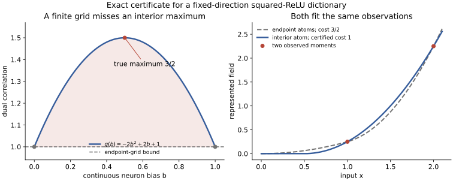

# Calculus–geometry pilot results

The corrected equality interpretation has a working mathematical and Python realization. This pilot produced exact rational geometry, differentiated affine projection, a bounded global polynomial compatibility checker and repaired root sensitivities. In the tested fixed representations, it did not demonstrate a new mathematical principle or a broad advantage over matched controls. Learned collapse features, task-conditioned geometry and nonlinear realization maps were not evaluated in this pilot; their usefulness is not settled by these results.

The [follow-up opportunity analysis](calculus-geometry-opportunities.md) audits this scope, distinguishes earlier learned-profile experiments, and derives concrete directions for constrained predictions, geometric PFNs, manifolds and Boolean circuits.

The completed [research campaign](calculus-geometry-campaign.md) adds independent
replay, fresh-seed constrained TabPFN confirmation, physical-sensitivity and
finite-calibration-step certificates, and a global monotone-energy verifier.
Its evidence and conclusions are separate from this earlier pilot.

The [derivations](calculus-geometry-pilot.md) state the proofs and limitations; the [API guide](affine-geometry.md) contains executable examples. [Machine-readable summary](benchmarks/calculus_geometry_pilot.json).

## Scientific ML

Six cases use two finite characteristic-wave families and seeds 101, 211, 307. The periodic wave system is satisfied by construction; initial data are inferred from noisy observations rather than supplied as exact constraints. All methods below share the same restricted exact solution family. The neural control trains a linear output layer over fixed sinusoidal features.

| Method | Mean held-out u RMSE | Maximum PDE residual | Mean setup + solve (s) |
| --- | ---: | ---: | ---: |
| `direct_characteristic_ls` | 0.004845836 | 1.67e-15 | 0.00016232 |
| `svd_nullspace_ls` | 0.004845836 | 8.25e-14 | 0.00518564 |
| `omnibias_projected_ls` | 0.004845836 | 4.79e-14 | 0.00263937 |
| `ordinary_qr_projected_ls` | 0.004845836 | 8.3e-14 | 0.000655202 |
| `matched_sine_network_adam` | 0.00492675 | 1.37e-15 | 0.156163 |

Direct coefficient least squares solves this family efficiently. The affine projection does not improve its fitted solution. Setup includes each method's factorization and projection construction; common representation/observation-array construction and imports are outside these small component timings. There are no repeated isolated timing samples, so the numbers do not support general speed claims.

The polynomial checker certifies a cubic wave's global derivative/PDE/initial-data identities and rejects an algebraically PDE-feasible but incompatible derivative section. Separately, pointwise projection makes a first-order PDE residual nearly zero while leaving contact defects of magnitude 0.5. Thus geometric intersections in derivative coordinates need a realizability condition.

The [20 October re-audit](unification-research-audit.md) distinguishes these
examples explicitly. The pointwise edit is incompatible with the retained
value field, although its derivative vector alone integrates to a different
field. A separate nonzero-curl example cannot be integrated at all. The
successful global compatible reconstruction remains valid; these counterexamples
do not reject every geometric correction.

## Tabular learning

Exact rational affine-subspace recovery classifies 58 fresh on-plane and 58 off-plane points correctly. Perturbing each positive measurement by an exact 1/1000 off the plane, while retaining its latent positive label, gives zero positive recall. This tests measurement sensitivity of that fixed exact detector; it does not rule out equality decisions after nonanalytic learned embeddings such as ReLU.

The noisy-data experiment imposes four artificial fixed equalities in a 16-dimensional hidden representation and uses a separate prediction head. These equalities encode no medical domain knowledge. Validation chooses learning rate/depth and checkpoint; preprocessing uses training rows only.

| Dataset | Method | Mean test log loss | Mean test accuracy |
| --- | --- | ---: | ---: |
| breast_cancer | `omnibias_projection` | 0.07966957 | 0.9736842 |
| breast_cancer | `ordinary_qr_projection` | 0.07966957 | 0.9736842 |
| breast_cancer | `absorbed_projection_head` | 0.07966957 | 0.9736842 |
| breast_cancer | `unconstrained_mlp` | 0.08376703 | 0.9707602 |
| breast_cancer | `catboost` | 0.08223323 | 0.9824561 |
| noisy_oblique_geometry | `omnibias_projection` | 0.4450984 | 0.8211382 |
| noisy_oblique_geometry | `ordinary_qr_projection` | 0.4450984 | 0.8211382 |
| noisy_oblique_geometry | `absorbed_projection_head` | 0.4450984 | 0.8211382 |
| noisy_oblique_geometry | `unconstrained_mlp` | 0.4523648 | 0.8146341 |
| noisy_oblique_geometry | `catboost` | 0.4453394 | 0.8195122 |

Native projection, ordinary QR and an absorbed-head equivalent network agree within 2.39e-15 in held-out probability. Their 20-step independent AdamW comparison also agrees in values, gradients and parameters. The modest pilot differences from the free MLP or boosting therefore do not establish a collapse-specific learning mechanism. A fixed projection immediately before a free affine head can be absorbed into that head.

Tree models are saved using CatBoost's official JSON format and replayed without refitting, alongside stored neural states and held-out predictions. Two numerical datasets and three splits cannot establish broad tabular superiority.

## Optimization and LP

The pilot contains 9 bounded LPs and 36 explicitly regularized QPs. All 275 independent reference/witness checks pass. HiGHS finds LP active sets; subsequent linear solves and affine projections are reported conditional on those sets, not as full LP solvers.

LP optimizer cost sensitivities are locally zero inside the fixed active region; constraint-RHS sensitivities are nonzero and agree with independent finite differences. At an active-set transition the optimizer jumps, and nonuniqueness is retained explicitly. Infeasibility has a Farkas witness.

| Family | Candidate | Maximum solution error | Maximum cost-gradient error | Maximum relative cost-gradient error |
| --- | --- | ---: | ---: | ---: |
| lp | omnibias_solver | 1.85e-09 | — | — |
| lp | omnibias_layer | 1.85e-09 | 5.57e-09 | — |
| qp | omnibias_solver | 6.99e-06 | — | — |
| qp | omnibias_layer | 6.99e-06 | 0.628 | 4.05e-05 |

The existing barrier layer's approximation error increases as QP regularization shrinks. Reference-check success is distinct from candidate accuracy; candidate errors remain visible in the summary. CVXPYlayers was unavailable and was not benchmarked. These cases establish neither faster generic LP solution nor differentiability at hard active-set transitions.

## Additional mathematical experiment: every continuous bias

The unshipped certificate prototype considers fixed-direction atoms \(\psi_b(x)=(x-b)_+^2\), \(b\in[0,1]\), and minimizes coefficient total variation subject to finite point observations. This is a continuous-dictionary convex measure problem. Exact primal feasibility gives an upper bound. Exact global pricing of \(g(b)=\sum_i q_i\psi_b(x_i)\) makes a scaled dual feasible over every permitted bias and gives a lower bound. Each pricing cell is quadratic, so endpoints and rational stationary points exhaust its extrema.

For data \(x=(1,2)\), \(y=(1/4,9/4)\), endpoint-only atoms have optimum \(3/2\). The atom at \(b=1/2\) fits with coefficient cost \(1\). The dual \(q=(-3,1)\) appears feasible on endpoint biases, but its correlation is \(-2b^2+2b+1\), whose true maximum is \(3/2\). Scaling to \((-2,2/3)\) proves the lower bound \(1\), matching the exactly recovered one-atom upper bound. This is a global optimum within the stated restricted dictionary, not unrestricted neural-network optimization.



Both fields in the figure fit the two observations. The certificate concerns their optimization objective, not accuracy between unobserved points or a PDE solution. Distributionally, the classical identity \(D_x^3\psi_b=2\delta_b\) connects these atoms to sparse sources.

The independent replayer verifies 25 retained rows across seven cases. The four-step exchange closes 2 cases, including the zero target; 1 has a positive gap and 4 initial dictionaries cannot produce a dual certificate. Known generating atoms provide labeled fallback upper bounds in those cases, and do not count as recovered solutions. The 21/101-point dense-grid controls close 6/7 and 6/7 cases; remaining cases retain positive gaps. Thus the exchange is not promoted as a superior solver.

The measure formulation, spline KKT conditions and exchange method are established. See [Bach 2017](https://jmlr.org/papers/v18/14-546.html), [Parhi–Nowak 2021](https://jmlr.org/papers/v22/20-583.html) and [Pilanci–Ergen 2020](https://proceedings.mlr.press/v119/pilanci20a.html). The scoped addition is an exact checker that detects a finite-grid certificate being incorrectly extended to all continuous biases. [Complete path-neutral certificate record](benchmarks/continuous_bias_certificate.json).

## Reproduce and interpret

Use the laboratory's existing locked optional tabular environment, which supplies scikit-learn and CatBoost; the base lab environment lacks those optional controls. From the lab root, run the stages sequentially with one BLAS/Torch thread:

```bash
OMP_NUM_THREADS=1 OPENBLAS_NUM_THREADS=1 MKL_NUM_THREADS=1 python -m calculus_geometry.run science --output artifacts/reproduction_geometry/science.json
OMP_NUM_THREADS=1 OPENBLAS_NUM_THREADS=1 MKL_NUM_THREADS=1 python -m calculus_geometry.run tabular --output artifacts/reproduction_geometry/tabular.json
OMP_NUM_THREADS=1 OPENBLAS_NUM_THREADS=1 MKL_NUM_THREADS=1 python -m calculus_geometry.run optimization --output artifacts/reproduction_geometry/optimization.json
python -m calculus_geometry.run science --output artifacts/reproduction_geometry/science.json --verify-only
python -m calculus_geometry.run tabular --output artifacts/reproduction_geometry/tabular.json --verify-only
python -m calculus_geometry.run optimization --output artifacts/reproduction_geometry/optimization.json --verify-only
```

The additional continuous-bias experiment and its independent replayer run as:

```bash
OMP_NUM_THREADS=1 OPENBLAS_NUM_THREADS=1 MKL_NUM_THREADS=1 python calculus_geometry_continuous_bias/run.py --output artifacts/reproduction_geometry/continuous_bias.json
python calculus_geometry_continuous_bias/replay.py artifacts/reproduction_geometry/continuous_bias.json
```

Outputs refuse overwrite. Replays check source/dependency/lock fingerprints and the complete frozen case matrix, then recompute identities, model predictions and witness arithmetic without retraining or retiming. Source changes require fresh output directories. The initial pre-hardening run is retained separately; the final run includes complete-matrix checks and serialized tree replay.

Preserve the reusable geometry and compatibility primitives, with their tests and explicit limitations. The strongest continuation question is whether corrections that preserve a realizable field, or certificates over continuous parameters, help a workload beyond ordinary coefficient algebra. That needs its own strong control and measurable advantage. The [opportunity analysis](calculus-geometry-opportunities.md) also identifies learned geometric and Boolean architectures outside this pilot; none is refuted by the fixed-projection equivalence.

## Validation

The follow-up [eight-hour research campaign](calculus-geometry-campaign.md)
tests adaptive verification, unknown-support counting models, true output
constraints, geometric decoder components and amortized LP proposals. It is a
separate experiment; the measurements below remain those of this pilot.

| Run | Passed | Skipped / deselected |
| --- | ---: | --- |
| core_and_fields | 5914 | 1 / 2 |
| torch_package | 1628 | 14 / 9 |
| jax_package | 983 | 0 / 0 |
| additional_native_compilation_case | 1 | 0 / 0 |
| laboratory_pilot_tests | 34 | 0 / 0 |
| continuous_bias_tests | 16 | 0 / 0 |
| final_polynomial_jet_checks | 25 | 0 / 0 |
| selected_executable_documentation | 4 | 0 / 54 |
| final_geometry_regressions | 51 | 0 / 0 |

These are separate commands with some overlapping focused checks. The final compiled-projection, saturation and shear examples were added after the package-wide runs and passed their listed focused checks. New modules pass Ruff and strict mypy, generated inventories are current, executable documentation passes, and the strict documentation build succeeds. [Commands and validation record](benchmarks/calculus_geometry_validation.json).

Two existing repository-policy checks still fail on earlier artifacts/local experimental files: missing SPDX headers and embedded local paths or scheduler wording. They were exercised separately and excluded from the passing core/fields run above. Frozen earlier files were preserved. Explicit CPU selection avoids the GPU-driver discovery warnings seen in the initial unrestricted backend run.
