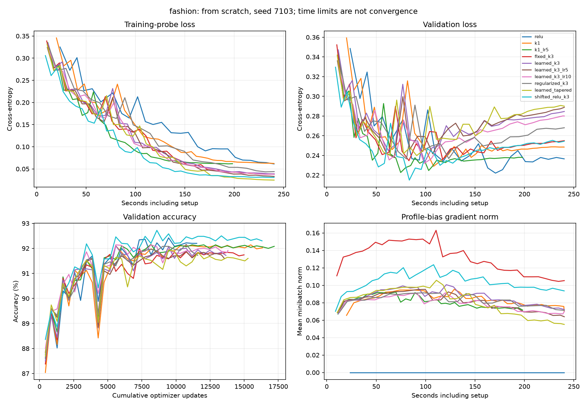
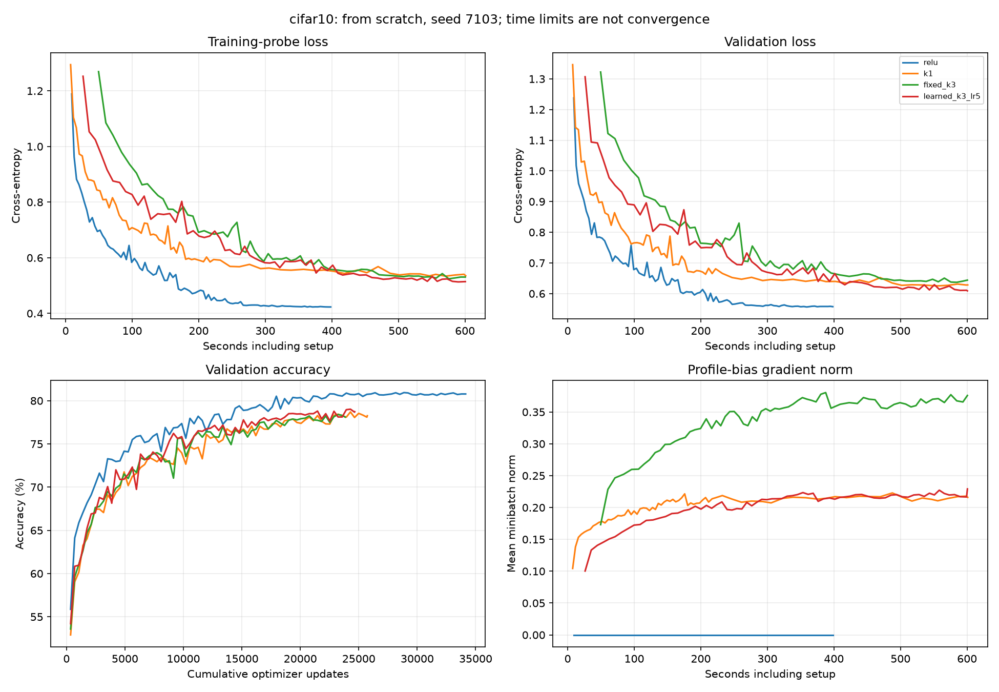
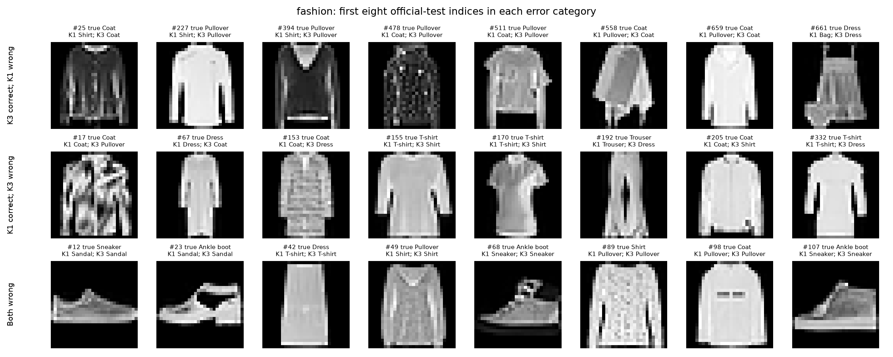
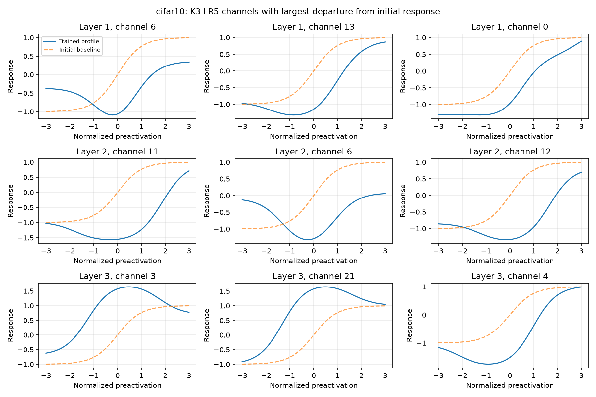

# Multi-bias learning, useful margins and image experiments

20 October 2026. Follow-up to the
[activation-profile compression study](activation-profile-compression.md).
Research implementations and raw evidence live in the sibling `omnibias-lab`;
the public packages, open paper and frozen compression artifacts are preserved.

The [24-hour frontier campaign](multibias-frontier-study.md) extends this work
with controlled activation growth, pretrained compression and joint band learning.

This follow-up completed **21 CUDA image fits**, replayed their exported
predictions, and passed **12 mathematical replay suites**. An independent
reader recomputed all 21 sets of accuracy, log loss, confusion matrices,
mistake indices and validation checkpoint choices from the retained evidence.
The image experiments use one seed and bounded resources: 19 fits reached
their time caps and two met an operational plateau rule. They support
mechanism investigation, not a claim of converged or general superiority.

The concrete advances are an exact baseline-preserving growth construction
with a conditional local descent proof, a rank criterion for retaining
downstream information when sharing filters, and an independently replayable
fixed-projection multiclass band optimizer. ReLU remains the strongest image
baseline in the registered main matrix. The next useful experiment is a
matched-update, repeated-seed test of selective growth, keeping learned gain,
ordinary activations and conventional sharing controls.
The [compact evidence snapshot](benchmarks/multibias_learning_and_margin.json)
contains the completed numerical results and artifact locations.

## What the earlier result actually measured

The 2.40× size reduction was **widthwise sharing, at unchanged depth**:
64 independent input directions became 16 shared directions, retaining 64
shifted sigmoid terms and their output coefficients. The teacher was the
already-trained 64-unit model being compressed.
The profile row was 97.50% mean accuracy and 8,548 exported bytes.
The nearby 97.41%, 6,128-byte row belonged to the local neuron-merging
control, not to the profile model.

For a teacher
\[
f(x)=d+\sum_j C_j\sigma(w_j^\top x+b_j),
\]
conversion replaces nearby directions by a representative \(v_g\), giving
\[
\widetilde f(x)=d+\sum_g p_g(v_g^\top x),\qquad
p_g(z)=\sum_{j\in G_g}C_j\sigma(z+b_j).
\]
One projection now feeds several shifts. This is exact for identical
directions; otherwise it is an approximation followed by fine-tuning.
The digits width-compression experiment fine-tuned with label cross-entropy.
It did **not** use teacher-output distillation. Synthetic approximation used
teacher targets; the separate depth experiment mixed label loss and teacher-logit
loss equally. Teachers and narrow scratch controls were trained from scratch;
the compressed models inherited teacher parameters.

The user's request to inspect convergence identified an important limitation:
all three primary teachers selected their last checkpoint at 1,500 updates,
and all nine fixed-profile and nine adaptive-profile conversions selected
their final checkpoint at 600 updates. Validation losses were still improving.
The original comparisons therefore establish outcomes under their fixed update
budgets, **not converged optima**. They neither prove an intrinsic limitation of
multi-bias representations nor establish their eventual superiority.

## Exact nesting is useful, but requires the right parameterization

For learned real coefficients,
\[
p(z)=\sum_{j=1}^K c_j\phi(z+b_j),
\]
the ordinary unit is recovered with \(c=(1,0,\ldots,0)\) and its original
first bias. Alternatively, tying all biases and imposing \(\sum c_j=1\)
recovers it exactly. Fixed alternating signs do this with odd \(K\), including
\((1,-1,1)\). Even alternating sigmoid sums have a zero positive-infinity
limit and cannot globally reproduce a single sigmoid.

Thus, for nested hypothesis classes and the **same objective and constraints**,
\[
\inf_{f\in\mathcal H_K}R(f)\leq \inf_{f\in\mathcal H_1}R(f).
\]
This is a statement about the best achievable risk. It does not compare SGD's
finite-time solutions, optimization conditioning, or population risk of
validation-selected fits. Different penalties can also destroy the comparison.
Strict positive gaps between *every* bias exclude the tied-bias embedding;
gap constraints should apply to active bands or permit an inactive baseline.

Two exact growth constructions are worth distinguishing:

* Add a shifted term with coefficient zero. The function is unchanged, and its
  coefficient can receive a gradient immediately. Its bias receives zero
  gradient until the coefficient moves.
* Add two coincident terms with coefficients \(c,-c\). Their outputs cancel;
  their separate bias derivatives are opposite and can split the pair where
  the underlying derivative is nonzero.

Both preserve the existing function and provide controlled starting points
for testing new parameter directions.
Function-preserving expansion has broader prior art, including
[Net2Net](https://arxiv.org/abs/1511.05641). The question here is whether an
activation-specific expansion and regularizer improve measured learning.

An independent local Jacobian check sharpens the initialization hypothesis:

| Tanh-profile initialization | Bias-Jacobian rank on the checked grid | Full shape-Jacobian rank |
|---|---:|---:|
| Fixed coefficients \((1,-1,1)\), biases \((0,0,0)\) | 1 | 1 |
| Fixed coefficients \((1,-1,1)\), biases \((0,s,s)\), \(s\ne0\) | 2 | 2 |
| Learned coefficients \((1,0,0)\), distinct bias centers | 1 | 4 |

These all represent the same initial tanh. In the first case, the first and
third bias gradients coincide. Under identical deterministic Adam settings,
their equality is invariant, leaving \(2\phi(z+b_+)-\phi(z+b_-)\).
The second construction removes that tie without adding parameters. Its
separate pair biases have opposite derivatives at a distinct center.
The learned-coefficient construction instead activates new coefficient
directions before the dormant biases move. Rank alone does not predict
generalization or optimization speed; centers that nearly coincide or saturate
have poor conditioning. Analytic and finite-difference Jacobians agree on
the retained fixture. This motivates a separate registered initialization
diagnostic, not a post-test reinterpretation of the original experiment.

There is also a learning-rate effect even before useful new shapes emerge.
At tied biases, write \(q_i=\phi'(z_i+b)\) and let the fixed coefficients be
\(c_j\in\{-1,1\}\) with \(\sum_jc_j=1\). The bias Jacobians satisfy
\[
J_{\rm multi}=q c^\top,\qquad
J_{\rm multi}J_{\rm multi}^\top=Kq q^\top.
\]
Thus the same bias-only SGD learning rate produces \(K\) times the baseline's
initial first-order change in predictions. The shared-weight Jacobian remains
unchanged. Using bias LR \(\eta/K\) matches the initial gradient-flow velocity,
not finite updates or the later trajectory. With fresh zero Adam moments,
fixed \(\pm1\) coefficients and no regularization, the first-step tangent has
the same amplification. General coefficients and accumulated Adam moments
need different accounting.

In contrast, coefficient-zero nesting \(c=(1,0,0)\) has the baseline bias
kernel initially; it adds coefficient-gradient directions instead.
Consequently a blanket 2–10× bias-rate increase is not justified by nesting.
The image pilot measures specified rate choices; an initially tangent-matched
\(\eta/K\) control for the fixed-sign unit remains a separate follow-up.
Independent rational identities and float64 finite differences agree, with
maximum checked Jacobian discrepancy \(6.5\times10^{-11}\); finite
tangent-matched SGD discrepancies scale quadratically with step size.

A practical safe-growth recipe is to retain the trained baseline checkpoint,
introduce a cancelling pair at a training quantile, and accept a candidate only
if validation improves. If its split coordinate is \(\delta\), the pair
\(c[\phi(z+s+\delta)-\phi(z+s-\delta)]\) has initial tangent
\(2c\phi'(z+s)\). Centers can therefore be ranked using their correlation with
the current loss residual before doing full joint fine-tuning. This is a
derivative-feature/greedy-selection interpretation; it does not remove
nonconvexity and has familiar connections to boosting and matching pursuit.
Retaining the baseline guarantees a fallback on the *observed validation
criterion*, not on unseen data; repeated validation search also has a cost.

### A proved local descent rule for growing bias pairs

There is a stronger statement than “an extra branch might rescue a gradient.”
Let an empirical data loss be differentiable as a function of the inserted
scalar activations at fixed projected scores. This includes the downstream
computation: a smooth final loss alone does not resolve a downstream ReLU kink.
For the distinct scores \(z_1,\ldots,z_N\), aggregate the
prediction gradients of samples sharing a score:
\[
r_i=\sum_{\ell:z_\ell=z_i}\frac{\partial\mathcal L}{\partial f_\ell}.
\]
Assume \(r\ne0\), \(\beta>0\), and \(c\ne0\). Insert the cancelling pair
\[
p_\delta(z)=c\{\sigma_\beta(z+s+\delta)-\sigma_\beta(z+s-\delta)\},
\qquad \sigma_\beta(t)=\sigma(\beta t).
\]
At \(\delta=0\), the entire function is unchanged. Its loss derivative is
\[
D(s)=2c\sum_i r_i\sigma_\beta'(z_i+s).
\]
**At least one of the \(N\) centers \(s_j=-z_j\) has \(D(s_j)\ne0\).**
Moving a sufficiently small distance in the opposite signed direction
therefore strictly decreases this empirical loss.

Here is a complete proof. Put \(a_i=e^{-\beta z_i}\) and
\[
K_{ij}=\sigma_\beta'(z_i-z_j)
       =\frac{\beta a_i a_j}{(a_i+a_j)^2}.
\]
For any nonzero vector \(v\),
\[
v^\top Kv
=\beta\int_0^\infty t
       \left(\sum_i v_i a_i e^{-a_i t}\right)^2dt>0.
\]
The integral identity follows by integrating \(te^{-(a_i+a_j)t}\).
Strictness follows from linear independence of exponentials with distinct
positive rates: order the rates, multiply an identically zero sum by the
exponential with the smallest rate, take the limit, and repeat.
Thus \(K\) is positive definite, \(Kr\ne0\), and the vector of pair derivatives
is \(2cKr\). Differentiability supplies strict decrease for sufficiently small
signed steps. In particular,
\[
\max_j|D(s_j)|\ge
\frac{2|c|\lambda_{\min}(K)\|r\|_2}{\sqrt N}.
\]
For rational \(a_i,\beta\), an independently checkable lower bound is
\(\lambda_{\min}(K)\ge1/\|K^{-1}\|_\infty\).
Exact checking of the squared full gradient bound also requires rational
\(r,c\). Ordinary floating-point scores generally have transcendental
\(a_i=e^{-\beta z_i}\); rigorous certificates for those inputs would require
enclosures, rather than treating the rational fixtures as real-model
certification.

A classical identity gives a further refinement: **any \(N\) distinct finite
centers suffice in exact arithmetic**. For \(t_j=e^{\beta s_j}\), the
evaluation matrix is a positive diagonal rescaling of
\((t_j+a_i)^{-2}\). Borchardt's identity
\(\det(C\circ C)=\det(C)\operatorname{perm}(C)\), with
\(C_{ji}=(t_j+a_i)^{-1}\), makes it nonsingular: the Cauchy determinant is
nonzero and the permanent is positive. See the
[independent proof of Borchardt's identity](https://arxiv.org/abs/2309.05886).
Fewer than \(N\) predetermined centers cannot guarantee a witness for every
residual vector, since their evaluation matrix has a nontrivial nullspace.

This provides a precise adaptive-growth mechanism: accumulate loss gradients
by projected score, find a translated derivative with nonzero correlation,
insert a cancelling pair, and backtrack its split before joint fine-tuning.
Important limits are part of the result:

* Opposing gradients at tied scores can aggregate to zero, ruling out
  first-order profile descent at that point. A scalar profile cannot assign
  distinct responses to tied scores. This does not rule out higher-order
  improvement of a nonconvex loss through a shared response change.
* The result needs a nonzero upstream gradient at an internal activation;
  it does not rescue a dead downstream computation.
* Signed splits must be allowed. Ordered nonnegative-band constraints can
  forbid the required direction; range restrictions such as \([0,1]\) also
  need checking after the split.
* Very close scores or poorly placed centers can make the matrix ill
  conditioned. Data-centered widely separated scores are well conditioned;
  their derivative matrix approaches \((\beta/4)I\).
* Exact function preservation does not preserve arbitrary parameter penalties:
  adding \(c,-c\) increases coefficient L1 penalties and storage.
* The guarantee concerns local empirical data loss, with no uniform step size,
  global convergence, generalization or computational advantage. A small
  quantile subset does not inherit the full \(N\)-center guarantee.

There is also an explicit conditioning tradeoff. If the distinct scores have
minimum spacing \(d>0\), the off-diagonal absolute row sums obey
\[
\sum_{j\ne i}|K_{ij}|
\le \frac{2\beta}{e^{\beta d}-1}.
\]
Indeed, \(\sigma_\beta'(t)\le\beta e^{-\beta|t|}\), and ordered scores are
at least \(d,2d,\ldots\) away on each side. Summing the geometric series proves
the bound. Gershgorin's theorem then gives, when \(\beta d\ge\log17\),
\[
\lambda(K)\subset[\beta/8,3\beta/8],\qquad \kappa_2(K)\le3.
\]
So a temperature chosen from score spacing can condition this finite
derivative dictionary. If spacing is tiny, the necessary temperature is huge;
this increases sensitivity, narrow feature localization and the risk of
fitting noise. The conclusion is about a finite linearized dictionary,
not about the conditioning of the whole neural network.

The general form is a rank criterion. For a differentiable primitive \(\phi\)
and candidate centers \(s_j\), put \(B_{ji}=\phi'(z_i+s_j)\).
Every nonzero aggregated residual has a first-order pair-growth direction
**if and only if** \(B\) has full column rank: the condition is exactly
\(\ker B=\{0\}\). A Gaussian-CDF primitive, for example, gives a positive
definite Gaussian derivative kernel at data-centered shifts. Repeated centers
can reduce rank, even when all individual branches have nonzero derivatives.
This explains why “at least one path is active” is weaker than a guaranteed
useful loss direction, and provides a measurable initialization criterion.

Four independent rational fixtures verify the identities, positive
definiteness, quantitative bound and counterexamples; finite differences
verify the logistic loss derivatives. The analytical argument, rather than
these fixtures, establishes the theorem. Its ingredients are classical.
[GradMax](https://arxiv.org/abs/2201.05125),
[splitting steepest descent](https://arxiv.org/abs/1910.02366) and
[signed neural splitting](https://arxiv.org/abs/2003.10392) are direct prior art
for gradient-guided function-preserving growth. The logistic bias-only
specialization is a useful complete formulation; mathematical novelty has
not been established.

The experiment-local implementation is
`multibias_learning_math.pair_growth.propose_pair_growth`. It aggregates tied
scores, computes candidate correlations in bounded-memory chunks, and uses
signed Armijo backtracking against the supplied empirical objective.
Insertion and split-regularization costs are included explicitly.
It accepts only a measured decrease using the actual exported two-bias
parameters. Saturated candidates, numerical ambiguity, rounded-away splits,
nonfinite values and exhausted searches return refusal or inconclusive states.
All 21 focused checks pass in an independent replay, including export-rounding
regressions. With \(M\) candidates, its arithmetic cost is \(O(NM)\); using
every data center is quadratic. It is a tested proposal mechanism, not a
completed image-training experiment with dynamic growth.

## Minimum gaps and gradient coverage are different requirements

For a sigmoid band with ordered boundaries \(a<b\),
\[
B(z)=\sigma(\beta(z-a))-\sigma(\beta(z-b)),\qquad \delta=b-a,
\]
its exact peak is
\[
\max_z B(z)=B((a+b)/2)=\tanh(\beta\delta/4).
\]
Consequently a desired peak \(\tau\in(0,1)\) needs
\(\delta\geq 4\operatorname{atanh}(\tau)/\beta\).
This is a meaningful minimum-width rule.

At the midpoint, however,
\[
B'(z)=0,\qquad
\partial_a B=-\frac{\beta}{4\cosh^2(\beta\delta/4)},\quad
\partial_b B=\frac{\beta}{4\cosh^2(\beta\delta/4)}.
\]
The separate boundaries can learn while the shared-input derivative is zero.
Very wide bands make even these derivatives small. A useful coverage condition
is that every relevant projected observation lies within \(h/2\) of some
threshold. Then at least one unit-amplitude branch satisfies
\[
\max_j\left|\partial_{t_j}\sigma(\beta(z-t_j))\right|
\geq \frac{\beta}{4\cosh^2(\beta h/4)}.
\]
For learned coefficients bounded below in magnitude, multiply by that bound.
This controls an individual branch Jacobian; upstream loss derivatives,
cancellation and zero coefficients can still make the complete gradient zero.

The checked Gaussian identity has no contradiction with this result:
decomposing the *same* function with tied parameters preserves its shared-input
derivative. Independently trainable branch biases change the parameter space
and can provide additional directions.

Research consequences:

| Proposal | Supported mechanism | Limitation or control |
|---|---|---|
| Quantile initialization | Put active boundaries where training preactivations occur | Calibrate after normalization; use training data only |
| Bias LR 2–10× | Move thresholds on a different time scale | Compare K=1 with the same LR multiplier; no universal optimal ratio |
| Minimum gap | Prevent a near-zero bell amplitude | Also measure maximum uncovered gap and saturation |
| Bias/drop-band regularization | Control profile complexity without removing the base path | Independent dropout of cancelling branches breaks cancellation |
| Coefficient/variation penalties | Control profile amplitude and sensitivity | Large weights alone do not prove overfitting |
| Fewer biases in deeper layers | A bounded allocation hypothesis | No theorem requires halving; many CNNs increase channel count with depth |

There is also a cost argument for testing the opposite allocation. In a
convolution with \(C_{\rm in}\) inputs, \(C_{\rm out}\) outputs and a
\(q\times q\) kernel, independent filters store
\(q^2C_{\rm in}C_{\rm out}\) weights. Adding learned shifts and amplitudes
costs approximately \(2KC_{\rm out}\) scalars, while activation work grows
with spatial area times \(KC_{\rm out}\). Deeper layers often have larger
\(C_{\rm in}\) and smaller feature maps, making extra profile terms relatively
cheaper there. Neither increasing nor decreasing \(K\) with depth is a
universal rule; allocation should follow measured benefit per byte and per
operation.

For sigmoid profiles there is a simple regularization target:
\[
\operatorname{Lip}_x\!\left[\sum_j c_j\sigma(\beta(w^\top x+b_j))\right]
\leq \frac{\beta}{4}\|w\|_q\sum_j|c_j|.
\]
The dual norm \(q\) matches the input norm. Controlling coefficient variation,
projection norm and temperature is more informative than interpreting every
large weight as overfitting. It also exposes a tradeoff: larger temperatures
sharpen logical boundaries but increase this sensitivity bound. This is an
elementary upper bound, not a complete generalization guarantee.

A regularizer designed around exact growth should also respect function
preservation. For fixed calibration scores \(t_1<\cdots<t_M\), consider
\[
R(p)=\frac{\lambda}{2}
\sum_{i=1}^{M-1}
\frac{[p(t_{i+1})-p(t_i)]^2}{t_{i+1}-t_i}.
\]
It is a positive-semidefinite quadratic in the sampled profile values, with
gradient \(\lambda D^\top\operatorname{diag}(1/\Delta t)Dp\), where \(D\)
takes adjacent differences. A cancelling-pair insertion leaves this penalty
exactly unchanged, whereas independent coefficient L1/L2 penalties generally
do not. Applying the penalty to the residual profile \(p-p_{\rm baseline}\)
instead preserves an unpenalized baseline path. This is a conventional
discrete smoothness penalty adapted to the representation; its useful
strength must be selected on validation data. It does not control arbitrary
behavior between calibration points without further bounds.

## A constructive one-dimensional approximation theorem

Let \(f:[a,b]\to\mathbb R\) be \(L\)-Lipschitz and extend it constantly
outside the interval. With \(x_i=a+i(b-a)/K\), define
\[
P(x)=f(a)+\sum_{i=1}^K [f(x_i)-f(x_{i-1})]
\sigma\!\left(\beta\left[x-\frac{x_i+x_{i-1}}2\right]\right).
\]
Then
\[
\boxed{\|P-f\|_\infty
\leq \frac{L(b-a)}{2K}+\frac{2L\log 2}{\beta}.}
\]
The norm is over the constantly extended field on the whole real line.
Also \(\sum_i|c_i|\leq L(b-a)\).

**Proof.** The midpoint staircase equals \(f\) at the nearest grid point,
so its uniform error is at most \(L(b-a)/(2K)\). Convolving it with the
logistic density produces exactly \(P\). Convolution preserves the first
error bound; smoothing an \(L\)-Lipschitz function adds at most
\(L\mathbb E|Z|=2L\log2/\beta\). The coefficient bound follows by summing
adjacent Lipschitz increments.

For requested error \(\varepsilon>0\), with \(K\ge1,\beta>0\), it suffices to take
\(K\geq\lceil L(b-a)/\varepsilon\rceil\) and
\(\beta\geq4L\log2/\varepsilon\). This is a constructive engineering bound,
not a newly established approximation-theory discovery. Independent numerical
convolution checks support the implementation; the proof supplies the guarantee.

The theorem uses signed real coefficients and a temperature allowed to grow.
It must not be attributed to fixed-amplitude Boolean bands. Ordered alternating
sigmoid bands with valid output in \([0,1]\) are logistic smoothings of a hard
union of intervals; at fixed \(\beta\), they satisfy
\(|P'|\leq\beta/4\), regardless of the number of bands. They cannot uniformly
approximate arbitrarily sharp ramps just by increasing \(K\).

Unrestricted real-coefficient translates at a fixed positive temperature have
a separate density argument on compact intervals, but it need not give
well-conditioned coefficients. To see this, set \(t=e^{\beta x}\) on a compact
positive interval. Translates are \(t/(t+a)\), \(a>0\). Their span together
with constants contains \((t+a)^{-1}\). Products with distinct poles are
linear combinations of such resolvents by partial fractions; repeated poles
are uniform limits of distinct-pole products. The uniform closure is therefore
a unital algebra separating points. Stone–Weierstrass gives density in the
continuous functions on that interval. The near-coincident poles in this
argument explain why density alone provides no coefficient-conditioning bound.
Approximation capability, numerical stability and learnability are distinct.
Trainable activation/spline theory already includes
[adaptive piecewise-linear units](https://arxiv.org/abs/1412.6830),
[spline representer results](https://jmlr.org/papers/v20/18-418.html), and
[Lipschitz-controlled learned activations](https://jmlr.org/papers/v25/22-1347.html).

There is a related distinction in the existing paper's ReLU formulation.
Every finite sum of forward hinges \(\sum_j c_j\operatorname{ReLU}(z+b_j)\)
has zero slope sufficiently far to the left. Adding another forward hinge
cannot free that slope on the **whole real line**. A general global
piecewise-linear function needs an affine term, or an oppositely oriented
hinge. On a compact interval, placing a hinge strictly to its left does
represent a linear term there. The compact approximation conclusion survives;
the global claim needs this qualification. The open paper was not edited.

### A tight oscillation budget for sigmoid profiles

For a shared temperature \(\beta>0\), consider
\[
p(z)=d+\sum_{j=1}^K c_j\sigma(\beta(z+b_j)).
\]
Merge equal biases and remove zero combined coefficients, leaving \(m\le K\)
terms. For a nonconstant profile:

* A horizontal threshold has at most \(m\) distinct intersections.
* The profile has at most \(m-1\) distinct stationary points.

Both bounds are tight with unrestricted real coefficients and a free offset.
These claims concern distinct roots, not their multiplicities, and exclude
constant profiles. Independently learned slopes fall outside the result.

**Proof of the threshold bound.** Put \(t=e^{\beta z}>0\) and
\(a_j=e^{-\beta b_j}>0\). For any threshold \(\tau\),
\[
p(z)-\tau=\frac{N(t)}{\prod_j(t+a_j)},\qquad \deg N\le m.
\]
The denominator is positive. A nonzero numerator has at most \(m\) positive
roots. If the profile has \(m\) distinct stationary points \(t_i\), its nonzero
coefficient vector \((c_ja_j)\) would instead satisfy
\[
\sum_j\frac{c_ja_j}{(t_i+a_j)^2}=0,\qquad i=1,\ldots,m.
\]
The squared Cauchy matrix is nonsingular by the Borchardt identity used in the
growth proof: the Cauchy determinant is nonzero and its permanent is positive.
This proves the stationary-point bound.

For sharpness, choose distinct positive \(a_j,r_i\), set
\(D(t)=\prod_j(t+a_j)\), \(N(t)=A\prod_i(t-r_i)\), \(A\ne0\), and take
\[
c_j=-\frac{N(-a_j)}{a_jD'(-a_j)},\qquad
d-\tau=\frac{N(0)}{D(0)}.
\]
Matching residues and the value at zero gives \(p-\tau=N/D\).
It has exactly \(m\) threshold crossings; Rolle's theorem and the preceding
bound give exactly \(m-1\) stationary points.

Consequently, on \(N\) distinct scores in a **fixed order**, these profiles
with at most \(K\) terms realize exactly
\[
2\sum_{q=0}^{\min(K,N-1)}\binom{N-1}{q}
\]
strict binary labelings. Choose at most \(K\) transition gaps and either
initial label. The construction places one positive root in each chosen
transformed-score gap. This differs from the fixed-alternating, far-left-zero
hard unit counted below, since its initial label costs a threshold.
This is an exact fixed-order capacity formula, not a count over all
Boolean projection orderings. Coefficients in the construction may be large
and ill-conditioned.

The bound supplies a necessary condition for depth replacement. If a teacher
alternates above and below a threshold by margin \(\gamma>0\) on \(M\) ordered
scores, a single profile approximating it with error strictly below \(\gamma\)
needs at least \(M-1\) effective terms. Rich activation shapes can replace
some computations, but cannot conceal unlimited oscillations in a fixed \(K\).
A sum over different projection directions requires separate accounting.

Exact rational fixtures verify the partial-fraction construction for
\(m=1,2,3,5\), Cauchy/Borchardt identities, 44 small counting cases and all
52 admissible six-score/three-term labelings. A second mathematical review
checks the proof. These are consequences of classical rational-function
algebra; novelty is not established.

## When can a profile replace other neural computations?

The preceding approximation construction can be combined with a precise
information condition. Let \(Z=v^\top X\in[a,b]\), assume
\(\mathbb E[Y^2]<\infty\), and let \(m(z)=\mathbb E[Y\mid Z=z]\) have an
\(L\)-Lipschitz version. For the constructed profile \(P\),
\[
\mathbb E[(Y-P(Z))^2]
=\mathbb E[\operatorname{Var}(Y\mid Z)]
 +\mathbb E[(m(Z)-P(Z))^2]
\leq \mathbb E[\operatorname{Var}(Y\mid Z)]
 +\left[\frac{L(b-a)}{2K}+\frac{2L\log2}{\beta}\right]^2.
\]
The cross term is zero because
\(\mathbb E[Y-m(Z)\mid Z]=0\).
This identifies two separate obligations: retain the information needed for the
task in the projection, then represent its scalar response accurately.
The construction assumes the values of \(m\) at the grid nodes are known;
estimating them and optimizing a learned model add errors not covered here.

For a deterministic teacher depending only on that projection, the first term
vanishes. In a scalar-output block, storing one shared projection and \(K\)
shift/amplitude pairs takes \(D+2K+1\) scalars, versus \(KD+2K+1\) for \(K\)
unconstrained input projections. This can be a substantial saving when the
shared-projection assumption holds and \(K\) remains moderate.

The larger architecture \(\sum_g p_g(v_g^\top x)\) also has direct classical
precedents: [projection pursuit regression](https://doi.org/10.1080/01621459.1981.10477729)
learns sums of smooth functions of linear projections, and
[generalized additive index models](https://academic.oup.com/jrsssb/article/78/4/729/7040666)
study projection indices together with constrained response shapes.
Thus the research contribution would need to concern a specific efficient
profile parameterization, growth rule, guarantee or measured deployment
advantage, rather than the general idea of learning a function after a
projection.

A counterexample makes the information restriction concrete. With independent
\(X_1,X_2\sim U[-1,1]\), \(Y=X_1^2+X_2^2\), and \(Z=X_1\),
\[
m(z)=z^2+1/3,\qquad
\mathbb E[\operatorname{Var}(Y\mid Z)]=1/5-1/9=4/45.
\]
No scalar profile on this projection can remove that residual error.
At \(K=16,\beta=32\), independent two-dimensional quadrature gives risk
0.08891877, close to the irreducible 0.08888889; the proved conservative upper
bound is 0.13368182. Six quadrature fixtures pass.
This is a useful combination of established identities and the constructive
bound, with a complete argument. It is not claimed as a new general theory of
deep learning or a result about classification accuracy.

## CNN bands are response selectivity, not automatically Difference of Gaussians

A multi-bias convolutional channel computes
\[
y(p)=\sum_j c_j\phi((K*x)(p)+b_j).
\]
It can select an interval of **filter response amplitudes** using one spatial
projection. A Difference of Gaussians computes
\[
y=(G_{\sigma_1}-G_{\sigma_2})*x,
\]
a linear spatial filter selecting frequency ranges. These are different
operations: the first is generally nonlinear, while the second obeys
superposition. An unconstrained ordinary convolution kernel can itself equal
\(G_{\sigma_1}-G_{\sigma_2}\). The
[scikit-image definition](https://scikit-image.org/docs/stable/api/skimage.filters.html#skimage.filters.difference_of_gaussians)
explicitly subtracts two blurred images.

The promising CNN hypothesis is therefore **several response regimes per learned
filter**, with a possible reduction in the number of separate filters needed.
The new image pilot holds channel count fixed to isolate optimization effects;
it does not itself test channel compression or establish a faster CNN.
The existing paper also contains binary-network compression and pretrained
fine-tuning experiments. The present floating-point, from-scratch CNN pilot
is a separate setting; it is not a replication of those reported experiments.

Two especially relevant architectural precedents belong in the comparison:
[Li, Ouyang and Wang, ICML 2016](https://proceedings.mlr.press/v48/lia16.html)
explicitly reuse a convolution response with multiple biases, exposing the
shifted responses as separate maps to the next convolution. A summed profile
instead combines its branches locally and preserves channel count. The
paper's existing comparison recognizes this difference.
[Metta et al., WACV 2024](https://arxiv.org/html/2301.00924v3)
study another allocation: output-specific pre-activation biases on connections,
before their weighted sum. That architecture also compares adding biases
against adding weights. Neither is the present identical drop-in unit, but
both predate the broad hypothesis that richer bias usage can replace some
weight capacity. New claims need a narrower mechanism and matched evidence.

### A rank criterion for reducing profile channels

Sharing an incoming projection and removing its outgoing feature channels
are separate operations. Suppose a group has the same scalar coordinate
\(z=v^\top x\), distinct shifts \(h_j(z)=\sigma(\beta(z+b_j))\), and
downstream contribution \(C h(z)+d\). Replace it by \(r\) scalar profiles
\(P(z)=A h(z)\) followed by a linear map \(B\). On an interval of attainable
scores, exact equality holds if and only if \(C=BA\) and the offsets agree.
Thus, within this specified architecture,
\[
\boxed{r_{\min}=\operatorname{rank}(C).}
\]
The rational-function argument above proves that the distinct translates,
together with the constant function, are linearly independent. This gives
necessity; a rank factorization gives sufficiency. Merge duplicate biases
before taking the rank, and stack all outgoing consumers' coefficients.
For scalar output one profile suffices. Multiple independent outputs can
require several profiles even when their incoming projection is identical.

For a following convolution, flatten its kernel as
\(U_{(o,\delta),j}=V_{o,j,\delta}\), with \(s\) spatial offsets.
Factoring \(U=B_{\rm flat}A\) gives \(r=\operatorname{rank}(U)\) exact local
profiles and a smaller following convolution. This is always a sufficient
algebraic construction. Necessity additionally requires the projected scores
at the offsets to vary independently over intervals; spatially constant
fields under valid convolution provide a counterexample without that condition.
The counterexample need not hold at zero-padded boundary sites.

For an approximate factorization with residual \(R=U-U_r\) and bounded
features \(|h_j|\le1\), the per-output-site error satisfies
\[
\|\Delta y(p)\|_2\le\sqrt{sK}\,\|R\|_F.
\]
A truncated SVD minimizes this sufficient Frobenius-based bound, not
necessarily prediction error. Multiple groups' bounds add; whole-tensor
Euclidean error additionally accounts for the number of output sites.
Preserve hidden-feature padding and all outgoing branches. Nonlinearities,
normalization, pooling or dropout between the two factored maps generally
prevent this rearrangement. Floating-point rounding needs separate treatment.

For input projection storage \(D\), this topology stores approximately
\(D+K+rK+Osr\) scalars instead of \(KD+K+OsK\), before unchanged offsets,
normalization and metadata. It still evaluates the shifted activations;
storage savings alone imply no latency or training-memory advantage.
Twelve independent check groups cover exact rational rank and error bounds,
NumPy convolution equality, input derivatives, SVD approximation, restricted
domains and padding counterexamples.

This gives a concrete predictor for the next compression experiment:
look for **similar incoming directions and low-rank outgoing use together**.
Direction sharing alone predicts only the first saving. The result uses
established rank factorization; its value here is a testable architecture
criterion, not a new linear-algebra claim.

There is also a precise classification contract. Let \(F(x)\) be the
original logits, with winning-class margin
\(m(x)=F_{k^*}(x)-\max_{j\ne k^*}F_j(x)>0\). If the complete replacement
satisfies \(\|\widetilde F(x)-F(x)\|_\infty<m(x)/2\), the winning class
is unchanged: its margin decreases by at most twice the error bound.
Propagating a compatible block-error bound through a verified downstream
Lipschitz bound can supply this premise. An observed margin on finitely
many test examples does not establish it on an entire input domain, and
preserving the original prediction also preserves its mistakes.

## Maximum-margin bands, multiclass outputs and priorities

For fixed band assignments \(r_i\), thresholds \(t_1\leq\cdots\leq t_K\)
and fixed band classes consistent with the labels, with at least two occupied
intervals, solve
\[
\max_{w,t,\rho}\rho,\quad \rho\geq0,\quad \|w\|_1\leq1,\quad
t_{r_i}+\rho\leq w^\top x_i\leq t_{r_i+1}-\rho,
\]
omitting the missing exterior boundary inequalities. This is an LP.
For \(\ell_2\) weight normalization it becomes a second-order cone problem.
Constant classifiers need separate handling: with only one occupied interval,
moving its boundaries outward makes this margin objective unbounded. A zero
optimum means the supplied assignments have no positive margin; imposing a
strictly positive minimum can make the LP infeasible.
For noisy labels, a conventional soft-margin variant minimizes
\(\frac12\|w\|_2^2+C\sum_i\xi_i\), with unit functional margins relaxed by
nonnegative slacks. Freely adding slacks to the displayed max-margin objective
would not suffice. Normalization or the quadratic penalty prevents arbitrary
rescaling from making the margin meaningless.

An executable LP plus independent rational checker gives XOR
\[
w=(1/2,1/2),\quad t=(1/4,3/4),\quad \rho=1/4.
\]
Optimality follows from \(w_1,w_2\geq2\rho\), hence
\(4\rho\leq w_1+w_2\leq\|w\|_1\leq1\). A single affine separator is infeasible.
This also certifies robustness to input \(\ell_\infty\) perturbations strictly
smaller than \(1/4\) for the hard band. Wrong assignments are rejected.

There is an exact inner solver for the complementary problem, **learning
bands while the projection is fixed**. Group identical training scores
\(t_1<\cdots<t_q\), with class weights \(a_{i,c}\). The minimum weighted
misclassification cost for one interval of groups is
\[
C(i,j)=\sum_{r=i}^j\sum_c a_{r,c}
       -\max_c\sum_{r=i}^j a_{r,c}.
\]
With at most \(B\) class bands, boundary penalty \(\tau\ge0\), and required
score margin \(m\ge0\), use
\[
D[b,j]=\min_k\{D[b-1,k]+C(k+1,j)+\tau\mathbf1_{\{k>0\}}\}.
\]
Positive cuts \(k\) are allowed only where \(t_{k+1}-t_k\ge2m\);
\(D[0,0]=0\), and impossible states are excluded. Every optimal partition
has a last segment and an optimal prefix, proving the recurrence by induction.
The selected cut's midpoint maximizes its distance from the adjacent scores.
Conflicting labels at a tied score retain their unavoidable weighted error.

The research implementation uses exact rational costs, deterministic ties,
independent suffix-DP replay and an explicit vector-valued compiler:
\[
f(t)=e_{c_1}+
\sum_{j=1}^{b-1}(e_{c_{j+1}}-e_{c_j})H(t-\theta_j).
\]
Thus \(b\) class bands need \(b-1\) threshold terms plus an offset.
All 20 check groups pass, including 72 exhaustive tiny multiclass cases,
margin restrictions, tampered and suboptimal certificates, invalid inputs and
compiler equivalence at boundaries. Arithmetic-operation complexity is
\(O(q^2C+Bq^2)\), after sorting, for \(C\) classes. Rational bit costs can
grow; this is not a large-data speed result. It applies established
segmentation dynamic programming to the stated classification objective.

This gives a concrete learning strategy: propose a projection, solve its
band problem exactly, use validation to choose complexity and margin, and
compile the result. It separates projection-search failure from failure to
optimize thresholds. The prototype does not yet implement or benchmark a
joint projection-search algorithm.

For a hard alternating band with score margin \(m>0\), the smooth realization
has error at most \(K/(1+e^{\beta m})\). Binary threshold agreement follows
when \(\beta m>\log(2K-1)\). Input perturbations of radius \(\epsilon\) reduce
the available score margin by at most \(\epsilon\|w\|_q\), where \(q\) is dual
to the input norm. This gives a direct path from learned margin to a checked
finite-temperature deployment.

“Inner” and “outer” bands also have a useful operational interpretation:
classify the interior \([t_r+m,t_{r+1}-m]\) with a margin guarantee and
abstain, defer to another model, or request another feature in the boundary
strips. Report both coverage and error on accepted predictions; abstention
must not be presented as an accuracy improvement on the complete dataset.
The rejected strips can be trained as routing regions in a hierarchy.

The conditional LP learns the direction \(w\) as well as the thresholds.
Choosing the number of bands, class sequence and sample assignments remains
the discrete learning problem. The LP with assignments supplied is not a faster
general SVM algorithm. Closest prior art includes
[k-separability](https://is.umk.pl/~duch/pubs/06-k-rep-LNCS.pdf),
[ordered max-margin thresholds](https://www.keerthis.com/ord_icml_chu_05.pdf),
and [one-class slab SVMs](https://arxiv.org/abs/1608.01026).

Different bands can carry different classes or repeated occurrences of one
class. Let \(s_j=\sigma(\beta(z-t_j))\). The gates
\[
p_0=1-s_1,\quad p_r=s_r-s_{r+1},\quad p_K=s_K
\]
are nonnegative and sum to one. Attaching a class-probability vector to every
band produces a multiclass response; it costs those additional parameters.
For overlapping bands on different projections, priorities can be represented
by \(q_r=B_r\prod_{s<r}(1-B_s)\), with a default gate
\(\prod_s(1-B_s)\). These form a partition of unity. They implement sequential
soft routing, not an assertion that overlapping random events are independent.
Priority learning and interpretability should be compared with decision lists.

For deterministic one-hot band labels, the ordered partition gives a
**sharper hardening bound** than the termwise \(K\)-dependent estimate above.
Arbitrary class-probability vectors do not inherit this guarantee.
An interior score at distance at least \(m\)
from both adjacent boundaries has its own band's probability at least
\[
1-\sigma(-\beta d_{\rm left})-\sigma(-\beta d_{\rm right})
\ge1-\frac{2}{1+e^{\beta m}}.
\]
Its assigned class receives at least that mass. Therefore
\(\beta m>\log3\) guarantees a unique matching argmax, independent of the
number of bands. For binary interval labels the absolute soft/hard output
error is at most \(2/(1+e^{\beta m})\). The constant is sharp for one positive
interior band with negative exterior bands. Exterior intervals have only one
tail. Equivalently, the soft readout averages the hard classifier under
logistic score noise; an incorrect label requires escaping the current band.

This is agreement with the fitted classifier, including its mistakes.
It requires ordered thresholds, a common temperature and valid interval-label
readouts. Arbitrary learned coefficients or separate temperatures do not
inherit it. Exact rational checks cover 96 ordered multiclass cases, sharp
examples, ties and a varying-temperature counterexample. The proof is
elementary smoothing/partition algebra; mathematical novelty is not claimed.
The exact fixtures use rational transformed coordinates. A float32 deployment
certificate would additionally require rounding and score-margin enclosures;
these are not certificates for the image models.

## Threshold counts and how to use extra expressiveness

No new simple efficient formula for the number of all linearly separable
Boolean functions has been established here. There is an exact classical
hyperplane-arrangement expression:
\[
T(n)=\sum_{S\subseteq\{0,1\}^n}
(-1)^{|S|-\operatorname{rank}\{(x,1):x\in S\}}.
\]
Here constants and functions ignoring some coordinates are included. This is
a [characteristic-polynomial/chamber-count identity](https://link.springer.com/article/10.1007/s00454-023-00557-2).
It has \(2^{2^n}\) terms. It is a finite exact expression, not a practical
closed-form breakthrough. This follow-up independently evaluates the ranks
using rational arithmetic for \(n=0,1,2,3\), obtaining \(2,4,14,104\).
The established next counts are \(1882,94572\) for \(n=4,5\).
These count functions; they are not minimum-bias counts.

A current literature update matters here. Xinyuan Xie's
[24 September 2026 preprint](https://arxiv.org/abs/2609.29756) reports
\[
T(n)=2\binom{2^n-1}{n}\bigl(1+O(n^{-99})\bigr).
\]
Its affine thresholds on \(\{-1,1\}^n\) correspond to the present
\(\{0,1\}^n\) convention by an invertible change of coordinates.
This is a reported asymptotic theorem with an unspecified constant in the
error term, not an exact integer-valued formula or a small-\(n\) evaluator.
We checked the statement and conventions, not the entire random-matrix proof;
the source is a recent preprint. The result is not attributable to this work.

For **one fixed strict projection ordering** of \(N\) samples, an alternating
unit starting at zero on the far left realizes
\[
S(N,K)=\sum_{j=0}^{\min(K,N)}\binom Nj
\]
label sequences using at most \(K\) thresholds, with an initial transition
before the first sample allowed. For fixed \(K\), its ratio to the same-order
single-threshold count grows approximately as \(N^{K-1}/K!\). With \(N=2^n\)
this is exponential in \(n\). It is **not** that ratio against all threshold
functions over every possible projection, and is not an exponential speed or
generalization guarantee.

The associated capacity scale is more modest than the raw pattern count
suggests. With a fixed projection, far-left output zero and at most \(K\)
thresholds, the VC dimension on the real score line is exactly \(K\).
Any \(K\) ordered points can be labeled by placing an initial transition if
needed and transitions at label changes. On \(K+1\) points, the alternating
labeling starting with one needs \(K+1\) transitions and is impossible.
If the far-left polarity is separately free, the dimension becomes \(K+1\).
Here polarity means an independently selectable initial output label, not
merely reversing the projection. On a domain with only \(M\) distinct scores,
the dimensions are \(\min(K,M)\) and \(\min(K+1,M)\), respectively.
Thus an exponential pattern-count ratio does not itself imply exponentially
better learning: the logarithm of the count, margins and data distribution
are what matter to statistical complexity. Learning the projection changes
the class and requires the larger multivariate analysis below.

Ties need separate treatment: points with the same projected score can share
one response if their labels agree, as the two positive XOR inputs do.
Contradictory labels at the same score cannot be resolved by any scalar
profile. The fixed-order formula therefore does not solve minimum-bias
optimization over weights, tied projections and all possible orderings.

A useful margin refinement makes the representation claim more practical.
For fixed distinct scores, let \(s_m\) be the number of adjacent gaps at least
\(2m\). Requiring margin at least \(m\) leaves exactly
\[
\sum_{j=0}^{\min(K,s_m+1)}\binom{s_m+1}{j}
\]
possible sequences. **Proof:** changes are possible precisely in those gaps;
one additional position is available before the first sample. Choosing the
change positions uniquely determines the labeling. Independent exhaustive
small enumeration agrees. For \(m>0\), a score range of length \(R\) gives
\(s_m\leq\lfloor R/(2m)\rfloor\).

This suggests allocating bias terms to **well-separated useful transitions**,
rather than maximizing the raw number of transitions. Penalize active terms,
coefficient variation and unstable gaps; fit labels and choose complexity on
validation data. Generalization theory for multilevel thresholds is established:
[Anthony's threshold decision-list analysis](https://jmlr.org/papers/volume5/anthony04a/anthony04a.pdf)
bounds the growth function of \(K\) parallel-threshold classifiers on \(m\)
points in \(\mathbb R^d\) by \(2\sum_{i=0}^{d+K-1}\binom{Km}{i}\).
Our elementary margin refinement is not claimed novel without further review.

The same growth bound gives a conservative asymptotic answer about universal
bias requirements. Put \(N=2^n\), \(r=n+K-1\), with \(n,K\ge1\).
Realizing every truth table requires
\[
2^N\le2\sum_{i=0}^r\binom{KN}{i}
 \le2(eKN/r)^r\le2(eN)^r.
\]
Here \(r\le KN\) and \(K/r\le1\). Taking logarithms gives
\[
K\ge\left\lceil\frac{2^n-1}{n+\log_2 e}-n+1\right\rceil
      =\Omega(2^n/n).
\]
This is a necessary worst-case bound for hard parallel-threshold units, not
an exact minimum or a claim about every particular Boolean function.
It also applies to strict binary labels of the common-temperature,
learned-coefficient sigmoid profiles above: their at-most-\(K\) crossings
place them inside the free-polarity parallel-threshold class.
Small-\(n\) values cannot establish non-exponential asymptotic growth.

Boolean completeness and XOR compression are real representation facts.
They do not imply that every Boolean function has a small, robust, learnable
single-projection implementation. Arbitrary truth tables still require
exponential worst-case resources; densely packed projected states can require
large precision or temperature. Exact logical readouts could support reliable
modules after training, but learning all required rules and composing them
correctly is a separate reasoning problem.

For example, the Boolean-complete encoding
\(w=(1,2,\ldots,2^{n-1})/(2^n-1)\) has \(\|w\|_1=1\) and neighboring
scores separated by \(1/(2^n-1)\). Midpoint thresholds have score margin
\(1/[2(2^n-1)]\). The sharper ordered-band guarantee is consequently
satisfied by \(\beta>2(2^n-1)\log3\).
This is a sufficient bound for this construction, not an optimal lower bound
over all possible projections. By contrast, normalized equal weights encode
Hamming counts with score spacing \(1/n\): parity needs \(n\) thresholds with
margin \(1/(2n)\), and an exactly-count predicate needs just two. The same
agreement guarantee then needs only the sufficient \(\beta>2n\log3\),
independent of the number of occupied bands. Structured
logic can therefore exploit profiles without relying on exponentially close
encoded states. This quantitative contrast is more useful than a raw
universality claim.

Likewise, a profile cannot recover information discarded by its projection.
Depth can cheaply create many oscillations or use genuinely different
directions; a shallow profile can need very many terms to match it.
[Depth-separation constructions](https://arxiv.org/abs/1602.04485) are relevant
controls. The productive target is a restricted replacement theory, with
projection sufficiency, profile complexity, margin and stored precision stated.

## New image pilot and reproducibility

The registered pilot uses fresh seed 7103, official MNIST, Fashion-MNIST and
CIFAR-10 splits, a training-only stratified 5,000-image validation split, and
the same three-convolution 16/32/64-channel backbone in every arm. It is a
from-scratch comparison. No teacher, distillation, architecture search on test
data, or claim of current benchmark-leading accuracy is involved.
Its sigmoid-family base is explicitly centered and scaled:
\(2\sigma(2z)-1=\tanh z\). This differs from the uncentered sigmoid in the
earlier digits MLP. Biases act on this normalized response coordinate.

Every fit records training and validation curves, separate parameter-group
gradient norms, learning-rate changes, active-bias gaps and saturation. Exported
validation logits are replayed; official test predictions are evaluated only
after the matrix's fits are complete. Per-example errors are retained.
Operational plateaus, epoch limits and time limits remain distinct. Neither
this protocol nor any finite curve inspection guarantees global convergence
or the absence of underfitting/overfitting.

### Official-test results of the main matrix

Every main arm was trained from scratch with the same backbone. All 18 fits
finished and produced test exports. The entries below are **accuracy / log
loss** at the checkpoint chosen by validation log loss, not the maximum
observed test or validation accuracy.

| Activation recipe | MNIST | Fashion-MNIST | CIFAR-10 |
|---|---:|---:|---:|
| Ordinary ReLU | 99.33% / 0.02011 | 91.77% / 0.23694 | 81.33% / 0.54450 |
| K=1 centered sigmoid | 98.87% / 0.03503 | 91.56% / 0.23846 | 78.52% / 0.62752 |
| Fixed-sign K=3, tied start | 99.07% / 0.02846 | 91.22% / 0.24320 | 78.61% / 0.62833 |
| Learned K=3, bias LR5 | 98.98% / 0.03352 | 91.01% / 0.25128 | 78.95% / 0.60494 |

The learned K=3 recipe improves over K=1 by 0.11 percentage points on MNIST
and 0.43 points on CIFAR-10, but loses 0.55 points on Fashion-MNIST.
ReLU is stronger in this registered pilot on all three datasets. These are
exploratory outcomes from one training seed, with no repeated-seed uncertainty
estimate or superiority claim. They do not establish converged ordering of
the hypothesis classes.

Fashion-MNIST supplied the broader mechanism ablation:

| Additional recipe | Test accuracy | Test log loss | Selected epoch |
|---|---:|---:|---:|
| K=1, bias LR5 | 91.49% | 0.23726 | 13 |
| Learned K=3, bias LR1 | 91.35% | 0.25001 | 13 |
| Learned K=3, bias LR10 | 91.52% | 0.24583 | 13 |
| Learned K=(3,2,1), bias LR5 | 91.32% | 0.24894 | 13 |
| Jointly regularized K=3 | 90.83% | 0.25295 | 9 |
| Local translated-ReLU K=3 control | 91.57% | 0.24129 | 13 |

Neither increasing the bias LR nor the tested taper or joint regularizer
establishes a benefit over the ordinary K=1 recipe here. The regularizer
changes several mechanisms together, so its result cannot identify which
component helped or hurt. The translated-ReLU arm is a local control, not
an official reproduction of a particular APL paper.

Sixteen main fits ended at the time cap. Fashion K=1 LR5 and CIFAR ReLU
met the operational plateau rule; none of these flags establishes a global
or local optimum. Main fit costs, including their recorded setup/finalization,
were approximately 240–243 seconds for most grayscale arms, 199 seconds for
Fashion K=1 LR5, 398 seconds for CIFAR ReLU and 601–602 seconds for the
other CIFAR arms. Full process, testing and replay costs are retained
separately. Equal wall-time limits give more expensive profiles fewer
updates; the saved plots also use cumulative optimizer updates.

Fashion checkpoints typically selected epochs 9–18 even though training
continued for 26–40 complete epochs. At their selected checkpoints,
training-probe accuracy was about 3–5 percentage points above validation
accuracy. Thus overfitting pressure is visible; the extra profile terms did
not automatically prevent it. CIFAR selected much later checkpoints and the
profile runs reached their caps, leaving continued-training performance
unresolved. These observations motivate specific diagnostics, not an
assumption that a longer run must reverse the measured ordering.
The selected CIFAR learned K=3 checkpoint is the evaluated partial epoch 71;
70 epochs were complete. It is a permitted checkpoint under this protocol,
not an additional completed epoch.

### Separately registered mechanism diagnostics

| Diagnostic | Matched original recipe | Diagnostic test accuracy | Change | Diagnostic log loss | Original log loss |
|---|---|---:|---:|---:|---:|
| Shifted cancelling-pair initialization, Fashion | Fixed-sign K=3, tied start | 91.74% | +0.52 pp | 0.24421 | 0.24320 |
| Deduplicated training quantiles, MNIST | Learned K=3 LR5 | 99.11% | +0.13 pp | 0.03237 | 0.03352 |
| Learned single-bias gain, Fashion | K=1 LR5 | 91.66% | +0.17 pp | 0.24408 | 0.23726 |

All three diagnostic fits reached their time cap. The pair initialization
supports investigating an initialization effect, but its test log loss
worsens slightly and the result is from one seed. A single-bias gain also
changes accuracy without introducing multiple response bands; amplitude
learning must therefore remain an explicit control. Neither diagnostic
beats the ReLU arm on both reported metrics.

The initialization diagnostics also expose a resource confound that must not
be hidden. The original learned K=3 MNIST run completed 7,103 updates within
its cap, while the deduplicated-quantile diagnostic completed 14,768, despite
the same dataset, batch size, architecture and fit cap. Their selected
checkpoints were epochs 15 and 18 respectively. The changed initialization
does not establish why runtime throughput differed. These wall-time-capped
runs therefore cannot isolate its causal effect on accuracy or claim a
throughput improvement. A fresh matched-update comparison is needed.
At epoch 15, both had 6,450 updates: the original run had validation loss
0.0369734 and accuracy 99.04%, while deduplication had loss 0.0426775 and
accuracy 98.78%. The deduplicated run's selected epoch 18 used 7,740 updates.
Their validation-driven learning-rate schedules also differ, so this is
descriptive matched-exposure evidence rather than an isolated mechanism
experiment. It provides no observed sample-efficiency advantage for
deduplication.

### What the curves and individual mistakes reveal

The curves separate fit wall time from cumulative optimizer updates.
Training-probe losses use the saved fixed training subset; they are not
fresh unbiased estimates of generalization. A zero profile-bias gradient
curve for ReLU means that it has no profile-bias parameters, not that its
backpropagation has failed. Gradient norms aggregate parameter groups of
different sizes and do not establish coverage of every branch.



On Fashion-MNIST, training loss continues falling while validation loss
eventually rises. The selected early checkpoints therefore matter. The
tested added capacity, faster bias rates and joint regularizer do not resolve
this generalization gap. The common-update view also prevents interpreting
different numbers of updates under a wall-time cap as equal optimization
exposure.



On CIFAR-10, ordinary ReLU has lower training and validation losses than the
sigmoid-profile arms in this run, including at comparable update counts.
The capped profiles may still improve with additional optimization, but
their current deficit is not solely a higher-capacity model overfitting its
training set. The [MNIST curves](img/research/multibias-mnist-curves.png)
and [follow-up diagnostic curves](img/research/multibias-initialization-diagnostics.png)
are retained separately. The diagnostic curves expose the MNIST throughput
confound discussed above.

Paired errors give a more useful account than aggregate accuracy alone.
For the learned K=3 LR5 and K=1 models, on each 10,000-image official test set:

| Dataset | K=3 correct, K=1 wrong | K=1 correct, K=3 wrong | Both wrong |
|---|---:|---:|---:|
| MNIST | 41 | 30 | 72 |
| Fashion-MNIST | 176 | 231 | 668 |
| CIFAR-10 | 596 | 553 | 1,552 |

Fashion-MNIST's learned profile reduces Shirt→T-shirt mistakes from 107 to
89, but increases the reverse mistakes from 78 to 113. It changes which
side of a difficult boundary wins rather than uniformly improving that
boundary. On CIFAR-10, cat accuracy improves by 4.3 percentage points,
but reciprocal cat/dog confusions increase from 286 to 293; gains on other
cat examples account for the class-level improvement. Airplane accuracy
falls by 2.4 points. These outcomes suggest examining class-conditional
response distributions and uncertainty, not assigning a semantic meaning
to each learned band from its shape alone.



The galleries show the first eight official indices in each displayed error
category, not hand-picked representative examples. The
[MNIST gallery](img/research/multibias-mnist-errors.png) and
[CIFAR-10 gallery](img/research/multibias-cifar10-errors.png) use the same rule.
No labels or training settings were changed in response to these test images.



The extra capacity was actually used. On the inspected response grid
\([-3,3]\), 6/16, 26/32 and 46/64 learned CIFAR profiles in successive
layers have both positive and negative slopes above the analysis tolerance.
The corresponding counts are 2/16, 13/32 and 0/64 for MNIST, and 8/16,
10/32 and 0/64 for Fashion-MNIST. These are grid diagnostics, not global
monotonicity certificates or evidence that all these response regions are
frequent in the data. Fashion's largest late-layer deviations are largely
gain changes, which reinforces the need for the single-bias learned-gain
control. Inspect the
[Fashion profiles](img/research/multibias-fashion-profiles.png) and
[MNIST profiles](img/research/multibias-mnist-profiles.png) alongside their
learning and error curves.

### Completed verification and its limits

All 18 main exports and all three diagnostic exports passed fresh-process
replay. The separate raw-evidence audit agrees with their metrics,
confusions, individual mistakes, validation checkpoint choices, source
fingerprints and the two analysis summaries. This is inference and evidence
consistency, not a second independently coded CNN or a complete replay of
every optimizer step.

All 12 mathematical suites passed: mechanism checks, margin probes,
approximation bounds, pair growth, exact band segmentation, profile crossing
bounds, tangent learning, ordered-band agreement, nesting tangents,
conditional profile risk, the pair-descent fixture and shared-profile rank.
Their written proofs state the assumptions that numerical examples cannot
establish by themselves.

The retained completion manifests are
`reports/multibias_learning_20261020/followup_pipeline.json`,
`reports/multibias_learning_20261020/final_evidence_pipeline.json`,
and `artifacts/multibias_mathematical_replay_20261020/manifest.json`.
The evidence index hashes the completed replays and audits. There were no
failed image fits, unavailable datasets or OOM retries in these fresh runs;
time-cap termination remains an unresolved optimization obligation.
These experiments did not measure CNN compression or deployment speed:
all image arms retained the same convolutional channel counts.

The frozen main implementation is
`omnibias-lab/multibias_learning_research`, with source fingerprint
`5c849fc0bb67d0cace423697608e5e248f8c2b4cb1856648d473fddeccc926bc`.
The three follow-up wrappers have their own registrations and fingerprints.
Their recipes were fixed before official-test access, after training-only
mechanism diagnostics; they are exploratory studies, not confirmation arms.
Main testing waits for all 18 main fits, while each follow-up has its own
fit/test/replay sequence. No settings change in response to test outcomes.

From `/home/vardan/dev/projects/omnibias_projects/omnibias-lab`, the main
entry point can reproduce the complete matrix into a fresh directory:

These commands require the retained dataset caches and the existing
`/tmp/omnibias-geometry-comparators` environment. Dependency fingerprints
document the tested environment; they are not an environment installer.

```bash
/tmp/omnibias-geometry-comparators/bin/python \
  -m multibias_learning_research.run \
  --stage run --dataset all --device cuda \
  --fashion-root artifacts/datasets/fashion-mnist-20261020 \
  --output artifacts/multibias_learning_fresh
```

For replay of the retained run, use its original absolute data path and output:

```bash
/tmp/omnibias-geometry-comparators/bin/python \
  -m multibias_learning_research.run \
  --stage replay --dataset all --device cuda \
  --fashion-root /home/vardan/dev/projects/omnibias_projects/omnibias-lab/artifacts/datasets/fashion-mnist-20261020 \
  --output artifacts/multibias_learning_20261020
```

Replay binds source/dependency fingerprints, dataset hashes, splits,
normalization, checkpoint arrays, validation/test logits and classifications.
It checks inference consistency rather than rerunning the entire optimization
trajectory. Resume operates at case granularity; unfinished fits restart.
An audited edge case in resuming an interrupted smaller-batch OOM retry
remains documented in `reports/multibias_learning_20261020/final_protocol_audit.md`;
that path was not exercised in this run.

The separately registered scripts are `fixed_pair_k3_diagnostic.py`,
`deduplicated_k3_diagnostic.py` and `learned_gain_k1_diagnostic.py`, each with
`--stage fit`, `--stage test` and `--stage replay`. Their retained outputs are
`artifacts/multibias_pair_init_20261020`,
`artifacts/multibias_dedup_init_20261020` and
`artifacts/multibias_gain_control_20261020`.
The saved sequential orchestration and complete commands are in
`reports/multibias_learning_20261020/followup_pipeline.json`.

Mathematical checks have an independent CPU-only entry point:

```bash
/tmp/omnibias-geometry-comparators/bin/python \
  reports/multibias_learning_20261020/replay_math.py \
  --lab /home/vardan/dev/projects/omnibias_projects/omnibias-lab \
  --output artifacts/multibias_mathematical_replay_fresh
```

It snapshots each fixture and proof, runs checks in separate sequential
processes, and retains failures, timeouts, dependency metadata and completion
status. It requires a fresh directory and supports `--only` for individual
checks. Numerical fixture success is evidence about implementations; the
written arguments, assumptions and counterexamples establish the general
mathematical statements.

## Current research priorities

The implementation coverage is deliberately explicit:

| User proposal | Work completed in this follow-up | What remains unestablished |
|---|---|---|
| More biases with an exact ordinary-unit embedding | Algebra, Jacobian checks and fixed/learned CNN arms | Better optimized or population risk from finite training |
| Minimum gaps and smart initialization | Peak/coverage bounds, training quantiles, coincident-center and cancelling-pair diagnostics | A universally useful gap or initializer |
| Faster bias learning | Fashion-MNIST multipliers 1, 5 and 10; matched K=1 LR5 control | A universal multiplier or a coefficient-independent advantage |
| Regularization and bias dropout | Joint residual-term dropout/gap/range/coefficient penalty arm; function-based penalty derivation | Individual penalty effects; a trained bias-noise ablation |
| Fewer terms with depth | A \(K=(3,2,1)\) CNN arm and allocation cost analysis | A universal halving rule or optimal layerwise allocation |
| Adaptive activation growth | Tested cancelling-pair descent search and a complete local argument | Integration into the image-training loop and held-out benefit |
| Multiclass and maximum-margin bands | Exact fixed-projection segmentation, compiler and conditional margin LP | Efficient joint projection/assignment search on large datasets |
| Band priorities and inner/outer regions | Partition-of-unity routing and abstention formulations | A trained hierarchical routing comparison |
| CNN and depth compression | Rank criterion, approximation/information bounds and counterexamples | New compressed CNN deployment measurements |

The mathematical results are complete under their stated assumptions, but
their ingredients are established approximation, kernel, rank and optimization
tools. The prototypes are useful engineering and the proposed combinations are
architectural candidates. A specific novel theorem or a reproducible competitive
advantage would require additional evidence; neither follows from the number
of supported constructions.

1. **Selective activation growth with an exact baseline path.** The immediate
   follow-up should compare the cancelling-pair initialization/growth rule at
   matched updates across fresh seeds, with learned single-bias gains and
   tangent-matched learning rates as controls. Use validation for selection
   and retain the baseline as an explicit fallback. The observed 0.52-point
   Fashion accuracy increase is a lead, not confirmation: log loss worsened.
2. **Learn-and-compile multiband classifiers.** Learn projection and band
   assignments, solve/check the continuous margin subproblem, and export a
   finite-temperature or hard model with explicit agreement guarantees.
3. **Selective filter sharing.** Jointly examine incoming direction similarity
   and outgoing coefficient rank. A common input filter alone does not ensure
   that one scalar profile preserves all consumers. Compare the resulting
   exports against pruning, low-rank compression and tied-weight evaluators
   before claiming a CNN storage or latency advantage.
4. **Restricted depth replacement.** Require a sufficient projection and a
   controlled profile approximation bound before interpreting layer reduction.

The strongest possible contribution would connect allocation of trainable
profile complexity to optimization, margin, generalization and actual
deployment cost, then predict a reproducible advantage. The existing
identities alone do not supply that empirical conclusion.
