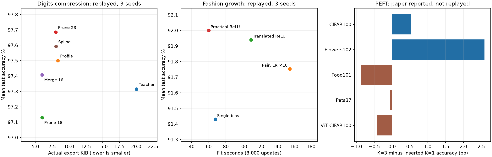

# Multi-bias research evidence and the path to a reliable default

The [complete session findings and theory](session-research-findings.md) preserve
the positive and negative results, corrections, assumptions, counterexamples
and complete source-note appendices across all research campaigns. Its source
inventory records the exact document hashes and the LAB checkpoint.

**Evidence synthesis, 22 October 2026.** Multi-bias is a worthwhile research
programme. Its clearest architectural advantage is increasing scalar response
complexity while retaining the layer's output shape. The present evidence
supports several useful mechanisms and some promising applications, but does
not yet support replacing ordinary activations everywhere with a larger fixed
number of biases.

The most direct next experiment is to reproduce the paper's strongest
**K=3 versus inserted K=1 parameter-efficient adaptation** results. The most
thoroughly replayed compact-classifier result is **learn a projection, then
compile hard bands**. These answer different questions: the former isolates
the proposed activation more directly; the latter currently supplies stronger
evidence for a narrow end-to-end application.

This report covers the multi-bias paper and related Boolean, optimization,
compression, growth, filtering and band-classification studies. It does not
reclassify every omnibias calculus or calibration experiment as evidence for
multi-bias. The stable libraries, open paper and frozen studies are unchanged.



The first two panels summarize replayed lab experiments. The third summarizes
paper-reported results that were not independently retrained or replayed here.
Points and bars are means, not proof of statistical superiority. In particular,
the PEFT panel compares different trainable parameter counts.

## Evidence levels and measurement definitions

| Level | Meaning | Appropriate conclusion |
|---|---|---|
| A | Lab experiment with retained configurations, exports and numerical replay | The measured result holds for the disclosed protocol; replay is not a new independent training replication |
| B | Current paper or repository reports, transcribed with source locations | Promising or negative reported evidence; raw training and metric pipelines still need independent reproduction |
| C | Mathematical argument or analytic fixture | The result holds under its assumptions; not a learning or deployment benchmark |

Unless stated otherwise, accuracy is ordinary test accuracy, balanced accuracy
averages class recalls, log loss is lower-is-better, and `±` in paper tables
is the paper's reported standard deviation, not a confidence interval.
Decimal MB means 1,000,000 bytes; KiB means 1,024 bytes.

**Pruning percentage** is reserved for removed neurons or channels. Sharing 64
directions down to 16 while retaining 64 responses is 75% fewer projections,
not 75% neuron pruning. A parameter-efficient adapter's trainable count excludes
its frozen backbone. Binary-weight counts exclude real biases, coefficients
and deployment metadata. Export bytes include the actual stored artifact and
are separate from raw inference-array payload bytes.

The [machine-readable evidence](data/multibias-synthesis-20261022/evidence.json)
contains source paths, seeds, configurations, caveats and complete extracted
rows. The CSV files linked below preserve rows omitted from the main tables.

## 1. The 2016 architecture and your architecture are different

Your output-shape correction is right. In Li, Ouyang and Wang's 2016 MBA,
one convolutional response creates K shifted feature maps which are
concatenated. Its activation interface is **C → KC**. A summed per-channel
profile instead has **C → C**. Figure 3 and Equation 1 show the distinction
directly. Their paper also compares MBA with an existing dimension-preserving
activation sum, APL. [Li et al.](https://proceedings.mlr.press/v48/lia16.pdf)

Writing the following convolution explicitly makes the cost and restriction
clear. For channel c and spatial kernel offset r, the expanded construction is

\[
Y_m=\sum_{c,k}V_{mck}*\phi(Z_c+b_{ck}).
\]

Your scalar profile construction can be written

\[
P_c=\sum_k a_{ck}\phi(Z_c+b_{ck}),\qquad
Y_m=\sum_c U_{mc}*P_c.
\]

It is a tied version of the expanded construction:
\(V_{mck}[r]=a_{ck}U_{mc}[r]\). This factorization shares downstream mixing
across the K responses. It saves parameters and supplies an inductive
restriction; the expanded architecture can choose more independent mixtures.

| Construction | Activation output channels | Following q×q convolution weights | Additional profile parameters | Main tradeoff |
|---|---|---|---|---|
| Ordinary activation | C | CC′q² | Usual bias | One response per projection |
| Li 2016 concatenated MBA | KC | KCC′q² | KC biases | Independent downstream mixing, larger interface |
| Summed fixed-sign profile | C | CC′q² | KC biases | Same interface; constrained scalar shape |
| Summed learned-coefficient profile | C | CC′q² | KC biases plus KC coefficients | Same interface; more flexible scalar shape |
| APL | C | CC′q² | 2S learned scalars per channel | Existing dimension-preserving learned piecewise-linear shape |

For C=C′=256, K=3 and q=3, the following convolution has 589,824 weights
with summed profiles versus 1,769,472 in the concatenated construction.
Biases and coefficients add 1,536 scalars if both are learned. This is a
substantial structural distinction. Both implementations may still evaluate
K nonlinear responses per channel; an unfused implementation can materialize
K times as many temporary activations even when its public output shape is
unchanged.

**The closest prior art is broader than the 2016 concatenating module.** APL
uses a scalar sum of learned hinges,
\[
h(z)=\operatorname{ReLU}(z)+\sum_{s=1}^{S}a_s\operatorname{ReLU}(-z+b_s),
\]
with 2S learned scalars per unit. Setting the additional coefficients to zero
recovers ReLU mathematically. It therefore already combines a fixed output
shape, a learned non-monotone profile and baseline inclusion. Your generic
base activations, coefficient constraints, Boolean constructions and growth
protocol are not all identical to APL, but output shape and baseline inclusion
alone do not establish novelty. [Agostinelli et al.](https://arxiv.org/pdf/1412.6830)

Function-preserving expansion and gradient-selected growth also have
precedents in [Net2Net](https://research.google/pubs/net2net-accelerating-learning-via-knowledge-transfer/)
and [GradMax](https://research.google/pubs/gradmax-growing-neural-networks-using-gradient-information/).
The defensible target is a narrower mechanism or demonstrated tradeoff.

## 2. Separate the constructions before comparing results

| Family tested | Definition and purpose | What its results do not automatically establish |
|---|---|---|
| Fixed alternating sigmoid bands | Shared w; ordered shifts; signs +, −, +, …; hard Boolean readout | The same Boolean completeness for fixed alternating ReLU or bounded K |
| Scalar learned profile | One p(z)=Σaₖφ(z+bₖ) per channel | Independent output-specific branch mixing |
| Vector-valued compression profile | p_g(z)=ΣC_:jφ(z+b_j); coefficients depend on destination | The accuracy of a scalar activation wrapper with a tied downstream matrix |
| Baseline plus residual pair | Ordinary path plus a cancelling pair that can split | Better generalization or nonzero shared-input gradient at insertion |
| Learned projection then bands | Smooth supervised score learning; discard head; refit hard intervals | Lossless hardening, or a gain caused uniquely by K>1 during training |
| Binary-network profile | Binary weight matrices plus thresholds and possibly real coefficients | Fully binary activations, packed deployment savings, or sigmoid-band equivalence |

This distinction explains why a positive result in the paper, a compression
result and a band-classifier result can coexist with a negative CNN growth
comparison. They are related mechanisms, not one identical model tested three
ways.

## 3. What is mathematically established

### Baseline inclusion is valuable but has a precise scope

For \(p_K(z)=\sum_k a_k\phi(z+b_k)\), tying all biases to b and choosing
\(\sum_k a_k=1\) reproduces \(\phi(z+b)\) in real arithmetic. An explicit
baseline plus cancelling residual also provides an embedding. Under the same
constraints and objective, if \(\mathcal H_1\subseteq\mathcal H_K\), then

\[
\inf_{h\in\mathcal H_K}R(h)\le\inf_{h\in\mathcal H_1}R(h).
\]

This is a statement about the best available function. It does not order the
test risk of the models returned by finite SGD. Parameterization changes
optimization, regularization and the statistical capacity. A penalty requiring
positive gaps between every pair can even exclude the baseline embedding.
Preserving an ordinary path and applying gap rules only to active added terms
avoids that conflict.

There cannot be a theorem promising strict improvement on every problem:
the ordinary model may already attain zero error or the Bayes risk. A useful
default must instead demonstrate reliable benefits on a defined range of
problems, controlled downside and acceptable cost.

### Exact mathematical recovery is different from bit identity

This synthesis added 116 small CPU checks of the current consumer module and
independent constructions, across float32 and float64. Some current default
K-term reductions differ from the ordinary activation by roundoff, including
float32 sigmoid/tanh differences of about 1.19×10⁻⁷ at K=6. Even odd K can differ
because of reduction order. Flattening `[base, r, -r]` into a sum changed
2,775 of 4,000 float32 fixture values; `base + (r-r)` matched the finite fixture.
Neither fact is a universal floating-point theorem.

An implementation can give K=1 the **literal original operation**, with the
same weights, state, dtype, backend and random realization. That is the
appropriate basis for a bitwise compatibility contract. Extra arithmetic,
stochastic branch masks and nonfinite values need separate tests. For example,
cancelling ReLU branches can turn an infinite response into NaN via ∞−∞.

Identical initial outputs also need not yield identical training. At coincident
biases with fixed signs ±1 summing to one, the initial bias-only gradient-flow
kernel is multiplied by K under a common learning rate. Scaling the per-bias
rate by 1/K matches that initial effect, not the entire later nonlinear
trajectory. A K=1 API default and a K>1 optimizer default are separate decisions.

There is also an important current default-policy mismatch. The consumer
module initializes even K with all-positive fixed coefficients and coincident
biases. For a monotone base activation, positive sums remain monotone even
after the biases separate; that family cannot realize the two-sigmoid XOR
band. Symmetric training can keep all branches tied as well. The explicit
alternating-band construction, learned coefficients and baseline-preserving
residual construction therefore need distinct configuration contracts.
Choosing only `number_of_biases` cannot silently promise all their properties
at once.

The [compatibility evidence](data/multibias-synthesis-20261022/evidence.json)
records the actual consumer source hashes and each counterexample. No stable
implementation was changed during this audit.

### Independent biases really do provide useful shape gradients

For the user's sigmoid bell, let t=wx+m and a=(b₁−b₂)/2>0. Then
\[
B(t,a)=\sigma(t+a)-\sigma(t-a)
=\frac{\sinh a}{\cosh t+\cosh a}.
\]
At its peak, \(B_t(0,a)=0\), but
\(B_a(0,a)=1/(1+\cosh a)>0\). Thus separate biases can change width and
height even when shifting the whole bell supplies no gradient. In the frozen
single-example test the fixed-height Gaussian retained half squared error
0.0343527; the two-sigmoid model reached approximately 10⁻³¹. A Gaussian with
a trainable amplitude also escaped. The compact closed-form sigmoid bell
learned identically with the same parameters.

This is a real parameterization benefit, not a failure of the chain rule.
There is no uniform positive lower bound in saturated tails, and different
examples can cancel gradients. See the [full two-bias experiment](two-bias-bell-experiment.md).

For function-preserving growth,
\[
p(z)=\phi(z)+\tfrac12[\phi(z+s+qa)-\phi(z+s-qa)],\qquad a=0,
\]
the split tangent is \(q\phi'(z+s)\). A nonzero correlation with the upstream
loss residual provides a local descent direction; the orientation q can choose
its sign. Residualizing this tangent against the ordinary bias/gain Jacobian
helps distinguish new directions from reparameterizations. The proof is
conditional on the candidate dictionary and nonzero upstream information; a
search over nine quantiles is not a guarantee of finding every descent
direction. See [learning and margin derivations](multi-bias-learning-and-margin.md).

### Boolean completeness and continuous geometry have different limits

For finite Boolean inputs, \(w=(1,2,\ldots,2^{n-1})\) produces distinct
scores. Ordered hard-threshold alternating bands can represent every labeling
along that axis with enough biases. Sufficiently steep sigmoid bands with a
strict-margin hard readout give the corresponding finite-cube construction;
this is not a completeness claim for an arbitrary base activation.
Two sigmoid biases and two input weights can classify
XOR; the four-input hard-label fixture is reproduced in the compatibility
checks. Finite sigmoid values are not literally exact 0 and 1; the hard
readout is exact under the stated margin convention.

This does not imply a small worst-case K. Under the previously enumerated
ordered hard-threshold convention, optimized worst-case minima for n=1,2,3,4
are 1,2,3,5. A minimum of exactly 8 at n=5 is not independently established by
this synthesis; conventions about coefficients, offsets and hard readout must
match before comparing the paper's solver bounds. The exact four-input
coverage table is:

| Maximum biases K | Representable functions | Out of 65,536 |
|---|---|---|
| 1 | 1,882 | 2.87% |
| 2 | 11,130 | 16.98% |
| 3 | 46,342 | 70.71% |
| 4 | 64,672 | 98.68% |
| 5 | 65,536 | 100% |

For one fixed ordering of N points, the transition convention gives
\(S(N,K)=\sum_{j=0}^{\min(K,N)}\binom Nj\). For fixed small K its ratio to
the one-threshold class in that **same ordering** is about \(N^{K-1}/K!\).
That is exponential in n when N=2ⁿ. It is not the ratio against all linear
threshold functions after optimizing the projection, or an exponential
learning-speed guarantee. The small-n table does not remove the counting
obstruction to inexpensive worst-case universality.

The earlier threshold-count study reproduced the classical exact expression
\[
T(n)=\sum_{S\subseteq\{0,1\}^n}(-1)^{|S|-\operatorname{rank}\{(x,1):x\in S\}},
\]
giving 4,14,104,1,882,94,572 for n=1,…,5. It did not discover a new simple
elementary closed form. The combinatorial computation remains substantial.
See the [counting derivation and its sources](multi-bias-capacity-and-architecture.md).

On continuous inputs, one unit p(wᵀx) supplies parallel level surfaces and
unions of parallel decision bands. A layer with multiple directions can
combine them into richer geometry; one projection does not retain arbitrary
multidirectional information. For square-integrable targets, the precise
obstruction is
\[
\inf_{g\in\mathcal G_K}\mathbb E[(f(X)-g(v^\top X))^2]
=\mathbb E[\operatorname{Var}(f(X)\mid v^\top X)]
+\inf_{g\in\mathcal G_K}\mathbb E[(\mathbb E[f(X)\mid v^\top X]-g(v^\top X))^2].
\]
The cross term vanishes by conditional expectation. For fixed v, increasing K
can reduce only the second term. Reducing the first requires a better
projection or additional retained directions. For example, with standard
Gaussian X in two dimensions and f(X)=X₂, replacing v=e₁ by v=e₂ reduces
the first term from one to zero without adding directions.
This points toward **jointly learning directions and allocating profile terms**,
rather than prescribing the same K everywhere.

With learned coefficients, an offset, growing K and an adjustable common
sigmoid scale, a scalar profile can approximate continuous one-dimensional
functions on compact intervals: approximate the function by small successive
steps, write the steps as offset plus weighted thresholds, and smooth them
with sufficiently steep sigmoids. Uniform continuity controls the transition
error. This is a representation construction, not a convergence guarantee.
A fixed alternating-sign profile constrained to [0,1] is a different class;
it cannot approximate arbitrary amplitudes without a suitable readout.

## 4. Width compression and depth feasibility

### Digits width compression — level A

Three seeds 4001,4003,4007; scikit-learn digits with 1,077/360/360
train/validation/test examples; float32 CUDA. The ordinary 64-unit sigmoid
teacher trained for 1,500 updates. Conversion clustered input directions,
retained shifted responses and vector-valued readouts, then fine-tuned for
600 updates using label cross-entropy. This width experiment was **not
knowledge distillation**; the depth and pretrained feature studies were.

| Method | Float parameters | Accuracy % | Log loss | Export bytes | File reduction % | Actual neuron pruning % |
|---|---|---|---|---|---|---|
| Teacher, 64 neurons | 4,810 | 97.31 | 0.1081 | 20,528 | 0.00 | — |
| Ours, fixed 16 projections / 64 shifts | 1,738 | 97.50 | 0.1075 | 8,548 | 58.36 | — |
| Ours, adaptive 16 projections | 1,782 | 97.50 | 0.1067 | 8,728 | 57.48 | — |
| Prune to 16 neurons | 1,210 | 97.13 | 0.1009 | 6,128 | 70.15 | 75.00 |
| Prune to 23 neurons | 1,735 | 97.69 | 0.0952 | 8,228 | 59.92 | 64.06 |
| Local merging to 16 neurons | 1,210 | 97.41 | 0.1036 | 6,128 | 70.15 | — |
| Low-rank, profile parameter budget | 1,738 | 96.85 | 0.0966 | 8,476 | 58.71 | — |
| Shared piecewise-linear spline | 1,738 | 97.59 | 0.1034 | 8,259 | 59.77 | — |

The fixed profile is **2.40× smaller than its teacher**, retaining mean
accuracy. It removes 75% of independent input projections and 63.87% of
stored float parameters while keeping the original 64 sigmoid terms.
It is a width/projection-sharing result with unchanged depth. It does not
beat the smaller local merging control or the matched-budget pruning and
spline controls. Adaptive growth did not establish an additional advantage.
Competitive confirmation therefore did not advance.

Most selected checkpoints were at the final allowed update; this is a
fixed-resource result, not a proof that every arm had converged. Independent
same-function evaluation and rational error-bound replay support the
conversion's correctness, not a unique gain over the same algebra.

[All width rows](data/multibias-synthesis-20261022/digits_compression.csv) ·
[full study and replay commands](activation-profile-compression.md)

### Depth feasibility — level A

Three seeds; the shallow models used both teacher-output and label losses.

| Method | Float parameters | Accuracy % | Log loss | Export bytes |
|---|---|---|---|---|
| 64→32 sigmoid | 6,570 | 97.13 | 0.1103 | 28,035 |
| onehidden16projection64shiftprofile | 1,738 | 96.85 | 0.1436 | 8,548 |
| onehidden23ordinarysigmoid | 1,735 | 97.59 | 0.1152 | 8,228 |

The profile flattened this particular model with a 69.51% file reduction,
but the ordinary shallow control obtained higher accuracy in a smaller file.
A manufactured one-projection compositional teacher also supported accurate
profile approximation, as expected from the conditional-variance identity.
Neither establishes cheap collapse of general deep networks.

A later scalar-output tying diagnostic retained 97.22% mean digits accuracy
while reducing a 16-direction vector profile from 8,548 to 7,075 bytes; at
eight directions it retained 95.74% while reducing 6,500 to 4,707 bytes.
The 16-neuron conventional controls were still stronger. These diagnostics
are not the same frozen cohort as the main width table.

A separate three-seed diagnostic (6007,6011,6029) also found a useful
sigmoid-symmetry correction: flipping a direction and bias requires the
corresponding coefficient sign and output-offset update because
σ(−z)=1−σ(z). Symmetry-aware vector-profile clustering improved 97.13%
to 97.50% at 8,548 bytes; its scalar profile reached 97.41% at 7,078 bytes.
The same correction helped conventional merging to 97.96% at 6,128 bytes.
This is a real conversion improvement shared by multiple methods, not a
unique profile advantage. See the [symmetry diagnostic](activation-profile-compression.md).

## 5. Learning from scratch and adaptive growth

### Early image pilots — level A, exploratory

MNIST, Fashion-MNIST and CIFAR-10 were tried on the small 16/32/64-channel
CNN. The early single-seed experiments mixed time caps, update counts and
initialization variants. MNIST reached 99.33% for ReLU and 99.07% for fixed
K=3; a Fashion cancelling-pair initializer improved an earlier 91.22% result
to 91.74%. Those observations motivated the controlled comparison; they
were not repeated-seed evidence of superiority. All 18 rows, update counts
and terminal states remain in the [early-pilot CSV](data/multibias-synthesis-20261022/early_image_pilot.csv).

### Controlled Fashion-MNIST growth — level A

Fourteen arms × three discovery seeds = 42 fits, each with 8,000 paired
updates, batch 128, AdamW, an update-based cosine schedule and validation
checkpoint selection. Mechanism comparisons used non-affine BatchNorm;
the practical ReLU reference retained affine BatchNorm. Ordinary weights
alone received weight decay. The translated-ReLU row is a local conventional
profile control, not an official APL reproduction.

| Arm | Accuracy % | Log loss | Fit seconds | Mean export bytes |
|---|---|---|---|---|
| ReLU, non-affine BN | 91.860 | 0.2309 | 55.5 | 139,710 |
| Single-bias tanh + gain | 91.430 | 0.2392 | 67.7 | 142,158 |
| Three terms, zero coefficients | 91.507 | 0.2425 | 107.4 | 145,494 |
| Pair at score quantile | 91.673 | 0.2391 | 157.6 | 147,135 |
| Gradient-selected residual pair | 91.427 | 0.2395 | 160.4 | 147,135 |
| Pair, gap target 0.3 | 91.443 | 0.2398 | 167.5 | 147,132 |
| Pair, gap target 1.0 | 91.383 | 0.2401 | 170.5 | 147,132 |
| Pair, bias LR ×5 | 91.690 | 0.2381 | 156.5 | 147,139 |
| Single bias, bias LR ×5 | 91.593 | 0.2376 | 67.2 | 142,162 |
| Pair, bias LR ×10 | 91.753 | 0.2364 | 155.0 | 147,140 |
| Single bias, bias LR ×10 | 91.633 | 0.2381 | 67.8 | 142,163 |
| Adaptive pair growth | 91.430 | 0.2393 | 142.3 | 146,127 |
| Translated-ReLU profile control | 91.940 | 0.2334 | 109.7 | 145,493 |
| Practical ReLU, affine BN | 92.000 | 0.2305 | 60.0 | 142,153 |

The best selected pair recipe, bias learning rate ×10, trailed practical
ReLU by 0.247 percentage points on average. Its paired interval was
−0.921 to +0.428 points and its log loss was 2.59% higher. The registered
advancement gate failed; fresh five-seed Fashion-MNIST confirmation and
subsequent CIFAR-10 confirmation were not run.

Increasing the gap target did not help. The target-1 penalty left all 336
measured channels below its target, so it was neither a hard separation
constraint nor a class margin. Faster bias rates also helped the single-bias
controls, making those controls essential. Adaptive growth did not improve
the mean. Longer 24,000-update diagnostics on already-seen seeds selected
early validation checkpoints and did not rescue the result: continued
training overfit rather than demonstrating a missing convergence win.

Low parameter overhead did not mean low execution overhead. At batch 128,
the measured profile took about 2.857 ms on GPU versus 1.063 ms for ReLU;
CPU values were 54.978 versus 18.404 ms. The code used ordinary unfused
operations. Fusion is a plausible engineering project, but these measurements
cannot be advertised as a runtime improvement.

[All growth rows](data/multibias-synthesis-20261022/growth_discovery.csv) ·
[frontier study, curves, mistakes and costs](multibias-frontier-study.md)

## 6. Parameter-efficient adaptation in the current paper

**Level B throughout this section.** These results are important positives
and negatives from the current manuscript, not independently replayed lab
training. Counts below are trainable adapter/head parameters; frozen backbones
are still stored and evaluated. GLUE results include validation metrics,
not evidence about generative reasoning.

| Backbone / task | Ours K=3: accuracy %; trainable | Inserted K=1 | BitFit | LoRA as configured |
|---|---|---|---|---|
| ResNet50 / CIFAR100 | 82.31 ± 0.10; 279k | 81.78 ± 0.11; 230k | 80.91 ± 0.11; 258k | 67.13 ± 0.33; 274k |
| ResNet50 / Flowers102 | 86.76 ± 0.21; 283k | 84.17 ± 0.18; 234k | 85.79 ± 0.21; 262k | 86.83 ± 0.35; 279k |
| ResNet50 / Food101 | 80.55 ± 0.18; 281k | 81.43 ± 0.12; 232k | 80.39 ± 0.04; 260k | — |
| ResNet50 / Pets37classification | 91.74 ± 0.19; 150k | 91.80 ± 0.17; 101k | — | — |
| ViTB16 / CIFAR100 | 86.58 ± 0.18; 187k | 87.00 ± 0.19; 114k | — | — |
| ConvNeXtT / CIFAR100 | 85.38 ± 0.09; 156k | — | 85.13 ± 0.16; 134k | — |
| BERTbase / SST2 | 91.02 ± 0.19; 112k | — | 91.06 ± 0.50; 124k | 91.70 ± 0.35; 296k |
| RoBERTalarge355M / SST2 | 94.72 ± 0.09; 297k | — | 92.58 ± 0.38; 325k | 95.41 ± 0.16; 788k |
| RoBERTalarge355M / MRPC | 68.38 ± 0.00; 297k | — | 68.38 ± 0.00; 325k | 78.68 ± 5.71; 788k |
| RoBERTalarge355M / RTE | 53.55 ± 2.21; 297k | — | 53.07 ± 3.08; 325k | 58.12 ± 2.41; 788k |

The most informative comparison is **K=3 against the inserted K=1 control**:
CIFAR-100 +0.53 points and Flowers +2.59, but Food −0.88, Pets −0.06,
and ViT/CIFAR-100 −0.42. This shows why gains over ordinary BitFit alone
cannot all be credited to multi-bias shape: K=1 insertion can itself be
a strong adapter, and its parameter budget is smaller than K=3.

RoBERTa-large/SST-2 reports 94.72% with 297k trainable parameters versus
92.58% with 325k for BitFit and 95.41% with 788k for the configured LoRA.
That is promising adapter evidence. MRPC/RTE results and K=1 wins on other
tasks prevent generalizing it to all language adaptation.

The current paper's ResNet-50/CIFAR-100 conventional profile comparisons are
82.31% / 279k for multi-bias, 82.48% / approximately 428k for APL, and
81.66% / approximately 354k for Maxout. This suggests a useful tradeoff,
but these are not identical parameter budgets. The local expanded Li-style
control uses one insertion site and approximately 1,975k trainable parameters
versus all-site multi-bias at 279k; that comparison does not isolate output
shape from placement and budget.

**What to reproduce first:** ResNet-50 Flowers and CIFAR-100 with identical
backbone, insertion sites, head, normalization, sample order and selection
allowance. Compare inserted K=1, K=3, APL, PReLU, a conventional spline and
matched-budget bias/gain adapters. Separate equal-update, equal-time and
equal-trainable-budget questions. This directly tests whether the extra shape
degrees of freedom earn their cost.

[All 33 PEFT rows](data/multibias-synthesis-20261022/paper_peft.csv) ·
[other profile controls](data/multibias-synthesis-20261022/paper_other_profile_controls.csv)

## 7. Binary networks and logic-oriented evidence

### Width and depth tradeoffs — level B

| Task | Architecture | K | Binary weights | Accuracy % |
|---|---|---|---|---|
| MNIST | MLP[1024,1024] | 1 | 1,851,904 | 98.17 ± 0.04 |
| MNIST | MLP[512,512] | 2 | 663,552 | 98.12 ± 0.03 |
| MNIST | MLP[256]depth1 | 2 | 200,704 | 97.70 ± 0.11 |
| MNIST | MLP[256]depth4 | 1 | 397,312 | 97.41 ± 0.09 |
| CIFAR10 | ConvNetc128 | 1 | 1,032,192 | 69.39 ± 0.37 |
| CIFAR10 | ConvNetc64 | 2 | 258,048 | 68.80 ± 0.67 |

The 512-wide K=2 MNIST model has 64.17% fewer binary weights than the
1024-wide K=1 model, with a 0.05-point accuracy loss. The depth-one K=2
model has 49.48% fewer binary weights than depth-four K=1 and is 0.29
points higher. These are promising **architecture-size tradeoffs**, not
pruning of one trained model. Full bytes, threshold overhead and packed
runtime remain to be established. The CIFAR comparison saves 75% of binary
weights while losing 0.59 points; it is not a no-degradation result.

The separate same-topology CIFAR-10 CNV comparison keeps 1,536,000 binary
weights and approximately 59.46 million MACs per example:

| Same-topology CIFAR-10 arm | Accuracy % |
|---|---|
| baseline_sign | 81.89 ± 0.33 |
| mbK2_fixedalt | 70.15 ± 2.16 |
| mbK2_learned | 78.04 ± 0.63 |
| mbK3_fixedalt | 80.74 ± 0.66 |
| mbK3_learned | 83.79 ± 0.16 |

Learned K=3 coefficients improve the reported mean by 1.90 points; fixed
alternating K=3 does not. This distinction is central: evidence for the
learned-coefficient profile cannot be presented as evidence that the fixed
Boolean-complete construction always trains better.

The repository's digital-weight-network comparison reports 98.22% hard-model
MNIST accuracy versus a published 98.27% reference in one eight-seed
configuration. Its fully discretized export metric is about one point lower.
The hard forward metric, published reference, bit count and fully discretized
deployment accuracy must remain separate. The earlier learned counting block
also solved exactly-three well but failed on parity where a GF(2) control was
exact; Boolean representability did not guarantee that relaxed routing learned
the right support.

[Binary architecture rows](data/multibias-synthesis-20261022/paper_BNN.csv) ·
[same-topology rows](data/multibias-synthesis-20261022/paper_same_topology_binary_CIFAR.csv) ·
[digital network endpoints](data/multibias-synthesis-20261022/paper_DWN.csv)

## 8. Localization, tabular data and function fitting

### Localization — level B

| Task | Method | Trainable parameters | IoU % |
|---|---|---|---|
| segmentation | headonly | 4,000 | 82.64 |
| segmentation | BitFit | 57,000 | 93.91 ± 0.03 |
| segmentation | mbK3 | 72,000 | 94.99 ± 0.06 |
| bbox | headonly | 8,000 | 45.03 ± 0.07 |
| bbox | BitFit | 61,000 | 66.04 ± 0.13 |
| bbox | Adapter | 211,000 | 69.09 ± 1.28 |
| bbox | mbK1 | 33,000 | 75.95 ± 0.30 |
| bbox | mbK3 | 82,000 | 77.91 ± 0.79 |
| bbox | LoRA_layer4 | 78,000 | 81.11 ± 0.28 |

For bounding boxes, K=3 improves over inserted K=1 by 1.96 IoU points but
uses 82k versus 33k trainable parameters; configured LoRA reaches 81.11 IoU
with 78k. Segmentation improves over BitFit but lacks the same inserted-K=1
isolation in that table. These are candidates for replication, not pruning
or deployed-size results.

### Tabular and scalar-function probes — level B

| Current paper task | Multi-bias | ReLU | XGBoost | Interpretation |
|---|---|---|---|---|
| Covertype accuracy % | 83.30 ± 0.26 | 82.24 ± 0.20 | 82.74 ± 0.30 | Positive under the paper's protocol |
| Adult accuracy % | 82.02 ± 0.16 | 82.93 ± 0.41 | 87.07 ± 0.11 | Conventional controls stronger |
| Wine quality RMSE | 0.888 ± 0.025 | 0.854 ± 0.027 | 0.718 ± 0.007 | Conventional controls stronger |

These current-paper values differ from older scratch summaries; they must
not be pooled as repetitions of one protocol. Parameter counts and actual
export sizes were not supplied in these tables.

The three-seed 1-D probes show strong selected advantages, such as an
8.19× ReLU-to-multi-bias RMSE ratio for a Gaussian at K=3 and 11.48×
for a three-mode mixture at K=50. They also include losses: the Gaussian
ratio is 0.71 at K=50, and the cubic-polynomial ratio is 0.34. More biases
did not monotonically improve the learned result. Absolute errors and
per-K parameter counts are needed alongside ratios.

The five-step staircase reports RMSE 0.102 for the smooth multi-bias
decomposition, 0.109 for a conventional ReLU network and 0.244 for the
specified straight-through model. This supports that smooth parameterization
under that protocol; it is not an ordinary derivative of the discontinuity.

For two coordinate-image fitting tasks, K=3 improves PSNR over ReLU from
35.10 to 42.40 dB and from 17.87 to 28.27 dB, with 14,037 versus 12,737
parameters. Specialized SIREN reports much higher values, 86.20 and 120 dB.
The unusually high values and variances deserve raw-metric/split checks before
making a deployment claim. Gaussian-mixture probes favor multi-bias in seven
rounded rows and tie one; they do not establish a universal density estimator.

The tiny-parity H=4 comparison reports 100% for K=3 on 3/4-input fixtures
versus 96% for ReLU on the 3-input fixture, but counts 40 versus 25
parameters. That is same width, not matched parameter budget. At width 16
both reportedly saturate on the tested input sizes.

The complete additional tables and source locations are in
[paper additions](data/multibias-synthesis-20261022/evidence.json).

## 9. Pretrained model compression

**Level A, incomplete primary matrix.** Official pretrained ResNet-18,
ResNet-50 and GPT-2 were tested. Image metrics use Imagenette while retaining
all 1,000 ImageNet outputs, not full ImageNet evaluation. Language metrics
use WikiText-2 NLL/perplexity, not reasoning benchmarks. Reconstruction uses
teacher features and is explicitly distillation.

The table summarizes a three-block primary protocol. Completed seed counts
differ; one ResNet-50 case is partial and one GPT-2 case is missing. Quantized
storage rows do not imply packed-kernel speed. Method names refer to the local
implementations unless the original study explicitly names an official run.

| Model | Method | Completed seeds | Accuracy % or perplexity | NLL | Whole export MB | File reduction % |
|---|---|---|---|---|---|---|
| resnet18 | teacher | 3 | 78.17 | 0.7891 | 46.831 | 0.00 |
| resnet18 | shared | 3 | 51.22 | 2.2754 | 44.239 | 5.53 |
| resnet18 | rank | 3 | 60.93 | 1.7787 | 39.155 | 16.39 |
| resnet18 | prune | 3 | 77.91 | 0.8465 | 43.793 | 6.49 |
| resnet18 | rank_prune | 3 | 75.75 | 0.8998 | 39.150 | 16.40 |
| resnet18 | teacher_q8 | 3 | 78.78 | 0.7817 | 11.828 | 74.74 |
| resnet50 | teacher | 2 | 87.18 | 1.1345 | 102.531 | 0.00 |
| resnet50 | shared | 2 | 86.55 | 1.2657 | 97.432 | 4.97 |
| resnet50 | rank | 2 | 86.41 | 1.2706 | 95.174 | 7.17 |
| resnet50 | prune | 2 | 86.64 | 1.2638 | 97.403 | 5.00 |
| resnet50 | rank_prune | 2 | 85.27 | 1.3672 | 95.169 | 7.18 |
| resnet50 | teacher_q8 | 2 | 86.85 | 1.1373 | 26.158 | 74.49 |
| gpt2 | teacher | 2 | PPL 25.170 | 3.2257 | 497.804 | 0.00 |
| gpt2 | shared | 2 | PPL 29.464 | 3.3832 | 483.649 | 2.84 |
| gpt2 | rank | 2 | PPL 29.895 | 3.3977 | 469.531 | 5.68 |
| gpt2 | prune | 2 | PPL 26.153 | 3.2640 | 483.640 | 2.85 |
| gpt2 | rank_prune | 2 | PPL 27.718 | 3.3221 | 469.512 | 5.68 |
| gpt2 | teacher_q8 | 2 | PPL 25.820 | 3.2511 | 125.337 | 74.82 |
| gpt2 | official_gptq_8 | 2 | PPL 25.174 | 3.2258 | 455.434 | 8.51 |

Incoming sharing leaves substantial outgoing mixing intact. Even ideal 2:1
incoming sharing of a block with equally sized incoming/outgoing matrices
only changes 2DH weights to 1.5DH before profile overhead: approximately
1.33× block compression, less for the whole network. A digits 2.40× ratio
cannot simply be transferred to every residual or transformer block.

The study did **not** establish a quality-matched whole-model advantage over
its strongest eligible controls. It also did not establish that every possible
profile compressor must fail. Missing comparators, incomplete matrices and
the magnitude of the observed quality losses are retained in the
[primary rows](data/multibias-synthesis-20261022/pretrained_primary.csv).

### A real conversion weakness was found and repaired experimentally

For positively collinear ReLU units,
\[
C\operatorname{ReLU}(\alpha v^\top x+b)
=\alpha C\operatorname{ReLU}(v^\top x+b/\alpha),\quad\alpha>0.
\]
The earlier mean-direction conversion did not exploit this identity. A
scale-aware mapping reduces a constructed fixture's error from 6 to about
8.88×10⁻¹⁶ without additional stored parameters. Twenty mapping/gradient
fixtures passed. The real fixed-recipe diagnostic was:

| Retrospective ResNet-18 arm | Accuracy % | Log loss | Export bytes |
|---|---|---|---|
| teacher | 78.17 | 0.7891 | 46,831,024 |
| raw_shared | 59.46 | 1.9175 | 44,238,930 |
| scale_aware_shared | 60.89 | 1.8506 | 44,238,930 |
| prune | 77.78 | 0.8496 | 44,215,391 |

The repair gains 56 correct predictions out of 3,925 versus raw sharing,
or 1.43 points, but still trails matched pruning substantially. This is
one retrospective seed and a different fixed recipe from the primary means.
It does not validate a ResNet-50/GPT-2 claim; ReLU homogeneity does not carry
unchanged to GELU.

Full-rollout follow-ups also tested validation-selected compositions:

| Model / three-seed rollout | Accuracy % | NLL | Whole export MB |
|---|---|---|---|
| ResNet-18 teacher | 78.17 | 0.7891 | 46.831 |
| ResNet-18 profile with outgoing rank reduction | 81.89 | 0.7775 | 43.684 |
| ResNet-18 conventional rank/pruning | 78.34 | 0.7813 | 39.745 |
| ResNet-50 teacher | 87.18 | 1.1345 | 102.531 |
| ResNet-50 profile with outgoing rank reduction | 85.91 | 1.1834 | 99.079 |
| ResNet-50 activation-weighted low rank | 86.22 | 1.1402 | 95.881 |

The ResNet-18 profile mean includes two seeds that retained native blocks
and one striking 89.33% result, with one accepted block. Predictions outside
the ten Imagenette classes fell from 853 to 255 in that case. This is
consistent with subset adaptation, but those counts do not establish a causal
explanation. It is a retained positive observation, not a reproduced
full-ImageNet compression win. The conventional rollout saves more bytes;
the two quality/storage tradeoffs should not be collapsed into one ranking.
In ResNet-50 the conventional low-rank rollout is both smaller and stronger
on the reported quality metrics.

Native export replay and full-text loss audits have distinct scopes. The
primary 126-export native checks used a bounded GPT-2 target probe, not a
second complete test-text evaluation for every export. Image rollout checks
included full-image native comparisons. An earlier GPU allocation-loop
reference issue invalidated memory attribution and was corrected with fresh
processes; it did not explain the classification losses.

[Composed rollouts](data/multibias-synthesis-20261022/pretrained_composed.csv) ·
[forensic report](multibias-followup-audit.md)

## 10. Learned projections, exact band compilation and checked margins

### Fresh compact-classifier result — level A

Five fresh seeds 7307,7309,7321,7331,7349 each generate **one problem from
the same synthetic family**: eight Gaussian features; an unknown projection;
classes 0,1,2,0 along cuts −1,0,1; 5% cyclic label noise; 256/256/4,096
train/validation/test examples. These are not five real-world benchmarks.

Training uses
\[
z=w^\top\hat x,\quad h_j=\sigma(4(z-b_j)),\quad
\ell_c=\sum_j A_{jc}h_j+d_c.
\]
There are 11+4K trainable parameters. Full-batch float64 Adam runs for
2,000 updates. Validation selects among twelve configurations per learner.
The pipeline then **discards the soft head**, retains the learned direction,
and solves exact fixed-score interval segmentation. The export contains one
projection, three cuts, four class labels and the training normalizer:
\[
r=\sum_{j=1}^{3}\mathbf1\{w^\top\hat x\ge t_j\},\qquad\hat y=\lambda_r.
\]

| Method | Accuracy % | Balanced accuracy % | Macro F1 % | Export bytes |
|---|---|---|---|---|
| smooth_compile | 92.67 | 92.66 | 92.67 | 1,482 |
| linear_svm | 52.26 | 51.54 | 47.50 | 1,608 |
| rbf_svm | 74.76 | 74.52 | 74.28 | 18,248 |
| cart | 52.83 | 52.84 | 52.80 | 8,328 |
| privileged_oracle | 94.62 | 94.60 | 94.61 | — |
| mlp | 87.67 | 87.62 | 87.65 | 2,247 |

| Seed | Soft K | Band balanced accuracy % | MLP balanced accuracy % | Learned direction cosine |
|---|---|---|---|---|
| 7307 | 1 | 92.18 | 85.81 | 0.9993 |
| 7309 | 6 | 93.63 | 87.59 | 0.9998 |
| 7321 | 1 | 90.18 | 88.23 | 0.9980 |
| 7331 | 2 | 93.22 | 87.64 | 0.9996 |
| 7349 | 2 | 94.12 | 88.84 | 0.9999 |

Mean balanced accuracy improves by **5.04 points** versus the selected
8→4→3 MLP; the paired 95% t interval across five generated problems is
**+2.84 to +7.25 points**. The export is **34.05% smaller**, or 1.52×
compression, not 2× when actual files are counted. Raw array payloads are
248 versus 537 bytes. The MLP has 51 trainable parameters; these are not
directly comparable to the compiled table's stored integers and normalizer.

This is promising structured classification. It is not yet causal evidence
that multi-bias shape caused the improvement: the score learner had an
SVM-derived initialization while the MLP was random; two successful selected
score learners used only K=1; the head refit adds capacity; projection-pursuit
and same-initialization controls are missing. Some MLP fits were still
improving at the cap. The winning pipeline does not use LP margin refinement.

### Broader bands and LP results — level A

Mean balanced accuracy %, three discovery seeds, corrected cohort:

| Dataset | Fixed bands | LP bands | Learned → bands | Linear SVM | RBF SVM | CART |
|---|---|---|---|---|---|---|
| binary | 52.30 | 54.58 | 50.72 | 51.53 | 60.73 | 52.70 |
| multiclass | 64.09 | 69.34 | 93.64 | 57.12 | 76.49 | 49.35 |
| count | 55.66 | 55.05 | 100.00 | 50.00 | 65.91 | 65.82 |
| radial | 54.14 | 54.44 | 75.19 | 51.53 | 87.87 | 92.73 |
| iris | 92.22 | 91.11 | 91.11 | 92.22 | 92.22 | 92.22 |
| wine | 86.98 | 88.34 | 91.31 | 97.54 | 98.09 | 87.23 |
| breast | 95.87 | 96.09 | 97.19 | 96.96 | 96.64 | 91.81 |

The exact fixed-score compiler and checked margins are useful engineering.
The LP-refined joint-learning candidate did not pass its primary gate.
One objective-checking defect was found, invalidated and corrected; the
original results remain retained. Sixty-two of 63 selected fixed-score
solutions had checked optimal objectives; one refined Wine solution had
inconclusive optimality, while its achieved objective was still reported.

Fixing a projection makes segmentation a dynamic programme. Fixing geometric
memberships allows a margin LP, with mistakes retained as mistakes. Neither
solves the global joint choice of projection and bands. Prediction-stability
balls are conditional on the learned classifier, not proof that the unknown
true label is constant. Boundary-strip abstention and fixed-priority routing
were implemented as feasibility mechanisms; they have not established a
competitive general selective-classification system.

The radial negative control is particularly informative: additional bands
along one axis cannot replace a second necessary direction. The hidden-count
task also admitted a training-derived moment control and exhaustive support
search, both with 100% held-out accuracy in the tested three seeds. That
prevents attributing easy structured recovery uniquely to neural profiles.

[Fresh model rows](data/multibias-synthesis-20261022/fresh_bands.csv) ·
[full band explanation and replay](multibias-followup-audit.md)

## 11. Filtering instability was substantially fixed on the analytic task

**Level A.** The follow-up uses 49-dimensional Gaussian patches and a
normalized difference-of-Gaussians direction. Its amplitude-selective target
is \(\tfrac12[\tanh(z+1)-\tanh(z-1)]\). It also includes a linear DoG
target and a genuinely two-direction nonlinear target.

A training-only second-moment cue
\(\mathbb E[(Y-\mathbb EY)XX^\top]=a ww^\top\), when a≠0, initializes
the direction. Here X is standard Gaussian, w is unit length, and Y is a
function of wᵀX plus independent zero-mean noise with the required finite
moments; a general Gaussian covariance needs whitening or a modified formula.
The first moment
is zero for the even response. This distinguishes lack of an initialization
signal from a failure of representability.

Three discovery and five fresh confirmation seeds; 512/512/4,096 samples;
600 updates; CPU float64; all exported predictions independently replayed.

| Target | Method | Fresh seeds | Mean test MSE | Stored scalars |
|---|---|---|---|---|
| amplitude_band | legacy_initialization_joint | 5 | 0.0381 | 56 |
| amplitude_band | moment_native_band | 5 | 6.81e-07 | 53 |
| amplitude_band | moment_quantile_joint | 5 | 1.56e-06 | 56 |
| amplitude_band | moment_quantile_varpro | 5 | 1.01e-07 | 56 |
| dog_linear | legacy_initialization_joint | 5 | 0.000239 | 56 |
| dog_linear | moment_native_band | 5 | 0.000174 | 53 |
| dog_linear | moment_quantile_joint | 5 | 6.9e-06 | 56 |
| dog_linear | moment_quantile_varpro | 5 | 6.73e-06 | 56 |
| independent_patterns | legacy_initialization_joint | 5 | 0.0438 | 56 |
| independent_patterns | moment_native_band | 5 | 0.0441 | 53 |
| independent_patterns | moment_quantile_joint | 5 | 0.0445 | 56 |
| independent_patterns | moment_quantile_varpro | 5 | 0.0446 | 56 |

On the amplitude target, the old initializer succeeded in 0/5 fresh cases
at MSE<10⁻³; moment-initialized joint fitting, variable projection and
the native-band control each succeeded in 5/5. This supports your suggestion
that an optimization flaw could obscure a real mechanism. The known-family
native-band control also succeeds, so the gain is not unique to multi-bias.

Twenty longer diagnostics on already-seen seeds reduced best-objective errors
further, but final fixed-learning-rate iterates sometimes oscillated. These
were diagnoses, not another fresh confirmation. The two-direction task still
has MSE around 0.044 across all one-direction methods: extra scalar terms
do not restore missing directions.

For any smooth shared-kernel profile,
\(\nabla_x p(k^\top x)=p'(k^\top x)k\). It can learn amplitude-dependent
response and can use a DoG-shaped k, but its local input direction remains
tied to that kernel. A linear difference of independent kernels is itself
one ordinary kernel; nonlinear independent branches supply additional
directions. No real-image CNN advantage follows directly from this fixture.

[Filtering rows](data/multibias-synthesis-20261022/filtering_fresh.csv) ·
[long diagnostics](data/multibias-synthesis-20261022/filtering_longer_diagnosis.csv)

## 12. Negatives that matter for a default activation

These results prevent a misleading favorable-only summary. Level B rows
below come from the current paper, not independent reruns.

| Test | Positive signal | Limitation or negative |
|---|---|---|
| Progressive K, two seeds | Pets 92.273% versus K=1 92.246% | Essentially tied; CIFAR-100 81.185% versus K=1 81.425% |
| Small character GPT, three seeds, 16k steps | K=3 best-val 2.231 BPC | ReLU 2.230; K=2/4 worse; no generation/reasoning superiority |
| CIFAR-10 10% label noise | — | Final K=3 89.20% versus ReLU 89.67% |
| CIFAR-10 20% label noise | — | 85.27% versus 86.01% |
| CIFAR-10 30% label noise | — | 80.93% versus 82.13% |
| CIFAR-10 40% label noise | — | 75.46% versus 77.80% |
| Adversarial robustness | Initial weak-attack appearance | Audited Lipschitz-projected cell: AutoAttack 0% robust accuracy, three seeds |

The small-GPT fair protocol used dropout and symmetric learning-rate
allowances. The apparent earlier benefit diminished after those controls.
The label-noise pattern is consistent with additional capacity memorizing
corrupted labels; the causal diagnosis remains a hypothesis, not a proof.
Its historical “best” column used clean-test selection, so this report uses
final values rather than presenting test-selected maxima as validation wins.

The paper explicitly retracts adversarial robustness for the audited
Lipschitz-projected cell after stronger attacks. Its separate fixed-sign
single-seed row was not tested under AutoAttack, so the zero result must not
be reassigned to that different model. Neither row establishes a defense.

OOD detection is also detector-specific:

| OOD set | Method | In-distribution accuracy % | Mahalanobis AUROC | MSP AUROC | Firing AUROC |
|---|---|---|---|---|---|
| SVHN | ReLU | 90.34 | 0.6272 | 0.8980 | 0.9651 |
| SVHN | mbK3 | 89.15 | 0.9029 | 0.8557 | 0.8502 |
| Textures | ReLU | 90.38 | 0.7327 | 0.8351 | 0.7773 |
| Textures | mbK3 | 89.27 | 0.8793 | 0.8132 | 0.8121 |

Mahalanobis AUROC improves, while MSP worsens and in-distribution accuracy
falls. A conclusion of “better OOD detection” without naming the detector
and accuracy tradeoff would be too broad.

## 13. My assessment and the most useful next programme

### What is already worth preserving

1. **The dimension-preserving activation interface.** It is a practical way
   to spend a small number of shape parameters without forcing downstream
   width changes. Keep it distinct from vector-valued compression profiles.
2. **The independently trainable shape mechanism.** Peak escape, split
   tangents and conditional local descent have concrete proofs and tests.
3. **A compiler from learned scores to compact checked bands.** It is useful
   even if a conventional single-index estimator eventually supplies the score.
4. **The paper's selected PEFT and binary-network results.** They deserve
   independent replication and stronger causal controls, not dismissal.
5. **The benchmark and forensic infrastructure.** It retained actual bugs,
   corrected results and independent implementations rather than hiding them.

### Highest priority: isolate the benefit of activation complexity

Replicate Flowers and CIFAR-100 adaptation before a broader benchmark search.
Freeze two hypotheses: extra K improves over an inserted K=1 adapter; and it
improves the quality/cost frontier against APL, PReLU, splines and gain/bias
controls. Use paired initial backbones, data orders and five to ten fresh
seeds. Check frozen-weight/BatchNorm state and where biases are inserted.
Report both equal trainable budget and equal update budget; do not describe
either alone as equal computational cost.

Initialize from the same ordinary function, then compare coincident,
training-quantile, derivative-coverage and residual-correlation proposals.
Match functional learning-rate effects where possible. Keep one change per
arm. Analyze loss curves, validation minima, saturation, term gradients,
parameter displacements, class-wise mistakes and calibration. A bad final
iterate can reflect fixed-rate oscillation; a widening train/validation gap
calls for regularization, not simply more updates.

### Next: allocate projections and profile terms together

Use the conditional-variance decomposition as a design rule. If a channel
already captures the right scalar direction but lacks response complexity,
grow its profile. If the target still varies strongly along equal-score
fibres, add or preserve a projection instead. Estimate these signals using
training/validation data, not an inaccessible target oracle.

Retain the baseline path; insert zero-function residuals; score new tangents
outside the bias/gain span; require an empirical descent step before ramping
active-pair regularization. Prune with coefficient-aware functional bounds.
Constrain coefficients or use a total-variation budget where oscillation and
label-noise memorization occur. Test bias-specific noise/dropout only after
the simpler initializer/rate/gap effects are isolated. None is yet an
established improvement.

This could become a useful **projection–profile resource allocation theory**:
separate information loss from scalar approximation error, then include
margin, finite precision, statistical capacity and actual execution cost.
The complete general theory and an optimal allocation algorithm remain open.

### Narrow applications and engineering

For checked bands, add matched SVM initialization for the MLP, a conventional
projection-pursuit/single-index learner and identical hard-head refits. Test
real repeated-regime tasks and external splits. If the gain remains with
the same compiler and simpler score learner, credit that pipeline accurately.

For CNNs, carry the successful moment/coverage ideas into small controlled
image tasks before another blanket activation replacement. Gaussian moment
identities do not automatically hold for real feature distributions. Add a
second direction when the one-direction residual indicates a genuine rank
limitation. Fuse pointwise profile computation and benchmark backward and
temporary memory as well as forward time.

For compression, prioritize positive-collinear or highly activation-correlated
groups, joint incoming/outgoing compression and narrow task-specific adapters.
Keep conventional merging, activation-weighted low rank, pruning and
quantization controls. The existing pretrained results do not justify a large
language-model compression claim.

## 14. What would justify making it a default

A **compatible interface with K=1 as the default** is a reasonable engineering
goal once its contracts are tested. A **K>1 default recommended for most
networks** requires more empirical evidence. These are separate milestones.

| Requirement | Current position | Needed before a stronger default recommendation |
|---|---|---|
| Unchanged output shape | Supported for summed scalar profiles | Keep CNN, MLP and sequence-axis contracts explicit |
| K=1 exact compatibility | Mathematically straightforward; generic current path has extra arithmetic | Literal legacy dispatch, state-dict migration, forward/input-gradient tests across supported dtypes/devices/compile modes |
| Exact initial embedding for K>1 | Supported for specified constructions in real arithmetic | Document finite-precision, nonfinite, stochastic and reduction-order behavior |
| Better learned risk | Selected positives; broad controls often tie or win | Fresh repeated-seed gains over strongest matching activation controls |
| Automatic K selection | Growth implemented, no general win | Locked selector with validation-only allocation and controlled regressions |
| Cheap execution | Few parameters, but measured unfused slowdown | Fused implementation with measured inference/backward/workspace costs |
| Generalization | Task-dependent; noise/LM negatives retained | Diverse tasks, calibration, external splits and failure analysis |

For a new pre-registered study, a reasonable target is at least 0.5
percentage-point mean accuracy improvement or 5% lower log loss, with paired
uncertainty supporting the gain and a disclosed regression allowance. Add
an explicit acceptable latency/memory budget. These are proposed future
decision rules, not retroactive changes to failed campaign gates. A default
claim needs multiple datasets and strong controls, not one favorable average.

My recommendation is **continue, concentrate, and keep K>1 opt-in for now**.
The research already supports useful mathematics, an interface advantage and
specific promising results. The strongest publishable outcome would identify
when extra activation shape is the right resource to add, reproduce its
benefit against an equivalent conventional control, and supply a selector
that avoids the observed regressions.

## 15. Claim classification and manuscript clarifications

| Candidate claim | Present classification |
|---|---|
| Extra scalar shape without output-channel expansion | Useful architectural property with direct prior art |
| Arbitrary Boolean labeling with enough biases under explicit conventions | Supported representation result; practical K/precision/learning limits remain |
| New simple exact count of threshold functions | Not established; existing exact arrangement expression reproduced |
| Peak-gradient escape through independent bias shape parameters | Supported conditional mechanism; not a universal convergence theorem |
| Function-preserving split selection | Tested architectural candidate; growth literature overlaps |
| 2.40× digits teacher-relative export compression | Replayed narrow engineering result; conventional controls remain competitive |
| General depth replacement | Unsupported; analytic restricted case and negative controls supplied |
| K=3 PEFT / binary accuracy gains | Promising paper-reported candidates requiring independent reproduction |
| Learned projection → compact checked bands | Strong narrow lab candidate; causal and real-data controls still missing |
| General multi-bias pretrained compression advantage | Not demonstrated; incomplete primary matrix and surviving quality gaps |
| Stabilized amplitude filtering | Replayed conditional optimization result; conventional known-family control also works |
| K>1 should always train/generalize better because K=1 is included | Disproved as a universal learned-risk claim by the disclosed counterexamples |
| A unique new general mathematical principle | Not established by these results |

The current paper should distinguish APL's 2S parameters and ReLU embedding
from broader claims of unique nesting; learned-coefficient ReLU profiles from
fixed alternating sigmoid Boolean units; algebraic identity from bit identity;
trainable adapter counts from full deployment size; and hard digital-network
metrics from fully discretized export accuracy. Its APL/Maxout budgets and
Li-style insertion sites are not identical to multi-bias. These are specific
clarifications, not a reason to discard the project. **The paper was not
edited as part of this synthesis.**

## 16. Reproducibility and preservation

This synthesis performs extraction, arithmetic checks, source preservation
checks and small CPU compatibility fixtures. It does not claim another
multi-hour training replication. The new scripts and preserved inputs live in
`/home/vardan/dev/projects/omnibias_projects/omnibias-lab/reports/multibias_synthesis_20261022`.
The public [manifest](data/multibias-synthesis-20261022/manifest.json) records
source/dependency hashes, output hashes and previous frozen-index checks.

Rebuild the synthesis and figure with the existing research interpreter:

```bash
cd /home/vardan/dev/projects/omnibias_projects/omnibias-lab
/tmp/omnibias-frontier-env-20261021/bin/python \
  reports/multibias_synthesis_20261022/build_report.py
```

Verify the retained sources and new artifacts without training:

```bash
/usr/bin/python3 \
  /home/vardan/dev/projects/omnibias_projects/omnibias-lab/reports/multibias_synthesis_20261022/replay_manifest.py
```

Repeat only the tiny compatibility fixtures, which write fresh diagnostic
JSON under `/tmp`:

```bash
/tmp/omnibias-frontier-env-20261021/bin/python \
  /home/vardan/dev/projects/omnibias_projects/omnibias-lab/reports/multibias_synthesis_20261022/compatibility_audit.py
/tmp/omnibias-frontier-env-20261021/bin/python \
  /home/vardan/dev/projects/omnibias_projects/omnibias-lab/reports/multibias_synthesis_20261022/compatibility_extra.py
```

The original experiment entry points, fingerprint-locked snapshots, frozen
seeds, model/data hashes and full numerical replay commands remain in the
[compression report](activation-profile-compression.md),
[frontier report](multibias-frontier-study.md) and
[follow-up audit](multibias-followup-audit.md). The current synthesis provides
an evidence map to them, not a replacement benchmark protocol.


## Projection versus profile allocation follow-up

[Projection/profile allocation study](projection-profile-allocation.md) records the new capacity-allocation experiment, matched-byte controls, replay and limitations.
