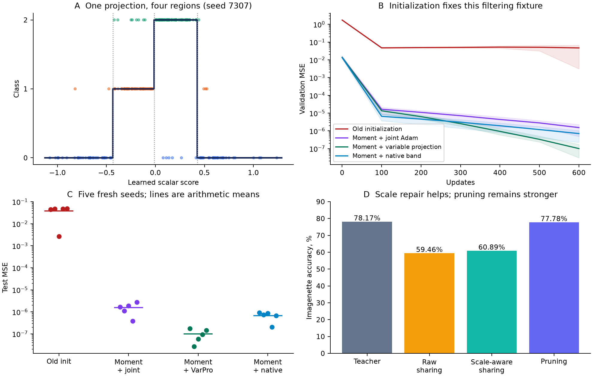

# Multi-bias follow-up: architecture explanation and forensic tests

**Completed 22 October 2026.** This follow-up responds to the three annotated
questions after the bounded frontier study. It preserves the earlier campaign,
paper and package APIs. New artifacts are in
`omnibias-lab/artifacts/multibias_followup_20261022_1444`; scripts are in
`reports/multibias_followup_20261022` in that lab.

The learned-band result survives a direct artifact audit. A real ReLU conversion
weakness was confirmed and tested; it gives a modest retrospective improvement,
not competitive compression. The filtering instability is fixable on the
matched Gaussian-patch task with training-derived direction initialization.
None of these findings establishes a unique new general architecture.



Panel A shows training observations and the compiled classifier. In panel B,
lines are arithmetic means over five fresh problems and shading is their
minimum-to-maximum range. Panel C retains every fresh test error. Panel D is
the separately disclosed retrospective pretrained diagnostic.

## 1. What the winning band model actually is

It is a supervised **single-index learner with a refitted piecewise-constant
response**. There is no teacher, pretrained model or knowledge distillation.
The pretrained compression study below uses teacher-feature distillation;
these are different experiments.

First standardize features using training statistics only:
\[
\hat x_i=(x_i-\mu_i)/s_i,\qquad z=w^\top\hat x.
\]
Then train shared-projection sigmoid features and three class logits:
\[
h_j=\sigma(4(z-b_j)),\quad
\ell_c=\sum_{j=1}^K A_{jc}h_j+d_c,\quad
L=-\frac1n\sum_i\log\operatorname{softmax}(\ell(x_i))_{y_i}.
\]
The shapes are \(w\in\mathbb R^8\), \(b\in\mathbb R^K\),
\(A\in\mathbb R^{K\times3}\), \(d\in\mathbb R^3\).
Every nonlinear feature uses the **same** projection. Their scalar responses
combine with unrestricted, class-specific coefficients. They are not the
fixed alternating-sign Boolean construction. The trainable count is
\(8+K+3K+3=11+4K\).

The pipeline has two distinct learning phases:

1. Jointly learn \(w,b,A,d\) with differentiable multiclass cross-entropy.
2. Discard \(b,A,d\), normalize \(w\) to unit L1 norm, and fit **new** hard
   intervals on the resulting training scores by dynamic programming.

This is not lossless hardening of the trained soft head, nor differentiation
through hard accuracy. The compiler can fit more boundaries than the soft head
contained. The selected soft feature counts were **1, 6, 1, 2, 2**, while all
five exported classifiers have **three cut points and four regions**.
Two of the successful direction estimators therefore used only one sigmoid
feature during training.

The exported classifier is simply
\[
r=\sum_{j=1}^{3}\mathbf1\{w^\top\hat x\ge t_j\},\qquad \hat y=\lambda_r.
\]
For seed 7307, the cuts are approximately
\((-0.434908,-0.013502,0.426815)\), with labels \((0,1,2,0)\).
Class 0 occupies both outer regions. In eight dimensions the cuts are three
parallel hyperplanes, and the inner regions are slabs. This experiment uses
interval inequalities, not an equality-only hyperplane detector.

The same exported function has an exact multi-bias step representation. Let
\(e_c\) be the one-hot vector for class \(c\), and
\(H_+(s)=\mathbf1\{s\ge0\}\). Then
\[
P(z)=e_{\lambda_0}+\sum_{j=1}^{3}
  (e_{\lambda_j}-e_{\lambda_{j-1}})H_+(z-t_j).
\]
It telescopes to the selected one-hot class in each region. For the displayed
example it is \(e_0+(e_1-e_0)H_+(z-t_1)+(e_2-e_1)H_+(z-t_2)
+(e_0-e_2)H_+(z-t_3)\).
This describes deployment; it was not the soft parameterization trained above.
Replacing the steps by ordered sigmoids also gives nonnegative region weights
\(1-\sigma_1,\sigma_1-\sigma_2,\sigma_2-\sigma_3,\sigma_3\)
that sum to one. Off the cut points they converge to the hard region weights
as inverse temperature grows. At a cut point sigmoid limits mix adjacent
regions, so the explicit right-tie hard readout remains a separate contract.

For a stored standardized point, the distance to the nearest decision plane
also supplies an L-infinity prediction-stability radius
\(\min_j|w^\top\hat x-t_j|/\|w\|_1\). Exact arithmetic checks the stored
readout and margins. This does not prove that the unknown true label is
constant throughout that ball, and the winning pipeline does not maximize
these margins with an LP.

### Data, optimization and selection

Each seed creates 4,608 independent eight-dimensional Gaussian examples and a
hidden random unit direction \(w_*\). The class rule along \(w_*^\top x\)
is \(0,1,2,0\) across cuts \(-1,0,1\). Five percent of labels are cyclically
flipped. There are 256 training, 256 validation and 4,096 test observations.

Both neural learners use float64, one CPU thread, full-batch Adam at 0.01 and
2,000 updates. The profile starts from the first class-0-versus-rest
`LinearSVC` coefficient row, using training labels only. It does not select
the best of eight directions. The ordinary MLP starts randomly.

The profile's twelve validation configurations are
\(B\in\{2,3,5,7\}\) and \(\tau\in\{0,0.01,0.05\}\).
For an initial segmentation with no cuts, one sigmoid feature is retained.
The MLP's twelve configurations are sigmoid/ReLU, widths 4/16, and weight
decays 0, \(10^{-4}\), 0.01 on weight matrices. Validation balanced accuracy,
then accuracy and compactness, select the exported configurations. Test labels
do not select configurations. All selected MLPs have width four.

For a fixed learned projection the compiler exactly minimizes
\[
\frac{\#\text{training errors}}{256}+\tau\,\#\text{boundaries}
\]
over at most \(B\) intervals. An interval's label is its majority class;
equal scores cannot be separated. Majority ties choose the smallest class,
and a score exactly on a cut enters the right interval. Independent integer
and exact stored-score checks agree for all five selected models. This is
fixed-score optimality, not global optimization over every direction.

### What the five-problem result means

| Seed | Soft features | Soft parameters | Band BA | MLP BA |
|---|---:|---:|---:|---:|
| 7307 | 1 | 15 | 92.176% | 85.808% |
| 7309 | 6 | 35 | 93.626% | 87.593% |
| 7321 | 1 | 15 | 90.181% | 88.227% |
| 7331 | 2 | 19 | 93.217% | 87.637% |
| 7349 | 2 | 19 | 94.116% | 88.843% |

Mean balanced accuracy is **92.663% versus 87.622%**, a paired gain of
**5.042 points**, with a five-seed t interval **[2.836,7.247] points**.
All five learned directions have absolute cosine greater than **0.998**
with the generating direction. The hidden direction was used only in this
post-hoc diagnostic, not supplied to the learner.

The deployed hard classifier stores eight projection weights, three cuts,
four integer labels and the input normalizer: **248 payload bytes / 1,482
actual NPZ bytes**. The selected \(8\to4\to3\) MLP has 51 trainable
parameters: **537 payload bytes / 2,247 NPZ bytes** including normalizer and
activation code. The actual-file advantage is **1.516×**. Separate frequency
probabilities are outside this hard-classifier export.

A plausible explanation is the correct single-index inductive bias, coupled
with an exact discrete response fit and boundary-complexity penalty. The
ordinary MLP estimates several independent projections from 256 labels.
This is an interpretation, not a completed causal ablation. Initialization,
hard-head refitting, regularization and the known single-index task structure
remain confounded. Four selected MLP fits were still improving at update
2,000. Equal initialization and direct projection-pursuit/tied-profile controls
are necessary before claiming unique activation or optimization superiority.
Projection-pursuit models already learn scalar functions of linear projections
([Friedman and Stuetzle, 1981](https://doi.org/10.1080/01621459.1981.10477729)).

## 2. Audit of pretrained compression

Twenty CPU fixtures independently checked BN folding with nonidentity and
negative BN scales, residual/downsampling shapes, odd spatial sizes, padding,
native GELU, grouping permutations, factor expansion and parameter/input
gradients. Native output error was at most \(2.11\times10^{-12}\);
expanded-factor agreement was at most \(8.53\times10^{-14}\) in those
float64 fixtures. No mapping defect was found in the tested interfaces.
The earlier 126 native export replays remain relevant, at their stated scope.

There is an avoidable **initialization approximation** for ReLU. When
\(w_j=\alpha_jv\), \(\alpha_j>0\), positive homogeneity gives
\[
C_j\operatorname{ReLU}(w_j^\top x+b_j)
=\alpha_jC_j\operatorname{ReLU}(v^\top x+b_j/\alpha_j).
\]
This retains the existing profile parameter count: absorb scale into the bias
and outgoing coefficient. The old raw-mean conversion retained the old bias
and coefficient. On a positively collinear fixture it produced maximum error
6, whereas compensation reduced error to \(8.88\times10^{-16}\).
ReLU scaling compensation also appears in established
[neuron merging](https://arxiv.org/abs/2010.13160).

For real, noncollinear filters, the follow-up retains the **same raw groups
and mean directions**, takes the positive least-squares coefficient
\(\alpha_j=(w_j^\top v)/\|v\|^2\), and compensates bias/readout.
Tiny/nonpositive cases use a disclosed fallback of one; none occurred here.
This minimizes an input-weight discrepancy, not the downstream feature loss,
and cannot reconstruct discarded directions. It is not directly applicable
to nonhomogeneous GELU.

### Real ResNet-18 correction test

This is a **retrospective diagnostic on seed 7201**, with the original
1,024 calibration and 1,000 validation images. Three blocks
(`layer1.0`, `layer2.0`, `layer4.0`) use fixed 2:1 sharing, matched 200-step
Adam reconstruction at 0.001, and a same-budget pruning control. All nine
fits completed. No recipe was selected from the new test metrics. Evaluation
retains all 1,000 output classes on the 3,925-image Imagenette evaluation set.
It is not new full-ImageNet confirmation.

| Method | Validation accuracy | Test accuracy | Test log loss | Whole-model bytes |
|---|---:|---:|---:|---:|
| teacher | 78.700% | 78.166% | 0.789138 | 46,831,024 |
| raw_shared | 58.900% | 59.465% | 1.917548 | 44,238,930 |
| scale_aware_shared | 60.300% | 60.892% | 1.850610 | 44,238,930 |
| prune | 77.700% | 77.783% | 0.849588 | 44,215,391 |

The raw reconstruction reproduces **every historical before/after block
error exactly**. Scale compensation improves accuracy by **1.427 points
(56 images)** with identical storage, but remains far behind pruning and the
teacher. Layer1 reconstruction actually worsens, layer2's final error worsens
slightly, and layer4 improves. Improved kernel approximation therefore does
not imply uniformly improved downstream features.

All four new exports were freshly reconstructed and reproduced every logit
on all 1,000 validation images exactly. This is a same-implementation replay,
not an independent full-test decoder. There is no latency claim.

The conclusion is narrower than “multi-bias compression cannot work.” The
registered conversion/reconstruction recipes did not win. Avoidable conversion
error, limited 200-update reconstruction, lost directions and independently
composed blocks remain distinct issues. The corrected initialization alone
does not explain the observed quality gap. A separate study would need a
stronger, validation-selected conversion/fine-tuning recipe before larger
ResNet/GPT-2 claims could be justified.

There is also a storage ceiling. If an incoming matrix costs \(CD\) weights
and its outgoing matrix costs \(CO\), sharing \(r\) input directions per
group gives approximately \(CD/r+CO\), before small biases/topology costs.
When \(D=O\), 2:1 sharing gives only a 4:3 block reduction, and 4:1 sharing
only 8:5. The full-model reduction is smaller when other blocks stay intact.
Pruning can remove both incoming and outgoing weights. This explains why the
earlier small-input/output architecture's compression ratio cannot simply be
transferred to an entire pretrained CNN or language model.

## 3. Stabilizing the filtering experiment

The original amplitude fixture is
\[
y=h(w_*^\top x),\qquad
h(z)=\tfrac12[\tanh(z+1)-\tanh(z-1)].
\]
Here \(x\) is a 49-dimensional iid Gaussian patch and \(w_*\) a normalized
7-by-7 difference-of-Gaussians pattern. A scalar profile can represent this
target exactly. The original training procedure nevertheless often settled
on an unhelpful direction. Nonfinite arithmetic and activation saturation
were not required for the failure.

### A mathematical reason initialization matters

For \(X\sim N(0,I)\), unit \(w_*\), and a sufficiently integrable even
response \(h\), symmetry gives \(E[YX]=0\). A linear correlation cue cannot
identify the direction. More explicitly, for any shared-profile predictor
\(p(w^\top X)\), its population squared-risk gradient at \(w=0\) is
\[
\nabla_w R(0)=2p'(0)\,E[(p(0)-Y)X]=0.
\]
Nonzero individual branch derivatives alone do not remove this stationary
point in the shared direction.

There is a second-order cue. Decompose
\(X=w_*Z+U\), with independent \(Z\sim N(0,1)\) and orthogonal Gaussian
\(U\). Conditional expectation gives
\[
E[(Y-EY)XX^\top]
=E[(h(Z)-Eh(Z))(Z^2-1)]\,w_*w_*^\top.
\]
The orthogonal term vanishes because \(E[Y-EY]=0\), and cross terms vanish
by independence and zero mean. If the scalar coefficient is nonzero, the
rank-one eigendirection identifies \(w_*\) up to sign. Two integrations by
parts identify that coefficient with \(E[h''(Z)]\) when the boundary terms
vanish. For this particular band, \(z h'(z)<0\) whenever \(z\ne0\), so
\(E[h''(Z)]=E[Zh'(Z)]<0\): the population cue is nonzero. Finite-sample
estimation and non-Gaussian inputs need additional
assumptions; this is not a universal neural initialization theorem. This is
closely related to established
[principal Hessian directions](https://doi.org/10.1080/01621459.1992.10476258).

The implemented initializer uses **training data only**: evaluate candidates
from the first response moment, extreme eigenvectors of the centered response
second moment, and the seeded random direction. Pick the candidate minimizing
the training regularized readout-fit objective. It never reads the true kernel.
Bias centers come from training projection quantiles 0.1, 0.5 and 0.9.

### Readout fitting

For the three-tanh profile, append a constant feature to form \(H_\theta\)
and solve
\[
c_*(\theta)=\arg\min_c\frac1n\|H_\theta c-y\|^2+10^{-6}\|c\|^2.
\]
Augmented reduced QR and triangular solves give a unique readout. In the
variable-projection arm it is refitted after each shape/direction update.
The envelope theorem permits first derivatives with the fitted readout held
fixed because its objective gradient is zero. Independent NumPy least squares,
finite differences of the reduced objective, stationarity and native input
derivatives were checked. This does not assert that detaching the readout
would give correct second derivatives of the reduced objective.
Variable projection is an established method
([Golub and Pereyra, 1973](https://epubs.siam.org/doi/10.1137/0710036)).

### Prospective protocol and results

Seven discovery arms separate the old initialization, least-squares readout
initialization alone, unit-norm/quantile initialization, variable projection,
training-derived moment initialization, a matched joint-Adam profile, and a
direct smooth symmetric band. There are three targets: linear DoG, the
amplitude band, and two independent nonlinear patterns.

Discovery uses seeds 7517, 7523, 7529; the profile recipe is frozen using
discovery validation MSE before five fresh seeds 7541, 7547, 7549, 7559, 7561.
Every case has 512 training, 512 validation and 4,096 test patches. All
**123 fits** completed 600 full-batch float64 CPU Adam updates at 0.01, with
validation every 100 updates. Validation selects checkpoints, including update
zero. The 300-second envelope is cumulative fitting time, not a per-fit cap;
actual fitting took 36.41 seconds. This uses a fresh data/protocol and common
readout ridge, so the old-initialization arm is not an exact rerun of the
original frozen fixture.

The selected recipe is moment initialization plus variable projection.
Fresh amplitude-target results are:

| Method | Mean test MSE | Runs below \(10^{-3}\) |
|---|---:|---:|
| Old initialization | 0.038098634 | 0/5 |
| Moment + joint Adam | 1.5619388e-06 | 5/5 |
| Moment + variable projection | 1.0065668e-07 | 5/5 |
| Moment + native band | 6.8072317e-07 | 5/5 |

Moment initialization raised initial mean direction alignment from about
0.072 to 0.917; training then recovered essentially the correct direction.
Random-direction variable projection still failed two of three discovery
cases. Thus the main repair is **finding a useful direction**, not merely
replacing the optimizer or preventing small gaps. Readout refitting improves
the remaining fixed-budget error with the same moment initialization.

All three moment-initialized constructions succeed. The direct native band
is itself a differentiable nonmonotonic tanh-difference response; it is not
the Gaussian activation. Its initial center zero and width one deliberately
match the target family. Coefficient ridge is basis-dependent, so the same
numerical ridge coefficient does not imply identical functional regularization
across the native and unconstrained profiles. These controls do not support
a unique architectural advantage or a Gaussian-versus-decomposition claim.

The two-independent-pattern target remains around **0.044 MSE** for all these
one-projection arms. No independent-kernel network was retrained in this new
matrix. The old study has that separate feasibility control. Single-kernel
input derivatives still have the form \(p'(k^\top x)k\); stabilization does
not supply a missing independent direction.
Multiple biases per CNN feature also have direct
[2016 architectural precedent](https://proceedings.mlr.press/v48/lia16.html).
This follow-up identifies an initialization/fitting repair within that broad
family rather than claiming its first introduction.

Successful fits selected update 600 and were still improving over their last
200 updates. These are fixed-budget stabilization results, not globally
converged-optimum rankings. Independent NumPy export/data/target replay passed
all 123 cases; the separate-process replay took 3.47 seconds. No full-image
CNN accuracy or new inference-speed advantage is claimed.

### Longer optimization diagnosis

To investigate that unresolved convergence issue, a separately registered
20-fit cohort restarts the same four methods and five already inspected seeds.
It exactly reproduces every original training/validation value at all seven
checkpoints through update 600: **140 prefix comparisons, maximum error zero**.
It then extends to 6,000 updates, or after at least 2,000 updates stops when
the best sampled training regularized objective improves by less than 0.1%
over the previous 1,000 updates. Validation continues to select checkpoints;
all test scoring waits until the fixed cohort finishes.

| Method | Mean selected-checkpoint test MSE | Mean last-iterate test MSE | Mean updates |
|---|---:|---:|---:|
| Old initialization | 0.03756921 | 0.052090367 | 6000 |
| Moment + joint Adam | 1.1463232e-08 | 1.2477682e-06 | 3120 |
| Moment + variable projection | 2.4731077e-09 | 3.3759166e-08 | 2240 |
| Moment + native band | 7.1141014e-09 | 3.7994021e-06 | 2740 |

All 20 fits completed and replayed. The same-moment joint optimizer and native
band also reach very small errors. Four old-initialization runs remain above
\(10^{-3}\) even after the longer budget; one escapes. Extending training
alone does not reliably replace a useful initialization.

The last-iterate columns expose another limitation: at the fixed learning
rate 0.01, some models move away from good earlier parameters. The stopping
rule checks improvement of the **best sampled objective**, so it does not
certify stationarity or stability of the last iterate. Native/joint final
training objectives also worsen in aggregate; this is consistent with
optimizer oscillation, not only statistical overfitting. Validation checkpoint
selection is part of the effective procedure. A decaying learning rate or a
safeguarded local solver is a concrete next test, not a tested remedy here.
This diagnosis cost 33.30 fitting seconds and is not additional fresh-seed
confirmation. It avoids declaring that a 600-step result settled the
asymptotic ordering.

## 4. Evidence, reproduction and decision

The full [fit table](data/multibias-followup-20261022-filtering.csv),
[learning curves](data/multibias-followup-20261022-filtering-curves.csv),
[longer diagnosis](data/multibias-followup-20261022-filtering-long.csv),
[band audit](data/multibias-followup-20261022-bands.csv),
[compression results](data/multibias-followup-20261022-compression.csv), and
[block reconstruction](data/multibias-followup-20261022-block-reconstruction.csv)
retain every case. The [follow-up manifest](data/multibias-followup-20261022-manifest.json)
records sources, dependencies, hashes, status, limitations and retained audits.
The original [frontier evidence](multibias-frontier-study.md) remains unchanged.

From `omnibias-lab`, replay the existing artifacts with:

```bash
OMP_NUM_THREADS=1 MKL_NUM_THREADS=1 /tmp/omnibias-frontier-env-20261021/bin/python -B \
  reports/multibias_followup_20261022/frontier_filter_stability_followup.py \
  --replay --output artifacts/multibias_followup_20261022_1444/filtering
CUBLAS_WORKSPACE_CONFIG=:4096:8 /tmp/omnibias-frontier-env-20261021/bin/python -B \
  reports/multibias_followup_20261022/frontier_scale_aware_followup.py \
  --replay --device cuda --output artifacts/multibias_followup_20261022_1444/compression
OMP_NUM_THREADS=1 MKL_NUM_THREADS=1 /tmp/omnibias-frontier-env-20261021/bin/python -B \
  reports/multibias_followup_20261022/frontier_filter_long_diagnosis.py \
  --replay --output artifacts/multibias_followup_20261022_1444/filtering_long
```

Omit `--replay` and use a **fresh output** to reproduce training. Existing
directories are refused rather than silently reused. The filtering runner
contains the fixed discovery/confirmation protocol; its replay is CPU only.
Compression uses existing local assets and the authorized CUDA execution path.
No new downloads or environment modifications were needed. The compression
study took 116.54 seconds; GPU validation replay was not separately timed.
These are recorded study costs, not matched-time algorithm superiority claims.

The concrete conclusion changes in one place: the filtering failure is now
**demonstrably repairable on its intended synthetic task**. A defensible next
step is training-derived initialization and stable readout fitting under
non-Gaussian/real-image conditions, with equally initialized conventional
controls. For band classifiers, separate direction learning from discrete head
refitting on untouched real repeated-regime datasets. For pretrained models,
the scale-aware correction is useful to retain, but stronger direction sharing
and joint reconstruction remain unproved hypotheses. Neither the old negative
pilot nor this limited repair establishes a universal outcome.

