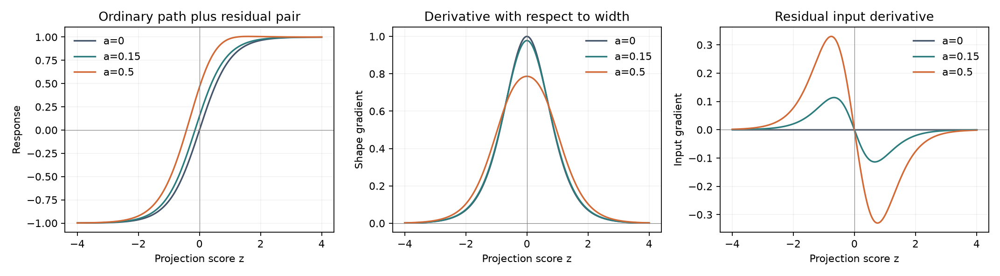
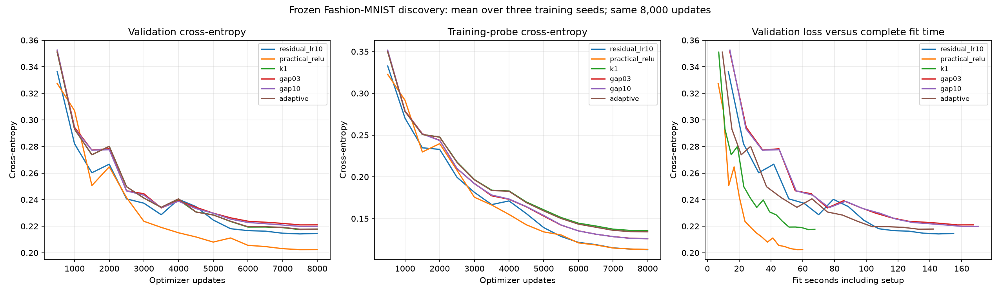
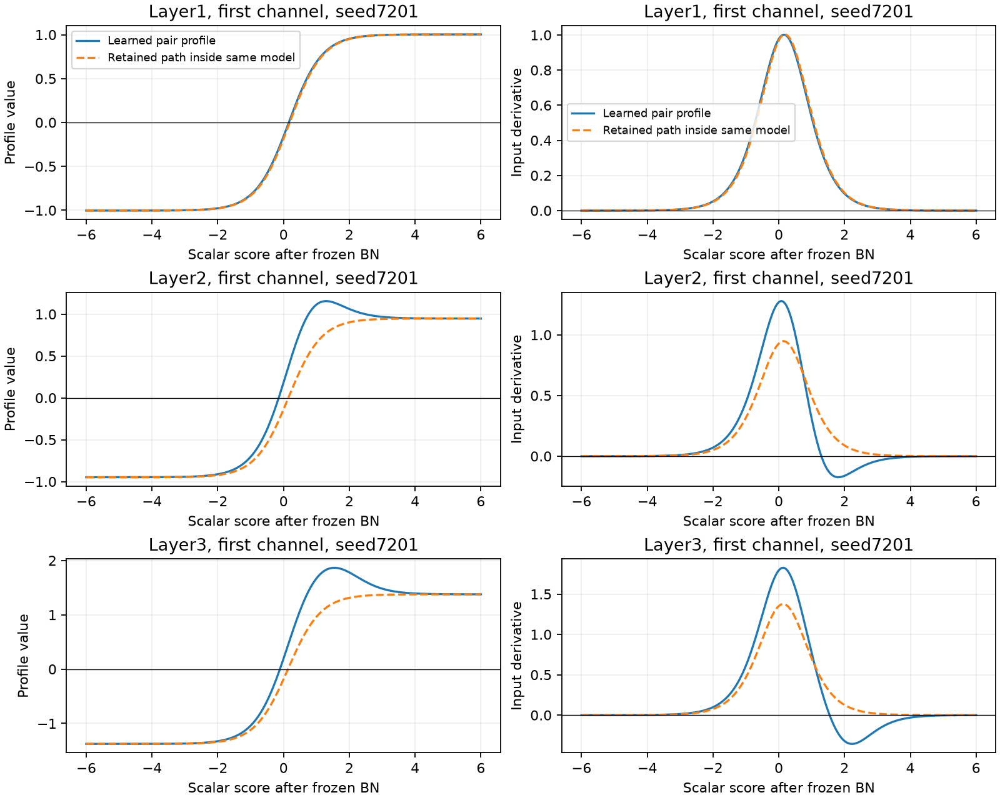
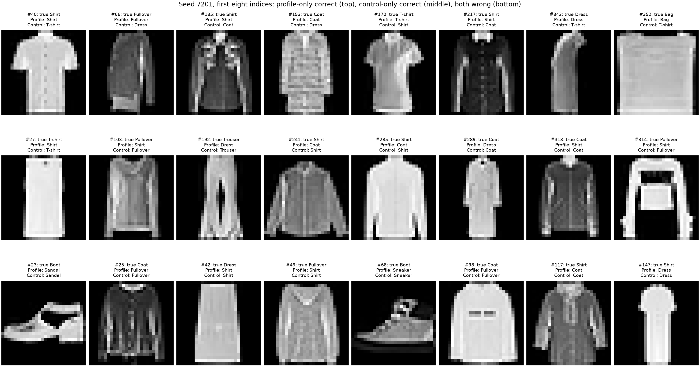
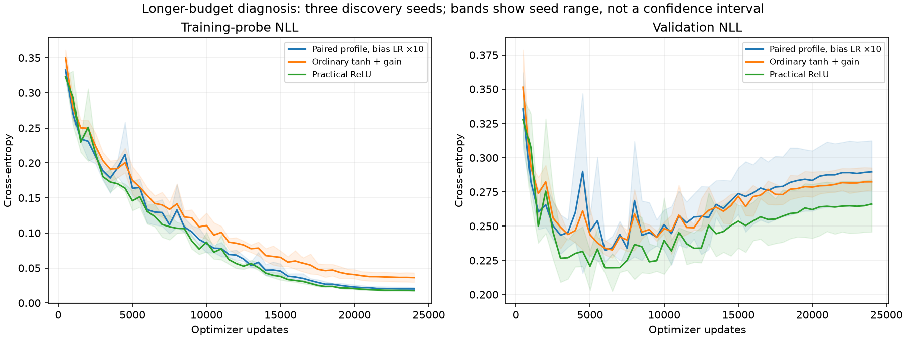
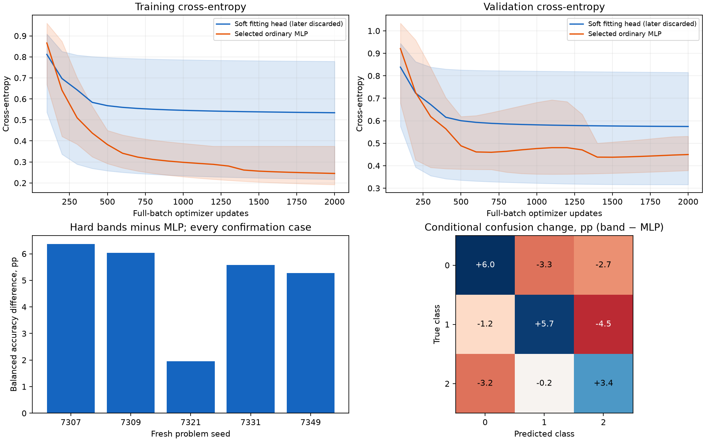

# Multi-bias frontier: adaptive profiles, pretrained compression and margin bands

Campaign started 21 October 2026, with a maximum duration of 24 hours.
**Status: bounded study completed, 22 October 2026.** The strongest positive
result is a learned single-projection hard-band pipeline on one synthetic
family: five fresh problems show a **+5.04-point** mean balanced-accuracy gain
against the selected compact MLP, **1.52× smaller** exports and a passing
conservative component-cost comparison. The paired 95% interval is
**[+2.84,+7.25] points**. This is an exploratory, fixed-resource result with
an unresolved initialization/control difference, not a new general principle.

| Direction | Decision from this campaign |
|---|---|
| CNN activation growth | Complete discovery; registered advancement gate not met. |
| Pretrained compression | Incomplete primary matrix; available profile conversions miss quality tolerances; composed image results miss the size advantage over matched controls. |
| LP-refined bands | Corrected discovery complete; primary advancement gate not met. |
| Learned score followed by hard compilation | Narrow five-problem accuracy/storage/cost route passed; closest initialization and projection-pursuit controls remain necessary. |
| Mathematical theory | Supported conditional constructions and explicit counterexamples; no mathematical novelty established. |

Growth discovery is complete: 42 fits at 8,000 updates and 42 fresh-process
inference replays. The validation-selected profile (`residual_lr10`) reached
**91.753%** mean held-out accuracy versus **92.000%** for the selected practical
ReLU control. Its mean per-seed log-loss ratio was **1.02586**. This fails the
registered growth advancement gate; the longer-budget diagnosis remains a
separate predeclared investigation, not fresh-seed confirmation.

This follows the [image-learning and margin study](multi-bias-learning-and-margin.md)
and [activation-compression study](activation-profile-compression.md).
Implementations and raw artifacts are in the sibling `omnibias-lab`, under
`multibias_frontier_research` and `artifacts/multibias_frontier_20261021_v4`.
The open multi-bias paper and stable package APIs are preserved.

The initial run is retained under the unsuffixed artifact directory. A focused
regression reproduced a job-cache defect: changing a requested device could
reuse a completed job without checking its specification. The guard was fixed
before any discovery-test access; 14 completed pre-correction fits are not
used as primary evidence. A second pre-test correction eliminated redundant
clustering during model reload, preserved clustering assignments while reducing
bookkeeping cost, and made structural controls include output biases in their
budgets and refuse infeasible ranks. Six more completed fits are retained in
the `_v2` directory. A final pre-test audit caught missing reconstructed
deployment-byte metadata, tightened malformed-export refusal, and corrected
weight-only decay and the network-wide active-pair mean penalty to the
registered protocol. Six completed `_v3` fits are also retained. The fresh
`_v4` run preserves the original global deadline and charges **3,400.4 seconds**
from the earlier attempts to the growth budget.
Assets are reused without repeat downloads. Matching reuse, job/device/fingerprint
refusal, assignment parity, direct restoration and payload-tampering rejection
have explicit regression checks. Twelve overlapping v1/v2/v3 discovery fits
had identical arrays. The final numerical protocol corrections mean those
earlier fits are not interchangeable with v4 evidence. None is fresh-seed
confirmation, and no official discovery-test evaluation preceded these fixes.

After growth and the first ResNet-18 case completed, a turn interruption left
the first ResNet-50 case unfinished. Its partial files are retained under
`interrupted_cases`; that case restarts from the original teacher. The
compression deadline remains **22 October 00:04:04 UTC**, four hours after its
original start, so interruption and restart costs are included.

Image metrics originally duplicated dense 1,000-by-1,000 confusion matrices
in parent summaries. A verified bounded driver now uses the same frozen
workers and scalar metrics while omitting only those diagnostic arrays from
parent copies. Raw worker files, predictions and exports remain intact.
Toy and complete real-artifact comparisons verified equality of every
non-confusion value. `resource_handoff.json` records this orchestration change;
the numerical source fingerprint remains unchanged. The alternative driver is
`reports/multibias_frontier_20261021/frontier_bounded_driver.py` in the lab.

## Paired shape coordinates



The zero-width pair leaves the ordinary function unchanged, while its width
derivative is nonzero near the covered scores. Its unchanged input derivative
does not acquire an extra gradient merely from graph decomposition.

Write
\[
p(z)=g\tanh(z+b_0)+Q,\qquad
Q=\tfrac12[\tanh(z+s+qa)-\tanh(z+s-qa)],
\quad a\ge0,\ q\in\{-1,1\}.
\]
At \(a=0\), \(Q\equiv0\). Its input/center and width derivatives are
\[
\partial_zQ=\partial_sQ=\tfrac12[\operatorname{sech}^2(z+s+qa)-
\operatorname{sech}^2(z+s-qa)],
\]
\[
\partial_aQ=\tfrac q2[\operatorname{sech}^2(z+s+qa)+
\operatorname{sech}^2(z+s-qa)].
\]
At the band center, the first derivative vanishes, while the width derivative
is \(q\operatorname{sech}^2a\), nonzero at every finite width. The unchanged
function has the same input derivative, but independently trainable shape
coordinates supply additional parameter derivatives. Loss gradients can still
vanish or cancel upstream.

Symmetry and monotonicity give the exact amplitude bound
\(\|Q\|_\infty=\tanh a\). Removing a pair changes a linear consumer's
output by at most \(\|C\|\tanh a\); further layers require their own
amplification bounds. For \(|z+s|\le H\) and \(a\le A\),
\[
|\partial_aQ|\ge\operatorname{sech}^2(H+A)>0.
\]
A lower gap protects amplitude; upper width and score coverage protect
derivative magnitude. A lower gap alone does not imply a classification margin.
These are real-arithmetic statements, not trained-CNN rounding certificates.

The orientation constraint also matters. Once \(q\) is fixed and \(a\ge0\),
an upstream gradient reversal can make the useful opening direction
inadmissible at \(a=0\). For the analytic fixture \(Q=\tanh a\), target
\(-1\), and half squared error, the data-loss right derivative at zero is
\(+1\). The registered gap coefficient \(\lambda=10^{-3},m=1\) contributes
\(-0.004\), leaving a positive total derivative and a constrained minimum at
zero width. Initial orientation selection avoids this particular trap at
insertion, but does not rule it out later. This is a limitation of the fixed
orientation, nonnegative-width parameterization, rather than a proof against
all multi-bias models. The independent tangent-limit fixtures check it.

The registered soft penalty is \(R=\lambda(t)[m-2a]_+^2\). Its right
derivative at zero is \(-4\lambda m\), whereas the usual AD convention for
\([m-|b_1-b_2|]_+^2\) gives zero separation gradient at coincidence.
Insertion uses zero penalty, followed by an accepted data-loss step and a
500-update penalty ramp. A soft penalty does not guarantee the target gap.
It also changes the training objective after insertion. The ordinary function
remains representable, but a forced active zero-width pair incurs a positive
gap penalty. A best-risk inclusion argument for an unregularized nested class
therefore cannot be transferred unchanged to this regularized experiment.

This is a more general symmetry constraint than the absolute-value example.
If a separation penalty is differentiable and orientation-symmetric,
\(R(t)=R(-t)\), differentiating at zero gives
\(R'(0)=-R'(0)=0\). No such penalty can choose an opening direction on
its own. A data-loss derivative, asymmetric coordinate, initialization or
explicit higher-order step must break that symmetry. This elementary fact
does not preclude useful gap regularization after an opening step.

The paired function can also be written with a signed width \(t=qa\).
Allowing \(t\in\mathbb R\) represents both orientations continuously,
whereas holding \(q\) fixed and constraining \(a\ge0\) restricts an
individual optimization path to one ray. This suggests a simpler future
coordinate choice, but it was **not** the registered projected-Adam arm.
The selected models did not exhibit zero-width trapping, so this observation
is not an empirical explanation of their accuracy results or evidence that
changing coordinates would improve them.

## Tangent gain beyond ordinary bias and amplitude updates

Let \(J_0\) be the baseline prediction Jacobian on a fixed finite sample,
\(P=I-J_0J_0^+\), and \(H\) the candidate split-tangent dictionary.
If \(H\) has full row rank and \(r_\perp=Pr\ne0\), some column satisfies
\[
r^\top Ph_j=r_\perp^\top h_j\ne0.
\]
Otherwise \(H^\top r_\perp=0\) contradicts full row rank.
The compensating baseline tangent \(-J_0^+h_j\) realizes \(Ph_j\) to
first order when those parameter directions are allowed. Differentiability
then supplies a signed local descent step. It gives no uniform step size,
global convergence or generalization guarantee.

Distinct data-centered tanh derivative features form a strictly
positive-definite dictionary. One independent argument uses
\[
\widehat{\operatorname{sech}^2}(\omega)
=\frac{\pi\omega}{\sinh(\pi\omega/2)}>0,
\]
with its positive continuous limit at zero. The quadratic form is the
integral of this density times
\(|\sum_j a_j e^{i\omega z_j}|^2\). Distinct scores and a nonzero coefficient
vector make that exponential polynomial nonzero, proving strict positivity.
Exact ties must be aggregated.

This full-dictionary statement does not transfer to the nine-quantile search.
If there are \(N>\operatorname{rank}J_0+9\) effective sample coordinates,
the joint column space of \([J_0,H_9]\) has a nontrivial orthogonal complement.
A nonzero loss gradient in that complement is invisible to every searched
first-order direction. This is a dimension-counting counterexample to a
guaranteed rescue from a fixed finite center dictionary. It does not imply
that larger finite steps or later optimization cannot improve the loss.
The CNN implementation uses a channel-local
bias/gain approximation and checks actual loss on a deterministic training
subset with normalization statistics frozen.

For a linearized squared-loss model the optimal scalar coefficient on \(h\)
reduces loss by \((r^\top h)^2/(2N\|h\|^2)\). This motivates normalized
correlation ranking; actual nonlinear updates need a descent check.
Six independent scalar fixtures check this identity and compensate ordinary
bias/gain tangents before opening a pair. Predicted and actual accepted
small-step improvements have Pearson correlation at least 0.9976 in these
fixtures. One initial fixed step increased loss; bounded Armijo backtracking
found descent for all tested nonredundant candidates. The failed step is
retained. A small step in prediction space can require a large parameter
step near a redundant tangent, so the local theorem supplies no uniform step
size. These are analytic teacher fixtures, not held-out image-learning gains.
Relevant growth precedents include [Net2Net](https://arxiv.org/abs/1511.05641),
[GradMax](https://arxiv.org/abs/2201.05125), and
[signed splitting](https://arxiv.org/abs/2003.10392). More directly,
[Growing Tiny Networks](https://arxiv.org/abs/2405.19816) formulates an
expressivity bottleneck as the functional gradient component outside the
current architecture's tangent space. Its
[DAG extension](https://arxiv.org/abs/2501.12690) uses that criterion to choose
architectural expansions. A [2026 residual-depth preprint](https://arxiv.org/abs/2608.14664)
also gives a first-order residual-tangent criterion under a specified
function-preserving insertion protocol. Therefore the orthogonal-tangent
principle itself is prior art. The present question is whether the restricted
two-bias shape direction is a useful, inexpensive implementation of it.
Growth-specific learning-rate design also has precedent in
[variance-transfer growth](https://arxiv.org/abs/2306.12700). Neither changing
activation complexity nor scaling newborn learning rates is a new general
principle on this evidence.

### Tangent span and optimization conditioning need different tests

If the baseline Jacobian already has full row rank on the measured sample,
then \(P=0\). No inserted feature adds a first-order prediction direction
on that sample. It can nevertheless change the cost of realizing an update.
An overparameterized CNN's channel-local bias/gain residual must therefore
not be described as a residual outside its complete parameter Jacobian.
Full finite-sample row rank also says nothing about the function away from
that sample. The separately registered audit on the ordinary tanh model at
seed 7201 measured a **320 × 33,658** parameter Jacobian on 32 training
images. It had numerical row rank **320** at relative singular thresholds
\(10^{-4},10^{-6},10^{-8}\). The loss-gradient component outside its column
space had relative norm \(2.02\times10^{-15}\).
Thus a new coordinate cannot add a first-order logit direction on this
particular sample. The calculation is not an exact rank certificate or a
statement about all 55,000 training images. Parameter-Jacobian rank must
also be distinguished from the input-gradient subspace used in the later
projection/factorization criteria.

For a precise conditioning calculation, consider a linearized squared-loss
problem with a specified positive-definite parameter-cost matrix \(M\):
\[
V(J,M)=\min_\delta\{\tfrac12\|r-J\delta\|^2+
\tfrac\lambda2\delta^\top M\delta\},\qquad\lambda>0.
\]
Let \(K=JM^{-1}J^\top\), \(A=K+\lambda I\). Eliminating the parameters gives
\(V=\lambda r^\top A^{-1}r/2\). Add a feature \(h\) with a signed
coefficient and quadratic cost \(\lambda\alpha^2/2\). Eliminating the
original parameters first leaves
\[
\tfrac\lambda2(r-h\alpha)^\top A^{-1}(r-h\alpha)
+\tfrac\lambda2\alpha^2.
\]
Completing this scalar square proves the exact reduction
\[
\Delta V=\frac\lambda2
\frac{(r^\top A^{-1}h)^2}{1+h^\top A^{-1}h}\ge0.
\]
This is ordinary ridge/Sherman–Morrison algebra. It suggests a
cost-normalized growth diagnostic even when tangent rank cannot increase,
but was not the scoring rule used in the primary CNN experiment. Its
assumptions include a linearized field, squared loss and a specified
parameter cost. Choosing an insertion orientation to match the optimal
coefficient's sign can realize this scalar optimum with a nonnegative
width; a previously fixed orientation need not allow it. Cross-entropy,
finite nonlinear updates and held-out risk require separate checks.

The choice of parameter metric is essential. Under \(\delta=S\theta\),
the transformed pair \((JS,S^\top MS)\) gives the same \(K\), whereas
silently resetting the metric to the identity can change the score merely
by rescaling parameters. Duplicating an existing coordinate can likewise
lower the effective quadratic penalty without adding a function direction.
For a diagonal original penalty \(\mu\), a duplicate with unit penalty
changes the penalty on their summed coefficient to \(\mu/(1+\mu)\).
Independent augmented least-squares fixtures check these identities and
the full-row-rank case. Such a gain is attributed to optimization geometry
or regularization, rather than to new representational capacity.

## Filtering, rank and approximation

### Information loss and profile approximation are distinct

Let \(Z=V^\top X\), \(f\in L^2\), and \(g_K\) be a bounded-complexity
profile with \(g_K(Z)\in L^2\). Conditional expectation is an orthogonal projection, so
\[
\mathbb E[(f(X)-g_K(Z))^2]
=\mathbb E[\operatorname{Var}(f(X)\mid Z)]
+\mathbb E[(\mathbb E[f(X)\mid Z]-g_K(Z))^2].
\]
The cross term vanishes after conditioning on \(Z\). Increasing the profile
budget can reduce the second term; it cannot remove the first term for a
fixed projection. Here "fewer independent projections" means fewer separately
stored incoming rows, not necessarily fewer linearly independent vectors.
On a finite support a generic real projection can be injective, making the
conditional-variance term zero. That observation does not bound the profile
complexity, required precision, conditioning or off-sample error. Finite-sample
encoding therefore supplies neither a cheap general depth-collapse theorem
nor a guarantee of useful generalization.

For standard Gaussian inputs, orthonormal \(V\), and the required square
integrable weak derivatives, conditional Gaussian Poincaré gives
\[
\mathbb E[\operatorname{Var}(f\mid V^\top X)]
\le\mathbb E\| (I-VV^\top)\nabla f(X)\|^2.
\]
Apply the unit-constant Gaussian inequality on every orthogonal conditional
fiber and integrate. This is a sufficient upper bound on discarded
information; a large gradient bound alone does not prove a large information
floor. It does not apply automatically to discrete image or Boolean data.
The relevant established theory is
[active-subspace approximation](https://doi.org/10.1137/130916138), with its
[published erratum](https://doi.org/10.1137/140983598). These results explain a
restricted opportunity: retained directions must already preserve useful
information, and the added profile must approximate the remaining scalar
response efficiently. Learnable univariate functions also have broad prior
art, including [KANs](https://arxiv.org/abs/2404.19756), whose edge-function
architecture differs from the shared affine projections tested here.
The broad sum-of-learned-profiles form
\(d+\sum_g p_g(v_g^\top x)\) also directly overlaps
[projection pursuit regression](https://doi.org/10.1080/01621459.1981.10477729),
introduced in 1981. A new contribution would need to concern a narrower
growth rule, deployment implementation or demonstrated resource/quality
tradeoff, rather than the general use of learned ridge responses.

### Exact factorization requires a common derivative geometry

There is an elementary exact criterion behind the approximation identity.
Let \(\Omega\) be open and convex, \(V\) have orthonormal columns, and
\(f\in C^1(\Omega;\mathbb R^p)\). Then
\[
f(x)=g(V^\top x)\quad\Longleftrightarrow\quad
Df(x)(I-VV^\top)=0\quad\text{for every }x\in\Omega.
\]
Necessity is the chain rule. For sufficiency, points in the same projection
fiber differ by a vector in \(\ker V^\top\). Integrating the derivative
along their segment gives zero change; convexity keeps that segment in the
domain. Thus \(g\) is well defined. Local sections
\(x_0+V(z-z_0)\) establish its differentiability on the projected domain.
This is a standard factorization argument, not a new calculus principle.

It requires one **common** retained subspace over the domain. Pointwise
Jacobian rank is insufficient: every scalar field has pointwise rank at
most one, while \(f(x_1,x_2)=x_1^2+x_2^2\) cannot factor through one fixed
linear coordinate on \(\mathbb R^2\). A finite collection of sampled
gradients also does not certify the everywhere condition. ReLU teachers
require separate piecewise or weak-derivative assumptions.

Factoring through \(G\) coordinates still does not imply an additive sum of
\(G\) scalar profiles. For a \(C^2\) response on a connected product region,
\[
g(z)=d+\sum_i p_i(z_i)\quad\Longleftrightarrow\quad
\partial_i\partial_jg=0\quad(i\ne j).
\]
If the mixed derivatives vanish, each \(\partial_i g\) depends only on
\(z_i\); integrating those derivatives leaves a constant remainder.
The converse follows by differentiation. This criterion concerns the
specified coordinates. For example, \(z_1z_2\) is not additive in
\((z_1,z_2)\), but becomes a difference of two quadratic profiles after
rotating to \((z_1+z_2)/\sqrt2\) and \((z_1-z_2)/\sqrt2\).
Projection selection, interactions and finite profile approximation are
therefore separate obligations. These criteria explain when depth can be
represented by a lower-dimensional response; they supply no economical
finite-bias representation of an arbitrary deep network.

### An explicit projection-budget example

There is a precise restricted setting in which allocating parameters to
profiles preserves more independent information than a dense low-rank
parameterization. This example uses learned-coefficient **ReLU** profiles,
not the one-pair tanh growth unit or fixed-sign Boolean units. It counts
scalar parameters, rather than measured artifact bytes or training cost.

Let \(X\sim N(0,I_D)\), let \(Q\) be an orthogonal projector of rank \(G\),
and set \(f(X)=X^\top QX-G\). For an orthonormal \(D\times r\) matrix \(V\),
write \(B=V^\top QV\). Gaussian conditioning gives
\[
\mathbb E[f\mid V^\top X=Z]=Z^\top BZ-\operatorname{tr}B.
\]
The centered Gaussian quadratic-form identity
\(\operatorname{Var}(Z^\top BZ)=2\operatorname{tr}(B^2)\)
follows by diagonalizing \(B\), using \(\mathbb EZ_i^4=3\), and independence.
Conditional-expectation orthogonality therefore proves
\[
\inf_g\mathbb E[(f-g(V^\top X))^2]
=2\left(G-\|V^\top QV\|_F^2\right).
\]
All eigenvalues of \(B\) lie in \([0,1]\). Optimizing the projection gives
\[
\inf_{V,g}\mathbb E[(f-g(V^\top X))^2]
=2\max(G-r,0).
\]
The lower bound allows an unrestricted measurable response \(g\), so it
also applies to every finite neural response using only those \(r\) linear
coordinates. This is standard Gaussian quadratic-form/conditional-projection
algebra, not a new general principle.

Now use \(G\) orthonormal directions spanning \(Q\), each with a shared
\(K\)-term scalar profile. A scalar-output profile block stores
\[
N_{\rm profile}=GD+2H+1,\qquad H=GK,
\]
for directions, biases, coefficients and offset. An ordinary dense
rank-\(r\) factorization retaining that expanded width stores
\[
N_{\rm rank}=r(D+H)+2H+1.
\]
At the profile budget it can retain at most
\[
r_{\max}=\left\lfloor\frac{GD}{D+H}\right\rfloor.
\]
The missing parameters are the free mixing coefficients in the dense
factorization. A structured or sparse mixing representation can avoid
that overhead; the comparison does not cover such alternatives.

For a finite construction put \(h=2R/K\) and
\[
q_K(z)=R^2+(-2R+h)(z+R)_+
+2h\sum_{j=1}^{K-1}(z+R-jh)_+.
\]
This is the linear interpolant of \(z^2\) at the uniform knots on
\([-R,R]\). On each interval \([a,a+h]\), its error is
\((z-a)(a+h-z)\), between zero and \(R^2/K^2\).
Outside that box, \(0\le q_K(z)\le z^2\): the left extension is constant,
and the right extension has slope \(2R-h\). Thus, for a standard normal \(Z\),
\[
\mathbb E[(q_K(Z)-Z^2)^2]
\le R^4/K^4+
2[(R^3+3R)\varphi(R)+3\Phi(-R)].
\]
The tail expression follows by two integrations by parts. For the chosen
basis directions, set \(\widehat f(X)=\sum_{g=1}^Gq_K(v_g^\top X)-G\).
Its per-profile constants combine into the one output offset.
Cauchy–Schwarz bounds its squared error by \(G^2\) times this expression.

Take **\(D=256,G=4,K=20,R=5\)**. The profile stores **1,185** scalar
parameters; the same-width dense factorization fits rank at most **3**.
Its population MSE is therefore at least **2**. For the profile construction,
Mills' bound \(\Phi(-5)\le\varphi(5)/5\), together with
\(e>27/10\) and \(\pi>2\), gives the fully rational upper bound
\[
\mathbb E[(\widehat f-f)^2]
<16\left[\frac1{256}+\frac{703}{5}
\left(\frac{10}{27}\right)^{12}\right]<\frac1{10}.
\]
Its decimal diagnostic is approximately 0.077488. The strict rational
inequality, rather than the decimal, establishes the separation. One hundred
rational interpolation checks and independent conditional-variance
computations accompany the argument in the
[exact fixture](data/multibias-frontier-projection-budget.json).

This supplies a concrete **representation-allocation** example. It does
not establish a unique multi-bias technology: a conventional spline or
identically tied-weight implementation realizes exactly the same function.
An ordinary quadratic-activation model represents this particular teacher
exactly with fewer parameters. The argument supplies no lower bound against
ordinary narrow or deeper networks, alternative encodings, or all compression
methods. It establishes neither trainability nor an empirical speed/storage
advantage. Its contribution here is an explicit, checkable condition under
which preserving directions and enriching responses can help.

### A band's tail behavior depends on its primitive

Two shifted sigmoids or tanh terms with opposite coefficients have zero tails
and can form a bell response. Two shifted ReLUs instead obey
\[
[z-a]_+-[z-b]_+\longrightarrow b-a\quad(z\to+\infty),
\]
so they form a clipped ramp, not a response vanishing at both extremes.
For a nontrivial compact ReLU profile \(\sum_jc_j[z+b_j]_+\), the right
tail vanishes precisely when
\[
\sum_jc_j=0,\qquad \sum_jc_jb_j=0.
\]
The left tail is already zero. With two distinct biases these equations force
both coefficients to zero. Three shifts suffice: the second difference
\[
T_a(z)=[z+a]_+-2[z]_++[z-a]_+,\qquad a>0,
\]
is a triangular response with support \([-a,a]\) and height \(a\).
The normalized \(T_a/a\) has fixed height one. A separately scaled residual
\(\gamma T_a/a\), initialized with \(\gamma=0\) and finite \(a\),
preserves an ordinary baseline without coincident boundaries. Its parameters
can be tied to a center and width even though it evaluates three shifts.
Primitive evaluations, independently learned biases and stored parameters are
therefore distinct complexity measures.

GELU also has a zero left tail and an asymptotically linear right tail, so the
same two moment cancellations are required for a residual vanishing at both
extremes. Its second difference has decaying tails rather than compact support.
Collapsing that difference at width zero gives a zero first width derivative:
function preservation alone does not ensure a first-order growth direction.
A finite-width, zero-amplitude insertion supplies a different trainable
coordinate, with its own conditioning and regularization obligations.

More generally, finite differences cancel polynomial tails through the
corresponding bias moments. This is classical spline/finite-difference
algebra, closely related to [learned spline activations](https://jmlr.org/papers/v20/18-418.html).
It is a design constraint, not a new mathematical branch. The registered
image growth uses tanh pairs; the ReLU/GELU tail constructions are derived
extensions and are not retrospectively credited with those image results.

For a shared kernel, \(f(x)=p(k^\top x)\) has gradient
\(p'(k^\top x)k\). Independent nonlinear branches can span different
directions. A linear difference of kernels already equals one kernel.
Thus an ordinary free kernel can learn a Difference of Gaussians; multi-bias
profiles additionally select response-amplitude ranges. Their sinusoidal
responses depend on frequency and amplitude and are not linear transfer functions.
The fixtures fit linear Gaussian-difference, nonlinear amplitude-band and
independent-pattern targets, disclosing parameter counts and learning curves.
The [ICML 2016 multi-bias CNN](https://proceedings.mlr.press/v48/lia16.html)
is direct architectural prior art.

Growth in the image mechanism study starts from scratch with class labels.
The pretrained stage instead compresses an existing model by teacher-feature
distillation on cached block inputs and outputs. Its learned vector-valued
profile coefficients are distinct from fixed alternating-sign Boolean units.
Network depth, residual interfaces and native activations are preserved.
Incoming sharing reduces independent projections; it retains the original
number of shifted nonlinear evaluations. Outgoing rank reduction adds a
separate linear-algebra compression. Reduced file size therefore does not
by itself imply lower activation memory or faster inference.

The factorization \(C=BA\) suffices to replace \(Ch(z)\) by \(B(Ah(z))\).
If the shifted features together with the offset are linearly independent
over the stated domain, it is necessary and the minimum intermediate profile
count is \(\operatorname{rank}C\). Without independence it is only sufficient.
ReLU hinge independence requires the corresponding knot/domain assumptions.

For \(|x_i|\le R_i\) and a primitive with Lipschitz constant \(L\),
\[
\|\sum_j C_j[\phi(w_j^\top x+b_j)-\phi(v_{g(j)}^\top x+b_j)]\|
\le L\sum_j\|C_j\|\sum_iR_i|w_{ji}-v_{g(j),i}|.
\]
Use \(L=1\) for ReLU/tanh. Exact GELU has
\(L\le1+1/\sqrt{2\pi e}\), from \(\phi'(z)=\Phi(z)+z\varphi(z)\).
For tanh-approximate GELU, \(\phi=z(1+\tanh u)/2\),
\(u=c(z+bz^3)\), \(b,c>0\), a conservative bound is \(L\le7/4\).
Indeed \(|zu'|\le3|u|\) and
\(|u|\operatorname{sech}^2u\le1/2\), since
\(\cosh^2u\ge1+u^2\ge2|u|\). The derivative's two terms are bounded
by one and three quarters. Floating-point rounding is outside these bounds;
downstream multiplication can make them loose.

### Collinear ReLU filters need not share their magnitudes

Positive homogeneity gives a useful initialization distinction:
\[
C_j\operatorname{ReLU}(\alpha_j z+b_j)
=\alpha_j C_j\operatorname{ReLU}(z+b_j/\alpha_j),\qquad\alpha_j>0.
\]
Thus collinear ReLU directions with different positive scales can share a
projection exactly by changing their biases and readouts, without adding
independently learned slopes. Replacing their weights by a mean while initially
retaining their old biases and coefficients need not preserve the function.
This is avoidable conversion error, rather than a representational impossibility:
the trainable profile could learn the corrected coefficients. The 200-update
reconstruction is not guaranteed to do so. Exact rational fixtures distinguish
these cases. Positive-homogeneity rescaling is already relevant to established
neuron-merging methods; it is not a new compression principle.

This argument does not transfer to GELU. For exact
\(\phi(z)=z\Phi(z)\),
\(\phi''(z)=(2-z^2)\varphi(z)\), and
\[
\widehat{\phi''}(\omega)=(1+\omega^2)e^{-\omega^2/2}.
\]
If \(\alpha>1\), representing \(\phi(\alpha z)\) by finitely many
unit-slope translates of \(\phi\), even with an additional affine term,
would require
\[
\sum_j c_j e^{ib_j\omega}
=\frac{\alpha(1+\omega^2/\alpha^2)}{1+\omega^2}
\exp\!\left[\tfrac12(1-\alpha^{-2})\omega^2\right].
\]
The left side is bounded and the right side is unbounded. This proves the
impossibility of exact finite representation on the whole line. Real analyticity
also rules out exact equality on an open interval. It does not by itself give
a positive lower bound on approximation error with unbounded parameters.
This is a concrete reason to separate retained projection information from
approximation within a restricted profile class.

### An untested extension: variance coordinates for exact GELU

The same Fourier density is strictly positive. Consequently the data-centered
curvature dictionary
\(G_{ij}=\phi''(z_i-z_j)\) is strictly positive definite at distinct scores,
by the earlier Fourier quadratic-form argument. It can supply a full dictionary
for the conditional tangent-descent theorem.

Consider the function-preserving three-term profile
\[
Q_a(z)=\phi(z+\sqrt a)-2\phi(z)+\phi(z-\sqrt a),\qquad a\ge0.
\]
It satisfies \(Q_0=0\) and
\[
\left.\partial_aQ_a\right|_{0+}=\phi''(z),\qquad
\left.\partial_a^2Q_a\right|_{0+}=\phi''''(z)/6.
\]
The ordinary separation coordinate has a zero first derivative at coincidence;
the variance coordinate has a generally nonzero, genuine derivative of the
represented function. A signed insertion still needs a suitable orientation,
and finite center searches retain the earlier limitations.

Taylor's theorem gives a stable small-variance realization:
\[
Q_a=a\phi''+\frac{a^2}{12}\phi''''+R,
\quad |R|\le a^3M_6/360,
\quad |\partial_aR|\le a^2M_6/120,
\quad |\partial_a^2R|\le aM_6/60,
\]
where \(M_6\ge\sup|\phi^{(6)}|\). The prototype uses this approximation
for \(a\le10^{-4}\), avoiding a square-root singularity in the computational
graph at zero. Independent high-precision fixtures check values and derivatives;
floating-point checking tolerances are separate from the analytic remainder.
For example,
\(\partial_aQ_a=\frac12\int_{-1}^{1}\phi''(z+\sqrt a\,t)\,dt\);
expanding this integral and its derivative gives the stated remainder bounds.
The polynomial
\(\phi^{(6)}=(-z^6+16z^4-51z^2+18)\varphi(z)\) gives a global bound by
bounding each Gaussian monomial separately. Its resulting expression is
approximately 40.2626681; the integer \(M_6=41\) is a conservative analytic
choice using \(e>2.7\) and \(\sqrt{2\pi}>2.5\). The decimal in the numerical
fixture is a floating-point diagnostic, not an interval-certified constant.
All **56** scalar value/gradient/second-derivative fixtures, on
\(|z|\le8\) and \(0\le a\le1\), passed against 100-digit arithmetic.
This is a bounded numerical prototype, not a general-purpose kernel.
Their maximum forward error was about
\(2.0\times10^{-14}\); the five-score curvature Gram fixture had minimum
eigenvalue 0.24362. These finite checks accompany the argument, rather than
replace it or establish a practical gradient lower bound at large sample size.

This is an architectural research candidate built from established
central-difference and Fourier algebra, not a demonstrated learning advantage.
Relevant second-order growth precedents include
[signed neuron splitting](https://arxiv.org/abs/2003.10392).
The exact-GELU proof does not apply automatically to GPT-2's native tanh-approximate
`gelu_new`. No pretrained architecture was changed to obtain these identities.

### Storage ceilings precede accuracy experiments

With \(m\) scalar terms, input dimension \(D\), output dimension \(O\),
and \(G=m/K\) shared directions, the dense affine pair stores
\(m(D+O+1)+O\) scalar parameters. Incoming sharing alone stores
\(GD+m+Om+O\). Ignoring fixed offsets in the large-width ratio gives
\[
R_{\rm pair}=\frac{D+O+1}{D/K+O+1}.
\]
When \(D\approx O\), even unlimited incoming sharing approaches a twofold
pair reduction. With outgoing group rank \(r\), the count becomes
\(GD+m+GOr+mr+O\). The extra \(mr\) coefficients must be counted.
Convolution uses the corresponding flattened kernel sizes. Whole-model
reduction is further diluted by every untouched block, attention operator,
embedding and normalization state.

For the three registered screened interfaces, factor-four incoming sharing
and outgoing rank two predict the following float32 payload reductions,
before any accuracy requirement or archive metadata:

| Model | Original whole payload | Predicted whole-model saving |
|---|---:|---:|
| ResNet-18 | 46,796,608 bytes | 19.15% |
| ResNet-50 | 102,441,032 bytes | 9.66% |
| GPT-2 small | 497,759,232 bytes | 7.09% |

GPT-2 counts tied embeddings once and excludes the legacy checkpoint's
nonpersistent causal masks. Consequently, this three-block rank-two recipe
cannot meet a 10% whole-model saving even against the uncompressed teacher
on ResNet-50 or GPT-2. It is a screening experiment. Validation-qualified
composition across additional blocks is necessary for those models; an
incomplete rollout cannot establish the registered whole-model advantage.
Actual exports, rather than these formulas, determine reported byte ratios.

The actual ResNet-18 export includes 160 bytes of native BatchNorm tracking
buffers absent from its legacy weight file. The table counts the reconstructed
inference state, including those buffers.

## Noisy band learning and checked deployment

The fixed-score DP minimizes classification error plus boundary cost and may
make mistakes. The margin LP constrains geometric memberships independently
of labels. A positive-gap current projection supplies a feasible witness.
After membership-preserving refinement, the old segmentation retains its
objective, so an exact DP re-solve cannot increase the optimum. The algorithm
also checks each accepted stored-float classifier by rational arithmetic and
requires a lower objective or equal objective with improved achieved margin.
This is a conditional local-refinement contract, not joint global optimality.

For stored standardized inputs and parameters,
\[
r(x)=\frac{\min_j|w^\top x-t_j|}{\|w\|_1}
\]
preserves the hard prediction for standardized \(\ell_\infty\) perturbations
strictly below \(r(x)\). It does not certify label correctness or raw-input
preprocessing. Zero-radius points have no positive robustness guarantee.
The ordered one-hot smoothing condition \(\beta m>\log3\) is a conditional
real-arithmetic agreement result, not a float32 implementation certificate.
In detail, for ordered thresholds \(t_1<\cdots<t_K\), set
\(s_j(z)=\sigma(\beta(z-t_j))\) and
\[
\pi_0=1-s_1,\quad \pi_j=s_j-s_{j+1},\quad \pi_K=s_K.
\]
These weights are nonnegative and sum to one. Assigning each interval its
one-hot label, including repeated classes, gives a valid probability vector.
At least distance \(m\) from both relevant boundaries, the hard interval has
weight at least \(1-2\epsilon\), where
\(\epsilon=\sigma(-\beta m)\); all other intervals together have weight at
most \(2\epsilon\). Thus its label wins when
\(\epsilon<1/4\), equivalently \(\beta m>\log3\). This theorem concerns
that specified one-hot smoother. It is not a hardening certificate for an
arbitrary trained sigmoid/logit head that is subsequently recompiled by DP.

The primary band run exposed a numerical control-flow defect in five of its
21 cases. A membership-preserving LP proposal passed exact replay, but a
subsequent floating-point regrouping could disagree with exact evaluation of
the stored direction and thresholds. The strict checker refused these
regroupings; the uncaught refusal aborted the case before model acceptance.
The primary matrix remains incomplete.

The independent **training-objective** audit then found one false acceptance
among 48 primary band models. In `bands_binary_7211/refined`, the stored
objective was 98,000 but the exported classifier made 99 exact training
errors, requiring 99,000. Prediction replay alone had not checked that
optimization claim. **That achieved-objective/optimality claim is invalidated.**
Its measured test predictions are separate evidence. Band promotion was
stopped immediately; the interrupted correction cohort and original failed
audit are retained.

There are two distinct numerical problems. A midpoint between adjacent
floating-point scores can round onto its left endpoint, changing the
compiled partition. In addition, floating-point and exact stored-parameter
dot products can disagree near a cut. The corrected compiler chooses a
representable cut in `(left, right]` for its stated right-inclusive readout;
this fixes the first problem, but cannot eliminate the second. Exact replay
must still refuse unsafe regroupings. The actual failing projection supplies
a retained regression: its floating-score DP value is 98,000 while its
exact exported value is 99,000, so the corrected path rejects it. A checked
fallback is feasible evidence, not proof of the relaxed DP optimum.

A separately versioned correction retains the independently checked LP
proposal when regrouping is refused. It also verifies the compiled training
objective and error count for **both** the proposal and fallback. The original
sources and failed artifacts remain unchanged. The focused gates include 372
tiny independent-DP cases, adjacent-float cuts, the actual false acceptance,
changed geometric memberships with unchanged class labels, and an incorrect
fallback objective. Corrected discovery uses a fresh artifact prefix; it does
not retrospectively repair the original incomplete matrix.
The independent suffix DP orders **rational dot products**, rather than
rounded scores. Its arbitrary-real-cut problem relaxes the requirement that
exported thresholds be representable floats, so it supplies a valid lower
bound for the exported classifier class. A rounded-tie fixture checks why
this distinction is necessary. Equality with an independently checked
achieved objective establishes the fixed-score optimum; a positive gap is
explicitly marked **inconclusive optimality**. A feasible achieved margin
does not close that gap. The correction has its own source hashes,
manufactured roundoff regression, unchanged-model check and invalid-fallback
refusal. Its reruns and any qualifying fresh-seed confirmation are separate
from the original matrix and remain within the failure-investigation reserve.

For a fixed ordering of \(N\) distinct scores, binary classifiers with at
most \(B\) constant-label intervals realize exactly
\[
2\sum_{j=0}^{\min(B-1,N-1)}\binom{N-1}{j}
\]
labelings: choose the first label and the locations of label changes.
Their fixed-projection VC dimension is \(B\): all \(B\) points can be
labeled, while the alternating labeling on \(B+1\) ordered points cannot.
This assumes free interval labels, including either initial class. It is not
the capacity of a fixed-sign unit with a forced exterior value or of a model
whose projection is also learned. More bands therefore bring a concrete
capacity and overfitting tradeoff even before projection learning is considered.

A post-hoc direction diagnostic supports a narrower explanation of the band
results. On the three repeated-class multiclass cases, the learned smooth
projection has absolute cosine 0.9994–0.9998 with the true generating
direction in raw-input coordinates. The fixed initializations range from
0.8349 to 0.9247, and LP-refined directions from 0.8641 to 0.9702. On the
two completed binary cases, refined alignment is only 0.4090 and 0.1120;
in one case it decreases while the finite training objective improves.
For the one completed counting case, smooth learning reaches 0.9999 versus
0.8444 after LP refinement. The known generator is used only for this
diagnostic, never as a learned initialization. Failed cases are absent from
these ranges. These observations locate a projection-learning bottleneck;
they do not prove a causal explanation or a new optimizer. The
[direction table](data/multibias-frontier-projection-diagnosis.csv) retains
the case counts and provenance.

Relevant classifier precedents include
[k-separability](https://is.umk.pl/~duch/pubs/06-k-rep-LNCS.pdf),
[ordinal margins](https://www.keerthis.com/ord_icml_chu_05.pdf), and
[slab SVMs](https://arxiv.org/abs/1608.01026).

## Protocol and evidence status

### Completed image-growth discovery



All entries use three seeds and the same 8,000-update budget. Exports include
inference arrays and topology metadata. Times include the recorded fit work;
replay and earlier pre-correction attempts are accounted for separately.
The translated-ReLU arm matches the per-channel inference-array payload of
a fully active paired profile: six stored scalar slots. It has six trainable
scalars, versus four trainable scalars plus orientation/index information for
the pair. Thus this is a storage-budget control, rather than equality of the
number of optimized scalar parameters; actual archive overhead is reported.

| Arm | Mean test accuracy | Mean test log loss | Mean fit seconds | Export bytes, approximate |
|---|---:|---:|---:|---:|
| ReLU, non-affine BN | 91.860% | 0.230889 | 55.5 | 139,710 |
| Single-bias tanh + gain | 91.430% | 0.239158 | 67.7 | 142,158 |
| Zero-coefficient terms | 91.507% | 0.242525 | 107.4 | 145,494 |
| Quantile cancelling pair | 91.673% | 0.239105 | 157.6 | 147,135 |
| Residual-selected pair | 91.427% | 0.239486 | 160.4 | 147,135 |
| Gap target 0.3 | 91.443% | 0.239811 | 167.5 | 147,132 |
| Gap target 1.0 | 91.383% | 0.240116 | 170.5 | 147,132 |
| Pair, bias LR ×5 | 91.690% | 0.238060 | 156.5 | 147,139 |
| Single bias, LR ×5 | 91.593% | 0.237609 | 67.2 | 142,162 |
| Pair, bias LR ×10 | 91.753% | 0.236409 | 155.0 | 147,140 |
| Single bias, LR ×10 | 91.633% | 0.238088 | 67.8 | 142,163 |
| Adaptive pair growth | 91.430% | 0.239286 | 142.3 | 146,127 |
| Translated-ReLU profile | 91.940% | 0.233366 | 109.7 | 145,493 |
| Practical affine-BN ReLU | 92.000% | 0.230467 | 60.0 | 142,153 |

[All 42 seed-level rows, updates, costs and export sizes](data/multibias-frontier-growth-discovery.csv)
are available separately. Every row has the frozen source fingerprint and a
passed fresh-process inference replay.

The selected pair's accuracy differences from the selected conventional
control were **−0.08, −0.10 and −0.56 percentage points**. The mean difference
was −0.247 points, with a seed-level 95% t interval of **[−0.921, +0.428]**
points. The mean log-loss ratio's interval was **[0.9915, 1.0602]**. These
intervals describe random-seed variation on this fixed test set; three seeds
do not establish broad non-inferiority or rule out all future improvements.

The pair improves some matched tanh comparisons, but does not improve the
strongest registered conventional reference. Minimum-gap penalties and the
specified adaptive growth rule also do not produce an advantage here. This
is evidence about the tested recipes and budget, rather than a proof that
all multi-bias training methods fail. The final growth-stage wall time was
5,488.9 seconds; adding earlier attempts gives 8,889.4 seconds, within the
four-hour allocation.

Against the ordinary tanh control with the same bias learning-rate multiplier,
the selected pair's accuracy differences are **+0.45, +0.04 and −0.13 points**:
a mean **+0.12 points**, with a wide 95% seed interval **[−0.621, +0.861]**.
Its mean log-loss ratio is **0.99336**. This is a useful matched ablation,
but does not establish a reliable improvement. It also shows why gains from
faster bias learning cannot all be attributed to additional bias terms.

The selected-checkpoint derivative audit also constrains the explanation.
Independent width-gradient formulas agree with autograd to at most
\(1.12\times10^{-8}\) in the paired arms below. No active pair in these
checkpoints has width within \(10^{-8}\) of zero. The analytic boundary
orientation trap therefore remains a possible failure mode, rather than
an observed explanation for these selected models.

| Arm | Active pairs across three seeds | Median bias gap | Pairs below the requested gap |
|---|---:|---:|---:|
| Residual pair | 336 | 0.38860 | No target |
| Soft gap target 0.3 | 336 | 0.38791 | 114 / 336 |
| Soft gap target 1.0 | 336 | 0.41423 | 336 / 336 |
| Residual pair, bias LR ×10 | 336 | 1.62394 | No target |
| Adaptive pair growth | 147 | 0.20277 | No target |

The registered soft penalty did **not** enforce its target gap. Its failure
to improve accuracy cannot rule out every stronger or differently designed
gap constraint. Conversely, wider gaps alone did not establish an advantage:
the LR ×10 arm opened substantially wider pairs and still missed the main
advancement gate. These are selected-checkpoint observations, not a claim
that gradients stayed nonzero throughout training. Inactive coordinates are
excluded from this [diagnostic table](data/multibias-frontier-profile-diagnostics.csv).

The added responses also genuinely changed shape. An independent reconstruction
of all 15 selected paired models checked their scalar input derivatives against
autograd, with maximum float64 error below \(6.7\times10^{-16}\).
Using a derivative-sign tolerance of \(10^{-3}\), the following channels
showed both positive and negative derivatives on the fixed training-calibration
observations. The same counts occurred on the sampled \([-6,6]\) grid.

| Arm | Channels across three seeds | Active pairs | Observed nonmonotone channels |
|---|---:|---:|---:|
| Residual pair | 336 | 336 | 114 |
| Gap target 0.3 | 336 | 336 | 116 |
| Gap target 1.0 | 336 | 336 | 123 |
| Pair, bias LR ×10 | 336 | 336 | 310 |
| Adaptive growth | 336 | 147 | 58 |

These finite observations are not everywhere monotonicity certificates.
They show that the image result cannot be explained by every added band
remaining inactive or reproducing an ordinary monotone response.



The figure shows the first channel of each layer at seed 7201. Its dashed
curve is the retained path **inside the same trained profile**, rather than
a separately trained ordinary-neuron control.

An independently written inference-only CNN evaluator reproduced all 10,000
test predictions for the selected profile, ordinary tanh and practical ReLU
at seed 7201, with maximum logit differences below \(5.8\times10^{-6}\).
Deployment timing is separate from this parity check:

| Dense evaluator | CPU batch 1, ms | CPU batch 128, ms | GPU batch 1, ms | GPU batch 128, ms |
|---|---:|---:|---:|---:|
| Paired profile, bias LR ×10 | 0.6265 | 54.9780 | 0.6701 | 2.8566 |
| Ordinary tanh + gain | 0.3762 | 27.5328 | 0.4764 | 1.4129 |
| Practical ReLU | 0.3007 | 18.4043 | 0.3305 | 1.0634 |

These are medians of three block means, each with 200 calls after 50 warmups,
including the same raw-input normalization. They are not individual-call
tail percentiles. The active-only evaluator also has measured overhead:
its paired-profile GPU batch-128 time was 3.5348 ms. No speed advantage is
established for this implementation. The
[full latency table](data/multibias-frontier-growth-latency.csv) retains
both evaluators, all timing blocks and measured allocator peaks.

Paired mistakes also show changed behavior rather than identical predictions.
Across the three fits, the profile alone classified 785 examples correctly,
and the ReLU control alone classified 859 correctly. These counts reuse the
same official 10,000 test images across seeds; they are not 30,000 independent
test observations. The largest per-class net changes were +26 on pullovers
and −34 on coats. This is descriptive error analysis, without a causal
explanation from class counts alone. The
[paired-mistake table](data/multibias-frontier-paired-mistakes.csv) retains
each seed and class separately.



### Longer-budget growth diagnosis



The predeclared failure investigation completed nine additional fits on the
same discovery seeds, with a new 24,000-update cosine schedule. All fits were
frozen before their tests. These are **not** fresh-seed confirmation and are
not continuations of the 8,000-update trajectories.

| Recipe | Mean selected test accuracy | Mean selected test NLL | Selected updates, three seeds |
|---|---:|---:|---|
| Paired residual, bias LR ×10 | 91.127% | 0.24982 | 5,500 / 6,000 / 4,500 |
| Ordinary tanh with gain | 91.137% | 0.25268 | 6,000 / 6,000 / 6,500 |
| Practical affine-BN ReLU | 91.650% | 0.24214 | 7,000 / 7,500 / 6,500 |

The learning curves show overfitting under these settings rather than a
complete absence of optimization signal. For the paired model, mean training
probe NLL fell from 0.14147 at the selected checkpoints to 0.02006 at the
final updates, while validation NLL rose from 0.22635 to 0.28970. Ordinary
tanh and ReLU also overfit. Training probes contain 4,096 training images;
they are diagnostics, not the full training objective. More steps alone did
not resolve the held-out gap. No CIFAR-10 confirmation was started because
the registered growth advancement gate failed.

Every seed is retained in the
[longer-budget table](data/multibias-frontier-longer-growth-diagnosis.csv),
alongside the [primary learning curves](data/multibias-frontier-learning-curves.csv).

### Completed corrected band matrix

The separately versioned correction completed all 21 cases in 550.0 seconds.
All 63 corrected band models passed the independent exact training-objective
audit. Sixty-two also matched the independent rational-score DP lower bound.
For `wine/7219/refined`, the achieved objective is 8,000 against a lower bound
of 7,000; optimality remains explicitly inconclusive. Its achieved predictions
and margin are checked. Among the 16 overlapping complete primary cases,
only the formerly false `binary/7211/refined` export changes its arrays.
The original failed audit remains retained: the combined audit reports
**passed except the one invalidated historical claim**, rather than hiding it.

Each cell below is mean test balanced accuracy over three seeds. Every
configuration was selected on validation data. Iris uses the locked
replacement seed 7229 for its exposed preflight fold.

| Dataset | Fixed bands | LP-refined bands | Smooth index + compiler | Linear SVM | RBF SVM | CART |
|---|---:|---:|---:|---:|---:|---:|
| Noisy binary bands | 52.301% | 54.583% | 50.716% | 51.531% | 60.728% | 52.699% |
| Repeated-class multiclass bands | 64.092% | 69.336% | 93.638% | 57.118% | 76.487% | 49.354% |
| Hidden six-input count | 55.657% | 55.051% | 100.000% | 50.000% | 65.910% | 65.817% |
| Two-direction radial target | 54.138% | 54.435% | 75.189% | 51.534% | 87.869% | 92.735% |
| Iris | 92.222% | 91.111% | 91.111% | 92.222% | 92.222% | 92.222% |
| Wine | 86.984% | 88.342% | 91.305% | 97.540% | 98.095% | 87.231% |
| Breast cancer | 95.871% | 96.090% | 97.195% | 96.958% | 96.642% | 91.810% |

The registered LP-refinement candidate fails all three positive-family
advancement tests. Its mean deficits against the RBF SVM are 6.145, 7.151
and 10.860 percentage points on binary, multiclass and count tasks,
respectively. Export ratios favor the bands by 10.23×, 11.90× and 12.05×,
but those accuracy gaps exceed the tolerance. No fresh-seed primary band
confirmation is justified. Three-seed uncertainty is large; this is a bounded
negative result for the registered recipe, not a universal impossibility.

The smooth-index comparator is the stronger surviving mechanism on the
structured tasks. It jointly learns the direction and a scalar response,
then fits a new hard classifier with the compiler. That last step is not
lossless hardening of the trained soft head. The familiar single-index/profile
architecture and its scalar Boolean counting prior need closer controls.
In particular, the disclosed classical second-moment support estimator and
exhaustive 924-support search both achieve 100% on the counting cases.
The moment's tiny recorded eigensolve time omits lookup/export overhead;
the complete three-seed diagnostic, including exhaustive search, took
6.68 seconds. No fast full-pipeline claim is based on the eigensolve alone.

The [corrected matrix](data/multibias-frontier-bands-corrected.csv) and
[unaltered primary matrix](data/multibias-frontier-bands-primary.csv)
remain separate. A registered exploratory multiclass follow-up adds a compact
ordinary MLP before considering fresh-seed confirmation.

### A prospective, narrower learned-band result

The strongest positive result is a **single-projection learn-and-compile
classifier**, on one identified synthetic family. It is separate from the
primary LP-refinement candidate, CNN growth, and pretrained compression.
The family has eight Gaussian features, three classes in repeated scalar
regimes, an unknown projection and 5% cyclic label noise. Each problem uses
256 training, 256 validation and 4,096 test observations.

The learner jointly fits a shared direction and sigmoid response features,
then discards its soft head and solves the registered hard segmentation
problem on the learned scores. This compilation fits a new hard classifier;
it is not lossless hardening of an arbitrary soft head. The direction starts
from the training-derived linear SVM initialization. The ordinary MLP control
starts randomly. This difference is an important unresolved attribution issue.

Both soft learners use float64, one CPU thread, full batches and Adam at 0.01
for 2,000 updates per distinct fit. The MLP receives twelve configurations:
sigmoid/ReLU, width 4/16, and weight decay 0/\(10^{-4}\)/0.01 on weight
matrices. The band learner receives the twelve registered combinations of
\(B\in\{2,3,5,7\}\) and \(\tau\in\{0,0.01,0.05\}\), with sigmoid
slope four. Final configurations are selected by validation balanced accuracy,
then accuracy and size. No confirmation outcome changes those settings.

The initial three-case follow-up added a closer compact MLP comparator and
failed its **2× file-size** route: its observed size ratio was only 1.74×.
A separate accuracy-and-cost route was frozen before accessing five new
problems. It required at least a one-point mean balanced-accuracy gain, a
positive lower endpoint of the paired 95% seed interval, no larger export
on any seed, and a conservative measured cost ratio at most one.

Before those fresh problems, a cached implementation reproduced every model
and data array, all twelve candidate validation results and every recorded
learning-curve value on all three discovery cases. It reuses identical
**completed** deterministic fits and interval-cost tables. It does not resume
incomplete optimizer trajectories or change the model. Across the fresh
cases it executes four to six distinct fits instead of twelve duplicated
configurations. That cost improvement is attributed to engineering reuse.

| Fresh problem seed | Hard-band balanced accuracy | MLP balanced accuracy | Difference, pp | Candidate component seconds, upper bound | MLP fit seconds, lower bound |
|---|---:|---:|---:|---:|---:|
| 7307 | 92.176% | 85.808% | +6.367 | 7.238 | 8.074 |
| 7309 | 93.626% | 87.593% | +6.033 | 5.533 | 8.047 |
| 7321 | 90.181% | 88.227% | +1.954 | 5.602 | 8.048 |
| 7331 | 93.217% | 87.637% | +5.581 | 4.950 | 8.015 |
| 7349 | 94.116% | 88.843% | +5.273 | 6.978 | 7.871 |
| Mean | **92.663%** | **87.622%** | **+5.042** | — | — |

The paired 95% t interval is **[+2.836, +7.247] percentage points**.
It describes variation across five freshly generated problems from this one
family. It is not an interval for performance on arbitrary tabular datasets.

Every hard-band export is **1,482 bytes**, versus **2,247 bytes** for the
validation-selected four-unit MLP: **1.516× smaller** actual archives.
Their raw inference-array payloads are 248 and 537 bytes, respectively;
payload ratios must not replace the registered file-size result. Both
exports contain their input normalization. The hard-band export supplies
class labels; its separately fitted frequency probabilities are not included
in this size comparison.

The geometric mean of the conservative cost ratios is **0.7485**. The
candidate component includes its other SVM/tree comparisons, routing diagnostic
and replay work, while the MLP denominator excludes its final test/replay work.
Shared process setup is outside these component timers; the complete eight-case
verification/confirmation/deployment driver took 116.07 seconds. Thus the
registered bounded accuracy/storage/cost route passes for these implemented
pipelines. This is not a claim that the profile optimizer takes intrinsically
better gradient steps or that all cold startup costs have been separately
attributed to individual learners.

Independent exact/NumPy replay passed all eight verification and confirmation
cases. The five-seed CPU hard-prediction measurements used the same float64
inputs, 50 warmups and three blocks of 1,000 calls. Mean block medians were
2.018 versus 4.755 microseconds at batch one and 2.710 versus 11.281
microseconds at batch 128. Paired geometric-mean speed ratios were 2.35×
and 4.15×. These are measured NumPy/SciPy executions with input
standardization excluded for both, not hardware-throughput claims inferred
from parameter counts.



Curve shading is the range across the five problems. The profile's plotted
cross-entropy belongs to its soft fitting head, which is removed before
hard compilation. Four selected MLP fits still reduced training CE by
1.76–2.33% during their final 200 updates; the other selected MLP was nearly
flat. One soft profile fit improved by 1.12%; the others by 0.12–0.34%.
Consequently this is a fixed-resource result, **not a comparison of globally
converged optima**. The confusion panel is descriptive evaluation of frozen
models and did not select a recipe.

The mechanism overlaps projection pursuit and tied-weight neural networks.
The next necessary control is an ordinary compact model with the **same
training-derived direction initialization**, followed by direct projection-
pursuit/profile controls. The present evidence supports a narrow pipeline
candidate. It establishes neither mathematical novelty, a general tabular
advantage, nor reduced depth in general deep networks. The earlier storage
route remains failed, and the original primary LP candidate remains unpromoted.

### Pretrained three-block discovery

The four-hour primary stage produced seven complete model/seed cases, one
partial ResNet-50 case and one unstarted GPT-2 case. Its matrix is
**incomplete**. The table below averages only complete cases; all 126
available method results, including the partial case, remain in the
[pretrained table](data/multibias-frontier-pretrained.csv).

Images use **Imagenette2-320**, with 3,925 official validation images as the
held-out test set and all 1,000 ImageNet output classes retained. This is
not full ImageNet evidence. The official ResNet-18 V1 and ResNet-50 V2
preprocessing contracts are retained. GPT-2 uses WikiText-2 raw text joined
with two newlines, context 1,024 and stride 512, counting each target once.
Its selected calibration and validation protocol has a disclosed deviation:
validation uses a contiguous 32,768-token prefix instead of 128 independently
reset 256-token windows. No reasoning-ability conclusion follows from NLL.

| Model / method | Complete seeds | Accuracy or perplexity | Test NLL | Whole export, MB |
|---|---:|---:|---:|---:|
| resnet18 / `teacher` | 3 | 78.166% | 0.789138 | 46.831 |
| resnet18 / `shared` | 3 | 51.219% | 2.275448 | 44.239 |
| resnet18 / `rank` | 3 | 60.934% | 1.778733 | 39.155 |
| resnet18 / `rank_prune` | 3 | 75.754% | 0.899772 | 39.150 |
| resnet18 / `teacher_q8` | 3 | 78.777% | 0.781683 | 11.828 |
| resnet50 / `teacher` | 2 | 87.185% | 1.134474 | 102.531 |
| resnet50 / `shared` | 2 | 86.548% | 1.265677 | 97.432 |
| resnet50 / `rank` | 2 | 86.408% | 1.270594 | 95.174 |
| resnet50 / `prune` | 2 | 86.637% | 1.263776 | 97.403 |
| resnet50 / `teacher_q8` | 2 | 86.854% | 1.137266 | 26.158 |
| gpt2 / `teacher` | 2 | 25.1705 PPL | 3.225672 | 497.804 |
| gpt2 / `shared` | 2 | 29.4644 PPL | 3.383182 | 483.649 |
| gpt2 / `rank` | 2 | 29.8954 PPL | 3.397704 | 469.531 |
| gpt2 / `prune` | 2 | 26.1534 PPL | 3.263980 | 483.640 |
| gpt2 / `official_gptq_8` | 2 | 25.1735 PPL | 3.225792 | 455.434 |
| gpt2 / `teacher_q8` | 2 | 25.8200 PPL | 3.251148 | 125.337 |

MB denotes 1,000,000 bytes. Totals are independently taken from the actual
inference-array archive plus its required topology/configuration JSON.
Checkpoints, training logs and raw prediction files are excluded. `shared`
reduces incoming projections; `rank` additionally reduces the outgoing
profile coefficient rank. Depth is unchanged. These learned-coefficient
profiles are different from fixed-sign Boolean units.
The teacher and deterministic whole-model rounding exports repeat the same
weights across seeds. The seed counts describe completed calibration cases;
they do not represent independently trained teachers or independent test sets.

The profile conversions miss the registered quality tolerances. The same
storage budget supports conventional structural controls with substantially
better quality in several cases; this does not mean those controls all meet
the strict teacher-preservation gate. For example, ResNet-18 `rank_prune`
also loses accuracy. Short reconstruction may be insufficient for either
family. No incomplete matrix or failed-quality comparison supports promotion.

Reconstruction did reduce feature MSE evaluated on the full calibration cache
after fitting.
Across screened blocks and ratios, median after/before MSE ratios for
`shared` / `rank` were 0.281 / 0.226 on ResNet-18, 0.243 / 0.171 on
ResNet-50, and 0.099 / 0.173 on GPT-2. All these profile block fits completed
200 updates. The [528-row reconstruction table](data/multibias-frontier-reconstruction.csv)
includes every method, infeasible budgets, actual updates and losses.
The losses recorded every 50 updates use different minibatches; their final
difference is not a stationarity certificate. Feature MSE improvement also
does not imply preservation of classification margins or language-model NLL.
Optimization remains bounded rather than proved globally converged.

Quantization has different precision and scope. `teacher_q8` is local
row-wise rounding of eligible whole-model matrices, stored as packed bytes
and decoded to float32 for evaluation. Its image results are strong storage
controls; its GPT-2 perplexity increase exceeds the 2% tolerance. The
`official_gptq_8` kernel is adapted to the three screened GPT-2 MLPs, leaving
most weights in float32. It is not a whole-model 8-bit reproduction. Packed
storage here does not imply a packed inference runtime or faster inference.
Equal-precision combinations are a separate registered follow-up.

The compression wall time was 14,418.9 seconds including finalization after
the four-hour numerical deadline. The interrupted ResNet-50 attempt and
serialization costs are retained. A bounded parent reader removes only
redundant diagnostic confusion matrices from parent copies; it does not
change numerical workers. Native decoder replay passed for all 126 available
exports: complete image test sets and a 1,023-target GPT-2 inference probe.
Full text loss and token coverage are also recomputed from retained arrays.
These are independent implementations within this campaign, not an outside
laboratory replication or all-input floating-point proof.

Several required comparisons remain limited. The local activation-weighted
SVD is diagonal input-RMS weighting, rather than an SVD-LLM reproduction.
The outgoing-rank budgets can be infeasible for the incoming-only SVD
adapter; that is an adapter limitation, not a lower bound against two-sided
low-rank methods. GPT-2's `spline` entry merely sorts the native shifted-GELU
terms and preserves the same function; it is **not** the requested
piecewise-linear profile control. End-to-end quality before reconstruction
is also not a complete matrix, although block errors before and after are
retained. These omissions prevent a comprehensive superiority claim.
Local Wanda entries use retained densities of 50% and 25%, with values,
uint16 column indices and row pointers included in storage; they are local
adaptations evaluated through dense reconstruction.

### Completed analytic learning fixtures

The following are mean held-out MSEs across three independently sampled
512-training/2,048-test patch fixtures, after 600 Adam updates:

| Target | Linear kernel, 50 parameters | Ordinary tanh, 52 | Shared three-bias profile, 56 | Three independent kernels, 154 |
|---|---:|---:|---:|---:|
| Linear DoG | \(5.74\times10^{-7}\) | \(4.56\times10^{-5}\) | \(2.37\times10^{-4}\) | \(2.33\times10^{-4}\) |
| Nonlinear amplitude band | 0.04998 | 0.05007 | 0.03945 | 0.01243 |
| Two independent patterns | 0.04351 | 0.04310 | 0.04357 | 0.03622 |

The shared profile's amplitude-band errors were **0.000805, 0.05631,
0.06125**. One fit found the useful shape; two did not. Its mean alone would
hide this optimization instability. The independent-kernel model has a much
larger parameter budget and also has unstable fits on the two-pattern task.
These are fixed-update feasibility tests, not converged-optimum comparisons.
An independent least-squares oracle represents the linear DoG to numerical
precision with an ordinary kernel.

On the separate fixed one-dimensional response-fitting fixture, five
coincident centers have initial derivative-feature rank one and last
pre-update training MSE **0.05462**. Uniform, quantile and derivative-coverage
centers have rank five and MSEs **0.002831, 0.002809 and 0.002934**;
random centers average **0.006101**. The deterministic initializers repeat
the same fixed fixture across seeds, so these repetitions are not independent
generalization trials. This supports avoiding symmetry collapse, while
leaving image-scale optimization and generalization to the registered CNN study.

### Claim-to-source comparison

| Candidate claim | Relevant established work | What this study can establish |
|---|---|---|
| Learned profiles along selected projections | [Projection pursuit regression, 1981](https://doi.org/10.1080/01621459.1981.10477729), [active subspaces](https://arxiv.org/abs/1304.2070) | A specific activation-growth or compression tradeoff; the broad representation and direction-reduction idea are established. |
| Multiple biases on one CNN filter | [Multi-bias CNN, 2016](https://proceedings.mlr.press/v48/lia16.html) | Whether the specified initialization, growth and gap rules help under matched updates. |
| Function-preserving growth | [Net2Net](https://arxiv.org/abs/1511.05641), [GradMax](https://arxiv.org/abs/2201.05125) | Correct initial embedding, optimizer-state preservation and measured optimization behavior. |
| Growth beyond the current tangent space | [Growing Tiny Networks](https://arxiv.org/abs/2405.19816), [residual-depth criterion](https://arxiv.org/abs/2608.14664) | Whether a restricted scalar-profile search is a useful implementation; the principle is established. |
| Shared directions and neuron reduction | [Neuron Merging](https://arxiv.org/abs/2010.13160), [Network Folding](https://arxiv.org/abs/2502.10216) | Actual bytes and quality against structural controls; teacher-relative compression alone is insufficient. |
| Incoming/outgoing factorization | [Low-rank convolution](https://arxiv.org/abs/1405.3866), [SVD-LLM](https://arxiv.org/abs/2403.07378) | A local diagonal-covariance SVD control is included; it is not a reproduction of SVD-LLM's full method. |
| Lower-bit storage | [Deep Compression](https://arxiv.org/abs/1510.00149), [GPTQ](https://arxiv.org/abs/2210.17323) | Local rounding and an official GPTQ kernel with a local three-FFN adapter; packed storage is separate from runtime speed. |
| Activation-aware sparsity | [Wanda](https://arxiv.org/abs/2306.11695) | A local magnitude-times-input-RMS adaptation with explicit CSR bytes, rather than an official end-to-end reproduction. |
| Learned scalar response profiles | [Adaptive piecewise-linear activations](https://arxiv.org/abs/1412.6830), [deep spline activations](https://jmlr.org/papers/v20/18-418.html) | Whether bias profiles offer an advantage over a conventional profile basis at the stated resources; local controls are not full paper reproductions. |
| Several intervals along one projection | [k-separability](https://is.umk.pl/~duch/pubs/06-k-rep-LNCS.pdf), [ordinal SVM](https://www.keerthis.com/ord_icml_chu_05.pdf), [slab SVM](https://arxiv.org/abs/1608.01026) | A bounded learn–refine–compile implementation with independently checked achieved margins. |

The official neuron-merging kernel and GPTQ kernel are callable in the isolated
environment. Their architecture adapters are local. The unmodified Network
Folding and Wanda pipelines have unavailable dependencies or architecture
assumptions recorded in `comparator_availability.json`; comparisons against
local adaptations do not establish superiority over those full systems.

### Learning the projection is a separate statistical problem

For \(X\sim N(0,I_d)\), orthonormal \(V\in\mathbb R^{d\times r}\),
and \(Y=f(V^\top X)\) with the required finite moments, conditional
Gaussian decomposition gives
\[
M=\mathbb E[(Y-\mathbb EY)XX^\top]
=V\,\mathbb E[(f(Z)-\mathbb Ef)(ZZ^\top-I_r)]V^\top,
\quad Z=V^\top X.
\]
To prove this, write \(X=VZ+\xi\), with \(\xi\) independent of \(Z\),
mean zero and covariance \(I-VV^\top\). Conditional expectation eliminates
the cross terms; centering \(Y\) eliminates the constant covariance term.
Thus \(\operatorname{rank}M\le r\). The converse need not hold because
the relevant second moments can cancel.

For a unit vector \(v\) and the even band
\(Y=\mathbf1\{|v^\top X|\le a\}\), first-order correlation vanishes,
but
\[
M=-2a\varphi(a)vv^\top,\qquad a>0.
\]
The scalar coefficient follows by integrating
\((z^2-1)\varphi(z)\) over \([-a,a]\), whose antiderivative is
\(-z\varphi(z)\). A second-order estimator can therefore identify a
direction invisible to a linear-correlation initializer. This belongs to
classical [principal Hessian directions](https://doi.org/10.1080/01621459.1992.10476258)
and [second-order index-model estimation](https://papers.nips.cc/paper_files/paper/2017/hash/4db0f8b0fc895da263fd77fc8aecabe4-Abstract.html),
not a new omnibias principle. Finite-sample eigenvalues are not population-rank
certificates without a valid concentration bound.

There is a sharp contrast between two Gaussian tasks. A balanced single-index
band with \(a=\Phi^{-1}(3/4)\) is represented perfectly by two thresholds.
The best ordinary affine halfspace has population accuracy \(3/4\): its
optimal threshold accepts the central band plus one exterior tail. An
irrelevant Gaussian component only randomizes this threshold decision and
cannot improve the optimum. A profile can therefore replace two independent
parallel projections in this restricted case, although an explicitly tied
ordinary implementation represents the same function.

This example also isolates a real surrogate-loss issue. Restrict logits to
\(w^\top X+b\) and minimize population binary cross-entropy. Its gradient at
\((w,b)=0\) is
\[
\mathbb E[(1/2-Y)(X,1)]=0
\]
by balance and symmetry. The risk is strictly convex: its Hessian is
\(\mathbb E[\sigma(\ell)(1-\sigma(\ell))(X,1)(X,1)^\top]\),
positive definite for every finite parameter vector under the full-support
Gaussian law. Thus the unique affine-logit minimizer is zero, with risk
\(\log2\) and constant-readout accuracy 50%, even though an accuracy-optimal
halfspace attains 75%. Two boundaries attain 100% on the noiseless target.

At zero logits, adding the even feature \(h(z)=\operatorname{sech}^2z\)
has loss derivative \(\mathbb E[(1/2-Y)h(Z)]<0\): its mean inside the
central band strictly exceeds its mean outside. Independent quadrature gives
approximately \(-0.136521\); the exact sign follows from that conditional-mean
comparison. This supports the conditional value of a new shape direction.
The projection is known in this example. It does not guarantee that a
network learns the projection, or that direct finite-sample metric training
outperforms cross-entropy in general. The distinction between surrogate and
classification risks has established theory, including
[Bartlett, Jordan and McAuliffe](https://doi.org/10.1198/016214505000000907).

For the registered radial target
\(Y=\mathbf1\{X_1^2+X_2^2>c\}\), \(c=2\log2\), the situation differs.
Any normalized linear projection is a Gaussian garbling of a projection in
the relevant plane; by rotational symmetry, observing \(Z=X_1\) is optimal
among one-dimensional projections. Its conditional positive probability is
\[
q(z)=\begin{cases}2\Phi(-\sqrt{c-z^2}),&z^2<c,\\1,&z^2\ge c.\end{cases}
\]
The exact optimal single-projection error is
\[
\varepsilon_* =\int_{\mathbb R}\min(q(z),1-q(z))\varphi(z)\,dz.
\]
The Bayes cutoff is \(|z|=\sqrt{c-[\Phi^{-1}(3/4)]^2}\).
Independent quadrature gives approximately **0.23363147** error, or **76.6369%**
maximum population accuracy. The integral characterization is the mathematical
result; the decimal and quadrature error estimate are not validated intervals.
Finite test accuracy can fluctuate around the population limit. This explains
a genuine representational limitation without attributing it to failed training.

The discrete setting has different algebra. Let independent uniform signs
\(S_i\in\{-1,1\}\) and let \(Y\) indicate exactly half-positive signs on
an unknown even-size support \(A\), \(|A|=k\). Put
\(p=\binom{k}{k/2}/2^k\). For
\(M_B=\mathbb E[(Y-p)SS^\top]\), the diagonal is zero, off-diagonal
entries inside \(A\) are \(-p/(k-1)\), and the remaining entries vanish.
On the event \(Y=1\), \(\sum_{i\in A}S_i=0\); squaring and applying
exchangeability gives the off-diagonal formula. Independence handles the
irrelevant variables. The unique lowest eigenvector is the normalized support
indicator, with eigenvalue \(-p\). The other support eigenvalues are
\(p/(k-1)\).

This motivates the registered moment/support-search diagnostic. Six-input
parity has zero second-order matrix and supplies its negative control.
Learning from low-degree Fourier coefficients already appears in
[symmetric-junta learning](https://arxiv.org/abs/math/0504246).

Crucially, \(M_B\) has rank \(k\), although the count rule uses one linear
projection. This is an explicit counterexample to applying the Gaussian rank
criterion to arbitrary Boolean or image inputs. Outgoing coefficient rank,
local Jacobian rank and supervised-moment rank have different assumptions and
must not be treated as interchangeable complexity measures.

The count diagnostic recovered the hidden six-input support on all three
discovery problems using both the supervised moment and exhaustive search
over the 924 supports. Each produced 100% held-out accuracy and a **547-byte**
integer support/count-response array archive, or **924 bytes** including its
377-byte JSON descriptor. Exhaustive search took approximately
1.87–1.91 seconds per problem before its test/export work. The very small
recorded moment times include moment formation, eigendecomposition and support
selection, but exclude count-response fitting, scoring and serialization;
they are not complete pipeline costs.
The entire three-case diagnostic process took 6.68 seconds, including both
methods. Its search allowance is explicitly larger than the twelve
configurations of the primary SVM/tree controls. These stronger task-specific
controls prevent interpreting the smooth band's perfect counting accuracy
as a unique neural capability or competitive advantage over all relevant
alternatives.

The frozen runner implements the accepted discovery matrices. Image comparisons
use matched updates and common minibatch orders. Independent replay, learning
curves, failures, convergence limitations and comparator availability are retained.
One Iris split used in preflight checking is excluded and replaced by locked
seed 7229; registration records this exposure. The final decisions below distinguish primary and exploratory outcomes.

The final primary source/dependency fingerprint is
`c17c0819ed3a67fe5e636a295e214a4c405eac06587178270310c5c60ec6ec60`.
Growth uses one network-wide mean gap penalty and decays ordinary convolution
and readout weight matrices only. Activation-bias learning-rate multipliers do
not change the ordinary output-bias learning rate. The translated-ReLU control
has six trainable activation scalars per channel, versus four for the paired
profile; actual storage is reported, and this control must not be called
exactly parameter matched. The difference is small relative to the shared
convolution/readout backbone but remains a protocol limitation.
Static paired exports additionally store orientations and indices, making
their activation-state payload comparable to the translated-ReLU control
despite different trainable-parameter counts. Adaptive sparsity and archive
headers change the actual byte comparison; both payload and file sizes are
reported.

<!-- BEGIN FINAL EVIDENCE -->

## Composed pretrained models and the large ResNet-18 case

The additional rollout makes validation-gated decisions across all supported image blocks. A repair matches each structural control to the candidate’s actual incoming/outgoing parameter budget. The original ResNet-18 SVD rollout retained the teacher because that adapter’s smallest representation was infeasible; it is not an eligible compression victory. The corrected image-control comparison is:

| Model | Frozen recipe | Cases | Mean accuracy | Mean NLL | Mean whole export, MB |
|---|---|---:|---:|---:|---:|
| resnet18 | rank | 3 | 81.885% | 0.777536 | 43.684 |
| resnet18 | rank_prune | 3 | 78.344% | 0.781322 | 39.745 |
| resnet50 | rank | 3 | 85.911% | 1.183448 | 99.079 |
| resnet50 | rank_weighted_svd | 3 | 86.217% | 1.140208 | 95.881 |

The ResNet-18 profile accepted zero, zero and one block across the three seeds. Its third case reached 89.325% accuracy, versus the teacher’s 78.166%. This is a real retained observation, rather than an assumed error: independent native expansion reproduced all 18 original/matched composed image models on every test image, with 100% hard-prediction agreement and maximum logit difference \(2.53\times10^{-5}\). A separate check verified the teacher arrays against every tensor in the official downloads and independently reconstructed the folder-to-ImageNet label map.

The outlier’s predictions outside the ten Imagenette classes fell from **853 to 255**. It corrected 563 teacher mistakes and introduced 125 mistakes, a net 438 correct predictions. Restricted-to-ten-class accuracy is 93.707%, but that is a diagnostic, **not** the registered 1,000-output metric. These observations are consistent with subset specialization; they do not demonstrate improved full ImageNet performance. Two profile cases remained uncompressed, and the profile’s mean file was larger than the matched pruning control’s. The compression gate therefore fails despite this interesting outlier.

The ResNet-50 profile was also larger and less accurate than its matched weighted-SVD adapter. That adapter’s repeated results reproduce the same implementation, rather than provide fresh statistical evidence. GPT-2 composition was blocked by its missing third validation screen. The [complete rollout table](data/multibias-frontier-rollout-comparison.csv) retains all cases. A future experiment may investigate scale-aware ReLU initialization, but the derived positive-homogeneity improvement was not applied to these frozen comparisons.

## Equal-precision storage combinations

The secondary comparison selected profile/control recipes on discovery validation results and evaluated both at the same bit depth. Forty-two available combinations completed; twelve combinations lack a complete primary screen. The following eight-bit rows average only available cases. Quantization is local row-wise rounding unless explicitly identified as an official kernel elsewhere. Packed files are decoded to float32 for evaluation.

| Model | Method | Available cases | Quality | Whole export, MB |
|---|---|---:|---:|---:|
| resnet18 | teacher | 3 | 78.777% | 11.828 |
| resnet18 | rank | 3 | 61.053% | 9.901 |
| resnet18 | svd | 3 | 77.130% | 11.172 |
| resnet50 | teacher | 2 | 86.854% | 26.158 |
| resnet50 | shared | 2 | 86.191% | 24.873 |
| resnet50 | weighted_svd | 2 | 85.924% | 24.874 |
| gpt2 | teacher | 2 | 25.8200 PPL | 125.337 |
| gpt2 | shared | 2 | 30.5664 PPL | 121.780 |
| gpt2 | prune | 2 | 26.8942 PPL | 121.780 |

The profile does not establish the registered quality-and-size advantage at equal precision. Naive four-bit rounding is especially poor: GPT-2 perplexities are roughly 190,000–224,000. This is a failure of the tested rounding implementation, not a finding that four-bit language models cannot work. The [54-row table](data/multibias-frontier-quantized-combinations.csv) includes every available result and the twelve missing cases. All 42 available raw quantized NLL/accuracy records were independently recomputed; 18 new exports passed native probes, while 24 reused exports were covered by the earlier primary decoder replay.

## Deployment measurements and the allocation correction

The original fixed-input timing run completed all twelve model/method cases. Its `named_modules()` loop nevertheless left its final `module` variable alive across methods. That retained the preceding model’s last layer on the GPU. For GPT-2, the tied final embedding alone holds 154,389,504 bytes. Those original allocator totals are real **process totals**, but their attribution as independent per-model peaks is invalidated.

A separate correction uses one new process and CUDA context for each model/method, asserts zero unrelated CUDA allocation before loading it, and tests loop-variable retention with weak references. It reruns GPU measurements with the same saved inputs, 50 warmups, three synchronized blocks of 100 calls, and float32 without AMP. All twelve corrected cases completed. The original failures and numbers are preserved and explicitly flagged in the old CSV.

The table combines the original CPU block medians with the corrected fresh-process GPU medians. CPU and GPU are separate experiments. Inputs are identical saved synthetic image tensors, or the same 256-token sequence; preprocessing and host-to-device transfer are outside these forward timers. The peak is the maximum allocated total across that method’s registered batches, including its model and forward runtime allocations. It is not whole-device VRAM or a theorem about every possible input.

| Model / evaluator | CPU batch 1, ms | CPU batch 16, ms | Isolated GPU batch 1, ms | Isolated GPU batch 16, ms | Isolated peak, MB |
|---|---:|---:|---:|---:|---:|
| resnet18 / teacher | 42.569 | 664.107 | 2.845 | 24.523 | 200.150 |
| resnet18 / rank | 36.854 | 616.822 | 2.620 | 25.894 | 192.475 |
| resnet18 / weighted_svd | 43.783 | 666.483 | 2.829 | 26.060 | 197.551 |
| resnet18 / profile_expanded | 46.055 | 679.520 | 3.142 | 27.970 | 200.139 |
| resnet50 / teacher | 102.119 | 1914.198 | 9.711 | 92.935 | 314.746 |
| resnet50 / shared | 99.880 | 1662.629 | 9.559 | 90.660 | 310.697 |
| resnet50 / weighted_svd | 94.608 | 1832.019 | 9.563 | 90.672 | 310.684 |
| resnet50 / profile_expanded | 103.622 | 1758.489 | 9.713 | 92.580 | 314.736 |
| gpt2 / teacher | 631.391 | — | 54.624 | — | 585.331 |
| gpt2 / shared | 619.118 | — | 53.732 | — | 571.175 |
| gpt2 / prune | 667.697 | — | 53.365 | — | 571.166 |
| gpt2 / profile_expanded | 672.135 | — | 54.590 | — | 585.331 |

GPT-2 rows use batch one, context 256, with no KV cache. The expanded evaluator is a separately reconstructed native network for the same profile function; it stores ordinary expanded weights. Its function equivalence has numerical checks, not an all-input floating-point identity guarantee. Neither modest latency/memory differences nor a faster failed-quality model establish a quality-matched performance win.

The [fresh-process GPU table](data/multibias-frontier-isolated-gpu.csv) contains each block mean, allocated/reserved peaks, setup/process cost and input/model hashes. The [original timing table](data/multibias-frontier-pretrained-latency.csv) remains available with invalidated allocation attribution. These are distributions of three **block means**, not per-call p99 measurements. Growth-deployment allocation totals also include both loaded evaluators; their table now separately exposes initial allocation and incremental forward peaks rather than presenting process totals as single-model memory.

## Matched coverage and bounded routing

The original validation-selected rejection thresholds produce different actual test coverage across methods. An additional frozen-model evaluation therefore ranks examples by confidence without using their labels and retains the same \(\lfloor qN\rfloor\) observations for each method. Cutoff ties use stable row order and are disclosed. All 126 independently reconstructed confidence/prediction records reproduce the original validation-threshold outcomes.

At requested test coverage 75%, the following are mean errors among retained observations across the three discovery problems/folds. Iris and breast-cancer coverage is slightly below 75% because of integer rounding. These post-hoc metrics select no new model or deployment threshold.

| Dataset | Refined bands | Learned-score bands | RBF SVM | CART |
|---|---:|---:|---:|---:|
| binary | 45.020% | 48.730% | 36.740% | 46.940% |
| multiclass | 25.477% | 4.460% | 23.557% | 50.022% |
| count | 31.170% | 0.000% | 22.129% | 31.571% |
| radial | 44.488% | 20.247% | 4.688% | 5.241% |
| iris | 1.515% | 0.000% | 1.515% | 4.545% |
| wine | 7.407% | 1.235% | 1.235% | 11.111% |
| breast | 0.392% | 1.176% | 0.000% | 5.882% |

The result remains task-dependent. Learned-score bands are useful on the intended multiclass/counting families; RBF SVM is much stronger on the radial negative control. On wine, learned-score bands and RBF SVM tie at this reduced coverage despite different full-coverage results.

The [504-row matched-coverage table](data/multibias-frontier-matched-coverage.csv) also checks exact stored-input band radii at 0, 0.01, 0.05 and 0.1 standardized units. For example, at requested 75% coverage and radius greater than 0.01, the learned multiclass bands correctly classify and certify prediction stability for 71.655% of all test points. This means correctness **at the observed point** plus stability of the model’s prediction; it does not prove that the true label is constant throughout the perturbation ball. Raw-input rounding/preprocessing and unknown physical semantics are outside this certificate.

The [two-level feasibility table](data/multibias-frontier-two-level-feasibility.csv) retains every routing attempt and its SVM comparison. Routing is fixed and trained on residual examples; it is not globally optimized, given a complete joint robustness certificate, or interpreted as a product of independent marginal probabilities. Integer replay additionally verified all six counting exports on all 4,096 possible inputs with no disagreements.

## Correctness, retained failures and source versions

The known primary band claim remains invalidated: stored objective 98,000 versus exact achieved objective 99,000. No original artifact is silently relabeled as corrected. A separately registered corrected cohort completed all 21 cases; its final exports pass exact readout/objective checks. Sixty-two of its 63 band models match the independent fixed-score lower bound. Wine/7219/refined has lower bound 7,000 and achieved objective 8,000, hence **inconclusive optimality**, while its achieved classifier and margin remain checked.

An additional 252-case audit checks every chosen starting partition. Its conservative FP64 margin comparison uses a uniform direction norm bound of two, covering starts and later proposals whose exact norm is at most one. This bounds the conventional finite dot/subtraction error below the registered \(10^{-10}\) acceptance tolerance; its arithmetic assumptions are explicit. It is not a formal build of BLAS. The future research implementation instead checks both starting objectives and progress margins directly with rational arithmetic and retains before/after model witnesses.

Thirty focused regression tests pass, alongside the owning 33 analytic/numerical checks, adapter checks and 372 tiny DP oracle cases. The integrated checkpoint test interrupts after update 2,500 with 28 grown pairs and reaches update 4,000 with identical parameters, optimizer state, sampler, augmentation and Python/Torch/CUDA RNG state. A first version failed only Python RNG equality: a lazy Rich import consumed `getrandbits(24)` after restoration. Eager metric imports before seeding/restoration fix that contract; the old failed audit is preserved. Future checkpoints also bind their data hashes and refuse changed/missing ones.

The research runner now keeps persistent stage windows, immutable attempt history, original resource envelopes, and refuses uncheckpointed continuation. A requested replay launches fresh inference jobs rather than reusing an earlier audit. The parent reader omits only diagnostic confusion copies, retaining raw worker files and all other values. Deployment inputs are fixed independently of model order. These are useful engineering repairs; they are not changes to stable public APIs.

The original numerical source/dependency fingerprint is
`c17c0819ed3a67fe5e636a295e214a4c405eac06587178270310c5c60ec6ec60`.
It remains in the frozen snapshot and verified replay workspace. The repaired research source is
`e04ee01482c66bb93dce461e7e6b87c441ab3cffbab90a284b42f05de4a2ce7b`.
Its focused fixtures are under `maintenance_contract`; historical measurements are not reassigned to that new version. A fresh archived-source inference replay passed with zero validation/test logit difference. The wrapper restores the originally recorded Fashion-MNIST directory because its hash keys contain absolute paths, without weakening content checks.

Other retained limitations include the pre-test protocol attempts, interrupted ResNet-50 cold restart, incomplete pretrained matrix, unavailable full Folding/Wanda implementations, local rather than full-paper SVD/Wanda controls, missing genuine GPT-2 piecewise-linear comparator, validation-window deviation, and finite training budgets. The auxiliary official-weight checker initially failed to detach gradient-flagged downloaded tensors before NumPy comparison; its corrected read-only check passes against all tensors, with the failed checker/log preserved. This checker error changed no model.

## Reproduction and costs

All prototypes and auxiliary drivers are in `omnibias-lab`. The primary source snapshot, data/model hashes, dependency versions, tokenizer/model revisions, configurations, terminal states, raw predictions, failed attempts and exports are retained under `artifacts/multibias_frontier_20261021_v4`. The [evidence index](data/multibias-frontier-evidence-index.json) records completion, source versions, audit outcomes and freshly computed file digests. The [table manifest](data/multibias-frontier-table-manifest.json) fingerprints the generated tables. The linked publication tables are compact views of that evidence, not replacements for it.

On this machine use the existing isolated interpreter; do not synchronize or modify the older environments:

```bash
cd /home/vardan/dev/projects/omnibias_projects/omnibias-lab
/tmp/omnibias-frontier-env-20261021/bin/python -B -m multibias_frontier_research.run \
  --stage all --device cuda --output <fresh-directory>
/tmp/omnibias-frontier-env-20261021/bin/python -B -m multibias_frontier_research.run \
  --replay --output <matching-source-directory>
```

Individual stages are registration, checks, growth, compression, bands, confirmation and report. A source mismatch is refused. For **this frozen campaign**, use the archived-source wrapper rather than point the repaired numerical runner at an old fingerprint:

```bash
/tmp/omnibias-frontier-env-20261021/bin/python -B \
  reports/multibias_frontier_20261021/frontier_replay_campaign.py \
  --output /home/vardan/dev/projects/omnibias_projects/omnibias-lab/artifacts/multibias_frontier_20261021_v4 \
  --device cuda
```

Adding `--case growth_fashion_7201_residual_lr10` performs the focused archival inference proof only. The default wrapper adds primary raw-metric, exact-objective and added-cohort audits. Native pretrained decoding, quantized raw checks, corrected GPU timing, complete Boolean readout replay and table/figure generation have separate retained drivers and invocation records. Archived source and original absolute data locations matter for same-host replay; another environment should register a fresh output.

The machine protocol uses the T1200, one CPU thread, sequential jobs and no AMP. Recorded public model/data/comparator transfers total 1,246,899,951 bytes and 442.62 attempt seconds, under the download allowance. The growth allocation charges 3,400.4 seconds of earlier attempts plus 5,488.9 seconds of final-stage work. Compression stops numerical work at its four-hour deadline; 18.9 additional seconds of finalization are explicitly counted. The primary band and pretrained omissions are retained rather than completed by resetting their clocks.

The confirmation/failure-investigation reserve, including the corrected fresh-process GPU rerun, accounts for 17,941.9 seconds against 21,600. Recorded machine audit work before final report assembly is 4,446.0 seconds, plus the separately recorded 21.49-second uniform-norm recheck and unallocated startup/bookkeeping. Full campaign elapsed time includes reasoning, report assembly and interruptions; those are not fabricated as per-method benchmark times. Per-fit timers and complete worker/driver wall times have distinct fields. Pretrained cold study costs begin with the fixed public checkpoints and include loading/calibration/search/reconstruction/export/replay, not their historical pretraining cost.

CIFAR-10 growth confirmation was **not advanced** after the complete Fashion-MNIST discovery gate failed. No partial pretrained matrix, post-hoc favorable seed, untested initialization change or failed-quality fast model is promoted.

## Classification and continuation decision

| Result | Classification |
|---|---|
| Function-preserving pairs, conditional tangent descent, conditional-variance decomposition, projection/fiber criteria and finite-score capacity | Established mathematics, with scoped derivations and counterexamples. |
| Explicit fixed-expanded-width Gaussian allocation example | Checkable illustration assembled from established facts; not a lower bound against all narrow/deep or structured alternatives. |
| Exact compiler/readout checks, runtime/memory corrections, provenance and deterministic work reuse | Useful engineering. |
| Five-fresh-problem learned-score/hard-band pipeline | Architectural/pipeline candidate with narrow empirical support; initialization, compiler and prior contributions remain confounded. |
| Exact-GELU variance coordinate and metric-aware growth diagnostic | Untested architectural/optimization candidates outside the main learning comparisons. |
| General CNN improvement, unique pretrained compression, universal cheap depth replacement or a new general theory of deep learning | Unsupported by this campaign. |
| Bias-only branches supply independently directed nonlinear kernels; a minimum bias gap itself guarantees a class margin or useful gradients; Gaussian moment-rank reasoning applies unchanged to Boolean inputs | Disproved under the specified constructions by explicit counterexamples. |
| A new mathematical principle or priority claim | None established by the completed argument and targeted review. |

The strongest continuation is **joint score estimation followed by a compact checked response**, with these specific tests next: an equally initialized ordinary MLP, a direct projection-pursuit/tied-profile control, and unchanged recipes on previously untouched real datasets with repeated regimes. Record soft-head outcomes before compilation and convergence/resource curves so that the benefit of direction learning, hard response fitting and work reuse can be separated. Keep the radial and nonsymmetric controls. Do not interpret the synthetic success as evidence that every problem admits one useful projection.

Preserve the compiler, data/gradient contracts, conditional theory and reproducible benchmarks. Defer scaling the current growth recipe or blanket ResNet/GPT-2 sharing: their registered primary evidence does not justify it. The allocation/scale-aware and exact-GELU extensions are concrete hypotheses for later bounded tests, not claimed breakthroughs. A broad theory would need further learning, generalization and approximation results beyond the valid restricted bridges proved here.

<!-- END FINAL EVIDENCE -->
