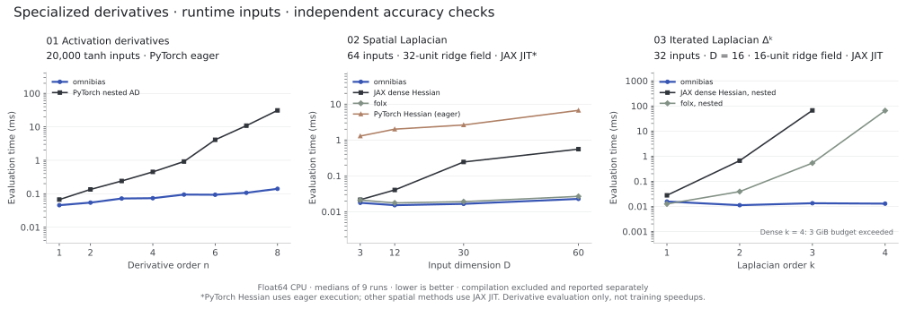
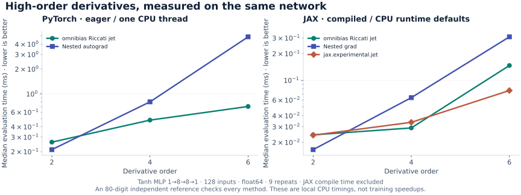

# Performance by workload

Activation derivatives, one-layer operator contractions and deep-network jets
are different computational problems. Compare timings within a workload, with
matching models, shapes, dtypes and execution policies. None of these timings
is an end-to-end PDE-training speedup.

## Full-scope matrix

<!-- BEGIN GENERATED FULL SCOPE -->

Ratio = baseline time / omnibias time; every row of [`docs/benchmarks/full_scope.json`](benchmarks/full_scope.json) names its record, interval and verdict (`big win`: lower bound >= 2, `win`: lower bound > 1, `parity`: the interval contains 1, `loss`: upper bound < 1, `incomplete`: no qualified baseline in the record). Rows are cells (an operator at one configuration against one baseline tier).

**Against independent baselines** (nested autodiff, dense Hessian and Jacobian, `jax.experimental.jet`, `folx`, PyTorch `jet_collapsed`, DeepXDE, GMRES, explicit grids):

| family | cells | big win | win | parity | loss | incomplete | ratio range |
|---|---:|---:|---:|---:|---:|---:|---|
| Activation derivatives | 16 | 7 | 1 | 8 | 0 | 0 | 1.00-220× |
| Deep Laplacian, per-call grid | 3,800 | 1,681 | 1,004 | 701 | 361 | 53 | 0.27-87.9× |
| Deep Laplacian, projected | 253 | 235 | 14 | 3 | 1 | 0 | 0.94-116× |
| Divergence and log-determinant | 64 | 55 | 2 | 5 | 1 | 1 | 0.98-1,229× |
| End-to-end time to target | 395 | 105 | 64 | 39 | 47 | 140 | 0.16-51.8× |
| Higher-order operators | 638 | 259 | 182 | 21 | 31 | 145 | 0.33-5,036× |
| Interop adapters and drop-ins | 44 | 17 | 8 | 2 | 17 | 0 | 0.12-40.9× |
| One-layer Laplacian | 12 | 7 | 4 | 1 | 0 | 0 | 1.15-294× |
| Operator compiler | 19 | 7 | 2 | 5 | 5 | 0 | 0.32-2,373× |
| Residual Gram, Gauss-Newton step, NTK diagonal | 440 | 353 | 33 | 1 | 0 | 53 | 1.00-44.2× |
| Residual solves | 63 | 57 | 0 | 6 | 0 | 0 | 0.93-2,969× |
| Ridge and tensor-grid losses | 1,202 | 656 | 382 | 30 | 0 | 134 | 0.94-7,238× |
| Training step | 34 | 14 | 4 | 1 | 2 | 13 | 0.86-485× |
| **all** | 6,980 | 3,453 | 1,700 | 823 | 465 | 539 | |

**Against engines fed omnibias's own first-layer projection** (the generic engine is `folx` or collapsed Taylor mode on the reduced function; the projection is omnibias's):

| family | cells | big win | win | parity | loss | incomplete | ratio range |
|---|---:|---:|---:|---:|---:|---:|---|
| Deep Laplacian, projected | 112 | 0 | 62 | 33 | 17 | 0 | 0.84-1.60× |
| Divergence and log-determinant | 96 | 9 | 46 | 40 | 1 | 0 | 0.90-4.77× |
| Higher-order operators | 92 | 3 | 62 | 7 | 20 | 0 | 0.30-2.30× |
| **all** | 300 | 12 | 170 | 80 | 38 | 0 | |

**Against omnibias's own variants and hand-written closed forms** (a loss here is one omnibias program beating another):

| family | cells | big win | win | parity | loss | incomplete | ratio range |
|---|---:|---:|---:|---:|---:|---:|---|
| Deep Laplacian, projected | 287 | 143 | 39 | 35 | 10 | 60 | 0.75-615× |
| Divergence and log-determinant | 80 | 70 | 5 | 4 | 1 | 0 | 0.94-1,237× |
| End-to-end time to target | 16 | 4 | 6 | 2 | 4 | 0 | 0.83-22.7× |
| Higher-order operators | 126 | 108 | 4 | 6 | 0 | 8 | 1.00-78.7× |
| Operator compiler | 22 | 0 | 2 | 8 | 12 | 0 | 0.33-1.12× |
| Residual Gram, Gauss-Newton step, NTK diagonal | 382 | 229 | 88 | 28 | 16 | 21 | 0.94-77.3× |
| Residual solves | 181 | 30 | 27 | 33 | 71 | 20 | 0.13-12.6× |
| Ridge and tensor-grid losses | 420 | 191 | 145 | 47 | 36 | 1 | 0.35-59.7× |
| **all** | 1,514 | 775 | 316 | 163 | 150 | 110 | |

**Per operator, independent baselines:**

| operator | cells | big win | win | parity | loss | incomplete | ratio range |
|---|---:|---:|---:|---:|---:|---:|---|
| DeepXDE adapter | 6 | 3 | 1 | 1 | 1 | 0 | 0.76-18.2× |
| Laplacian (deep) | 105 | 92 | 9 | 3 | 1 | 0 | 0.94-116× |
| Laplacian (deep, per call) | 3,800 | 1,681 | 1,004 | 701 | 361 | 53 | 0.27-87.9× |
| Laplacian (one layer) | 12 | 7 | 4 | 1 | 0 | 0 | 1.15-294× |
| Laplacian (point diffusion) | 60 | 60 | 0 | 0 | 0 | 0 | 2.20-34.9× |
| Laplacian (time-dependent) | 88 | 83 | 5 | 0 | 0 | 0 | 1.86-90.9× |
| NTK diagonal | 72 | 57 | 2 | 1 | 0 | 12 | 1.00-10.8× |
| NTK diagonal (projected) | 39 | 39 | 0 | 0 | 0 | 0 | 4.49-44.2× |
| PINA adapter | 6 | 3 | 0 | 1 | 2 | 0 | 0.55-13.2× |
| activation derivative | 16 | 7 | 1 | 8 | 0 | 0 | 1.00-220× |
| bi-Laplacian | 212 | 117 | 60 | 8 | 1 | 26 | 0.90-179× |
| bi-Laplacian (deep, per call) | 96 | 26 | 25 | 0 | 0 | 45 | 1.31-31.7× |
| bi-Laplacian (time-dependent) | 138 | 74 | 37 | 1 | 2 | 24 | 0.84-184× |
| divergence | 32 | 27 | 2 | 1 | 1 | 1 | 0.98-229× |
| folx drop-in (folx_compat) | 16 | 4 | 3 | 0 | 9 | 0 | 0.12-40.9× |
| fourth-order residual Gram | 141 | 107 | 11 | 0 | 0 | 23 | 1.38-21.4× |
| log-determinant | 32 | 28 | 0 | 4 | 0 | 0 | 1.01-1,229× |
| operator compiler | 19 | 7 | 2 | 5 | 5 | 0 | 0.32-2,373× |
| planner on a folx call | 16 | 7 | 4 | 0 | 5 | 0 | 0.34-36.9× |
| poly-Laplacian (one layer) | 8 | 5 | 1 | 0 | 1 | 1 | 0.80-5,036× |
| residual Gram (projected) | 50 | 48 | 2 | 0 | 0 | 0 | 2.29-34.9× |
| residual Gram and Gauss-Newton step | 138 | 102 | 18 | 0 | 0 | 18 | 1.21-14.9× |
| residual solve (Woodbury) | 63 | 57 | 0 | 6 | 0 | 0 | 0.93-2,969× |
| ridge operators against Taylor mode | 224 | 49 | 101 | 2 | 0 | 72 | 1.02-191× |
| ridge residual loss | 160 | 44 | 99 | 6 | 0 | 11 | 1.01-17.0× |
| ridge value-and-gradient (fused) | 100 | 30 | 63 | 0 | 0 | 7 | 1.05-14.7× |
| separable-grid Gauss-Newton step | 144 | 62 | 61 | 19 | 0 | 2 | 0.94-14.8× |
| separable-grid loss | 144 | 88 | 54 | 2 | 0 | 0 | 1.13-11.4× |
| tensor-grid Gauss-Newton step | 120 | 102 | 0 | 0 | 0 | 18 | 37.2-7,238× |
| tensor-grid loss | 190 | 174 | 4 | 1 | 0 | 11 | 0.99-149× |
| tensor-grid training step | 120 | 107 | 0 | 0 | 0 | 13 | 3.13-180× |
| third-order directional derivative (per call) | 144 | 9 | 59 | 12 | 15 | 49 | 0.67-2.72× |
| time to target (end to end) | 395 | 105 | 64 | 39 | 47 | 140 | 0.16-51.8× |
| training step | 34 | 14 | 4 | 1 | 2 | 13 | 0.86-485× |
| tri-Laplacian / PFC residual | 40 | 28 | 0 | 0 | 12 | 0 | 0.33-212× |
| **all** | 6,980 | 3,453 | 1,700 | 823 | 465 | 539 | |

**Where an independent baseline is faster:** every operator, back end and baseline with at least one loss cell. Cells that tie are counted under parity; the cell list with its record, interval and basis is in the JSON.

| operator | backend | baseline | cells | loss | parity | ratio range of the losses |
|---|---|---|---:|---:|---:|---|
| Laplacian (deep, per call) | jax | `folx_sparse` | 538 | 121 | 181 | 0.27-0.99× |
| Laplacian (deep, per call) | torch | `jet_collapsed` | 494 | 111 | 91 | 0.39-0.99× |
| Laplacian (deep, per call) | jax | `folx_forward` | 538 | 104 | 197 | 0.28-0.99× |
| time to target (end to end) | jax | `adam:jet` | 67 | 15 | 7 | 0.16-0.75× |
| time to target (end to end) | jax | `adam:dense` | 34 | 12 | 10 | 0.63-0.99× |
| Laplacian (deep, per call) | jax | `jax_forward_over_reverse` | 463 | 9 | 83 | 0.75-0.98× |
| Laplacian (deep, per call) | jax | `jax_jet_taylor` | 525 | 9 | 75 | 0.75-0.94× |
| folx drop-in (folx_compat) | jax | `folx.forward_laplacian` | 16 | 9 | 0 | 0.12-0.89× |
| Laplacian (deep, per call) | jax | `jax_hessian_trace` | 463 | 7 | 74 | 0.75-0.98× |
| third-order directional derivative (per call) | jax | `jax_nested_jvp` | 22 | 7 | 7 | 0.72-0.90× |
| time to target (end to end) | jax | `lbfgs:dense` | 10 | 6 | 4 | 0.82-0.95× |
| planner on a folx call | jax | `folx.forward_laplacian` | 16 | 5 | 0 | 0.34-0.90× |
| third-order directional derivative (per call) | jax | `jax_jet_taylor` | 26 | 4 | 5 | 0.67-0.91× |
| third-order directional derivative (per call) | jax | `nested jax.jvp` | 24 | 4 | 0 | 0.75-0.93× |
| time to target (end to end) | jax | `adam:sdgd` | 15 | 4 | 2 | 0.37-0.46× |
| time to target (end to end) | jax | `spring:dense` | 4 | 4 | 0 | 0.76-0.77× |
| tri-Laplacian / PFC residual | jax | `folx3` | 8 | 4 | 0 | 0.33-0.74× |
| tri-Laplacian / PFC residual | jax | `full_comp` | 24 | 4 | 0 | 0.56-0.82× |
| tri-Laplacian / PFC residual | jax | `jet` | 6 | 4 | 0 | 0.55-0.62× |
| operator compiler | jax/torch | `folx` | 6 | 3 | 0 | 0.32-0.71× |
| time to target (end to end) | jax | `adam:stde` | 6 | 3 | 0 | 0.25-0.45× |
| PINA adapter | torch | `PINA operator on its own autograd graph` | 6 | 2 | 1 | 0.55-0.58× |
| bi-Laplacian (time-dependent) | jax | `forward_bilaplacian_full_seed` | 48 | 2 | 1 | 0.84-0.88× |
| time to target (end to end) | jax | `gn:dense` | 4 | 2 | 2 | 0.59-0.59× |
| training step | jax | `folx_forward` | 8 | 2 | 1 | 0.86-0.91× |
| DeepXDE adapter | torch | `DeepXDE operator on its own autograd graph` | 6 | 1 | 1 | 0.76-0.76× |
| Laplacian (deep) | jax | `forward_laplacian_full_seed` | 9 | 1 | 2 | 0.97-0.97× |
| bi-Laplacian | jax | `forward_bilaplacian_full_seed` | 72 | 1 | 5 | 0.97-0.97× |
| divergence | jax | `autodiff_jacobian` | 32 | 1 | 1 | 0.98-0.98× |
| operator compiler | jax/torch | `jax-jet` | 2 | 1 | 0 | 0.39-0.39× |
| operator compiler | jax/torch | `jax-nested` | 3 | 1 | 0 | 0.54-0.54× |
| poly-Laplacian (one layer) | jax/torch | `folx_nested` | 4 | 1 | 0 | 0.80-0.80× |
| time to target (end to end) | jax | `adam:hutch` | 16 | 1 | 4 | 0.47-0.47× |

<!-- END GENERATED FULL SCOPE -->

## Protocol and accounting

**Ratios.** Every figure is `baseline time / omnibias time` (memory: baseline bytes over omnibias bytes), so above 1 omnibias is
faster. A row of the matrix is one operator at one configuration against one baseline tier, with its record, interval and
basis; the verdict comes from the interval, never from a point estimate alone. The strongest baseline of a cell is the fastest
completed independent method: nested autodiff, dense Hessian or Jacobian, `jax.experimental.jet`, `folx` (dense and sparse),
PyTorch `jet_collapsed`, DeepXDE, GMRES or an explicit grid.

**Kinds of baseline.** *External* rows compare with another package or a generic autodiff program. *Engine on omnibias
projection* rows feed `folx` or collapsed Taylor mode omnibias's own first-layer projection, so the projection is shared and
only the engine differs. *Omnibias variant* and *hand-written* rows compare one omnibias program with another or with a
hand-written closed form; a loss there selects the fastest variant per regime and is not a competitor winning. Where two
implementations trade places, both ship and the caller chooses.

**Same backend, so differences are algorithmic.** The omnibias JAX programs, `folx`, `jax.experimental.jet` and nested
autodiff all lower through the same XLA, and the PyTorch programs use the same ATen, cuBLAS and Triton stack. The repository
holds no C, C++, CUDA or Rust source, so a ratio compares differentiation strategies, not runtimes.

**Deep closed forms compose to any depth.** The stream engines (`omnibias.jax.experimental.streams` and its PyTorch twin)
carry value, tangents and the second-order stream per layer: one matrix product and one elementwise Faà di Bruno update from
the closed-form activation tower, which comes from a single base evaluation. This holds for every activation with a fast-path
kernel; one whose derivatives jump is refused unless the caller opts in, and none is approximated. Derivatives with respect
to the parameters come from reverse-mode autodiff through that program: the closed form replaces nested spatial autodiff, not
parameter autodiff. `DEFAULT_LAYOUT` selects the stacked or the split array layout of the streams; both are exact. `"auto"`, the
default, takes the split layout on a CPU, while a training program is traced (`training_layout()`, which `compile_training_step`
and a planned operator built with `differentiate="params"` enter) and whenever the weights or points are being differentiated
(`jax.grad`, `jax.value_and_grad`, `jax.jvp`, detected from the tracers at trace time), and the stack for forward-only calls on an
accelerator except float64 calls of at most two hidden layers ([measurements](#stream-layout)). The PyTorch twin takes the split layout in
eager calls and in a captured call that gradients flow through, and the stack while a forward-only call is captured in a CUDA graph or
`torch.compile` traces ([measurements](#pytorch-stream-layout)).

**Exact engines follow the same trajectory.** Programs that evaluate the same derivative exactly give the same residual and
gradient up to rounding, so for one optimizer and seed the per-step ratio is the time-to-the-same-accuracy ratio. State accuracy
next to speed only for estimates (Hutchinson, SDGD, STDE) or when the optimizer differs.

**Accounting.**

- Compile time is reported apart from steady execution and is not part of a per-call or per-step claim.
- A baseline that fails inside omnibias's own construction code is incomplete, not evidence about the baseline; a baseline that
  runs out of memory or time under the stated budget is a resource refusal and carries no speedup.
- Memory is not constant. It grows with batch, width, depth and the number of streams the program carries.
- The structured programs cover chains of dense layers. A model that is not one runs on the generic engines
  ([operator planner](operator-planner.md#models-that-are-not-dense-chains)); transformers, graph networks and neural
  operators are outside them.
- Order two on a narrow deep network is the recursion that `folx` and collapsed Taylor mode also run, so only constants
  (launches, fusion) differ; the advantage grows with derivative order and with `D / H`, where the other programs carry more
  directions. With `D <= H` the first-layer projection reduces nothing.
- End-to-end training is a separate result ([end-to-end training](operator-planner.md#end-to-end-training)).
- **Records and re-measurement.** A cell that two records cover takes the newer farm record only when that record declares
  `"supersedes": [<older record>]` in its header; two farm records on one cell without it are a build error. Rows marked
  `role=superseded_*` are replaced by the same record's `role=fix_verification` row of the cell. The older rows stay in their file;
  the matrix and its counts use the newer ones. The per-call grid records are
  [`farm_percall_jax_a100.json`](benchmarks/farm_percall_jax_a100.json), [`farm_percall_jax_cpu.json`](benchmarks/farm_percall_jax_cpu.json),
  [`farm_percall_torch_a100.json`](benchmarks/farm_percall_torch_a100.json) and
  [`farm_percall_torch_cpu.json`](benchmarks/farm_percall_torch_cpu.json); the end-to-end re-run is
  [`farm_time_to_target_rerun.json`](benchmarks/farm_time_to_target_rerun.json).
- **Cross-framework comparisons.** The operator compiler's PyTorch backend and a JAX `jit` baseline are different runtimes. On one CPU
  thread the compiled PyTorch operator is 0.32 to 0.71 of `folx`, `jax-manual` and `keras-jax` in the matrix, with a per-call floor of
  about 0.33 ms, while it is at parity (0.94 to 1.09) with its own PyTorch reference: the gap is a dispatch floor, not a derivative method.
  No `torch.compile` lowering of the operator compiler was written or measured.

## Direct activation derivatives

20,000 tanh inputs, float64, PyTorch eager with one CPU thread. Both methods
return the requested derivative; the final nested-autograd result does not
retain an additional training graph. Nine timed repeats follow two warmups.

| Order | Closed form | Nested autograd | Speedup |
| --- | ---: | ---: | ---: |
| 1 | 0.0455 ms | 0.0669 ms | 1.5× |
| 2 | 0.0543 ms | 0.1345 ms | 2.5× |
| 3 | 0.0720 ms | 0.2405 ms | 3.3× |
| 4 | 0.0736 ms | 0.4496 ms | 6.1× |
| 5 | 0.0944 ms | 0.9184 ms | 9.7× |
| 6 | 0.0933 ms | 4.0961 ms | 43.9× |
| 7 | 0.1068 ms | 10.8289 ms | 101.4× |
| 8 | 0.1405 ms | 30.9908 ms | 220.5× |

[Raw activation measurements](benchmarks/derivative_order.json) include an
independent 80-digit reference at 33 points, finite-difference errors and
cross-backend differences. A roughly flat small-order timing curve is not an
asymptotic `O(1)` claim: polynomial evaluation still grows with order.

## One-layer Laplacian

`f(x) = sum_h c_h tanh(w_h.x + beta_h)`, 64 points and 32 hidden units.
JAX methods are compiled; `torch.func.hessian` runs eagerly with one thread.
The last column is a cross-framework execution comparison, not an isolated
algorithmic speedup. All input arrays and parameters are runtime arguments.

| Dimension | omnibias JIT | folx JIT | JAX Hessian JIT | Torch Hessian eager |
| --- | ---: | ---: | ---: | ---: |
| 3 | 0.0177 ms | 0.0210 ms | 0.0215 ms | 1.2872 ms |
| 12 | 0.0152 ms | 0.0176 ms | 0.0403 ms | 2.0020 ms |
| 30 | 0.0165 ms | 0.0190 ms | 0.2433 ms | 2.6206 ms |
| 60 | 0.0227 ms | 0.0267 ms | 0.5544 ms | 6.6897 ms |

[Raw Laplacian measurements](benchmarks/laplacian_scaling.json) record compile
cost, first execution, all steady-state samples and independent accuracy.

## Repeated one-layer Laplacian

32 points, 16 hidden units, 16 dimensions. Each JAX method runs in a fresh
subprocess with a 120-second wall budget and 3 GiB RSS budget, including
imports, compilation and accuracy validation. Successful cells report only
steady-state execution; a budget termination has no fabricated timing.

| Operator | omnibias | folx nested | Dense JAX nested |
| --- | ---: | ---: | ---: |
| `Δ^1` | 0.0156 ms | 0.0125 ms | 0.0276 ms |
| `Δ^2` | 0.0112 ms | 0.0389 ms | 0.6615 ms |
| `Δ^3` | 0.0134 ms | 0.5318 ms | 66.4122 ms |
| `Δ^4` | 0.0129 ms | 64.8343 ms | memory_budget (3 GiB) |

At `k = 1`, folx is faster than omnibias in this run. The large gains appear
at higher repeated-Laplacian orders.

[Raw repeated-Laplacian measurements](benchmarks/polylaplacian_order.json)
include resource observations, compilation costs and independent 80-digit
accuracy checks. A memory-budget result is a bounded experiment, not a proof
that the baseline cannot run on a larger machine.



## Benchmark protocol

Operator benchmarks pass coordinates and parameters as runtime arguments and report compilation apart from execution. A
zero-argument function that captures them as constants lets XLA fold the operator into a constant result, which is not an
evaluation of a changing field; the [compiler audit](benchmarks/laplacian_scaling.json) records both forms. The activation
benchmark stops retaining a graph after the final requested nested derivative, matching the derivative-only task. The general
deep-MLP benchmark below propagates complete directional jets through multiple nonlinear layers and complements the direct
operators.

Reproduce from a development checkout:

```bash
uv run --all-packages python benchmarks/derivative_order.py
uv run --all-packages --with folx python benchmarks/laplacian_scaling.py
uv run --all-packages --with folx python benchmarks/polylaplacian_order.py
```

Outputs go to `artifacts/`, or `$OMNIBIAS_SCRATCH`. See each JSON configuration
for versions, seeds, dtypes, shapes and source hashes. Dirty working trees
record a base commit plus hashes of the actual measured files. When later
maintenance changes a measured file, its exact historical version is retained
in [content-addressed source snapshots](benchmarks/sources/README.md).

## Precision is measured separately from speed

Exact derivative identities remove recursive spatial autodiff; they do not
remove floating-point conditioning. The shared integer coefficients are exact,
but evaluating their polynomials can lose significant digits through
cancellation. That behavior is present in the kernels retained from the
pre-separation checkpoint.

The [bounded precision probe](benchmarks/precision_sweep.json) compares both
closed-form backends and JAX Taylor-mode AD against an independent 80-digit
reference. At `tanh`, `z = 3`, order 16, the closed-form relative error is
`7.09e-7`, versus `2.60e-13` for JAX Taylor mode. At `z = 0.1`, the same
closed-form derivative is within one float64 ULP. These are pointwise examples,
not exhaustive error bounds. Neither universal bit identity nor universal
high-order failure of another framework follows from the activation formula.

Reproduce the four-point/order cases with
`uv run --all-packages python benchmarks/precision_sweep.py`. Workload timings and pointwise
accuracy answer different questions; choose an algorithm that satisfies both
your cost and error requirements.

The separate [float32/float64 activation study](benchmarks/activation_precision_study.json)
checks 141 inputs through order 16, including parameter gradients. Existing
stable Taylor providers improve saturated-tail behavior; the shipped dense
polynomial fastpaths are not universally more accurate. In JAX 0.10.2,
`jet` drops `tanh`'s highest-accuracy setting. A tested local patch restores
that opt-in path, while highest-accuracy ordinary JAX AD already provides a
stable alternative. The [research record](bias-collapse-pde.md#float32-accuracy-and-an-opt-in-jax-taylor-rule-repair)
includes the patch, application checks and remaining intermediate-underflow
limits. This study makes no speed or general PINN-accuracy claim.

The separate [verified-enclosure comparison](benchmarks/verified_tanh_study.json)
uses 54 point cases and 20 boxes, including scaled tails. A controlled
recurrence/log-scaled implementation meets every point error budget, but its
geometric speed ratio against the fastest eligible classical interval control
is **0.5353x**. The strongest multiprecision monomial control also meets all
point budgets. The [replayed research record](bias-collapse-pde.md#verified-activation-bounds-tighter-enclosures-no-matched-control-speedup)
keeps this negative result, source provenance, refusals and the serialization
correction used by its separate replay checker. These are CPU primitive costs,
not PDE-training or certification-workflow timings.

## General deep-network jets



This run measures **input-derivative evaluation**, not end-to-end training:
a `1 → 8 → 8 → 1` tanh MLP, 128 points, float64, CPU, fixed weights and seed,
nine timed repeats. JAX timings synchronize results and exclude compilation;
PyTorch runs eagerly with one thread. Compare methods within each panel:
framework execution and thread policies differ.

| Order | Torch nested AD | Torch omnibias | JAX nested AD | JAX Taylor AD | JAX omnibias |
| --- | ---: | ---: | ---: | ---: | ---: |
| 2 | **0.211 ms** | 0.261 ms | **0.016 ms** | 0.024 ms | 0.024 ms |
| 4 | 0.799 ms | **0.481 ms** | 0.064 ms | 0.034 ms | **0.029 ms** |
| 6 | 4.885 ms | **0.703 ms** | 0.309 ms | **0.077 ms** | 0.147 ms |

At order six, omnibias was **6.9× faster than nested PyTorch autograd** in this
run. At order two, nested autodiff won in both backends.
JAX's existing Taylor-mode `jet` also beat omnibias at order six. Taylor-mode AD is an
important alternative, and the comparison includes it rather than treating
nested autodiff as the only baseline.

The [measurement artifact](benchmarks/readme_derivatives.json) records
every result, separate compilation and first-call times, sample timings,
source hashes, working-tree status, versions and independent **80-digit mpmath**
accuracy checks. A dirty working tree labels its recorded revision as the base
commit; source hashes identify the measured files.
Rerun the bounded experiment on your hardware:

```bash
uv run --all-packages python benchmarks/readme_derivatives.py
```

Results go to `artifacts/`, or `$OMNIBIAS_SCRATCH` when set. The
[benchmark guide](https://github.com/derivon-ai/omnibias/tree/main/benchmarks) covers other derivative workloads.
Speed depends on architecture, order, batch size, dtype and execution mode.

## Training programs for one-layer tanh ridge operators (experimental)

[`omnibias.jax.experimental.tanh_ridge_residual_loss`](api/jax.md) is an opt-in
value-and-gradient program for the mean-square residual of constant-coefficient
operators on `u(x) = sum_h c_h tanh(w_h.x + b_h)`: `Δ^k`, `∂_x^n` and sums of
them. Every term has the exact ridge form `|w|^(2k) φ_(2k)(z)` or `w_i^n φ_n(z)`.
The reverse rule recomputes `z`, so no `(B, H)` array is stored, and it keeps the
live `|w|^(2k)` factor so gradients reach `W`, `b` and `c`. This is not a general
activation or deep-network method.

This section is training-program cost, not derivative-only evaluation. All rows
are float64 on one exclusive NVIDIA A100-SXM4-80GB with JAX 0.10.2. Each cell is
three fresh processes in rotating method order, three warmups and 51
synchronized samples; the ratio is the strongest control's median over the
program's median, paired by process, and `lower95` is
`exp(mean(log r) - 2.920 sd(log r)/sqrt(3))`. Every compared method passes
float64 gradient checks against 40-digit mpmath on a row subset (gradients
`1e-8` / `2e-9`, values `1e-9` / `2e-10`), and full-size outputs are finite and
agree with the strongest control. Controls use the same projection structure,
rematerialization and readout: autodiff of the same closed form, Riccati and JAX
Taylor-mode engines in two structures each, and the released
`neural_field_polylaplacian` compiler for Laplacian powers.

| Workload | Input dim | Regime | Cells | Lower95 ≥ 1 | Parity | Loss | Ratio range | Smallest lower95 |
| --- | --- | --- | ---: | ---: | ---: | ---: | --- | ---: |
| Heat, Burgers, hyperdiffusion 4/6, polyharmonic 2/3 | 2 | value + gradient | 16 | 16 | 0 | 0 | 1.25–1.37× | 1.17 |
| same | 2 | 100 Adam steps | 4 | 4 | 0 | 0 | 1.31–1.37× | 1.30 |
| `Δ`, `Δ²`, `Δ³`, `∂²`, `∂⁴`, `∂⁶`, mixed | 2 | value + gradient | 14 | 14 | 0 | 0 | 1.09–1.30× | 1.06 |
| same | 3 | value + gradient | 14 | 14 | 0 | 0 | 1.09–1.58× | 1.02 |
| same | 2 | 100 Adam steps | 3 | 3 | 0 | 0 | 1.16–1.29× | 1.15 |
| same | 3 | 100 Adam steps | 3 | 3 | 0 | 0 | 1.15–1.40× | 1.14 |
| same | 8 | value + gradient | 14 | 8 | 0 | 6 | 0.91–1.62× | 0.89 |
| same | 8 | 100 Adam steps | 3 | 2 | 0 | 1 | 0.99–1.60× | 0.97 |
| same | 16 | value + gradient | 18 | 8 | 5 | 5 | 0.89–1.16× | 0.60 |
| same | 16 | 100 Adam steps | 3 | 1 | 1 | 1 | 0.99–1.19× | 0.99 |

No row reaches the 2× significance bar. The measured advantage is
1.1–1.6× per training step in input dimensions two and three, for derivative
orders two to six, at batch sizes of 65,536 and 1,048,576 points with 64 or
256 hidden units. The strongest control is usually autodiff of the same closed
form or the released compiler. Against this program's own previous custom
reverse rule (without the restructured backward pass) the ratio is 1.06–1.26×
for dimensions up to eight and 0.82–1.15× at `D = 16`.

The rows above were measured with the benchmark implementation of this program.
The shipped module was measured separately in 20 value-and-gradient cells
(`D = 2, 3, 8`; `Δ`, `Δ³`, `∂⁴`, `∂⁶` and mixed operators; same controls and
rotation): 18 have `lower95 ≥ 1` and the two losses are `D = 8` Laplacian powers
(0.92× and 0.95×). Its median time is within 0.95–1.03× of the benchmark
implementation in every cell. The `D > 8` code path of the module is covered by
tests only, not by this timing check.

### Against network-level Taylor mode

A later matched run, with a new seed and new cells, also timed this benchmark
implementation against general higher-order autodiff of the network `u(x)`:
JAX Taylor mode (`jet`) and collapsed Taylor mode along exact polarization
directions, nested forward-mode autodiff per monomial, and folx's forward
Laplacian for `Δ` to `Δ³`. Each baseline ran only where it applies (for example,
at most 400 polarization directions). The protocol, accuracy checks and fairness
rules are the ones above. This is a secondary analysis of that run; its
pre-registered candidate was a fused GPU kernel that is not shipped. The run also
included Taylor mode in the ridge variable `z` per hidden unit, a structure-aware
baseline that uses the same one-layer structure as this program.

| Workload | Input dim | Cells | Network-level: lower95 ≥ 2 / ≥ 1 / incomplete | Ratio, geometric mean (range) | Per-unit Taylor in `z`: lower95 ≥ 1 / parity / loss | Ratio, geometric mean (range) |
| --- | --- | ---: | --- | --- | --- | --- |
| Heat, Burgers, hyperdiffusion 4/6, polyharmonic 2/3 (16,384 points × 288 units; 49,152 × 96) | 2 | 16 | 14 / 2 / 0 | 3.48× (1.93–11.9×) | 16 / 0 / 0 | 1.34× (1.16–1.57×) |
| `Δ`, `Δ²`, `Δ³`, `∂⁴`, `0.5Δ + 0.25Δ² + 0.125Δ³` | 2, 3, 5, 12 | 20 | 9 / 4 / 7 | 6.1× (1.33–49.7×) | 18 / 2 / 0 | 1.35× (1.02–1.68×) |

"Incomplete" means a network-level baseline ran out of memory or failed to
compile (4 cells; never promoted, and excluded from the geometric means) or none
applied (3 cells). Ratios below 2× occur for `Δ` against folx (1.33–1.46×) and
for the second-order heat equation against nested forward mode (1.93–1.97×).
Higher derivative orders carry more directions or monomials in the network-level
methods, which is where the large ratios come from. Per-unit Taylor mode in `z`
is the stronger baseline. For the seven other operators in that run, the
closed-form program timed was autodiff of the operator symbol, not this module's
reverse rule, and it lost to per-unit Taylor mode in all 28 cells (0.54–0.80×).
Four of those operators are accepted by this module but were not timed with it:
anisotropic second-order sums, advection–diffusion, and the linearized KdV and
Kuramoto–Sivashinsky operators. The other three are outside its interface:
Helmholtz, `∂₀∂₁ + 0.5∂₀² − 0.5∂₁²` and an anisotropic biharmonic.
[Raw rows](benchmarks/ridge_taylor_mode_a100.json).

Where it does not help:

- **Pure Laplacian powers at `D = 8` and `D = 16`** lose or tie against the released
  compiler (`0.91–1.04×`, `H = 64` and `256`). Mixed and coordinate-derivative
  operators still win at `D = 8` (1.03–1.62×) and in 8 of 9 such cells at `D = 16`
  (the exception is the launch-bound problem below).
- **A launch-bound problem** (`D = 16`, `H = 16`, 4,096 points) has `0.89–1.01×`.
- **Forward-only residuals** are not this program's regime. The closed-form
  forward programs measured at `D = 16` and in the `D = 2` PDE residuals ran
  at `0.80–1.05×` of the strongest control (a control was usually faster). Forward cells at `D = 3` were not measured:
  the forward-only small-`D` programs of every method hit a very slow XLA
  compile (190–610 s) on this stack.
- **Cold cost is larger.** Lowering, compile and first call take 0.8–1.9 s
  (median 1.1 s) for this program and 0.5–2.6 s for the controls. Including that
  cost, the per-evaluation advantage pays for itself after roughly 100–10,000
  value-and-gradient evaluations (group medians 2,000–3,500) in dimensions two and
  three; at `D = 8` the largest grid values are 100,000 and two Laplacian cells
  never reach a lower bound of one against every control. At one evaluation the total cost is `0.34–0.94×` of the strongest control
  in those dimensions. A persistent compilation cache reduces repeated-process
  lowering, compile and first-call time from about 1.7 s to 0.05 s in the cases
  measured.

These ratios were measured with the same hardware and library versions for the
candidate and every control; they are not an end-to-end PDE-training speedup,
and neither these programs nor the fast front end establish convergence or
conditioning for any PDE. The default `1 − tanh²` form loses relative accuracy
in the tails; `accurate_tails=True` uses an exponential form at a measured extra
cost.

[Raw cell results](benchmarks/tanh_ridge_training_a100.json) keep wins, parity,
losses and suppressions together.

## Derivative-closed activations: one-layer `sin` ridge operators (experimental)

[`omnibias.jax.experimental.closed_ridge_residual_loss`](api/jax.md) applies when
the activation satisfies a linear constant-coefficient system `v' = C v`,
`σ = a·v` (`sin`, `cos`, `exp`). Then `σ^(m) = (a C^m)·v` exactly, and every
constant-coefficient operator of `u(x) = sum_h c_h σ(w_h.x + b_h)` collapses to
`len(v)` feature columns. For `sin` those are `sin z` and `cos z`, with the phase
cycle as rows. The `(B, H)` work is independent of derivative order and of the
number of terms; only `O(H)` symbol work grows with them.

Same hardware, protocol, accuracy checks and statistic as the tanh section, with
a new seed and new cells: 73,728 points × 160 units (`D = 3`), 131,072 × 96
(`D = 6`), 163,840 × 80 (`D = 7`) and 65,536 × 192 (`D = 16`). Ten operators:
`Δ`, `Δ²`, `Δ³`, `Δ⁴`, `∂₁⁴`, `∂₁⁸`, an anisotropic second-order sum, an
advection–diffusion operator, and the linearized KdV and Kuramoto–Sivashinsky
operators. Value and gradient of the mean-square residual.

| Baseline tier | Cells | Lower95 ≥ 2 / ≥ 1 / parity / loss / incomplete | Ratio, geometric mean (range) |
| --- | ---: | --- | --- |
| Network-level Taylor mode (`jet`, collapsed Taylor, nested forward mode, folx) | 40 | 21 / 13 / 0 / 0 / 6 | 2.62× (1.16–11.8×) |
| Per-unit Taylor mode in `z` | 40 | 0 / 35 / 5 / 0 / 0 | 1.30× (1.01–1.82×) |
| Closed-form benchmark programs (autodiff of the collapsed symbol, one-pass manual gradient) | 40 | 0 / 15 / 4 / 21 / 0 | 1.01× (0.84–1.20×) |

The largest network-level ratios come from operators that need many directions
(anisotropic sums and advection–diffusion, 3–12×) and from `Δ³` against folx
(2.6–4.0×). Single-axis `∂⁴` and `∂⁸` against nested forward mode (1.2–2.0×) and
`Δ` against folx (1.4–1.75×) stay below 2×. No network-level baseline ran `Δ⁴` in
any cell (too many directions, out of memory, or not supported), so those five
cells are counted as incomplete, not as wins.

Where it does not help:

- **Against closed-form programs in XLA at `D ≥ 7`** the module is 2–16 % slower
  (0.84–0.98×); it wins at `D = 3` and `D = 6` (1.03–1.20×). Its reverse rule
  recomputes the projection instead of storing it.
- **An earlier version had a `D = 8` defect.** It used the unrolled projection of
  the tanh module inside the recomputing reverse rule, and was 2.7–2.9× slower
  than the same algorithm in the benchmark harness at `D = 8`, `H = 64`. The
  module now unrolls only for `D ≤ 6`. A re-measurement of that cell gives
  1.00–1.04× of the benchmark program, 2.67× (1.39–7.37×) against network-level
  Taylor mode and 1.24× against per-unit Taylor mode. The earlier rows are kept
  in the raw results, marked as superseded.
- `cos` and `exp` are covered by tests, not by timing. Large `|w|^(2k)` or large
  `exp` arguments can overflow, and cancellation in the residual is not removed.

[Raw cell results](benchmarks/closed_ridge_training_a100.json).

### Fused GPU kernels for the same quantity

[`omnibias.jax.experimental.fused_closed_ridge_value_and_grad`](api/jax.md)
computes the same value and gradient with float64 Pallas GPU kernels: one pass
over the points for `D ≤ 4`, two kernels otherwise. It was measured in a separate
matched run with a new seed and new cells: 57,344 points × 224 units (`D = 2`),
114,688 × 112 (`D = 4`), 40,960 × 320 (`D = 5`), 180,224 × 72 (`D = 10`) and
49,152 × 256 (`D = 20`), with the same ten operators, protocol and accuracy checks.

| Baseline tier | Cells | Lower95 ≥ 2 / ≥ 1 / parity / loss / incomplete | Ratio, geometric mean (range) |
| --- | ---: | --- | --- |
| Network-level Taylor mode | 50 | 30 / 13 / 0 / 0 / 7 | 3.06× (1.42–14.7×) |
| Per-unit Taylor mode in `z` | 50 | 0 / 50 / 0 / 0 / 0 | 1.51× (1.05–2.11×) |
| Closed forms in XLA (benchmark programs and `closed_ridge_residual_loss`) | 50 | 0 / 20 / 10 / 20 / 0 | 1.08× (0.86–1.51×) |

The kernels add no robust gain over the closed forms compiled by XLA. They win
at `D = 2` (1.00–1.19×) and `D = 10` (1.21–1.51×), are mixed at `D = 4` and
`D = 20` (0.88–1.15×) and lose in every operator at `D = 5` with 320 units
(0.86–0.99×). Their advantage over Taylor mode is the advantage of the closed
form itself. They require a GPU backend.
[Raw cell results](benchmarks/fused_closed_ridge_training_a100.json).

## Tensor-product grids: the residual loss as a Gram quadratic form (experimental)

[`omnibias.jax.experimental.closed_ridge_grid_loss`](api/jax.md) returns the
same weighted mean-square residual as `closed_ridge_residual_loss` when the
points form a tensor grid `X_1 × … × X_D` with product weights and a separable
target. Each `sin` feature is an exponential of the ridge variable, so it
factors over the axes, and a constant-coefficient operator only multiplies it
by its symbol `p(i w_h)`. The loss is then an exact `H × H` quadratic form whose
kernel is the Hadamard product of `D` one-dimensional Gram matrices. The cost is
`O(D H² N)` for `N` nodes per axis instead of `O(N^D H)`, and the grid points
are never visited.

Same hardware, protocol, accuracy checks and statistic as the sections above,
with a new seed and new cells: 102,400 points × 160 units (`D = 2`), 110,592 ×
192 (`D = 3`), 104,976 × 160 and 1,048,576 × 128 (`D = 4`), 100,000 × 128
(`D = 5`) and 117,649 × 96 (`D = 6`), and the ten operators of the `sin` section.
Value and gradient of the loss. The per-point tier is every closed form of the
previous two sections on the same grid points: the shipped XLA module, the
shipped fused kernels and the XLA benchmark programs.

| Baseline tier | Cells | Lower95 ≥ 2 / ≥ 1 / parity / loss / incomplete | Ratio, geometric mean (range) |
| --- | ---: | --- | --- |
| Per-point closed forms (`closed_ridge_residual_loss`, fused kernels, benchmark programs) | 60 | 51 / 8 / 0 / 0 / 1 | 3.68× (2.03–27.9×) |
| Per-unit Taylor mode in `z` (`jet`, shifted series) | 60 | 60 / 0 / 0 / 0 / 0 | 6.45× (3.13–39.3×) |
| Network-level Taylor mode (`jet`, collapsed Taylor, nested forward mode, folx) | 60 | 47 / 0 / 0 / 0 / 13 | 11.2× (4.53–180×) |

The ratio is set mostly by the number of grid points. At about 100,000 points
the per-point ratio is 2.2× at `D = 2` (seven of ten cells have `lower95`
between 1.74 and 1.97, against the fused kernels) and 2.7–3.1× for `D = 3` to
`6`; at those small node counts the Gram program is launch-bound, so the gain
does not keep growing with `N^(D−1) / (D H)`. At 1,048,576 points (`D = 4`) it
is 18.5–27.9×.
The incomplete per-point cell is a `D = 4`, 1,048,576-point linearized KdV cell
where `closed_ridge_residual_loss` hit the 1,200 s worker budget in an XLA
compile in all three processes. The 13 incomplete network-level cells are
`Δ²` to `Δ⁴` where `jet` or collapsed Taylor mode ran out of memory or did not
compile; folx is then the only control, and for `Δ⁴` none applies. The module
reproduces the benchmark implementation of the same algorithm within
0.90–1.12× (geometric mean 1.00). Full-grid deviations from the per-point
module are at most `2.7e-15` in the loss and `7.8e-15` in the gradient.

Where it does not help:

- **Non-grid points** are outside this interface (per-point methods apply).
  Targets given by their grid values and separable variable coefficients are
  supported with smaller gains (next subsection).
- **Cold cost is larger.** Lowering and compilation take 3.1–6.6 s (median
  3.9 s), 2.4–5.3 s more than the fastest per-point closed form. The
  per-evaluation advantage pays for that after 563–11,096 value-and-gradient
  evaluations (median 8,209); against Taylor-mode tiers the medians are 2,604
  (per-unit) and 699 (network-level) evaluations.
- **Accuracy near a fit.** The quadratic form subtracts terms of size `S²` with
  `S = sum_h |c_h p(i w_h)|`, so its absolute rounding error is about `eps S²`
  whatever the loss value. At a random initialization this is invisible (above);
  near a fit the relative accuracy of the loss degrades like `eps S² / loss`,
  the square of the per-point residual's `eps S / |r|`.

[Raw cell results](benchmarks/closed_ridge_grid_training_a100.json).

### Grid-value targets and variable coefficients

`closed_ridge_grid_loss` accepts two extensions. With `target_values`, the
target is given by its value at every grid point. Only the cross term
`Σ_x q(x) f(x) e^(i w_h·x)` sees it, and that term is contracted one axis at a
time in about `4 H N^D` flops, with no transcendental function per point. With
`coefficients` and `term_factors`, each operator term has a separable
coefficient `a_t(x) = Π_d C_d(x_d)`. The coefficients become extra weights of
the per-axis Gram matrices, and terms that share a coefficient are grouped.
The cost is `O(U² D H² N + K² D H²)` for `U` distinct factors per axis and `K`
groups.

The run used a new seed and six new cells: 147,456 points × 128 units
(`D = 2`), 175,616 × 160 and 1,124,864 × 128 (`D = 3`), 234,256 × 128
(`D = 4`), 161,051 × 112 (`D = 5`) and 117,649 × 112 (`D = 6`). Each cell ran
in two variants:

- the ten operators of the `sin` section, with a non-separable target (a
  Gaussian times a plane wave, plus independent noise at every grid point);
- six variable-coefficient operators: Ornstein–Uhlenbeck, harmonic
  oscillator, Black–Scholes type, variable diffusion `Σ_d ∂_d((1 + sin(x_d)/2) ∂_d)`,
  a Gaussian potential and an Euler-type `Σ_d x_d⁴ ∂_d⁴ + 1`.

Per-point methods received the explicit points, target values and coefficient
values. Every method was checked against a 40-digit oracle on a small
sub-grid.

| Variant and baseline tier | Cells | Lower95 ≥ 2 / ≥ 1 / parity / loss / incomplete | Ratio, geometric mean (range) |
| --- | ---: | --- | --- |
| Grid-value target vs per-point closed forms (module, fused kernels, benchmark programs) | 60 | 38 / 22 / 0 / 0 / 0 | 2.80× (1.36–9.32×) |
| Grid-value target vs per-unit Taylor mode in `z` | 60 | 60 / 0 / 0 / 0 / 0 | 5.07× (2.30–15.3×) |
| Grid-value target vs network-level Taylor mode | 58 | 47 / 0 / 0 / 0 / 11 | 9.0× (2.64–55.0×) |
| Variable coefficients vs the per-point closed form | 36 | 28 / 5 / 1 / 2 / 0 | 3.62× (0.49–28.0×) |
| Variable coefficients vs per-unit Taylor mode in `z` | 36 | 31 / 4 / 0 / 1 / 0 | 3.99× (0.99–25.7×) |
| Variable coefficients vs network-level Taylor mode (`jet` along every axis) | 36 | 36 / 0 / 0 / 0 / 0 | 20.2× (5.22–149×) |

With a grid-value target, the gain over the per-point closed forms is
2.2–3.5× for `D = 2` to `4` at 150,000–230,000 points. It falls to 1.9–2.5× at
`D = 5` and 1.4–1.9× at `D = 6` (161,000 and 118,000 points), and reaches
6.9–9.3× at 1.1 million points. The target contraction grows with the grid,
so the gain is smaller than with a separable target. With variable
coefficients, the gain is 2.0–8.4× at 150,000–230,000 points with `D ≤ 4` and
11.5–28.0× at 1.1 million points.
The 11 incomplete network-level cells are `Δ²` to `Δ⁴` where `jet` or
collapsed Taylor mode ran out of memory (requests of 72 GiB to 1 TiB). The
module reproduces the benchmark implementation within 0.83–1.10× (median
1.00). Full-grid deviations from the per-point methods are at most `9.0e-16`
(loss) and `3.3e-15` (gradient) with grid-value targets, and `6.0e-15` and
`7.1e-15` with variable coefficients, the same level at which the per-point
methods differ from each other.

Where it does not help:

- **Many distinct coefficients on small grids.** At `D = 6` with 7 nodes per
  axis, the Black–Scholes-type and variable-diffusion operators (13 and 12
  terms, each with its own coefficient factor) run at 0.49× and 0.54× of the
  per-point closed form, and the variable diffusion at 0.995× of per-unit
  Taylor mode. The Black–Scholes-type operator is at parity (1.02×) at `D = 5`.
  The pair Gram matrices grow with the square of the number of factors and
  terms, while the per-point cost grows only with the number of points.
- **Cold cost.** Lowering and compilation take 2.0–5.8 s (median 4.0 s), a
  median 3.3 s more than the fastest per-point closed form. That is repaid
  after a median of 4,694 evaluations (35–22,888), or 1,694 against per-unit
  Taylor mode.
- **The same limits** as the separable-target loss: tensor grids, product
  weights and the `eps S²` accuracy floor near a fit.

[Raw cell results](benchmarks/closed_ridge_grid_options_a100.json).

### Gauss–Newton steps on the same grids

The Jacobian rows of the residual factor over the axes in the same way, so the
Gauss–Newton matrix `G = Σ_x J(x)ᵀ J(x)` over all `N^D` points is a sum of
Hadamard products of per-axis moment Gram matrices.
[`omnibias.jax.experimental.closed_ridge_grid_gauss_newton`](api/jax.md)
returns the loss, the gradient and the `P × P` matrix `G` (`P = (D + 2) H`)
without forming a Jacobian. The timed program is one damped step: the loss, the
gradient, `G`, and `(G + λ I)⁻¹ g` with `λ = 1e-8 tr(G) / P`, solved by the
same Cholesky code in every method.

The cells are 82,944 points × 128 units (`D = 2`), 64,000 × 160 and
884,736 × 128 (`D = 3`), 65,536 × 128 (`D = 4`), 59,049 × 112 (`D = 5`) and
46,656 × 96 (`D = 6`), with the ten operators of the `sin` section, a new seed
and the same hardware and statistic. Every method's loss, gradient and `G` are
checked against 40-digit Jacobian rows on a small sub-grid. The step itself is
not qualified because the damped systems are ill-conditioned.

| Baseline tier | Cells | Lower95 ≥ 2 / ≥ 1 / parity / loss / incomplete | Ratio, geometric mean (range) |
| --- | ---: | --- | --- |
| Per-point closed-form Jacobian (explicit closed form + GEMM, forward-mode AD of the closed-form residual) | 60 | 60 / 0 / 0 / 0 / 0 | 8.78× (5.13–59.7×) |
| Forward-mode AD Jacobian of the per-unit Taylor residual | 60 | 60 / 0 / 0 / 0 / 0 | 103× (37.2–1,471×) |
| Forward-mode AD Jacobian of the network-level Taylor residual | 60 | 42 / 0 / 0 / 0 / 18 | 918× (287–7,238×) |

Against the per-point closed-form Jacobian the ratio is 5.1–7.8× at 47,000 to
83,000 points and 55–60× at 884,736 points. The 18 incomplete network-level
cells are those where that Jacobian ran out of memory or hit the 1,200 s worker
budget, so no control from the tier completed. The module reproduces the
benchmark implementation of the same algorithm within 0.97–1.05× (median
1.00). Full-grid deviations from the per-point closed-form Jacobian are at
most `6.1e-16` in the loss, `2.9e-15` in the gradient and `1.0e-14` in `G`.
The damped steps differ by up to `2.4e-6`, the same as the two per-point
methods differ from each other (`3.1e-6`), which reflects the conditioning of
the system, not the Gram algebra.

Where it does not help:

- **The same interface limits** as the loss: tensor grids, product weights,
  separable targets and constant coefficients.
- **Cold cost.** Lowering and compilation take 3.5–7.9 s (median 4.4 s), a
  median 2.4 s more than the per-point closed-form Jacobian; that is repaid
  after 0–1,097 steps (median 477).
- **The solve stays `O(P³)`.** The Gram algebra removes the `N^D` factor from
  forming `G`, not the cost of factorizing it, so very wide networks are
  limited by the dense Cholesky in every method.

[Raw cell results](benchmarks/closed_ridge_grid_gauss_newton_a100.json).

### Separable networks on tensor grids

The same reduction applies to deep separable networks
`u(x) = Σ_r Π_d φ_d(x_d)_r`, with one MLP `φ_d` per axis. On a tensor grid, a
linear operator with constant or separable coefficients maps `u` to a sum of
products of one-dimensional derivative tables `∂^k φ_d`. With a separable
target, the residual is a CP tensor of rank `J = T R + Q` (`T` operator terms,
`Q` target terms). Its weighted squared norm is `½ Σ_jk Π_d (A_dᵀ diag(q_d) A_d)_jk`,
so the loss needs the `D` per-axis `J × J` Gram matrices and never the grid.
[`omnibias.jax.experimental.separable_grid_loss`](api/jax.md) builds the
tables with Taylor mode along each axis and costs `O(D N J²)` after them,
instead of the `O(N^D J)` of evaluating the residual on the grid.

Value and gradient of the loss for tanh MLPs `1 → 64 → 64 → 64 → R`,
compared with the same model, tables, data and initialization when the
residual is materialized on the grid: as one rank-`J` CP contraction, as one
outer product per operator term (the usual separable-network residual), or
per term with nested forward-mode tables. The cells are
4,194,304 points (`D = 2`, `R = 96`), 884,736 and 7,077,888 (`D = 3`,
`R = 128`), 32,768,000 (`D = 3`, `R = 64`), 5,308,416 (`D = 4`, `R = 128`),
40,960,000 (`D = 4`, `R = 64`), 7,962,624 (`D = 5`), 7,529,536 (`D = 6`) and
5,764,801 (`D = 8`), with eight operators (Poisson, Helmholtz, heat, wave,
advection–diffusion, linear Klein–Gordon, biharmonic with mixed partials and
an Ornstein–Uhlenbeck operator with variable separable coefficients). Every
method is checked against a 40-digit oracle on a small sub-grid.

| Baseline tier | Cells | Lower95 ≥ 2 / ≥ 1 / parity / loss / incomplete | Ratio, geometric mean (range) |
| --- | ---: | --- | --- |
| Residual materialized on the grid (CP contraction, per-term outer products, nested forward tables) | 72 | 51 / 19 / 2 / 0 / 0 | 3.29× (1.13–11.4×) |

The gain grows with the number of grid points per Gram entry. It is 1.29×
at `D = 2` with 4.2 million points, where both parity cells are, and 1.50× at
`D = 3` with 885,000 points. With 5.3–8.0 million points it is 2.2–4.1× for
`D = 3` to `8`, and with 33–41 million points it is 8.4–9.4×. Below about a
million points the per-axis derivative tables dominate both programs. The
module reproduces the benchmark implementation within 0.85–1.23× (median
0.97). Full-grid deviations from the materialized residual are at most
`5.3e-15` in the loss and `4.5e-15` in the gradient.

A second held-out run (new seed and cells: widths 48–96, depths 3–5,
`D = 2`–`7`, 0.5–11.2 million points) builds the tables with
`omnibias.jax.experimental.separable_grid.mlp_axis_tables`: one batched
product per layer over all Taylor orders and all axes, using the exact tanh
series recurrence, instead of one Taylor-mode pass per axis. The strongest
materialized control in that run uses the same stacked tables.

| Baseline tier | Cells | Lower95 ≥ 2 / ≥ 1 / parity / loss / incomplete | Ratio, geometric mean (range) |
| --- | ---: | --- | --- |
| Residual materialized on the grid (also from stacked tables) | 72 | 37 / 35 / 0 / 0 / 0 | 2.71× (1.18–8.45×) |
| Previous module (per-axis Taylor-mode tables) | 72 | 14 / 58 / 0 / 0 / 0 | 1.90× (1.29–2.65×) |

The stacked tables are 1.4–2.3× faster than per-axis Taylor mode in every
cell. Against the materialized residual the gain again follows the grid size:
1.28× at `D = 2` with 2.4 million points, 1.9–2.9× for `D = 3`–`7` with
0.5–3.0 million points and 5.9–7.3× with 9.8–11.2 million points. The module
takes 0.72–1.03× (median 0.89) of the benchmark implementation's time;
full-grid deviations from the materialized residual are at most `1.8e-15` in
the loss and `4.3e-15` in the gradient. Lowering and compilation take
2.2–8.8 s (median 5.0 s), 3.5–14.9 s less than with per-axis tables.

Where it does not help:

- **Small grids and `D = 2`.** The tables cost the same in both programs, so
  the advantage stays small until the grid is large.
- **Non-grid points and non-separable targets or coefficients** are outside
  this interface.
- **Cold cost** is about that of the materialized residual: lowering and
  compilation take 8.4–25.6 s (median 12.4 s) against 7.9–27.1 s (median
  12.5 s). Where the module compiles slower, the difference is repaid after
  2–4,464 evaluations (median 310).
- **Accuracy near a fit** degrades as for the ridge grids above. The absolute
  rounding error of the quadratic form scales with the square of the summed
  CP-term norms, not with the loss.

[Raw cell results](benchmarks/separable_grid_training_a100.json).

#### Gauss–Newton steps for separable networks

The Jacobian-vector product of the rank-`J` CP residual along a parameter
direction is itself a CP tensor of rank `D J`: one factor per axis is replaced
by its directional derivative. The Gauss–Newton product `Jᵀ Q J v` therefore
follows from per-axis `J × J` mixed Gram matrices and one JVP and transpose of
the derivative-table map, again without the grid.
`omnibias.jax.experimental.separable_grid.separable_grid_gauss_newton`
returns the loss, the gradient and this product. The timed program is one
Gauss–Newton step: loss, gradient `g = Jᵀ Q r` and ten conjugate-gradient
iterations on `(Jᵀ Q J + λ I) x = g` with `λ = 1e-6 g·g / P`, using the same CG
code in every method.

The cells use a new seed and tanh MLPs of width 48–96 and depth 3–5:
2.4 million points (`D = 2`), 0.9, 4.1 and 16.8 million (`D = 3`), 2.6 and
16.8 million (`D = 4`), 3.2 million (`D = 5`), 3.0 million (`D = 6`) and
2.1 million (`D = 7`), with the eight operators above. Every method's loss,
gradient and Gauss–Newton product are checked against a 40-digit oracle
along two fixed parameter directions on a small sub-grid.

| Baseline tier | Cells | Lower95 ≥ 2 / ≥ 1 / parity / loss / incomplete | Ratio, geometric mean (range) |
| --- | ---: | --- | --- |
| Gauss–Newton products through the residual materialized on the grid (CP contraction linearized once or per product, per-term outer products, vmapped Taylor-mode tables) | 72 | 62 / 9 / 0 / 0 / 1 | 3.67× (1.29–14.8×) |
| Autodiff of the same mixed-Gram identity (JAX differentiates the `J × J` Gram algebra) | 72 | 0 / 52 / 14 / 5 / 1 | 1.15× (0.94–2.15×) |

Against the materialized residual the gain follows the grid size again: 1.42×
at `D = 2` with 2.4 million points, 2.2–4.1× for 0.9–4.1 million points with
`D = 3`–`7`, and 7.9× and 13.2× with 16.8 million points. The gain over
autodiff of the same identity is small: most of the speed comes from the
identity, which JAX differentiates almost as efficiently. It rises with `D`
(1.02× at `D = 2`, 1.37× at `D = 7`) and is largest for the biharmonic
operator (1.6–2.2× for `D = 5`–`7`). The module reproduces the benchmark
implementation within 0.85–1.22× (median 1.01). Full-grid losses and
gradients agree with every other method to `3.9e-15` and `7.5e-15`. The CG
iterates are not compared: ten iterations on the damped, nearly singular
system amplify rounding differences, and two materialized controls differ from
each other by up to 69% in the iterate. One package repetition exceeded the
1,200 s worker budget while its job was suspended by the scheduler (its other
two repetitions took 2.6 ms). That cell is reported as incomplete, as the
protocol requires.

Where it does not help:

- **Against autodiff of the same identity** the result is parity or a loss in
  19 of 72 cells: five losses (0.94–0.99×), four of them at `D = 2`.
- **Cold cost.** Lowering and compilation take 3.5–11.4 s (median 5.2 s),
  about as long as the materialized controls (median 0.5 s less); where the
  module compiles slower it is repaid after 4–317 steps (median 69).
- **The same interface limits** as the separable loss: tensor grids, separable
  targets and separable coefficients.

[Raw cell results](benchmarks/separable_grid_gauss_newton_a100.json).

## Deep networks with many inputs: first-layer projection (experimental)

For a deep MLP `u(x) = f(W₁ x + b₁)` with `W₁` of shape `(H, D)`, the
Laplacian, `|∇u|²` and `tr(S Sᵀ ∇²u)` see the input only through the first
pre-activation and the `H × H` matrix `G = W₁ S Sᵀ W₁ᵀ`. The forward Laplacian
normally carries every hidden unit's derivative along all `D` input directions
(or the `r` columns of `S`). Any factor `F` with `F Fᵀ = G` carries the same
information, and one with `k = min(rank, H)` columns exists. When `D` exceeds
the width, the hidden layers therefore cost `O(B H² k)` instead of
`O(B H² D)`, and only products with `W₁ S` still see `D`.
[`omnibias.jax.experimental.projected_laplacian.projected_deep_laplacian`](api/jax.md)
takes `F` from a Cholesky factorization of `G`, with a Householder QR
fallback when `W₁ S` is ill-conditioned or rank-deficient. Values and
parameter gradients are exact. Drift terms `v · ∇u` are carried as extra
first-order tangents.

The run timed deep tanh MLPs with four operators: the Laplacian, an HJB
operator `Δu − |∇u|²`, an Ornstein–Uhlenbeck generator `Δu − x · ∇u` and a
rank-`r` diffusion `tr(S Sᵀ ∇²u)` with `r = min(D/2, 1024)`. Each operator was
timed for its values at `B` points (forward) and for a mean-square residual
loss with its gradient in every parameter (value and gradient). The cells were
`(D, H, depth, B)` = (512, 96, 5, 1,024), (2,048, 64, 3, 512),
(2,048, 192, 4, 512), (8,192, 96, 4, 128), (8,192, 160, 3, 256),
(32,768, 128, 5, 32) and (100,000, 64, 4, 16), plus two controls with
`D ≤ H` where the projection cannot reduce anything. The strongest baselines
are the same forward-Laplacian recursion seeded with all `D` directions (or
with the `r` columns `W₁ S`, as in operator factorization; for these operators
this equals collapsed Taylor mode), `omnibias.jax.laplacian` and folx. Every
method was checked against a 50-digit oracle on a reduced instance with the
projection active.

| Baseline tier (D > H cells) | Cells | Lower95 ≥ 2 / ≥ 1 / parity / loss / incomplete | Ratio, geometric mean (range) |
| --- | ---: | --- | --- |
| Full-seed forward Laplacian / operator factorization / folx, forward | 28 | 22 / 3 / 0 / 0 / 3 | 6.55× (1.30–21.0×) |
| The same tier, value and gradient | 28 | 22 / 2 / 0 / 1 / 3 | 8.21× (0.85–32.6×) |
| Taylor mode (one second-order jet per direction), forward | 28 | 26 / 2 / 0 / 0 / 0 | 14.4× (1.07–51.8×) |
| Taylor mode, value and gradient | 28 | 26 / 1 / 0 / 1 / 0 | 28.5× (0.94–116×) |
| Nested autodiff (`D = 512` only), forward / value and gradient | 4 / 4 | 4 / 0 / 0 / 0 / 0 each | 10.5× / 16.0× |

The gain grows with `D / H`. Against the full-seed tier it is 1.9–3.8× at
`D = 512` and 3.6–11.4× at `D = 2,048`. From `D = 8,192` it is 15–33× for the
Laplacian, HJB and drift operators. The rank-`r` diffusion gains less (2.0–3.1×
up to `D = 8,192`), because both programs form `W₁ S` and its gradient, and
that `H × D × r` product dominates. At `D = 32,768` this diffusion
gains 2.04× (forward) and 1.16× (value and gradient), and at `D = 100,000` it gains 1.30× and loses
0.85×. The three incomplete cells at `D = 100,000` are those where folx failed
to compile; against the members that ran, they are 8.2–17.3×.

Full-size outputs agree with every other engine to `4.0e-15` (values) and
`7.9e-15` (gradients), except Taylor mode at `1.6e-13`. Lowering and compilation
take 2.2–11.0 s (median 5.3 s), a median of 1.1 s more than the full-seed
programs. Where it compiles slower, the module is repaid after a median of 124
calls. The module took 0.94–1.55× (median 1.12) of its benchmark
implementation's time. Three causes were found afterwards: the module formed
`W₁ S` twice, so its backward pass computed the `H × D × r` weight gradient
twice; it used a second Gram-sized product for the factor's tangent; and it
appended drift tangents to the projection columns. A revision removes all three.
On the same cells with a new seed (in-process medians, not a held-out run), the
revised module takes 0.90–1.15× (geometric mean 1.02) of the benchmark
implementation's time. Its remaining excess, 12–15% in value and gradient at
`D ≥ 32,768` (1.1–1.5 ms per step), is probably the exact differentiation of the
Cholesky factor: one more triangular solve per step than the benchmark's
first-order construction, so the cost does not grow with the batch.

Where it does not help:

- **`D ≤ H`.** With no reduction, it loses to the full-seed programs
  (0.75–1.02×). The drift operator is slowest here.
- **Large-rank diffusion at very large `D`**, where forming `W₁ S` and its
  gradient dominates both programs.
- **Second parameter derivatives.** As measured, Hessian-vector products of
  projected losses were not exact when `D > H`: holding the basis constant keeps
  only values and first derivatives exact. The revised module differentiates
  the Cholesky factor of `G` exactly to every order. It keeps the constant
  Householder basis, with exact first derivatives only, when `W₁ S` is
  ill-conditioned or rank-deficient.

[Raw cell results](benchmarks/projected_deep_laplacian_a100.json).

**Against stochastic trace estimators (calibration, not held out).**
High-dimensional PINN work often replaces the exact Laplacian by a sampled
estimate: Hutchinson probes `vᵀ ∇²u v` with Rademacher `v`, or a random subset
of `V` coordinates scaled by `D / V`. One calibration compared those with the
exact module. Both estimators were fed through the same forward-Laplacian
recursion with fresh samples per point, and drawing the random numbers was
included in the time. The cells were `(D, H, depth, B)` = (1,000, 64, 4, 256),
(10,000, 128, 3, 64), (30,000, 64, 4, 64) and (100,000, 128, 4, 16), with
inputs `x ~ N(0, I)`. Median relative errors were taken over eight draws.

| Estimator, samples per point | Time / exact module | Error of `Δu` | Error of the loss gradient |
| --- | ---: | ---: | ---: |
| Hutchinson, 8 / 32 / 128 / 512 | 0.6–1.7× / 1.0–3.4× / 2.1–11× / 7–40× | 40–55% / 19–25% / 10–13% / 4.5–6.3% | 57–64% / 27–32% / 14–16% / 6.8–7.7% |
| Sampled coordinates, 8 / 32 / 128 / 512 | 0.6–2.6× / 0.7–2.6× / 0.85–2.7× / 1.2–3.9× | 38–50% / 18–24% / 9–12% / 4–6% | 56–68% / 27–31% / 13–15% / 4.7–7.7% |

Every estimator run that was no slower than the exact module had at least
23% error in `Δu` and at least 14% in the loss gradient. These errors depend
on the network and the inputs; the runs used random initializations.

### Time-dependent fields: operators on some of the inputs

A field `u(t, x)` takes time as one more input, and a parabolic residual such as
`u_t − Δₓu` applies the second-order operator to the space coordinates only.
In the interface above that operator is `S = E`, the `(1 + D) × D` selection
matrix: forming `W₁ E` costs `H D²` flops, and `E` alone is 80 GB at
`D = 100,000`. The `coordinates` option instead reads the space columns of
`W₁` as a static slice. A one-dimensional `diffusion` is a diagonal `S` and is
applied as a column scaling. Time derivatives and drift terms are directions:
`e_t`, or `(1, −x)` for an Ornstein–Uhlenbeck drift.

The held-out run timed deep tanh MLPs on `R^(1+D)` with four residuals:
heat `u_t − Δu`, HJB `u_t + Δu − |∇u|²`, backward Kolmogorov
`u_t + Δu − x · ∇u` and diagonal diffusion `u_t − Σᵢ sᵢ² ∂ᵢ²u` with
`sᵢ ~ U(0.5, 1.5)`, each forward and for value and gradient. The cells
`(D, H, depth, B)` were (256, 128, 4, 1,024), (1,000, 64, 5, 512),
(3,000, 96, 4, 256), (10,000, 128, 3, 128), (20,000, 64, 4, 64),
(50,000, 96, 3, 32) and (100,000, 128, 4, 8), plus a control with `D < H`
(24, 96, 3, 2,048). Besides the tiers of the previous section, two tiers were
added: the same module given the explicit selection matrix, and generic
engines (`jet`, folx) given the same projected columns, which separates the
projection from the dedicated recursion. Every method passed a 50-digit
oracle check on a reduced instance.

| Baseline tier (D > H cells) | Cells | Lower95 ≥ 2 / ≥ 1 / parity / loss / incomplete | Ratio, geometric mean (range) |
| --- | ---: | --- | --- |
| Full-seed forward Laplacian / `omnibias.jax.laplacian` / folx, forward | 28 | 20 / 4 / 0 / 0 / 4 | 8.25× (1.65–16.9×) |
| The same tier, value and gradient | 28 | 16 / 4 / 0 / 0 / 8 | 8.97× (1.54–23.2×) |
| Taylor mode (one jet per space column), forward / value and gradient | 28 / 28 | 28 / 0 / 0 / 0 / 0 each | 18.6× / 42.2× |
| Nested autodiff (`D ≤ 1,000`), forward / value and gradient | 8 / 8 | 8 / 0 / 0 / 0 / 0 each | 9.05× / 14.3× |
| The module with the explicit selection matrix, forward | 28 | 12 / 6 / 2 / 4 / 4 | 4.01× (0.97–62.3×) |
| The same, value and gradient | 28 | 8 / 6 / 4 / 2 / 8 | 2.37× (0.97–14.5×) |
| `jet` and folx with the same projected columns, forward | 28 | 0 / 15 / 4 / 9 / 0 | 1.03× (0.85–1.26×) |
| The same, value and gradient | 28 | 0 / 12 / 1 / 15 / 0 | 1.05× (0.84–1.39×) |

Against the full-seed tier the gain is 1.5–1.7× at `D = 256` (twice the width),
6–7× at `D = 1,000` and 10–23× from `D = 3,000`. The incomplete cells are those
where folx failed to compile or ran out of memory (`D = 100,000`, and value and
gradient at `D = 50,000`); against the members that ran they are 8.9–22.0×.
The explicit selection matrix costs nothing measurable up to `D = 1,000`
(0.97–1.10×), then 1.2–1.4× at `D = 3,000`, 4× at 10,000, 13–15× at 20,000 and
54–62× at 50,000; beyond that it does not fit in memory.

Full-size outputs agree with every other engine to `5.5e-15` (values) and
`3.9e-15` (gradients), and with Taylor mode to `1.7e-14`. Lowering and
compilation take 2.5–11.7 s (median 5.5 s), a median of 1.4 s more than the
full-seed programs, repaid after a median of 201 calls.

Where it does not help:

- **`D < H`.** The control loses slightly to the full-seed programs
  (0.93–1.00×).
- **Very large `D` against generic engines with the same projection.** From
  `D = 10,000`, folx on the projected columns is 7–16% faster. The module's
  time also grows faster with `D` than that of an independent implementation
  of the same projection: 1.03–1.06× of it at `D = 24`, 1.15–1.23× at
  `D ≥ 20,000` in value and gradient. Calibration traces this to the
  conditional that selects the rank-deficient fallback. The current module
  passes the first-layer weights to it instead of the sliced block, which
  removes the forward gap at `D = 100,000` (1.10× → 0.97× of the independent
  program, calibration only) but leaves about 1.2× in value and gradient.

[Raw cell results](benchmarks/projected_deep_laplacian_time_a100.json).

#### State-dependent diffusion

When the diffusion depends on the point, `Σᵢ sᵢ(x)² ∂ᵢ²u`, the projected
factor changes from point to point. `point_diffusion=s` takes one row of `s`
per point. The module forms each point's `H × H` Gram matrix
`M diag(s_b²) Mᵀ`, where `M` holds the space columns of `W₁`. This is one
packed product over the `H (H + 1) / 2` row pairs when `2B ≥ H`, and a batched
product otherwise. A batched Cholesky factor follows. The hidden recursion
still carries `k = min(D, H)` columns.

The held-out run used three residuals, each forward and for value and
gradient:

- Black–Scholes on `D` uncorrelated assets: `u_t + ½σ² Σ xᵢ² ∂ᵢ²u + r x · ∇u − r u`.
- Variable conductivity: `u_t − ∇ · (κ ∇u)` with `κᵢ = 1 + sin(xᵢ)/2`.
- Multiplicative Ornstein–Uhlenbeck: `u_t + Σ (1 + xᵢ²) ∂ᵢ²u − x · ∇u`.

Points had `t ~ U(0, 1)` and `x ~ N(0, I)`. The cells `(D, H, depth, B)` were
(384, 96, 4, 1,024), (2,000, 128, 3, 512), (6,000, 64, 4, 256),
(12,000, 96, 5, 128), (30,000, 128, 4, 64), (60,000, 64, 3, 32) and
(100,000, 96, 4, 8), plus a control with `D < H`, (32, 96, 3, 2,048). The
previous-interface tier is the same module without `point_diffusion`, vmapped
over points with one diagonal per call. Every method passed a 50-digit oracle
check on a reduced instance.

| Baseline tier (D > H cells) | Cells | Lower95 ≥ 2 / ≥ 1 / parity / loss / incomplete | Ratio, geometric mean (range) |
| --- | ---: | --- | --- |
| Full-seed forward Laplacian / `omnibias.jax.laplacian` / folx, forward | 21 | 3 / 3 / 0 / 0 / 15 | 2.16× (1.56–2.96×) |
| The same tier, value and gradient | 21 | 3 / 3 / 0 / 0 / 15 | 1.96× (1.34–2.84×) |
| Taylor mode (one jet per scaled space column), forward / value and gradient | 21 / 21 | 21 / 0 / 0 / 0 / 0 each | 8.28× / 13.9× |
| Nested autodiff (`D = 384` only), forward / value and gradient | 3 / 3 | 3 / 0 / 0 / 0 / 0 each | 4.29× / 6.51× |
| The module vmapped over points, one diagonal per call, forward | 21 | 21 / 0 / 0 / 0 / 0 | 128× (47–615×) |
| The same, value and gradient | 21 | 21 / 0 / 0 / 0 / 0 | 82.5× (30–432×) |
| `jet` and folx with the same per-point projected columns, forward | 21 | 0 / 12 / 6 / 3 / 0 | 1.07× (0.97–1.17×) |
| The same, value and gradient | 21 | 0 / 11 / 7 / 3 / 0 | 1.05× (0.96–1.24×) |

The incomplete full-seed cells are those from `D = 6,000` up, where folx failed
to compile. Against the members that ran, the module is 2.9–7.4× faster there
(forward) and 2.4–8.0× (value and gradient). The vmapped interface is slow
because under `vmap` its fallback conditional runs both branches for every
point. Full-size outputs agree with every other engine to `4.9e-15` (values)
and `1.4e-14` (gradients), while two of the controls differ from each other by
`1.3e-14`. Lowering and compilation take 3.1–12.0 s (median 6.1 s), a median
of 0.8 s more than the full-seed programs, repaid after a median of 174 calls.

Where it does not help: in the `D < H` control the module matches or slightly
trails the full-seed programs (0.98–1.00×). Against generic engines given the
same per-point projection, 3 cells per regime are losses and 6–7 are within
noise.

[Raw cell results](benchmarks/projected_deep_laplacian_point_diffusion_a100.json).

### Bi-Laplacians through the same projection

The operator `(tr(S Sᵀ ∇²))² u`, the bi-Laplacian when `S = I`, also sees
the first layer only through `G`. Any factor `F` with `F Fᵀ = G` therefore
gives the same value.
[`omnibias.jax.experimental.projected_bilaplacian.projected_deep_bilaplacian`](api/jax.md)
returns `u`, `tr(S Sᵀ ∇²u)` and `(tr(S Sᵀ ∇²))² u`. For every hidden unit it
carries the gradient, the `k × k` Hessian, the Laplacian, the gradient of the
Laplacian and the bi-Laplacian along the same `k = min(rank, H)` columns,
using closed-form activation derivatives up to order four. Each layer costs
`O(B H² k²)` instead of `O(B H² D²)`. The Hessians are stored in full for
`k < 8`, as upper triangles for `8 ≤ k < 32` and as `8 × 8` lower block
triangles from `k = 32`.

The run timed deep tanh MLPs with three operators: the bi-Laplacian, a
Swift–Hohenberg residual `(1 + Δ)² u + u³` and the squared rank-`r` diffusion
operator with `r = min(D/2, 1024)`. As in the previous section, each operator
was timed forward and for value and gradient. The cells `(D, H, depth, B)` were
(160, 48, 3, 192), (256, 64, 4, 64), (320, 20, 4, 96), (384, 48, 3, 32),
(640, 64, 3, 8), (1,024, 32, 4, 8) and (3,072, 96, 3, 48), plus five controls
with `D ≤ H` (`D` = 2, 3, 6, 12 and 48). The baselines were the same
fourth-order forward recursion seeded with all `D` directions (or the `r`
columns), the forward Laplacian of folx applied twice, Taylor mode (`jet`
and collapsed Taylor mode along exact fourth-order polarization directions),
`omnibias.jax.laplacian` with a nested Hessian of its Laplacian, nested
`jax.hessian` (`D` or `r` ≤ 64), and folx and collapsed Taylor mode seeded with
the same `k` projected columns. Every method was checked against a 50-digit oracle on a
reduced instance with the projection active.

| Baseline tier (D > H cells) | Cells | Lower95 ≥ 2 / ≥ 1 / parity / loss / incomplete | Ratio, geometric mean (range) |
| --- | ---: | --- | --- |
| Full-seed forward bi-Laplacian, forward | 21 | 18 / 0 / 0 / 0 / 3 | 17.1× (3.02–66.3×) |
| The same, value and gradient | 21 | 18 / 0 / 0 / 0 / 3 | 22.5× (3.61–106×) |
| folx forward Laplacian applied twice, forward / value and gradient | 21 / 21 | 18 / 0 / 0 / 0 / 3 each | 23.5× / 35.7× |
| Taylor mode (`jet`, collapsed Taylor mode), forward | 19 | 18 / 0 / 0 / 0 / 1 | 36.6× (6.08–162×) |
| Taylor mode, value and gradient | 19 | 8 / 0 / 0 / 0 / 11 | 41.1× (8.92–179×) |
| `omnibias.jax.laplacian` with a nested Hessian of its Laplacian (`D` or `r` ≤ 256), forward / value and gradient | 8 / 8 | 8 / 0 / 0 / 0 / 0 each | 21.8× / 22.1× |
| folx and collapsed Taylor mode with the same projected columns, forward | 21 | 0 / 18 / 3 / 0 / 0 | 1.39× (1.08–1.82×) |
| The same, value and gradient | 21 | 1 / 20 / 0 / 0 / 0 | 1.58× (1.17–2.30×) |

The gain grows with `D / H` and is largest for the full fourth-order
operators. Against the full-seed recursion, the bi-Laplacian and
Swift–Hohenberg operators gain 10.8–15.7× at `D = 160`–`256` and 23–106× at
`D = 320`–`1,024`; the rank-`r` diffusion gains 3.0–26.6×. At `D = 3,072`
every full-input program ran out of device memory, so only the projected
generic engines remain (the module is 1.74–1.94× faster). In six
value-and-gradient cells `jet` ran out of memory and only collapsed Taylor
mode completed; the module is 64–354× faster than it there, but these cells
count as incomplete. Against generic engines given the same projection, the
gain comes from the dedicated recursion and the packed Hessians.

In the controls with `D ≤ H` the projection cannot reduce anything, but the
packed Hessians still help: 1.35× forward and 1.17× value and gradient
against the full-seed recursion. That tier has six losses (0.90–1.00×) at
`D ≤ 6`. Against Taylor mode the controls gain 1.76× and 2.22×, with one loss
(0.91×, `D = 2`, value and gradient of the diffusion operator).

Full-size outputs agree with every other engine to `6.1e-15` (values) and
`2.4e-14` (gradients, against Taylor mode; `7.0e-15` against the other
engines). Lowering and compilation take 1.5–12.3 s (median 4.2 s), a median
of 0.4 s less than the full-seed programs. Where it compiles slower, the module
is repaid after a median of 85 calls. It took 0.51–1.11× (median 0.82) of the
time of the benchmark implementation, which keeps full Hessians.

Where it does not help:

- **Small `D`.** In value and gradient, the full-seed recursion matches or
  beats it in six of the nine control configurations with `D ≤ 6`.
- **Generic engines with the same projection** come within 1.1–2.3×: most of
  the gain over full-input methods is the projection itself.
- **Activations with jumps in their first three derivatives** (ReLU, ELU,
  SELU, Huber, softsign, hard-swish, PReLU) are refused unless
  `allow_almost_everywhere=True`.

The nested-autodiff baseline did not qualify in six control cells (its
gradient check failed while its values passed) and ran out of memory in two
more. For one of the six configurations, a rerun on
another GPU reproduced a 19% gradient error in all three fresh compilations,
while the same program on CPU agreed with the module to `1e-15`. Those cells
are reported as incomplete.

[Raw cell results](benchmarks/projected_deep_bilaplacian_a100.json).

#### Time-dependent fourth-order residuals

The bi-Laplacian module takes the same `coordinates`, `diffusion` and
`directions` options as the Laplacian. It also returns `|Sᵀ∇u|²`, so
residuals that mix fourth-order, second-order, gradient and time terms need
one call. The held-out run used three residuals on `R^(1+D)`, each forward and
for value and gradient:

- Kuramoto–Sivashinsky: `u_t + Δ²u + Δu + ½|∇u|²`.
- Cahn–Hilliard: `u_t − Δ(u³ − u) + Δ²u`, expanded as
  `u_t − (3u² − 1)Δu − 6u|∇u|² + Δ²u`.
- Anisotropic hyperdiffusion with advection: `u_t + c · ∇u + (tr(A∇²))²u`
  with `A = diag(s²)`, `sᵢ ~ U(0.5, 1.5)` and `c ~ N(0, I/D)`.

Points had `t ~ U(0, 1)` and `x ~ N(0, I/D)`. The cells `(D, H, depth, B)`
were (128, 40, 4, 256), (200, 24, 3, 192), (400, 64, 3, 24), (768, 16, 4, 24)
and (4,000, 64, 3, 32), plus three controls with `D ≤ H`: (3, 112, 4, 4,096),
(10, 48, 4, 2,048) and (36, 64, 3, 1,024). The tiers are those of the previous
section, with the full-input programs given the scaled space columns.
Taylor mode ran for `k ≤ 2,048` directions and nested autodiff for
`k ≤ 256`. Every method passed a 50-digit oracle check on a reduced instance.

| Baseline tier (D > H cells) | Cells | Lower95 ≥ 2 / ≥ 1 / parity / loss / incomplete | Ratio, geometric mean (range) |
| --- | ---: | --- | --- |
| Full-seed forward bi-Laplacian, forward | 15 | 12 / 0 / 0 / 0 / 3 | 22.4× (9.03–55.2×) |
| The same, value and gradient | 15 | 12 / 0 / 0 / 0 / 3 | 29.1× (9.19–98.1×) |
| folx forward Laplacian applied twice, forward / value and gradient | 15 / 15 | 12 / 0 / 0 / 0 / 3 each | 39.7× / 54.0× |
| Taylor mode (`jet`, collapsed Taylor mode), forward | 12 | 12 / 0 / 0 / 0 / 0 | 67.1× (27.6–177×) |
| Taylor mode, value and gradient | 12 | 0 / 0 / 0 / 0 / 12 | — |
| `omnibias.jax.laplacian` with a nested Hessian, and nested `jax.hessian`, forward / value and gradient | 6 / 6 | 6 / 0 / 0 / 0 / 0 each | 32.1× / 41.5× |
| folx and collapsed Taylor mode with the same projected columns, forward | 15 | 0 / 12 / 1 / 2 / 0 | 1.31× (0.97–1.77×) |
| The same, value and gradient | 15 | 2 / 12 / 1 / 0 / 0 | 1.50× (1.14–2.08×) |

Against the full-seed recursion the gain is 9.0–9.3× at `D = 128`, 21–30× at
`D = 200`–`400` and 51–98× at `D = 768`. At `D = 4,000` every full-input
program failed to compile, which accounts for the three incomplete cells per
regime. Taylor mode is incomplete in value and gradient for every cell. `jet`
ran out of memory from `D = 128`, where collapsed Taylor mode alone is
54–194× slower than the module, and both ran out of memory from `D = 400`.

Full-size outputs agree with every other engine to `6.2e-15` (values),
`8.9e-15` (loss) and `5.9e-15` (gradients; `3.4e-14` against `jet`). Lowering
and compilation take 1.5–11.0 s (median 4.3 s), a median of 0.1 s less than
the full-seed programs. Where it compiles slower, it is repaid after a median of
41 calls. The module took 0.58–1.14× (median 0.89) of the time of an
independent implementation of the same projection.

Where it does not help:

- **Small `D`, value and gradient.** At `D = 3` the full-seed recursion is
  faster (0.84–0.89×). The other controls gain 1.07–1.72× against it, and
  1.5–6.5× against Taylor mode and folx.
- **Generic engines with the same projection** come within 1.1–2.1×. At
  `D = 768` with `H = 16`, collapsed Taylor mode on the projected columns ties
  or wins forward (0.97–1.03×).

[Raw cell results](benchmarks/projected_deep_bilaplacian_time_a100.json).

## Divergence of deep vector fields (experimental)

For a deep MLP vector field `s(x) = W_L σ(W_n ⋯ σ(W_1 x + b_1) ⋯) + b_L`
with `s: R^D → R^D`, the Jacobian is `W_L S_n W_n ⋯ W_2 S_1 W_1` with
`S_l = diag σ′(z_l)`. The trace is cyclic, so
`div s = tr(S_n W_n ⋯ W_2 S_1 C)` with `C = W_1 W_L`, an `H × H` matrix formed
once per parameter set. `D` then enters only through that product.
[`omnibias.jax.experimental.projected_divergence.projected_deep_divergence`](api/jax.md)
uses closed forms for one hidden layer (`diag(C) · σ′(z_1)`) and two
(`σ₂′ᵀ (W_2 ∘ Cᵀ) σ₁′`). Both cost about one forward pass, less than one
Hutchinson probe. For deeper networks it carries the `H` columns of `C`
through the middle layers, or the `D` input columns when those are fewer. The
divergence is exact, as are its gradients in every parameter. It is used in
continuous-flow log-densities, implicit score matching and continuity or
Fokker–Planck residuals. The `coordinates` option pairs outputs with a subset
of inputs, for example the space coordinates of a time-dependent field.

The run timed tanh fields for two objectives: the divergence itself, and the
implicit score-matching objective `div s + |s|² / 2`. Each was timed for its
values (forward) and for its mean with the gradient in every parameter (value
and gradient). The cells `(D, H, n, B)` were (160, 64, 2, 2,048),
(384, 96, 3, 1,024), (768, 64, 4, 512), (1,536, 160, 3, 256),
(2,048, 256, 4, 128), (3,072, 96, 5, 128), (6,144, 192, 3, 64),
(12,288, 64, 2, 64), (24,576, 96, 4, 32), (49,152, 128, 1, 16) and
(98,304, 160, 3, 8), plus one control with `D < H`. The baselines were the
forward recursion of the hidden Jacobians seeded with the `D` columns of `W_1`
(the strongest full-input exact program; it never forms a `D × D` matrix), the
traces of `jax.jacfwd` and `jax.jacrev` (where `B D² ≤ 5·10⁹`), and JVPs along
the same `H` projected columns. Every method was checked against a 50-digit
oracle that forms the full Jacobian.

| Baseline tier (D > H cells) | Cells | Lower95 ≥ 2 / ≥ 1 / parity / loss / incomplete | Ratio, geometric mean (range) |
| --- | ---: | --- | --- |
| Full-input recursion (`D` columns of `W_1`), forward | 22 | 20 / 2 / 0 / 0 / 0 | 9.62× (1.87–28.5×) |
| The same, value and gradient | 22 | 22 / 0 / 0 / 0 / 0 | 11.6× (3.08–39.4×) |
| Autodiff Jacobian traces (`jacfwd`, `jacrev`), forward | 14 | 14 / 0 / 0 / 0 / 0 | 33.0× (9.92–218×) |
| The same, value and gradient | 14 | 13 / 0 / 0 / 0 / 1 | 34.3× (11.5–229×) |
| JVPs along the same projected columns, forward | 22 | 2 / 13 / 7 / 0 / 0 | 1.28× (1.01–2.86×) |
| The same, value and gradient | 22 | 2 / 19 / 1 / 0 / 0 | 1.55× (1.08–4.77×) |

The gain over the full-input recursion grows with `D / H` and with depth. It is
5.2–11.5× for `D = 160`–`2,048` and 9.1–39× for `D ≥ 3,072` with two or more
hidden layers. With one hidden layer (`D = 49,152`) it is 1.9–3.5×, because the
full-input program is already a single pass. The incomplete autodiff cell is
`D = 6,144`, where `jacfwd` ran out of memory and `jacrev` was 259× slower.
Against JVPs along the same columns, the closed forms gain most where the
per-point work dominates (2.6–4.8× with two hidden layers at `D = 160`). At
`D ≥ 12,288` with `B ≤ 64` the gain is only 1.01–1.52×, because forming
`C = W_1 W_L` and its gradient dominates both programs.

Full-size outputs agree with every other engine to `3.0e-14` (values) and
`1.7e-14` (gradients); two baselines differ from each other by up to `2.4e-14`.
Lowering and compilation take 1.6–10.1 s (median 3.9 s), about as long as the
full-input recursion (median difference 0.0 s). Where it compiles slower, the
module is repaid after a median of 117 calls against that recursion. It took
0.58–1.08× (median 0.96) of the time of its benchmark implementation.

Where it does not help:

- **`D < H`.** The module carries the `D` input columns, the same work as the
  full-input recursion: 0.95–1.09× against it (two losses) and 0.98–1.15×
  against autodiff (two losses) at `D = 24`, `H = 96`.
- **Against JVPs along the same columns** the gain is modest (1.28× forward,
  1.55× value and gradient). Most of the gain over full-input methods is the
  cyclic-trace identity itself.
- **Three or more hidden layers** still cost `O(H³)` per point: the trace is
  then a multilinear form in the per-layer slopes, so dense weights admit no
  cheaper exact contraction.

[Raw cell results](benchmarks/projected_deep_divergence_a100.json).

### Log-determinants of residual blocks

The same matrix gives the Jacobian log-determinant of a residual block
`x + s(x)`, which residual flows and other change-of-variables densities need.
Sylvester's identity gives `det(I_D + W_L A W_1) = det(I_H + A C)`, with
`A = S_n W_n ⋯ W_2 S_1` and `C = W_1 W_L` as above. That replaces the
`D × D` determinant by an `H × H` one per point.
[`omnibias.jax.experimental.projected_logdet.projected_deep_logdet`](api/jax.md)
carries the `H` columns of `C` through the hidden layers and factors
`I + A C` per point. When the field has fewer outputs than `H`, it forms the
smaller Jacobian instead. Values and parameter gradients are exact.

The run timed tanh blocks scaled to Lipschitz constant 0.9, so `I + J` is
invertible, as in invertible residual networks. It timed two objectives:
`log|det(I + J)|`, and the flow negative log-likelihood
`|x + s(x)|² / 2 − log|det(I + J)|`. Each was timed for its values (forward)
and for its mean with the gradient in every parameter (value and gradient).
The cells `(D, H, n, B)` were (160, 64, 2, 1,024), (384, 96, 3, 512),
(768, 64, 4, 256), (1,536, 160, 3, 64), (2,048, 256, 2, 32),
(3,072, 96, 5, 32), (6,144, 192, 3, 8), (12,288, 64, 2, 16),
(24,576, 96, 4, 16), (49,152, 128, 1, 8) and (98,304, 160, 3, 4), plus one
control with `D < H`. The baselines were `slogdet(I + J)` with the `D × D`
Jacobian from the forward recursion seeded with the `D` columns of `W_1`, or
from `jax.jacfwd` or `jax.jacrev`. These ran only where `B D² ≤ 2·10⁹` and
`B D³ ≤ 4·10¹²`, the first seven cells. The last baseline applies the same
identity, building `A C` from JVPs along the `H` columns of `C`. Every method
was checked against a 50-digit oracle that forms the full Jacobian and its
determinant.

| Baseline tier (D > H cells) | Cells | Lower95 ≥ 2 / ≥ 1 / parity / loss / incomplete | Ratio, geometric mean (range) |
| --- | ---: | --- | --- |
| Full-input recursion, then `D × D` `slogdet`, forward | 14 | 14 / 0 / 0 / 0 / 0 | 68.3× (3.41–1,237×) |
| The same, value and gradient | 14 | 14 / 0 / 0 / 0 / 0 | 63.1× (4.22–756×) |
| Autodiff Jacobian (`jacfwd`, `jacrev`), forward | 14 | 14 / 0 / 0 / 0 / 0 | 68.1× (3.41–1,229×) |
| The same, value and gradient | 14 | 14 / 0 / 0 / 0 / 0 | 63.1× (4.18–753×) |
| The same identity through JVPs, forward | 22 | 0 / 5 / 8 / 9 / 0 | 1.00× (0.90–1.05×) |
| The same, value and gradient | 22 | 0 / 6 / 10 / 6 / 0 | 1.02× (0.94–1.08×) |

The gain over the full-input methods follows the `D × D` factorization. It is
3.4–4.4× at `D = 160` and 7.9–9.5× at `D = 384`. It grows to 67–128× at
`D = 768`–`2,048`, and to 227–1,237× at `D = 3,072`–`6,144`. The full-input
baselines take 0.98–1.12× of each other's time, because the `D × D`
factorization dominates all of them.

Full-size outputs agree with the JVP route and the benchmark implementation
to `1.2e-13` (values) and `9.2e-15` (gradients). Against the full-input
methods, which factor a `D × D` matrix, values differ by up to `8.1e-12` and
gradients by up to `2.8e-14`. Lowering and compilation take 2.0–9.9 s (median
4.1 s), close to the full-input methods (median difference −0.4 s). Where it
compiles slower, the module is repaid after a median of 9 calls. It took
0.91–1.13× (median 0.99) of the time of its benchmark implementation.

Where it does not help:

- **Against the same identity through JVPs** it is at parity (0.90–1.08×,
  15 losses in 44 cells). The whole gain is Sylvester's identity: carrying the
  `H` columns of `C` by closed forms is no faster than JAX's forward mode
  here, because the per-point `H × H` work and the LU dominate both.
- **`D < H`.** The module forms the `D × D` Jacobian, the same work as the
  full-input methods: 0.94–1.09× against them (one loss) at `D = 48`,
  `H = 96`. Using the `H × H` block anyway, as the JVP route does, is
  2.0–2.3× slower there.
- **Cost** is still `O(H³)` per point and layer, plus an `H × H`
  factorization per point.

[Raw cell results](benchmarks/projected_deep_logdet_a100.json).

## Gram matrices of PDE residual gradients (experimental)

Gauss–Newton, Levenberg–Marquardt and energy natural gradient steps for a
residual loss `½|r|²` can be taken in dual form, `Jᵀ(J Jᵀ + λI)⁻¹ r` with
`J = ∂r/∂θ`, when there are fewer residual rows than parameters. The same
`K = J Jᵀ` is the empirical neural tangent kernel of the residual. Forming `J`
row by row costs a full parameter gradient per point, and every row of a deep
MLP has `in · out` entries per dense layer.

[`omnibias.jax.experimental.residual_gram`](api/jax.md) avoids `J`. A dense
layer `z = W a + b` maps all `T` forward-Laplacian streams of a point (value,
`D` first derivatives and the Laplacian, so `T = D + 2`) by the same `W`. The
gradient of `r_b` in `W` is therefore `Q_b P_bᵀ`, where `P_b` holds the
`(in, T)` input streams and `Q_b` the `(out, T)` cotangents of the output
streams. One reverse pass of `Σ_b r_b` gives every `Q_b`, because point `b`
reaches only `r_b`. Then

`⟨∂_W r_b, ∂_W r_c⟩ = Σ_{t,s} (P_bᵀ P_c)_{ts} (Q_bᵀ Q_c)_{ts}`,

which costs `T(T + 1)/2 · (in + out)` per pair of rows in one block instead
of `in · out`. A layer uses this identity when
`2.2 · pairs · (in + out) < in · out`, and explicit rows from the same
cotangents otherwise (the first layer and the readout always). The constant
2.2 was the only parameter chosen, on separate calibration cells.
`deep_residual_gram` returns `r` and `K` for several blocks of rows (interior,
boundary and initial conditions, of orders 0–2, one or more residual
components); `deep_residual_gauss_newton` also returns the damped step, with
`Jᵀα` taken through the same cotangents. Results equal `J Jᵀ` up to rounding.

The run timed eight held-out cells `(D, H, depth, B)`: (2, 320, 3, 3,072),
(3, 192, 4, 2,048), (4, 384, 3, 1,536), (6, 448, 3, 1,280), (8, 640, 3, 768),
(12, 256, 3, 1,024), (16, 768, 3, 512) and (2, 1,024, 3, 2,048), with `B`
interior points. It used three residuals: Poisson with `B/4` boundary rows,
a viscous eikonal (HJB-type) equation, and an Allen–Cahn heat equation in
`(t, x)`. Each was timed for `(r, K)` and for the loss with the damped step
(`λ = 10⁻³`). Every baseline forms `J`: explicitly from the same stream
cotangents, or one point at a time by `vmap` of the residual gradient through
forward-Laplacian engines (omnibias and folx), JAX Taylor mode or nested
autodiff. All baselines share one Cholesky solve. Every method was checked
against a 50-digit oracle on a reduced instance; the module passed both with
its rule and with the identity forced on every layer.

| Baseline tier | Cells | Lower95 ≥ 2 / ≥ 1 / parity / loss / incomplete | Ratio, geometric mean (range) |
| --- | ---: | --- | --- |
| Explicit `J` from the same stream cotangents, `(r, K)` | 24 | 18 / 3 / 0 / 0 / 3 | 4.86× (1.27–14.5×) |
| The same, loss and damped step | 24 | 18 / 3 / 0 / 0 / 3 | 4.36× (1.19–12.3×) |
| Per-point gradients through forward-Laplacian engines, `(r, K)` | 24 | 18 / 3 / 0 / 0 / 3 | 4.75× (1.21–14.5×) |
| The same, loss and damped step | 24 | 18 / 3 / 0 / 0 / 3 | 4.41× (1.23–12.3×) |
| Taylor mode (`jax.experimental.jet`), `(r, K)` | 24 | 18 / 3 / 0 / 0 / 3 | 5.17× (1.34–14.8×) |
| The same, loss and damped step | 24 | 18 / 3 / 0 / 0 / 3 | 4.93× (1.37–12.5×) |
| Nested autodiff, `(r, K)` | 24 | 18 / 3 / 0 / 0 / 3 | 5.21× (1.39–14.9×) |
| The same, loss and damped step | 24 | 18 / 3 / 0 / 0 / 3 | 4.97× (1.44–12.6×) |

The gain is largest where the layers are wide relative to the streams. Across
the four tiers it is 9.1–14.9× at `D = 2`, `H = 320`, 5.8–10.4× at `D = 4`,
`H = 384`, 5.2–9.7× at `D = 8`, `H = 640`, 4.5–8.0× at `D = 6`, `H = 448`,
and 3.9–6.3× at `D = 3`, `H = 192`. At `D = 16`, `H = 768`, where the rule
sits at its crossover, it is 2.5–3.5×. The incomplete cells are
`D = 2`, `H = 1,024`, `B = 2,048`, where `J` has 2,560 rows of 2.1 million
parameters. Every baseline failed there in XLA's autotuning, and the module
took 29–39 ms. XLA's compile-time memory estimate for the
module is 0.5–3.6 GB, against 2.3–19 GB for the strongest baseline.

Full-size `K` agrees with every baseline to `1.4e-14` relative, and residuals
and losses to `2.9e-15`. The damped step is limited by the conditioning of
`K + λI`. The module and the baselines agree to `4e-14`–`1e-9` at `D ≥ 6`, and
to `5.3e-7` at `D = 2`–`4` with `B ≥ 1,536`, where two baselines sharing one
solve already differ by up to `1.2e-7`. Lowering and compilation take
4.0–35.9 s (median 10.6 s). The identity is unrolled over the streams, so
compilation grows with `D`: 12–36 s at `D = 16`, where the baselines take
4–13 s. Against the different tiers, the module is repaid after a median of
56–108 calls (at most 655). It took 0.95–1.06× (median 1.00) of the time of
its benchmark implementation.

Where it does not help:

- **Narrow layers relative to the streams.** At `D = 12`, `H = 256`
  (`T = 14`), the rule keeps explicit rows for the interior pairs. The module
  still avoids assembling `J`, but gains only 1.2–1.9× (lower95 above 1,
  below 2).
- **The per-layer rule adds little here.** In the same benchmark
  implementation, the rule and the identity forced on every hidden layer are
  within 1.2 % of each other, except at `D = 12` with boundary rows, where the
  rule is 4–6 % faster. The forced-identity tier takes 0.94–1.06× of the
  module's time (23 losses in 48 cells), the same spread as the module against
  its benchmark implementation. The gain is the identity itself.
- **Cost** is quadratic in the streams and in the rows. On square layers the
  identity needs `2.2 T(T + 1) < H`, so it gives way to explicit rows as `D`
  grows; `K` is a `B × B` matrix, with a `B × B` Cholesky factorization for
  the step.

[Raw cell results](benchmarks/deep_residual_gram_a100.json).

### Inputs wider than the network (`D > H`)

For `D > H` the full-seed streams above carry `T = D + 2` streams per point and
form the first-layer gradient of every row explicitly, `H · D` entries per row.
[`omnibias.jax.experimental.projected_gram`](api/jax.md) uses the projection of
[first-layer projection](#deep-networks-with-many-inputs-first-layer-projection-experimental):
the residual depends on `W₁` only through `W₁ A W₁ᵀ` and the drift tangents, so
the streams carry `k = min(rank, H)` projected tangent columns instead of `D`
directions. The first-layer gradient of row `b` is then
`q_b x_bᵀ + Q^F_b Ω + Q^V_b Vᵀ`, built from the cotangents `q_b` (value),
`Q^F_b` (the `k` projected tangents) and `Q^V_b` (drift) of the same reverse
pass. Its block of `K` is a sum of inner products of `H`-vectors and
`(H, k)` matrices, `O(N² (D + H k))` against `O(N² H D)`, and the `H × D` rows
are never formed. Hidden layers use the rule above on the projected streams.
`projected_residual_gram` and `projected_residual_gauss_newton` take the
blocks, the layers and the projection of
`projected_deep_laplacian`; results equal `J Jᵀ` up to rounding, also when
`W₁ A W₁ᵀ` is rank-deficient.

The benefit grows with `D / H` and was calibrated on separate cells before the
run: 1.4–1.9× over explicit first-layer rows at `D / H = 8`, 2.2–3.4× at 16–156
and none (0.9×) at `D / H = 0.1`. The held-out run timed eight cells
`(D, H, depth, B)` with six in the claim regime `D / H ≥ 16`:
(3,000, 96, 3, 384), (4,096, 192, 3, 256), (6,000, 64, 4, 512),
(8,192, 128, 3, 192), (12,000, 96, 3, 128) and (2,560, 128, 4, 768), and two
controls at `D / H` of 5 and 6, (768, 128, 3, 512) and (1,024, 192, 3, 512).
Each cell has the Poisson `(r, K)`, Allen–Cahn heat `(r, K)` and viscous
eikonal damped-step regimes, `λ = 10⁻³`. The strongest tier of every cell is
the same projected streams and cotangents with the first-layer rows formed
explicitly (or `vmap` of the gradient through
`projected_deep_laplacian`); the other tiers do not use the projection.
The claim regime is 6 cells × 3 residuals = 18 comparisons. Every method was checked against a 50-digit oracle
on a reduced instance (the module also with the identity forced on every
layer).

| Baseline tier | Regime | Cells | Lower95 ≥ 2 / ≥ 1 | Ratio, geometric mean (range) |
| --- | --- | ---: | --- | --- |
| Projected streams, explicit first-layer rows or `vmap` through the projected Laplacian (strongest per cell) | `D / H ≥ 16` | 18 | 16 / 2 | 2.95× (1.45–6.62×) |
| Previous module, full-seed streams | `D / H ≥ 16` | 18 | 18 / 0 | 9.29× (6.33–17.1×) |
| Explicit `J` from full-seed cotangents | `D / H ≥ 16` | 18 | 18 / 0 | 8.15× (4.33–16.1×) |
| Per-point gradients through forward-Laplacian engines | `D / H ≥ 16` | 18 | 18 / 0 | 8.79× (4.95–18.1×) |
| Taylor mode (`jax.experimental.jet`) | `D / H ≥ 16` | 18 | 18 / 0 | 17.6× (10.2–34.9×) |
| Projected streams, explicit first-layer rows or `vmap` (strongest per cell) | controls | 6 | 0 / 6 | 1.38× (1.30–1.55×) |
| Previous module, full-seed streams | controls | 6 | 4 / 2 | 2.50× (2.22–2.84×) |
| Nested autodiff | controls | 6 | 6 / 0 | 6.72× (6.26–7.55×) |

The module took 3.8–16.0 ms per call in the claim regime. The two claim-regime
comparisons with lower95 below 2 against the strongest tier are both the damped
step of the eikonal residual: 2.22× (lower95 1.85) at (8,192, 128, 3, 192) and
1.45× (lower95 1.40) at (12,000, 96, 3, 128), where `vmap` of the gradient
through the projected Laplacian is the strongest tier. By operator, the
strongest-tier ratios in the claim regime are 3.0–6.6× (Poisson), 2.2–5.0×
(heat) and 1.45–4.25× (eikonal step). Full-size `K` agrees with every baseline
to `1.5e-14` relative, residuals to `5.5e-15`, losses to `3.6e-16` and the
damped step to `2.6e-14`. The module compiles in 8.8–15.6 s (median 12.2 s),
a median 1.2 s more than the explicit first-layer variant and 2.9 s more than the
full-seed module; against those tiers it is repaid after a median of 157 and 76 calls.

Where it does not help:

- **Small `D / H`.** At `D / H` of 5–6 the first layer is a minor part of the
  cost: 1.3–1.55× over explicit first-layer rows. At `D ≤ H` the
  full-seed module is the right choice.
- **Large `D / H` with few rows.** At `D / H = 125` and `B = 128`, and
  for the Poisson and heat residuals at `D / H = 64`, `vmap` of the gradient
  through the projected Laplacian is the strongest tier, at 1.45–3.3× and
  2.9–3.9× the module's time.
- **Cost** is quadratic in the rows, as above: `K` is `B × B`, and the step
  needs a `B × B` Cholesky factorization.

[Raw cell results](benchmarks/projected_residual_gram_a100.json).

### Fourth-order residuals

Kuramoto–Sivashinsky, Cahn–Hilliard and hyperviscous residuals need the
bi-Laplacian. The streams of
[`projected_deep_bilaplacian`](api/jax.md) (value, `k` gradients, `q` drift
tangents, the packed Hessian, the Laplacian, its `k` gradients and the
bi-Laplacian: `T = 1 + k + q + k(k + 1)/2 + 1 + k + 1`, so 7, 11 and 16 at
one, two and three space coordinates with one drift) pass through every dense
layer by the same `W`. The identity above therefore holds for blocks of
fourth-order rows without change: one reverse pass gives the cotangent of every
stream, and per layer `⟨∂_W r_b, ∂_W r_c⟩` is a sum over stream pairs.
`projected_residual_gram` and `projected_residual_gauss_newton` take blocks with
`order=4` next to blocks of order 0–2, so an initial-condition block mixes with
the fourth-order rows. Fourth-order blocks use the constant 1.2 in the layer
rule, calibrated on separate cells (the identity was 15–29 % slower than
explicit rows at `ρ = H / (T(T + 1)) = 0.7–1`, and 12–35 % faster at
`ρ = 1.4–1.9`); second-order blocks keep 2.2.

The run timed twelve held-out cells `(space coordinates, H, depth, B)` for
inputs `(t, x)`, each with a block of `B/4` initial-condition rows:
eight in the claim regime `ρ ≥ 3` set from the calibration,
(1, 384, 3, 768), (1, 640, 3, 384), (1, 192, 5, 1,024), (2, 512, 3, 384),
(2, 768, 3, 256), (2, 1,024, 3, 192), (3, 896, 3, 192) and (3, 1,024, 3, 160),
and four controls with `ρ < 3`, (2, 320, 3, 448), (3, 384, 3, 320),
(4, 256, 3, 256) and (2, 192, 6, 512). Each cell was timed with the
Kuramoto–Sivashinsky `(r, K)` and damped step and a second `(r, K)` residual
(Cahn–Hilliard or hyperviscous advection, alternating). The baselines are the
explicit rows from the same streams (the strongest tier without the identity),
`vmap` of the gradient through an independent forward bi-Laplacian recursion,
nested forward Laplacians (folx), Taylor mode along the exact biharmonic
quadrature directions and nested autodiff (small `D`). Every method was
checked against a 50-digit oracle on a reduced instance.

| Baseline tier | Regime | Comparisons | Lower95 ≥ 2 / ≥ 1 / below 1 | Ratio, geometric mean (range) |
| --- | --- | ---: | --- | --- |
| Explicit rows from the same streams | `ρ ≥ 3` | 24 | 24 / 0 / 0 | 3.78× (2.52–7.36×) |
| Per-row forward bi-Laplacian | `ρ ≥ 3` | 24 | 24 / 0 / 0 | 5.47× (2.88–9.71×) |
| Nested forward Laplacians (folx) | `ρ ≥ 3` | 24 | 24 / 0 / 0 | 7.35× (3.27–13.7×) |
| Taylor mode | `ρ ≥ 3` | 24 | 24 / 0 / 0 | 6.12× (2.96–9.78×) |
| Nested autodiff | `ρ ≥ 3` | 23 | 23 / 0 / 0 | 11.0× (3.55–21.4×) |
| Identity on every layer (the rule's ablation) | `ρ ≥ 3` | 24 | 0 / 14 / 10 | 1.18× (1.08–1.52×) |
| Explicit rows from the same streams | controls | 12 | 1 / 9 / 2 | 1.42× (1.10–2.28×) |
| Per-row forward bi-Laplacian | controls | 12 | 4 / 8 / 0 | 1.86× (1.28–2.87×) |
| Taylor mode | controls | 12 | 6 / 6 / 0 | 2.23× (1.60–3.26×) |

Against the explicit rows the ratio is 4.5× at one space coordinate, 3.6× at
two and 3.2× at three (geometric means), 4.2–11.9 ms per call for the module
in the claim regime, and 0.14–0.40× of the explicit-row time. The per-row
bi-Laplacian tier is partial: `vmap` of the gradient through the package's own
one-point path aborted the worker (a segmentation fault in the XLA compile) in
all 22 programs with two or more space coordinates and ran only at one, so the
tier's ratios are against the independent recursion. Nested autodiff ran out
of memory in one claim-regime cell, (2, 1,024, 3, 192). Neither was fixed. Full-size `K`
agrees with every baseline to `1.2e-14` relative, residuals to `8.4e-15` and
losses to `7.2e-15`. The damped step is limited by the conditioning of
`K + λI`: the median deviation is `4e-9`, and the worst cell,
(1, 384, 3, 768), deviates by `8.3e-3` from every independent baseline, where two
independent baselines already differ by `5e-4`. The module compiles in
14.6–61.9 s (median 21.4 s), a median 7.2 s more than the explicit rows,
which it repays after a median of 579 calls (at most 20,739).

Where it does not help:

- **Small `ρ`.** At `ρ < 3` the identity wins only slightly over explicit rows:
  1.10–2.28× (one of twelve comparisons with lower95 above 2), and 1.10–1.13×
  at four space coordinates (`T = 22`, `ρ = 0.5`), where the rule (the
  identity for `ρ > 1.2` on square layers) keeps explicit rows in the hidden
  layers.
- **The rule itself.** Forcing the identity on every layer, including the
  narrow first and readout layers, takes 1.08–1.52× the module's time
  (geometric mean 1.18×); lower95 is below 1 in 10 of the 24 claim-regime
  comparisons.
- **Cost** grows with the square of the streams, which grow with the square of
  the space coordinates through the packed Hessian; `K` is `B × B`.

[Raw cell results](benchmarks/fourth_order_residual_gram_a100.json).

### The diagonal of the kernel

The per-row gradient norms `|∂r_b/∂θ|²`, the diagonal of `K`, give the
empirical-NTK weights used to balance residual terms, and the traces of its
blocks, without the `B × B` matrix. For one row the identity above becomes
`|∂_W r_b|² = Σ_{t,s} (P_bᵀ P_b)_{ts} (Q_bᵀ Q_b)_{ts}` per layer, or explicit
row norms from the same cotangents, chosen per layer by a rule on the stream
count (constant 1.0, set on separate cells). `deep_residual_ntk_diagonal`
returns `(r, diag)` for full-seed streams and `projected_residual_ntk_diagonal`
does the same for `D > H` with the first layer in closed form. Memory is
`O(N)` instead of `O(N²)`.

The full-seed run timed eight held-out cells `(D, H, depth, B)`:
(2, 192, 3, 16,384), (3, 320, 4, 8,192), (5, 384, 3, 12,288),
(8, 256, 3, 16,384), (4, 96, 6, 32,768), (12, 512, 3, 4,096),
(30, 128, 3, 8,192) and (2, 640, 3, 8,192), with the Poisson, eikonal and
Allen–Cahn residuals. Baselines form the same row norms from per-point
gradients through forward-Laplacian engines, Taylor mode or nested autodiff,
from the explicit rows of the shared cotangents, or from the diagonal of the
full Gram matrix (cells with up to 24,576 rows).

| Baseline tier (full seeds) | Cells | Lower95 ≥ 2 / ≥ 1 / below 1 | Ratio, geometric mean (range) |
| --- | ---: | --- | --- |
| Per-point gradients through forward-Laplacian engines | 24 | 21 / 2 / 1 | 2.96× (1.00–7.41×) |
| Explicit rows from the shared cotangents | 18 | 15 / 3 / 0 | 3.44× (1.16–8.39×) |
| Taylor mode | 18 | 18 / 0 / 0 | 5.46× (2.65–9.41×) |
| Nested autodiff | 18 | 18 / 0 / 0 | 6.03× (2.85–10.8×) |
| Diagonal of the full Gram matrix | 12 | 12 / 0 / 0 | 37.8× (25.1–77.3×) |

The cell counts are the comparisons in which the tier completed (the other
cells are listed as failures below). Against the strongest tier of each cell the
ratio is 2.05–7.41× in the 21
cells with `D ≤ 12`, with lower95 above 2 in all of them. At `D = 30`,
`H = 128` (`T = 32` streams per row) it is 1.00–1.08×: the rule keeps explicit
rows there and the module is at parity with per-row forward-Laplacian engines. The
baselines that did not complete are `RESOURCE_EXHAUSTED` failures at the
largest cells (28–80 GiB allocations for the Gram diagonal, explicit `J`,
Taylor mode and nested autodiff, 80 records in all); a tier with a failed
member is partial and its ratio is taken against the members that ran. The
module took 3.6–13.4 ms, 0.96–1.16× of an independent program using the same
identity. The diagonal agrees with every baseline to `5.8e-15` relative and
the residuals to `3.2e-15`. Lowering and compilation take 3.6–6.2 s (median
4.2 s), 1.4 s more than explicit rows at the median, repaid after a median of
66 calls (at most 1,920).

For `D > H`, the projected variant was calibrated separately: 1.2–1.9× over
explicit first-layer rows at `D / H = 5–32`, 2.0–2.6× at `D / H = 47–156`. The
held-out run used four cells with `D / H ≥ 64`, (5,000, 64, 3, 512),
(10,000, 96, 3, 320), (14,000, 128, 3, 160) and (7,000, 48, 4, 384), and three
controls with `D / H` of 8, 21 and 32, (1,536, 192, 3, 512), (2,048, 96, 3, 512)
and (4,096, 128, 3, 384), each with three residuals. The strongest baselines
form the first-layer rows explicitly from the same projected cotangents, or
take per-point gradients through the projected Laplacian.

| Baseline tier (projected) | Regime | Comparisons | Lower95 ≥ 2 / ≥ 1 / below 1 | Ratio, geometric mean (range) |
| --- | --- | ---: | --- | --- |
| Strongest of the two projected baselines in each cell | `D / H ≥ 64` | 12 | 6 / 6 / 0 | 2.29× (1.96–2.75×) |
| Projected streams, explicit first-layer rows | `D / H ≥ 64` | 12 | 10 / 2 / 0 | 2.53× (2.20–3.24×) |
| Projected per-point gradients | `D / H ≥ 64` | 12 | 7 / 5 / 0 | 2.52× (1.96–3.38×) |
| Full-seed streams | `D / H ≥ 64` | 12 | 12 / 0 / 0 | 16.2× (11.1–21.4×) |
| Per-point gradients, forward-Laplacian engines | `D / H ≥ 64` | 12 | 12 / 0 / 0 | 14.7× (11.0–20.4×) |
| Strongest of the two projected baselines in each cell | controls | 9 | 0 / 9 / 0 | 1.60× (1.39–1.87×) |
| Full-seed streams | controls | 9 | 9 / 0 / 0 | 7.55× (4.91–11.3×) |

In the claim regime the point estimate against the strongest projected
baseline is at least 2× in 10 of 12 comparisons, but its lower bound is above
2 in only 6; every lower bound is above 1.68. The projected diagonal is
therefore about a 2.3× gain over the projected baselines in the claim regime and
1.4–1.9× in the controls, with no 2× headline.
It took 1.9–8.8 ms, 0.29–0.72× of the explicit-first-layer program, agrees with
every baseline to `6.2e-15`, and compiles in 5.0–7.3 s (median 6.1 s).

Where it does not help:

- **Large streams.** At `D = 30`, `H = 128` (full seeds) the rule keeps
  explicit rows and per-point forward-Laplacian engines tie.
- **Moderate `D / H`.** Below `D / H ≈ 50` the projected variant gives 1.4–1.9×
  over explicit first-layer rows.
- **Failed baselines.** The memory failures above remove the Gram, explicit-`J`,
  Taylor-mode and nested tiers from some cells; they are not counted as wins.

Raw cell results: [full seeds](benchmarks/deep_residual_ntk_diagonal_a100.json),
[projected](benchmarks/projected_ntk_diagonal_a100.json).

## Programs from the cost theory (experimental)

A cost theory says each derivative quantity is a tensor network whose cost follows its narrowest bond. The programs below
follow from it and passed their registered adoption gates: gates and thresholds were registered before any measurement,
calibrated on one seed and evaluated on a held-out seed. One exclusive A100-SXM4-80GB, float64, 3 warmups and 51 samples per
fresh process, 3 paired fresh-process repetitions; ratios are the strongest completed comparator over the candidate, with
`lower95 = exp(mean(log r) − 2.920 sd(log r)/√3)`; compile time is reported separately; every method was checked against a
40 to 50-digit oracle.

| Program | Shipped as | Result |
| --- | --- | --- |
| Woodbury solves for bottleneck residual maps | `residual_solve`, `residual_solve_transpose`, `residual_inverse`, `residual_inverse_newton` | 4.5 to 25.7× (lower95) over the strongest of dense, `jacfwd` and GMRES at `D ≥ 4H` |
| tri-Laplacian and PFC residual by composing the projected bi-Laplacian | `projected_deep_trilaplacian` | held-out gate met in 20 of 20 rows, lower95 5.6 to 198× over the full-input tier |

### Woodbury solves for bottleneck residual maps

Result: **adopted for the solve group (solve, solve_vg, adjoint); inversion by `residual_inverse` chooses between fixed-point and Newton steps by the measured contraction**.

The Woodbury identity (I + W_L A W_1)^-1 g = g - W_L (I_H + A C)^-1 A W_1 g applied through the bottleneck map passed the registered 2x gate against the strongest of the dense, jacfwd and GMRES comparators on calibration and on the frozen held-out seed in every cell with D >= 4H: 18 of 18 held-out cell-regime rows, lower95 4.5 to 25.7.

Rows are the held-out cells.

| cell | regime | pred vs dense | meas vs dense | pred vs gmres | meas vs gmres | strongest | lower95 | gate |
|---|---|---|---|---|---|---|---|---|
| w1 | adjoint | 27.81 | 5.96 | 7.62 | 7.12 | jacfwd | 5.89 | PASS |
| w1 | solve | 27.81 | 6.33 | 7.62 | 7.47 | jacfwd | 5.33 | PASS |
| w1 | solve_vg | 27.81 | 6.27 | 7.62 | 11.68 | dense_fwd | 5.09 | PASS |
| w2 | adjoint | 825.09 | 103.87 | 21.38 | 13.33 | gmres | 11.50 | PASS |
| w2 | solve | 825.09 | 101.38 | 21.38 | 13.02 | gmres | 12.64 | PASS |
| w2 | solve_vg | 825.09 | 79.34 | 21.38 | 18.65 | gmres | 17.92 | PASS |
| w3 | adjoint | 98.74 | 45.97 | 3.53 | 5.35 | gmres | 4.54 | PASS |
| w3 | solve | 98.74 | 43.22 | 3.53 | 5.04 | gmres | 4.74 | PASS |
| w3 | solve_vg | 98.74 | 34.04 | 3.53 | 6.89 | gmres | 6.66 | PASS |
| w4 | adjoint | 17076.13 | 2855.72 | 31.14 | 19.53 | gmres | 18.64 | PASS |
| w4 | solve | 17076.13 | 2952.58 | 31.14 | 19.73 | gmres | 19.51 | PASS |
| w4 | solve_vg | 17076.13 | 1942.77 | 31.14 | 25.58 | gmres | 22.68 | PASS |
| w5 | adjoint | 3116.32 | 1658.35 | 8.61 | 8.83 | gmres | 8.55 | PASS |
| w5 | solve | 3116.32 | 1677.48 | 8.61 | 9.42 | gmres | 8.33 | PASS |
| w5 | solve_vg | 3116.32 | 1154.80 | 8.61 | 10.99 | gmres | 10.38 | PASS |
| w6 | adjoint | 2575.04 | 210.35 | 36.82 | 24.28 | gmres | 23.12 | PASS |
| w6 | solve | 2575.04 | 220.31 | 36.82 | 25.13 | gmres | 24.48 | PASS |
| w6 | solve_vg | 2575.04 | 133.63 | 36.82 | 28.02 | gmres | 25.68 | PASS |
| w7 | adjoint | 1.06 | 0.99 | 2.14 | 3.88 | jacfwd | 0.76 | control within [0.95, 1.05] |
| w7 | solve | 1.06 | 0.93 | 2.14 | 3.89 | dense_fwd | 0.75 | control outside [0.95, 1.05] |
| w7 | solve_vg | 1.06 | 0.94 | 2.14 | 5.89 | dense_fwd | 0.80 | control outside [0.95, 1.05] |

Shipped as `residual_solve(x, layers, rhs)` and `residual_solve_transpose(x, layers, rhs)` in `omnibias.jax.experimental`: both return `(s(x), y)` for the residual block `x + s(x)`, take `layers` as `(W, b, spec)` tuples with an affine last layer, and differentiate with ordinary autodiff (the derivative of the solve is the implicit one). `residual_inverse(y, layers, method="auto")` inverts the block `x + s(x) = y`: `method="fixed_point"` iterates `x <- y - s(x)` (one pass through the network per step, linear convergence), `method="newton"` (also `residual_inverse_newton`) takes one Woodbury solve per step (quadratic convergence, about `0.8 H_n` fixed-point steps of work per step on one CPU thread and `0.2` to `0.7 H_n` on an A100), and `"auto"`, the default, starts with fixed-point steps and switches to Newton when the observed contraction predicts more fixed-point steps than a Newton phase costs (`switch_steps`, default `4 H_n` on a CPU and `H_n` on an accelerator), restarting Newton from the starting point if the fixed-point residual grew. All three return the same solution to the tolerance (`test_experimental_residual_woodbury.py`); the iteration is not differentiated through, and `residual_solve` differentiates the converged map.

Inversion regimes (`residual_inverse`, tolerance `1e-10` in float64 and `1e-4` in float32, at most 400 steps, three fresh processes, nine interleaved blocks per cell; `scale` multiplies the residual branch, so the contraction factor of the fixed-point map grows with it; every cell and ratio is in the [full-scope matrix](#full-scope-matrix) and in the [raw record](benchmarks/farm_residual_inverse.json)):

| regime (float64) | one CPU thread (`D:H:B` = 64:16:64, 64:16:1024, 256:64:64) | one A100 (`D:H:B` = 64:16:64 to 1024:64:256) |
| --- | --- | --- |
| weak contraction (`scale` 0.05 to 0.5) | fixed point is 1.2 to 5.7× faster than Newton in all nine cells | fixed point is 1.6 to 8.9× faster than Newton in eight of the nine `H = 64` cells and at parity in the ninth; at `H = 16` the two are within 1.2× for `scale` ≤ 0.2 and Newton is 1.8 to 2.3× faster at `scale` 0.5 |
| strong contraction (`scale` 0.9) | Newton is 4.2 to 4.5× faster at `H = 16`; fixed point does not reach the tolerance in 400 steps at `H = 64` | Newton is 11 to 14× faster at `H = 16` and 1.7× at `D:H:B = 1024:64:256`; fixed point does not reach the tolerance in two cells |
| non-contracting (`scale` 1.2) | Newton is 3.1× faster at `D:H:B = 64:16:64`; fixed point does not reach the tolerance in the other four cells | Newton is 9.1× faster at `D:H:B = 64:16:64`; fixed point does not reach the tolerance in the other four cells |
| `auto` against the faster of the two | 0.94 to 1.35 (upper bound 1.76 in one cell) | 1.00 to 1.48 |

`auto` pays for the contraction test with 1.05 to 1.5× in the weak-contraction cells and lies within 0.94 to 1.21 of the best method in the strong-contraction cells. Against `residual_inverse_newton` alone (the only inversion of earlier releases) it is 2.2 to 4.8× faster on the CPU and 1.4 to 6.2× faster on the A100 where fixed point wins, at most 1.13× slower on the CPU, and 1.2 to 1.5× slower in 8 of the 25 A100 cells (`H = 16` and the `scale` 0.5 and 0.9 cells at `D:H:B` = 64:16:64, 64:16:1024 and 256:64:64), where both methods take about a millisecond. Select `method="fixed_point"` when the contraction is known to be weak and `method="newton"` when it is known to be strong. Float32 shifts the balance: on one CPU thread (tolerance `1e-4`) `auto` stays within 0.89 to 1.49 of the best method in every cell where both converge and converges in 10 steps at `scale` 1.2 where fixed point does not in 400; on an A100 the Woodbury solves stall at the precision floor and `auto` is 2.9 to 7.8× slower than fixed point in six of the 23 float32 cells with a converged baseline (`scale` 0.5 and 0.9), so use `method="fixed_point"` there.

Prediction versus measurement: measured / predicted against GMRES lay in [1/3, 3] in 18 of 18 rows and the JVP-composed variant read 0.95 to 1.09 of the explicit program in 18 of 18; against the dense tier only 6 of 18 rows were in [1/3, 3] (measured 0.05 to 0.54 of the prediction): the dense LU baseline is faster than the registered flop model says, so the model overstates the gain over dense.

Newton inversion through the Woodbury solve is slower than fixed-point iteration where the contraction is weak (table above); `residual_inverse` selects the method.

Where it does not help:

- D <= H (control cell w7): Woodbury is within 0.93 to 0.99 of the dense D x D solve, i.e. no gain, and two of three held-out control rows lie slightly outside the registered [0.95, 1.05] band (0.927, 0.940). Cold compile of the Woodbury program is comparable to the dense one.

Cold compile, reported apart from the ratios: 3.0 to 12.3 s (median 5.2 s) over 21 program-regime rows; 0.89 to 2.01x (median 1.23x) of the cold compile of the strongest comparator in the same row. In the 11 rows where the candidate compiles longer than the strongest comparator and is faster per call, the extra compile is repaid after 8,438 to 658,572 calls.

[Raw cell results](benchmarks/woodbury_a100.json).

### Higher-order operators (tri-Laplacian, PFC residual)

Result: **adopted: held-out gate met in 20 of 20 target rows (lower95 5.6 to 198 against the full-seed tier); projected-input comparators reported separately**.

Composing the projected bi-Laplacian program over k = min(D, H) outer directions gives the tri-Laplacian and the PFC residual without the full-input sixth-order program. On the frozen held-out seed it beat the strongest completed full-seed comparator (full_comp, folx3 or jet) by a lower95 of 5.6 to 198 in all 20 rows with D >= 2H (five cells, two operators, forward and value-and-gradient); the ratio grows with D at fixed k = 16 with log-log slopes 2.61 to 3.06 (registered band 2.5 to 3.5). Against the existing projected bi-Laplacian program fed the same inputs (inner_proj) it is 2.9 to 8.5x faster.

Rows are the held-out cells.

| cell | op | regime | predicted vs full-seed | measured | lower95 | vs inner_proj | vs folx3_proj | gate |
|---|---|---|---|---|---|---|---|---|
| t12_16 | pfc | forward | 1.00 | 0.43 | 0.42 | 1.00 | - | control or below the registered D >= 2H region |
| t12_16 | pfc | vg | 1.00 | 0.33 | 0.32 | 1.00 | - | control or below the registered D >= 2H region |
| t12_16 | tri | forward | 1.00 | 0.60 | 0.60 | 1.00 | - | control or below the registered D >= 2H region |
| t12_16 | tri | vg | 1.00 | 0.35 | 0.35 | 1.00 | - | control or below the registered D >= 2H region |
| t24_8 | pfc | forward | 22.66 | 9.79 | 8.98 | 3.07 | 0.42 | PASS |
| t24_8 | pfc | vg | 22.66 | 7.34 | 7.11 | 6.01 | 0.52 | PASS |
| t24_8 | tri | forward | 22.66 | 5.95 | 5.59 | 3.21 | 0.44 | PASS |
| t24_8 | tri | vg | 22.66 | 7.78 | 7.41 | 6.15 | 0.56 | PASS |
| t48_16 | pfc | forward | 24.77 | 34.27 | 34.09 | 2.96 | 0.44 | PASS |
| t48_16 | pfc | vg | 24.77 | 16.18 | 16.15 | 2.95 | 0.32 | PASS |
| t48_16 | tri | forward | 24.77 | 34.34 | 33.84 | 2.96 | 0.40 | PASS |
| t48_16 | tri | vg | 24.77 | 16.35 | 16.28 | 2.97 | 0.35 | PASS |
| t64_16 | pfc | forward | 58.10 | 71.24 | 70.76 | 3.89 | 0.39 | PASS |
| t64_16 | pfc | vg | 58.10 | 32.82 | 32.40 | 3.92 | 0.30 | PASS |
| t64_16 | tri | forward | 58.10 | 72.82 | 72.78 | 3.94 | 0.41 | PASS |
| t64_16 | tri | vg | 58.10 | 32.83 | 32.75 | 3.94 | 0.32 | PASS |
| t96_16 | pfc | forward | 194.04 | 209.07 | 196.59 | 5.93 | 0.47 | PASS |
| t96_16 | pfc | vg | 194.04 | 129.30 | 125.84 | 8.26 | 0.58 | PASS |
| t96_16 | tri | forward | 194.04 | 212.49 | 197.83 | 6.35 | 0.49 | PASS |
| t96_16 | tri | vg | 194.04 | 133.83 | 128.30 | 8.50 | 0.57 | PASS |
| t96_24 | pfc | forward | 60.04 | 77.02 | 75.84 | 3.90 | 0.37 | PASS |
| t96_24 | pfc | vg | 60.04 | 36.02 | 35.72 | 3.93 | 0.35 | PASS |
| t96_24 | tri | forward | 60.04 | 77.31 | 76.01 | 3.92 | 0.39 | PASS |
| t96_24 | tri | vg | 60.04 | 36.03 | 35.98 | 3.94 | 0.37 | PASS |

Shipped as `projected_deep_trilaplacian(x, layers)` in `omnibias.jax.experimental`: it returns `(u, |grad u|^2, Laplacian u, bi-Laplacian u, tri-Laplacian u, v . grad u)` and takes the same `coordinates`, `directions` and `allow_almost_everywhere` arguments as the projected bi-Laplacian it is built on. `outer="coordinates"` keeps the outer Laplacian over the selected inputs as a control. The PFC residual is assembled from the returned terms.

Prediction versus measurement: measured / predicted in [1/3, 3] in 18 of 20 target rows (misses: t24_8 pfc vg 0.32 and t24_8 tri forward 0.26); slope band met in 4 of 4 series. Parity with a generic engine fed the same projected columns (folx3_proj) is outside the registered [0.5, 2] in 16 of 20 rows: that engine is 1.7 to 3.3x FASTER than the candidate program, a baseline win that stays visible.

Refuted or null: none of the registered adoption or theory criteria is refuted for the full-seed tier; the parity criterion against folx3_proj is missed.

Where it does not help:

- D < H (control t12_16): 0.33 to 0.60 of folx3 and jet, i.e. slower. In every D >= 2H cell a generic engine given the same projected columns (folx3_proj) is 1.7 to 3.3x faster than the candidate program, so the gain is over the full-input comparators and over the projected bi-Laplacian program, not over a generic engine fed the projected columns. Cold compile is 4.6 to 34.8 s.

Cold compile, reported apart from the ratios: 4.6 to 34.8 s (median 11.7 s) over 24 program-regime rows; 0.34 to 2.06x (median 0.64x) of the cold compile of the strongest comparator in the same row.

The nested-autodiff baseline did not pass the oracle check at the D < H control cell in the value-and-gradient and forward programs (its parameter directional derivative disagreed with the oracle), so it is excluded from the comparison there; the folx3, jet and nested baselines also ran out of memory or failed autotuning in the larger cells, and the strongest completed member is the comparator.

[Raw cell results](benchmarks/trilaplacian_a100.json).


## Per-call grid

A grid registered before it ran measured the per-call speed of the low-order programs and the planner's default
against the baselines they are compared with (`folx`, Taylor-mode `jet`, dense and nested autodiff). **None of the
five registered targets was met as written, and the table below says which parts were.** The grid is one device, one
software stack and one clock, and it measures a call, not training: the training-time evidence is in
[end-to-end training](operator-planner.md#end-to-end-training).

**Re-measured on the final tree.** The 40 cells were run again, in float64 and in float32 with the highest and with TF32
precision, against every baseline of the grid, on exclusive A100s (JAX: four fresh-process rounds per precision; PyTorch: three) and
on one CPU thread (three rounds; JAX in float64, PyTorch in float64 and float32 with the highest precision, eager only)
([`farm_percall_jax_a100.json`](benchmarks/farm_percall_jax_a100.json),
[`farm_percall_torch_a100.json`](benchmarks/farm_percall_torch_a100.json),
[`farm_percall_jax_cpu.json`](benchmarks/farm_percall_jax_cpu.json),
[`farm_percall_torch_cpu.json`](benchmarks/farm_percall_torch_cpu.json)); every cell is in the matrix above with its interval
(big win / win / parity / loss). **Where an independent baseline is faster is not summarized away:**

| record, baseline | big win | win | parity | loss |
|---|---:|---:|---:|---:|
| JAX A100, `folx` dense seed | 101 | 112 | 164 | 93 |
| JAX A100, `folx` sparse seed | 103 | 114 | 145 | 108 |
| JAX A100, nested forward over reverse / dense Hessian trace / `jax.experimental.jet` | 162 / 186 / 219 | 146 / 132 / 154 | 78 / 70 / 75 | 9 / 7 / 9 |
| PyTorch A100, `jet_collapsed` | 62 | 199 | 77 | 96 |
| PyTorch A100, nested forward mode / `torch.func` Hessian trace | 361 / 324 | 2 / 39 | 0 / 0 | 0 / 0 |
| JAX CPU, `folx` dense / sparse seed | 11 / 11 | 13 / 8 | 33 / 36 | 11 / 13 |
| PyTorch CPU (eager), `jet_collapsed` | 0 | 31 | 14 | 15 |

The `folx` losses are mostly in the device clock of narrow networks: 44 and 55 of the 117 device-forward cells of the dense and sparse
seeds (`D <= H` in 32 and 44 of them, two hidden layers in 30 and 38, float32 in 37 and 44), against 11 to 22 of 119 eager cells (either quantity)
and 18 and 20 of 115 device value-and-gradient cells. PyTorch's 96 losses against `jet_collapsed` are 43 device-forward, 39 device-value-and-gradient and 14 eager cells;
in the device value-and-gradient clock the losses fell from 76 of 98 cells to 39 of 95 when a captured call that gradients flow through took the
split layout ([PyTorch stream layout](#pytorch-stream-layout)). The 14 eager losses all have 2,048 points and `D` of 64 to 256. About 35 eager cells
moved from win to parity between an earlier four-round record and this three-round one: no eager code path changed, the interval is wider with
fewer rounds, and the cells stay in the matrix with the wider interval. A kernel profile shows the
forward device gap at `B >= 256`, `D >= 64` (46 kernels, 532 us against 42 kernels, 373 us of `jet_collapsed`); no kernel-level rewrite was written for it.

**Protocol.** One NVIDIA A100 80 GB in exclusive-process mode (checked at the start and the end of every job; the killed order-four JAX jobs have the start check only), JAX
0.10.2 and PyTorch 2.9.0, run from a snapshot of installed wheels (the benchmark refuses the live source tree; every
record carries the hash of the installed tree). Laplacian cells: `D` from 2 to 4,096, `H` from 32 to 256, `L` 2 and 4,
`B` from 32 to 2,048, 40 cells in float64, in float32 with `highest` matmul precision and in float32 with TF32;
the third and fourth powers (`Delta^3`, `Delta^2`) in float64 at `D` from 16 to 1,024. Weights are runtime inputs, the
compile is excluded, the statistic is the median of nine timing blocks of about 30 ms. *Eager* is the host-timed call
(JAX: the jitted call; PyTorch: the Python call with a synchronize). *Device* is the amortized per-call time of a scan
of 32 calls (JAX) or of a CUDA-graph replay (PyTorch). Launch counts are the kernel-starting instructions of the
compiled module (JAX) or the kernels in one profiler window (PyTorch). Weights, cells, methods, thresholds and the
analysis were fixed in a pre-registration; the changes made after jobs had run are 13 dated deviations, listed in
[the record](benchmarks/percall_grid.json) under `deviations` and summarized under *Defects found* below.

**Targets and results.**

| target (registered) | result |
|---|---|
| **T1** the planned default within 1.05 of the best exact baseline, forward and value-and-gradient apart | **missed**: no group of 24 (back end, precision, clock, quantity) has every cell at 1.05 or less; the counts are in the first table |
| **T2** at least 2 times `folx` for value-and-gradient and 1.5 times for the forward in latency-bound cells (`H` up to 128, `B` up to 2,048, `L` up to 4), 3 times where `D >= 2H`, for the fused kernel and for the planned training default | **missed**: 0 of 60 evaluable groups; PyTorch has no `folx` and is not evaluable |
| **T3** at least 1.5 times faster at orders three and four than collapsed Taylor mode, nested `folx` (order four) and the best of the other baselines | **partly met**: 18 of 30 evaluable groups; order four on JAX meets it against nested `folx` and collapsed Taylor mode in most cells where they ran; order three on JAX does not meet it for the forward against the best baseline (0 of 12 cells); PyTorch is eager-only at order three |
| **T4** the order-three and order-four ratios within 10 % of the published ones | **missed**: against `folx` 0.51 (order three) and 0.10 (order four) of the published ratio, against a dense Hessian 0.10 (order three); the published revision and the working tree give the same omnibias times on this host, so the difference is the host's (below) |
| **T5** the PyTorch planned operator at least 1.5 times faster than `jet_collapsed` in every order-two cell, and a CUDA-graph training step of at most 1 ms | **missed** for the cells (0 of 12 groups; medians 0.75 to 1.0); **step**: 1.014 ms in float64 (missed) and 0.820 ms in float32 (met), at `D = 100` |

Each cell of a table below reads `cells meeting / cells evaluated, median` of the ratio of the baseline's time to the
planned one (T1 inverts it: the planned time over the best baseline, so 1 is parity and lower is better). A cell
without a measurement is not evaluated, not counted as met.

**T1, the planned default against the best exact baseline** (`<= 1.05` meets):

| back end, precision | eager forward | eager value-and-gradient | device forward | device value-and-gradient |
|---|---|---|---|---|
| jax, float64 | 24/39, 0.98 | 23/39, 0.997 | 21/39, 0.982 | 19/37, 1.04 |
| jax, float32, highest | 21/40, 1 | 24/40, 0.924 | 18/39, 1.12 | 22/39, 1.01 |
| jax, float32, TF32 | 20/40, 1.04 | 25/40, 0.952 | 16/39, 1.28 | 15/39, 1.2 |
| torch, float64 | 28/36, 0.999 | 9/36, 1.13 | 7/23, 1.24 | 3/20, 1.33 |
| torch, float32, highest | 32/38, 1 | 14/38, 1.09 | 9/33, 1.19 | 5/31, 1.25 |
| torch, float32, TF32 | 27/38, 0.997 | 14/38, 1.11 | 9/29, 1.22 | 6/27, 1.26 |

**T2, speed-up against the best `folx` in latency-bound cells.** Columns: the planned training default over all latency cells,
over the cells with `D >= 2H` (threshold 3) and with `D < 2H`, and the forced fused kernel (JAX only; it exists in the cells
where it compiles):

| precision | clock | quantity | planned training default, all latency cells | planned, D >= 2H (threshold 3) | planned, D < 2H | fused kernel, all latency cells |
|---|---|---|---|---|---|---|
| float64 | eager | forward (1.5) | 11/34, 1.06 | 6/19, 1.85 | 0/15, 0.93 | 0/9, 0.0766, worst 0.00718 |
| float64 | eager | value-and-gradient (2.0) | 11/34, 1 | 8/19, 2.34 | 0/15, 0.879 | 0/3, 1.11, worst 0.854 |
| float64 | device | forward (1.5) | 15/34, 1.05 | 10/19, 3.03 | 0/15, 0.751 | 0/9, 0.0233, worst 0.00339 |
| float64 | device | value-and-gradient (2.0) | 10/32, 0.956 | 6/17, 2.43 | 0/15, 0.724 | 0/3, 0.571, worst 0.385 |
| float32, highest | eager | forward (1.5) | 10/34, 1.05 | 6/19, 1.6 | 0/15, 0.952 | 0/6, 0.881, worst 0.676 |
| float32, highest | eager | value-and-gradient (2.0) | 10/34, 1.1 | 7/19, 2.09 | 0/15, 0.836 | 0/3, 1.31, worst 1.23 |
| float32, highest | device | forward (1.5) | 11/34, 0.93 | 6/19, 1.61 | 0/15, 0.73 | 0/6, 0.341, worst 0.111 |
| float32, highest | device | value-and-gradient (2.0) | 10/34, 1.02 | 7/19, 2.06 | 0/15, 0.721 | 0/3, 0.886, worst 0.634 |
| float32, TF32 | eager | forward (1.5) | 11/34, 1.05 | 7/19, 1.59 | 1/15, 1 | 0/6, 0.892, worst 0.586 |
| float32, TF32 | eager | value-and-gradient (2.0) | 8/34, 1.05 | 6/19, 1.58 | 0/15, 0.979 | 0/3, 1.16, worst 1.05 |
| float32, TF32 | device | forward (1.5) | 11/34, 0.841 | 7/19, 2.13 | 0/15, 0.652 | 0/6, 0.31, worst 0.135 |
| float32, TF32 | device | value-and-gradient (2.0) | 9/34, 0.855 | 6/19, 1.76 | 0/15, 0.634 | 0/3, 0.722, worst 0.618 |

**T3, orders three and four** (float64; "collapsed" is the polarization plan run through `jet`; nested `folx` is order four only):

| back end, order | clock | quantity | vs collapsed Taylor | vs nested folx | vs best of all other baselines |
|---|---|---|---|---|---|
| jax, 3 | eager | forward | 2/12, 1.11 | n/a | 0/12, 0.948 |
| jax, 3 | eager | value-and-gradient | 4/12, 1.2 | n/a | 4/12, 1.2 |
| jax, 3 | device | forward | 9/12, 1.56 | n/a | 0/12, 0.938 |
| jax, 3 | device | value-and-gradient | 10/12, 2.16 | n/a | 9/12, 1.86 |
| jax, 4 | eager | forward | 5/5, 6.72 | 6/8, 1.84 | 6/8, 1.84 |
| jax, 4 | eager | value-and-gradient | 5/5, 12.9 | 8/8, 2.36 | 8/8, 2.36 |
| jax, 4 | device | forward | 5/5, 7.26 | 6/7, 1.92 | 6/7, 1.92 |
| jax, 4 | device | value-and-gradient | 4/4, 10.3 | 6/6, 2.69 | 6/6, 2.69 |
| torch, 3 | eager | forward | n/a | n/a | 12/12, 8.52 |
| torch, 3 | eager | value-and-gradient | n/a | n/a | 12/12, 6.26 |
| torch, 3 | device | forward | n/a | n/a | n/a |
| torch, 3 | device | value-and-gradient | n/a | n/a | n/a |
| torch, 4 | eager | forward | 7/7, 2.74 | n/a | 7/7, 2.74 |
| torch, 4 | eager | value-and-gradient | 6/6, 2.86 | n/a | 6/6, 2.86 |
| torch, 4 | device | forward | 5/5, 2.68 | n/a | 5/5, 2.68 |
| torch, 4 | device | value-and-gradient | 4/4, 3.53 | n/a | 4/4, 3.53 |

**T5, PyTorch planned operator against `jet_collapsed`** (1.5 meets):

| precision | clock | quantity | cells at 1.5 or more, median, worst |
|---|---|---|---|
| float64 | eager | forward | 4/36, 1, worst 0.713 |
| float64 | eager | value-and-gradient | 4/36, 0.883, worst 0.551 |
| float64 | device | forward | 4/23, 0.808, worst 0.608 |
| float64 | device | value-and-gradient | 2/19, 0.753, worst 0.444 |
| float32, highest | eager | forward | 6/38, 0.997, worst 0.727 |
| float32, highest | eager | value-and-gradient | 5/38, 0.913, worst 0.57 |
| float32, highest | device | forward | 4/33, 0.84, worst 0.629 |
| float32, highest | device | value-and-gradient | 3/30, 0.794, worst 0.456 |
| float32, TF32 | eager | forward | 2/38, 1, worst 0.387 |
| float32, TF32 | eager | value-and-gradient | 2/38, 0.9, worst 0.147 |
| float32, TF32 | device | forward | 6/29, 0.822, worst 0.504 |
| float32, TF32 | device | value-and-gradient | 5/26, 0.783, worst 0.456 |

**Where it wins and where it loses.** The planned default is a different program from `folx` only in some regimes.
For `D >= 2H` it is faster than the best `folx` forward by a median of 1.8 (eager) and 3.0 (device) in float64, and by a
median of 2.3 (eager) and 2.4 (device) for value-and-gradient, with the best cells at `D = 4,096`, `H = 64`
(27 times the forward and 32 times the eager value-and-gradient); for `D < 2H` its median is 0.72 to 0.93 of `folx` in
float64, and the worst cell is 0.49 (`D = 64`, `H = 128`, `L = 4`, `B = 2,048`, eager value-and-gradient). In the nine small cells
(`D <= 64`, `H = 64`, `L = 2`) the planned default and `folx` run 6 to 9 and 6 to 10 kernels in a forward call and 22 to 33 and
28 to 36 in a value-and-gradient call (6 to 28 and 6 to 21 forward over all 40 cells), so the narrow cells are decided by the
cost per kernel, not by the kernel count. The worst ratios of T1 (up to 30
in float32 with TF32) come mostly from records with two to eight calls per timing block (below); the 35 timings whose median
is more than twice their minimum are listed in the record. On PyTorch the planned operator launches more kernels than
`jet_collapsed` (53 forward and 162 for value-and-gradient against 43 and 122 at `D = 2`, `H = 64`, `B = 32`, float64) and its
device time is 0.75 to 0.84 of the baseline's in the medians of T5; the eager column is about 1 ms of host time for every program.

**Fused kernels.** On JAX the Pallas kernel is slower than `folx` forward in every latency cell it was run in: median 0.077 (eager) and
0.023 (device) of the `folx` forward speed in float64 (worst 0.0072 and 0.0034), and 0.88 and 0.34 in float32 with `highest`
precision. For value-and-gradient (three cells per precision) its median is 1.11 (eager) and 0.57 (device) in float64 and 1.31 and
0.89 in float32; it met neither threshold in any cell. The candidate-pool run (below) is the only place the grid found a kernel
beating its alternatives by the registered factor: on PyTorch in float32, at `D = 2`, `H = 64`, `L = 2`.

| precision | cell | fused fwd | default fwd | jet fwd | fused vag | default vag | jet vag |
|---|---|---|---|---|---|---|---|
| float32, highest | D2H64L2B32 | 0.0404 | 0.103 | 0.106 | 0.13 | 0.285 | n/a |
| float32, highest | D16H64L2B32 | 0.108 | 0.0983 | 0.0857 | n/a | 0.303 | 0.247 |
| float32, highest | D2H64L2B256 | 0.0334 | 0.102 | 0.0858 | 0.116 | 0.32 | 0.264 |
| float32, highest | D16H64L2B256 | 0.117 | 0.112 | 0.0918 | n/a | 0.361 | 0.286 |
| float32, highest | D2H64L2B2048 | 0.0427 | 0.132 | 0.104 | 0.146 | 0.454 | 0.348 |
| float32, highest | D16H64L2B2048 | 0.178 | 0.213 | 0.154 | n/a | 0.744 | 0.493 |
| float32, TF32 | D2H64L2B32 | 0.0401 | 0.123 | 0.109 | 0.12 | 0.291 | n/a |
| float32, TF32 | D16H64L2B32 | 0.108 | 0.101 | 0.0863 | n/a | 0.307 | 0.245 |
| float32, TF32 | D2H64L2B256 | 0.0336 | 0.103 | 0.0858 | 0.117 | 0.319 | 0.263 |
| float32, TF32 | D16H64L2B256 | 0.118 | 0.113 | 0.0896 | n/a | 0.354 | 0.27 |
| float32, TF32 | D2H64L2B2048 | 0.0425 | 0.133 | 0.0971 | 0.148 | 0.446 | 0.326 |
| float32, TF32 | D16H64L2B2048 | 0.177 | 0.215 | 0.139 | n/a | 0.725 | 0.444 |

(Device time in milliseconds, CUDA-graph replay, `fused` is the forced Triton kernel, `default` the planned operator,
`jet` `jet_collapsed`; `n/a`: the backward kernel is refused by the shared-memory bound at `D = 16`, `jet` value-and-gradient
could not be captured at `B = 32`.) At `D = 2` the fused kernel is 2.6 to 3.1 times faster than the planned default forward and 2.2 to 3.1
times for value-and-gradient, and 2.3 to 2.7 times faster than `jet_collapsed` forward (value-and-gradient: 2.2 to 2.4 times in the cells where it could be captured); at `D = 16` the forward is level
with the default. **The planned default does not choose it** (the cost model ranks it third and `mode="find"` times two
candidates), and the ranking was not tuned against these records, as registered. Over all 40 cells the planned default's device time
is the best forced program's to within 5 % in most cells:

| precision | quantity (device) | cells | default / best forced program, median | cells with default within 1.05 |
|---|---|---|---|---|
| float64 | forward | 24 | 1.001 | 23 |
| float64 | value-and-gradient | 23 | 1.001 | 23 |
| float32, highest | forward | 36 | 0.998 | 32 |
| float32, highest | value-and-gradient | 33 | 0.999 | 30 |
| float32, TF32 | forward | 31 | 1.0 | 27 |
| float32, TF32 | value-and-gradient | 29 | 1.003 | 26 |

The eager columns of the pool run are not quoted: their blocks hold a median of 5 calls, against 24 for the planned default, and
the fixed cost per short block (below) dominates them.

**Orders three and four.** For `Delta^2` on JAX, the planned default ran in every cell of the grid at `D <= 1,024` and `B <= 2,048`
(compile time of the call 0.6 to 5 s; the time the planner spends timing candidates under `mode="auto"` is not in that figure and
reached minutes at `D = 256`). In the cell `D = 256`, `B = 256` the planned training method did not finish timing its candidates in
72 minutes in either of two jobs and has no measurement there; the planned default ran (1.33 ms forward and 4.20 ms value-and-gradient
on the device). The baselines did not: nested `folx` finished at `D <= 64` for every `B` and at `D = 256` for `B <= 256`,
failed an XLA autotune or ran out of memory in the larger cells (`D = 1,024` all three `B`, `D = 256` at `B = 2,048`), and the
collapsed-Taylor baseline was not built above `D = 64` in the registered grid (its exact rational polarization plan did not finish
in 20 minutes at `D = 256`; the follow-up paragraph below built it later). The T3
order-four cells therefore cover `D <= 256`. On PyTorch the planned default ran in all 12 cells; the nested
Hessian ran in 6 of them and `jet_collapsed_bilaplacian` in 7, and both ran out of memory in the others (all at `D >= 256` except
the nested Hessian at `D = 64`, `B = 2,048`).
At order three on PyTorch the job holds the forced stream engines and the nested JVP only (no planned default), 12 of 12 cells
at a median of 8.5 (forward) and 6.3 (value-and-gradient) times the nested JVP in eager time; their device column does not exist
because CUDA-graph capture of the stream engines fails at order three (48 records, an open defect).

<a id="stream-layout"></a>
**Stream layout.** The stack layout concatenates and slices the value, tangent and second-order channels at every layer; the split
layout keeps them in separate arrays and forms only the channels the readout uses. On the narrow deep-network cells (`D < 2H`) the
compiled forward program of `D = 64`, `H = 64`, `B = 256` accesses (XLA:CPU cost analysis) 48.8 MB in 17 fusions with the stack and 0.30 MB in 5 fusions
with the split layout (`folx`: 0.28 MB, 4 fusions). Seven cells, each against `folx`, in two timing modes, nine paired
fresh-process rounds on one CPU thread (`D:H:L:B` = 2:64:2:32 to 64:128:4:32; [raw record](benchmarks/farm_deep_order2_cpu.json)):
the stack layout took 0.45 to 1.10 of `folx`'s speed (26 of 28 axes a loss, one win, one parity); the split layout takes 0.77 to 1.33
(7 wins, 15 parity, 6 losses: the forward device cells 16:64:2:32, 16:64:2:256 and 64:128:4:32, the forward eager cell 16:128:4:32 and
the value-and-gradient device cells 2:64:2:256 and 16:64:2:256). Against the stack the split layout takes
0.48 to 0.72 of the time in the value-and-gradient pass in 14 of 14 cases and 0.63 to 0.88 in the forward pass in 11 of 14; one forward
case (`D = 16`, `H = 128`, four layers, `B = 32`, device) takes 1.09 (interval 1.05 to 1.14). On an A100 (17 cells, 4 to 6 rounds) the
split layout takes 0.50 to 0.88 of the stack's value-and-gradient time in 25 of 34 cases and is slower in none, and 0.56 to 0.92 of its
forward time in 12 cases and 1.06 to 1.62 in 7 (the four-layer cells and one `D = 2` cell). `"auto"` therefore takes the split layout on a
CPU and in training programs on any device, and keeps the stack for forward-only calls on an accelerator, with one exception that a
second comparison measured. A caller who wants the other layout passes `layout="stack"` or `layout="split"`, or sets
`omnibias.jax.experimental.streams.DEFAULT_LAYOUT`.

*Forward-only float64 calls with at most two hidden layers (`AUTO_SPLIT_MAX_HIDDEN = 2`) take the split layout on an accelerator.* The
registered comparison ran the 40 cells of the per-call grid on an A100, four fresh-process rounds per precision, the default
(stack) against `layout="split"`; verdicts from the 95 % hierarchical bootstrap interval of the time ratio, *improved* when its upper
bound of split over stack is below 0.95 and *degraded* when the lower bound is above 1.02. Forward device time, two-hidden-layer cells
(28 per precision): float64 13 improved, 2 equivalent, 13 undecided, none degraded; float32 with TF32 products 14 improved, none degraded;
float32 with the highest precision 11 improved and one degraded (`D = 4,096`, `H = 64`, 32 points: 1.05 times the stack's time, interval
1.04 to 1.70). Four-hidden-layer cells (12 per precision): float64 1 improved and 2 degraded (`D = 64`, `H = 128`, 256 and 2,048 points);
float32 1 improved, none degraded. Forward eager time, two-hidden-layer cells: float64 3 improved, none degraded; float32 2 and 4
improved, none degraded. The registered gate (a third of the two-hidden-layer cells improved, none degraded) is met in float64 and in
float32 with TF32 and not in float32 with the highest precision, so the rule is float64 only and a float32 caller who measures the gain
passes `layout="split"`. The gate's improvement is a device-time result: in eager timing most cells are undecided, the host's dispatch
dominating a forward call.

A training step that differentiates the weights outside `training_layout()` used to trace the stack layout, and on an A100 in
float64 that program was the slower side of the per-call grid against `folx` in value-and-gradient (the grid's `B = 1,024` cells).
`"auto"` now reads the tracer types at trace time (`JVPTracer` and `LinearizeTracer`, the type JAX 0.10 gives `jax.grad`) and takes the
split layout for any call whose weights or points are differentiated; a forward call, and `jax.grad(jax.jit(f))`, where `f` is traced
without the differentiation being visible, keep the stack, and `training_layout()` covers that case. A planned operator built with
`differentiate="params"` enters `training_layout()` itself. The exploration that decided this measured the A100 float64
value-and-gradient pass 1.1 to 2 times faster with the split layout and the forward pass unchanged
([per-call grid records](benchmarks/farm_percall_jax_a100.json)).

<a id="pytorch-stream-layout"></a>
**PyTorch stream layout.** The PyTorch streams take the same two layouts (`STREAM_LAYOUT`, argument `layout`). Eager PyTorch pays host
time per operation, so the stack's concatenate and slice cost kernels, and the split layout removes them. Two interleaved
snapshots (stack against split, same host, 2 rounds on an exclusive A100 for 21 cells, 3 rounds on one CPU thread for 15 cells; ratios are
stack time over split time, so above 1 the split layout is faster): eager forward 0.92 to 1.77 (median 1.26) in float32 with the
highest matmul precision, 0.95 to 1.80 in float32 with TF32 and 0.97 to 1.27 in float64, and eager value-and-gradient 0.92 to 2.00
(median 1.39), 0.82 to 2.13 and 1.00 to 1.68; on the CPU forward 0.71 to 1.74 (float32) and 0.83 to 1.84 (float64), value-and-gradient
0.95 to 1.51 and 0.94 to 1.84. The split layout was slower in none of the 21 A100 eager forward cells in float32 (interval of the ratio
below 1) and in 1 of 21 of the eager value-and-gradient cells. Under CUDA-graph replay, where host time is gone and the kernel count
decides, the split layout was faster in 9 of 21 float32 forward cells and slower in 10, so a captured forward-only call keeps the stack
(and so does a `torch.compile` trace).

*A captured call that gradients flow through takes the split layout.* The backward pass of the stack's concatenations and slices costs
more kernel time than the stack saves in launches: for `D = 64`, `H = 64`, two hidden layers and 2,048 points in float32 the value-and-gradient
program holds 132 kernels with the stack (2,158 µs of kernel time, 1,864 µs replayed) and 120 with the split layout (1,148 µs, 1,087 µs);
`D = 64`, `H = 128`, four hidden layers: 8,490 against 5,729 µs replayed. A paired comparison of the two trees (`"auto"` before and
after the change, 16 cells of the per-call grid, three fresh-process rounds per precision on exclusive A100s, the planned
`differentiate="params"` program): the replayed value-and-gradient time is *improved* (interval of new over old time below 0.95) in 11 of 16
cells in float32 with the highest precision, 14 of 16 with TF32 and 13 of 16 in float64, at 0.51 to 0.94 of the earlier time, and
degraded in none; the replayed forward time is level in 47 of 48 cells (undecided in one), as the forward-only call is unchanged. The
host-timed (eager) endpoints use the same code path in both trees; four cells of the three-round comparison were flagged
*degraded* in the eager forward pass and five in the eager value-and-gradient pass (of 96 cell-endpoints) and none stayed so when the
flagged cells were re-run for six rounds (all level), which is host-timing noise of a call that runs on the CPU between launches.
`"auto"` therefore takes the split layout in eager calls and in a captured call whose weights, biases or points require grad (grad mode on),
and the stack while a forward-only call is captured or `torch.compile` traces. A caller who wants the other layout passes
`layout="stack"` or `layout="split"`.

**Directional-jet layout.** `directional_jet_streams` carries the value and the Taylor coefficients of its directions in the same stack,
and takes the same split alternative (`layout="split"`: separate arrays, no concatenate or slice, and the first hidden layer reads its
coefficients from `W` without the stack's zero channels; values agree to rounding). Third-order directional derivative of a deep tanh
network (`H = 64`, two hidden layers, one direction, runtime weights and inputs), three fresh processes per device, interleaved timing
blocks, 95 % hierarchical bootstrap ([record](benchmarks/farm_jets_layout.json)). On one CPU thread the split layout takes 0.59 to 0.91 of
the stack's time in the forward pass in 6 of 6 cells and 0.53 to 0.89 in the value-and-gradient pass in the 4 cells of 256 or 2,048 points;
at 32 points its value-and-gradient pass takes 1.07 to 1.25 of the stack's. With the split layout omnibias is ahead of nested `jax.jvp`
(1.02 to 1.61 times) and of `jax.experimental.jet` (1.28 to 2.41 times) in all 24 CPU comparisons, where the stack was behind nested
`jax.jvp` in 14 of 24. On an A100 the split layout's value-and-gradient pass takes 1.06 to 1.20 of the stack's in every cell and its forward
pass 0.81 to 1.07 (mixed). `JET_LAYOUT = "auto"` therefore takes the split layout on a CPU from `JET_SPLIT_MIN_POINTS = 128` points and the
stack otherwise; the 4 CPU rows that remain losses (forward, 32 points, against nested `jax.jvp`: 0.75 to 0.93) are the price of keeping the
stack where the split layout slows the gradient, and `layout="split"` selects the other side.

**Training step.** One call of the compiled training step (`compile_training_step`, `D = 100`, depth 3, 128 interior and 64 boundary
points). Registered record, stack layout: JAX 0.335 ms in float32 and 0.481 ms in float64 against 0.288 and 0.370 ms for a forward-Laplacian step with `folx`
(the planner is level with or slower than `folx` at `D = 100`) and 0.56 and 0.74 ms for the Hessian trace; at `D = 1,000` it is
0.41 and 0.57 ms against 1.20 and 1.65 ms for `folx` (2.9 times). `compile_training_step` now traces its programs in the split
stream layout (stream layout paragraph above). A later measurement on an exclusive A100 (7 paired fresh-process rounds, width 64,
`docs/benchmarks/farm_deep_order2_a100.json`) reads, as `folx` time over omnibias time: `D = 100` float64 1.05 [1.05, 1.05] (0.345 ms; 0.77 with
the stack layout, a win now) and float32 0.91 [0.91, 0.92] (0.256 ms; 0.74 with the stack layout, still a loss); `D = 1,000` float64
3.09 [2.97, 3.29] (0.53 ms) and float32 2.24 [1.97, 2.46] (0.40 ms). On one CPU thread at `D = 100`
(`docs/benchmarks/farm_deep_order2_cpu.json`, nine rounds) the step takes 30.2 ms in float64, 1.02 [0.99, 1.04] of `folx`'s speed
(parity; 0.63 with the stack layout), and 14.9 ms in float32, 1.05 [1.03, 1.07] (a win; 0.63 with the stack layout). PyTorch with CUDA-graph replay: 0.820 ms in float32 and 1.014 ms in
float64 at `D = 100`, 0.968 and 1.187 ms at `D = 1,000`, against about 21 to 22 ms for the captured nested-autograd step and 128 to 469
ms for `jet_collapsed`, whose module is rebuilt on every call (so that figure is not a like-for-like baseline); the eager planned
step is 5.9 to 11.7 ms.

**Roofline (JAX, order two).** Against the A100's peak (19.5 TFLOP/s for float64 and float32 with `highest` precision, 156 TFLOP/s for TF32) the
planned training default reaches a median of 0.14 (float64), 0.13 (float32 `highest`) and 0.020 (TF32) of the peak and at most 0.44, 0.63
and 0.078; `folx` forward reaches 0.066, 0.084 and 0.013. These are latency-bound cells; the model counts
`2B[DH + (L-1)(r+2)H^2 + (r+2)H]` with `r = min(D, H)` and is the registered one.

**Short timing blocks.** The probe sizes a block from its second call. When that call is slow a block holds eight or fewer calls, and
a fixed cost of about 4 to 5.5 ms per block decides the median: 1,463 of 4,060 host-timed records are such. The registered
statistic is unchanged; repeating every eager verdict with the minimum in place of the median for those records changes the
counts of 7 of 64 groups and the verdict of none.

**Follow-up: collapsed Taylor at `D = 256`, order four.** The registered grid could not build the collapsed-Taylor baseline above
`D = 64` because the exact rational polarization plan did not finish. The plan is now sparse and memoized (it builds at `D = 256` in
about 6 s), `benchmarks/lowering_probe.py` tries it up to `D = 256`, and one separate run on an exclusive A100-SXM4-80GB (JAX 0.10.2,
float64, `H = 64`, two layers, runtime weights, compilation excluded, 9 repeats, memory budget 60 GiB; record
`omnibias_experiments/perf_audit_20261026/records/d256_collapsed_taylor_order4_a100.json`) measured the two cells of that row it
tried. It is not part of the registered grid and is not merged into its verdicts.

| `B` | method | forward | value and gradient | compile (forward / gradient) |
|---|---|---|---|---|
| 32 | omnibias planned default (`projected`) | 0.294 ms | 1.068 ms | 2.4 / 2.5 s |
| 32 | collapsed Taylor (`jax_jet_taylor`) | 29.20 ms | 133.5 ms | 8.4 / 13.9 s |
| 32 | nested `folx` | 5.30 ms | 16.75 ms | 1.9 / 4.8 s |
| 256 | omnibias planned default (`projected`) | 1.376 ms | 4.328 ms | 1.9 / 2.0 s |
| 256 | collapsed Taylor (`jax_jet_taylor`) | out of memory (72.9 GiB single buffer) | autotune failed | n/a |
| 256 | nested `folx` | 43.30 ms | 96.97 ms | 2.8 / 5.1 s |

At `B = 32` the collapsed-Taylor baseline is 99 times (forward) and 125 times (value and gradient) slower than the planned default,
and at `B = 256` it does not run in 80 GB; nested `folx` is 18 and 16 times slower at `B = 32` and 31 and 22 times slower at `B = 256`. Both
baselines agree with the planned default to a maximum relative error of 2.2e-15 and 7.2e-16. These are two cells at the extreme
of `D / H = 4` with the baseline carrying a 65,536-row direction table; the registered medians for order four (6.7 to 12.9 times on JAX)
remain the figures to quote, and `B = 2,048` was not run.

**Resource refusals and gaps.** Of the 1,229 PyTorch records with a host-timed median, 822 have a device time; 333 were skipped by a
guard because too little memory was free after the cache was emptied, and 74 could not be captured (48 of them the stream engines at
order three). The process held 15 to 33 GiB reserved with 0.05 to 0.07 GiB allocated after the cache was emptied, which is not
explained (one cause, a side stream and its BLAS workspace per capture, is fixed in the harness). The device-mode verdicts of PyTorch
cover the cells whose capture ran and the eager verdicts cover every cell. `omnibias_fused` on JAX is unavailable at order four (more
than 24 stream channels).

**T4.** The CPU rerun of the polylaplacian ratios on JAX (`D = H = 16`, `B = 32`, float64, the published script) gave, for the
third power, 0.050 ms for omnibias against 1.01 ms for nested `folx` (20 times, 0.51 of the published ratio) and 25.4 ms for the dense
nested Hessian (506 times, 0.10 of the published ratio), and for the fourth power 24.8 ms for nested `folx` (484 times, 0.10 of the
published ratio; the dense baseline hit its memory budget). The published record has 0.0134 ms for omnibias at the third power and
0.53 and 66.4 ms for the two baselines. A diagnostic repeat with the tree at the published revision and with the working tree, on one
host, gave the same omnibias medians in both (0.022 to 0.041 ms at the third power, 0.026 to 0.042 ms at the fourth) and baselines
within 4 % of each other, so the change from the published ratios is not a regression in the code: omnibias is 1.6 to 4
times slower on this host than in the published record, nested `folx` is 1.9 times slower at order three and 2.6 times faster at
order four, and the dense baseline is 2.6 times faster. The ratio depends on the host more than the published figures suggest,
and a rerun on the published hardware class is the check that was not made.

**Defects found by the grid** (each fixed, with a regression test that fails on the old code, except where noted):
1. The planned bi-Laplacian raised `No constant handler for type DynamicJaxprTracer` when differentiated into the parameters
   under `jit` at `min(D, H) >= 32`: the block layout captured arrays made inside a trace in a `custom_jvp` rule.
2. `compile_training_step(graph="auto")` on PyTorch: a failed CUDA-graph capture left the default generator flagged as capturing
   (every later draw raised "Offset increment outside graph capture encountered unexpectedly") and left the warm-up steps applied
   to the parameters. It now abandons a failed capture, restores parameters and optimizer state and renews the generator.
3. `taylor_closed` for `Delta^2` stacks `4 m^2 + 1` channels: 16,385 (`m = 64`) compile, 262,145 (`m = 256`) held more than 98 GiB
   of host memory for 40 minutes. It is refused above 16,385 channels, with the pointer to `projected`; nothing between 64 and 256 inputs
   was measured. The `find` timers of both back ends treated a candidate that raised (out of memory included) as an error of the
   whole plan; they now record it as a failed candidate and rank it last.
4. Benchmark harness: backward through a `jet` module a second time, tensors and capture pools held between methods, a segmentation
   fault of the nested-autograd step baseline, a polarization plan built while listing methods (it did not finish at `D = 256`
   and held more than 150 GiB), and the block of fixed cost above.
5. Not fixed, and recorded as open: XLA crashed compiling a candidate it sized at 2.2 TB when the planner timed candidates under an
   unlimited memory budget (`D = 1,024`, `B = 2,048`, order four; a budget of 60 GiB avoids it); a PyTorch process crashed once in
   the TF32 candidate pool without a Python error; the stream engines cannot be captured at order three on PyTorch.

**Candidate pool.** The method filter of the grid is a prefix match and did not select the planner's forced candidates
(`omnibias:<program>`), so a separate run measured them on PyTorch with the order-two cells: `projected`, `forward_laplacian`,
`taylor_closed`, `taylor_jet`, `nested_autodiff` and, where eligible, `fused_streams` (`D <= 16` at width 64). It adds the two
tables above and no verdict.

**Kernel route.** The plan allowed one new kernel route only if T2 and T3 missed and the measurements pointed to it: Pallas and
Triton were shipped, and a CUDA C++ kernel behind an XLA custom call was a decision record. It is not justified by this record. On JAX the
`folx` forward at `D = 2`, `H = 64`, `L = 2`, `B = 32` runs six kernels in about 7 microseconds, so the 1.5-times forward target
asks for under 5 microseconds, a floor a hand-written kernel could hardly cross from the six launches that remain, and the Pallas
kernel is 3 times (float32, 20 microseconds) to 5 times (float64, 34 microseconds) slower than that, not faster; the planned default
has 6 to 9 forward launches in the small cells against `folx`'s 6 to 10. On PyTorch
the one kernel that wins, the Triton one, is already in the registry and is not chosen by the ranking, which is the cheaper
thing to fix and needs a held-out grid to calibrate. What would change the decision: a calibrated ranking that picks the Triton kernel
still short of T5 at the cells it does not cover, or a JAX value-and-gradient launch count of the planned default at or below
`folx`'s with a larger time per launch.

**Not run.** The third round of the dispatch gate is registered and was not run; a repeat of this grid
on a second card was not run (the planner's speed on other devices is unmeasured). The end-to-end suite v2 was registered and not run in the
round that measured this grid; it has since been run, and its results are in [end-to-end training](operator-planner.md#end-to-end-training). The registered thresholds, cells and the analysis
rules were not changed after jobs had run, other than the loaders of the order-four parts (deviations D9 to D13), which change no
rule. The full record, with every timing, launch count, deviation and tree hash, is
[percall_grid.json](benchmarks/percall_grid.json).

## Shipped optimizations

Every optimization below was measured against an immutable snapshot of the tree as it stood before it (`A`), with paired rounds
that alternate fresh processes of `A`, a second run of `A` (the noise floor) and the candidate (`B`). A change that is a
refactor is bit-identical on float64 cells; one that changes a summation order stays inside its cell's tolerance and does not
raise the oracle error; XLA temporary bytes plus baked-in constants (JAX) and the CUDA peak (PyTorch) do not rise unless the
rise is listed under the trades below. Timings are float64 on one CPU thread unless a row says GPU (one exclusive A100); they
are derivative evaluations and training-step programs, not convergence evidence. Ratios are `B / A`, so lower is faster;
compile (first-call) times are reported next to them.

| Change | Cells (float64) | Forward `B / A` | Value and gradient `B / A` | Other |
| --- | --- | --- | --- | --- |
| Sparse, memoized polarization plans (`omnibias.core.polarization`) and their gather and segment-sum consumers | six plan builds, `D = 6` to `20`, orders 2 to 4 | 0.006–0.042 (24–170×) | n/a | outputs identical; one `D = 64` plan 0.245 |
| Support terms and interval matrix products (`omnibias.core.contraction`, `verified.interval_array`) | five contractions, `D = 6` to `24` | 0.65–0.77 | n/a | identical; `multi_index` cells 0.97–1.01 (parity) |
| PyTorch `deep_field_polylaplacian`: exact projected program from `STRUCTURED_MIN_DIM` (`auto`) | `Delta^2` small and mid, `Delta^3` small and mid | 0.020–0.301 | 0.011–0.228 | within 3e-15 of `A`; calls into the readout bias keep an exact-zero gradient |
| PyTorch support enumeration, one batched program per support size | `Delta^2` `D = 4` to `16`, `Delta^3` `D = 4`, `6` (forced) | 0.10–0.34 | 0.09–0.28 | first call 0.10–0.35; forward-only CUDA peak rises (below) |
| JAX `deep_field_polylaplacian`: projected program in `auto` | `Delta^2` small and mid, `Delta^3` small | 0.08–0.17 | 0.05–0.11 | temporaries 12.8 → 2.2 MB and 170 → 8.7 MB (`Delta^2`, mid), 834 → 592 KB and 37.5 → 1.8 MB (`Delta^3`, small); first call 0.01–0.21 |
| JAX `Delta^3`, mid size | one cell, **`A` did not finish** (support enumeration, killed at a 64 GB reservation after 40 minutes) | 9.8–16 ms | 40–50 ms | 22 MB of temporaries; judged by its oracle and tests |
| PyTorch routed fields (`laplacian`, `biharmonic`, `divergence`) through the planner's projected programs | three cells | 0.145–0.352 | 0.348–0.537 | identical gradient leaves (`none_mask.py`) |
| Generic Hessian block (one triangle, mirrored) and cached quadrature rules | two cells | 0.74 and 0.94 | n/a | identical |
| JAX stream engine, wide cells (`D` large) | `bilap.jets.wide`, `lapgrad.wide` (11 rounds) | 0.57, 0.46 | 0.93, 0.88 | first call 0.18, 0.05; narrow cells are parity with identical XLA programs |
| JAX `second_order_streams` with a traced `hess_form` under `jit`: `m` coordinate tangents with the metric applied in-graph (`m <= 2H`; on an accelerator `m <= H/4`) | four cells, `m / H` 0.25–0.83 | 0.20–1.06 | 0.15–0.80 | XLA temporaries 0.15–0.67 of `A`'s (153 → 22 MB at the largest); outputs within 8e-15 |
| JAX distributed Gram and Gauss–Newton programs built once per signature | two cells | 0.0003 (A re-compiled on every call: 609 and 421 ms) | n/a | identical |
| JAX `compile_training_step` run and step | two cells | 0.56 and 0.70 | n/a | identical |

The same changes on one exclusive A100 (PyTorch, three paired rounds, 83 cells): routed `laplacian`, `biharmonic` and `divergence`
0.244, 0.294 and 0.417 in the forward and 0.46, 0.55 and 0.52 in the gradient; `Delta^2` support enumeration 0.006 (mid) and 0.030 (small)
forward and 0.003 and 0.029 in the gradient, `Delta^3` 0.109 and 0.107; the generic jets on wide inputs (`bilap.jets.wide`,
`lapgrad.wide`) 0.001 and 0.000. The planner's `find` for the bi-Laplacian is 0.41. Cells that A could not run at all are
judged by oracle and tests: the bi-Laplacian jets at `D = 64` and `128` (JAX first call 1.5 and 0.75 s, forward 17.9 and 30.4 ms,
temporaries 34 and 67 MB; PyTorch forward 74 and 140 ms), and the polarization plan of the bi-Laplacian at `D = 64`, `128` and `256`
(first call 0.16, 2.4 and 6.4 s).

On the same card for JAX (A, `A2` and the candidate interleaved in one job: 76 cells for three rounds, the cells the first pass flagged for seven):
the deep polylaplacian cells that route to the projected program take 0.27–0.29 of the forward and 0.04–0.12 of the gradient time with a first
call of 0.01 (`Delta^2` mid and `Delta^3` small; temporaries 17.5 → 1.7 MB and 1.1 MB → 0.5 MB), the small one 0.89 and 0.65; the
generic jets on wide inputs 0.97 and 0.91 (`bilap.jets.wide`) and 0.91 and 0.85 (`lapgrad.wide`); distributed programs 0.001; the training
step and run 0.84 and 0.76 (the first pass could not time them, because a donated state is gone after the first call; the cell now copies
it where donation is honored); a traced `hess_form` 0.85 and 0.38 at `m / H = 0.25`. Every other cell, among them the planned operators, the
Gram blocks, the projected programs and the routed fields, has the same compiled program as `A` (equal flops, bytes, instruction counts,
buffers and constants) or a ratio inside the noise floor. A100 outputs of the exact cells differ in the last bit between two processes of the
same code (the autotuned algorithm of a product), so a cell whose `A` and `A2` disagree, or whose candidate returns one of `A`'s outputs on `A`'s
compiled program, is held to its tolerance.

**Costs and trades that remain visible.**
1. The PyTorch batched support enumeration holds a chunk of per-support jets (at most `_SUPPORT_JET_FLOATS` floats) where the
   unrolled loop held one support, so the **forward-only CUDA peak rose** by 1.4 to 7.4 MiB in three cells (`Delta^2` mid, `Delta^3`
   small, the planned `Delta^2` support program); the training peak fell in the same cells (89.5 → 8.3 MB, 6.9 → 3.0 MB) and the run time by
   10 to 300 times. Set `omnibias.torch.laplacian.SUPPORT_UNROLL_MAX_COEFFS` to a positive coefficient count to keep the
   unrolled per-support loop (one support's jets live at a time) for programs up to that size; the default `0` batches everywhere.
2. JAX keeps the unrolled support program of earlier releases up to `SUPPORT_UNROLL_MAX_COEFFS = 2,000` total jet coefficients and
   batches above: the batched program compiles 3 to 70 times faster (`D = 4` to `16`) and runs in a similar time (forward medians 0.96–1.31 of
   `A`'s, best rounds 0.61–1.22), but its XLA temporaries are 1.7 to 1.8 times larger where the unrolled one still compiles (`D = 4` and `8`,
   `Delta^2`), so it is not the default there. The unrolled
   program takes 40 to 116 s to compile at `D = 12` to `16`; set `omnibias.jax.laplacian.SUPPORT_UNROLL_MAX_COEFFS = 0` to batch everywhere.
3. `precision="default"` of the PyTorch fused kernel followed neither its name nor the process setting: `"default"` ran TF32 and `"tf32"`
   ran IEEE. `"default"` now follows `torch.set_float32_matmul_precision` (full precision unless the process opts out) and `"tf32"` is
   TF32 (0.46 of the gradient time of `"highest"` at `D = 2`, width 128, `B = 4,096`, relative error 4e-3). `"highest"` is unchanged, and so are the A100
   records, which used it; a caller who relied on `"default"` being fast now asks for `"tf32"`.
4. Routing `auto` to the projected program leaves the sampling fallback untouched on PyTorch past the support budget, and moves the JAX
   crossover to the measured dimension (`STRUCTURED_MIN_DIM`, `STRUCTURED_MIN_DIM_CUDA`): `Delta^2` from `D = 2`, `Delta^3` from
   `D = 4` (CPU) and `3` (accelerator) on JAX, `6` and `3` on PyTorch. Below those dimensions support enumeration is faster or tied.
5. A traced `hess_form` takes the coordinate-tangent route only where it is faster on the device at hand. It pays `B m^2 H` per layer for the
   quadratic form, where the Gram stack's partner channels cost an elementwise product: on a CPU it was no slower at any of the four sizes
   (`m / H` 0.25 to 0.83), on an A100 it was faster in both passes at `m / H = 0.25`, not faster in the gradient at 0.5, **1.36 times slower in
   the forward pass** at 0.67 and 1.1 times slower with a 4 MiB cuBLAS workspace in the temporaries at 0.83. `HESS_FORM_COORDINATES_MAX_RATIO`
   (2) and `HESS_FORM_COORDINATES_MAX_RATIO_ACCELERATOR` (1/4) hold the two limits, `form="diag"` takes the coordinates everywhere, and
   `form="gram"` keeps the Gram stack.

## Compile time

Every speed ratio on this page excludes compilation. The cold compile of a
fresh process (lowering plus XLA compilation) is 2–40 s for the programs
above, and one forward program took minutes. This section records what
determines it and which settings change it. The library sets no global XLA
flag; every setting below is chosen by the caller, per process or per
compilation, and every number is float64 on one A100.

**Depth is not the cost.** Fitting the cold compile of 11 shipped programs
(projected Laplacian, bi-Laplacian, divergence, log-determinant and residual
Gram) against the layer count (2–16 layers) gives 0.04–0.87 s per layer
(median 0.11 s) and intercepts of 3.0–10.4 s (median 6.0 s). The intercept is
XLA's autotuning of each distinct matrix-product shape. These cells are
calibration, not a claim.

**Settings.** 16 programs (the shipped program and the strongest control of
eight cells from different families), three fresh processes each, ratio =
variant / default. A ratio below 1 is faster.

| Setting | Cold compile | Steady state |
| --- | --- | --- |
| Triton GEMM off, `XLA_FLAGS=--xla_gpu_enable_triton_gemm=false` | 0.10–0.71× (median 0.24×) | shipped programs 0.99–1.15× (median 1.07×); controls 0.77–1.17× |
| Autotune level 0, `compile(compiler_options={"xla_gpu_autotune_level": 0})` | 0.23–0.86× (median 0.33×) | 1.10–3.09× (median 1.69×) |
| Persistent cache, second fresh process (`JAX_COMPILATION_CACHE_DIR`) | 0.01–0.38× of the cold compile (median 0.07×) | 0.92–1.05× |

Switching Triton GEMM off cuts the cold compile of the shipped programs to
0.20–0.71× (median 0.28×) for a steady-state cost of up to 15 %, mostly in the
Laplacian, bi-Laplacian and residual-Gram programs (1.00–1.15×); the log-
determinant and divergence programs lose nothing (0.99–1.00×). Autotune level 0
shortens the compile further but slows the programs by 10 % to 3×, so it is not
a general default. Writing the persistent cache costs 0.95–1.60× of an
uncached compile (median 1.08×); every later process pays 1–38 % of the cold
compile. An earlier calibration on 51 programs of the same families gave the
same picture: Triton off 0.08–0.57× (median 0.20×) at 0.78–1.32× steady
state, autotune level 0 0.20–0.54× (median 0.30×) at 0.98–4.9× (median
1.49×), a warm cache 0.01–0.31× (median 0.06×).

**Small `D`, forward only.** The closed-form forward evaluation of a
one-layer ridge network with `D = 2`–3 inputs at `B = 5·10⁵`–`8·10⁵` points
(`closed_vjp` in the benchmark) took 204–258 s to compile by default: XLA
autotunes an input-reduce fusion. Autotune level 0 compiled the same program in
0.1–0.2 s with the same steady-state time (0.79–0.83 ms and 1.10–1.13 ms);
in calibration, Triton off and autotune levels 1–3 did not change it. For the Riccati control
of the same cells it cut 0.9–1.3 s to 0.2–0.4 s and slowed the program by
10–15 %. For this class (forward evaluation at small `D` and very large
batches) level 0 is the setting to use.

**Enumeration of stream pairs (not adopted).** The residual-Gram identity
above forms `T = D + 2` stream pairs, one stream against all later streams per
product, so XLA compiles about `T` product shapes. A cyclic-offset
enumeration, `K = S + Sᵀ` with `S = ½A₀ + Σ_d A_d` (offset `d` is one batched
product of identical shape), compiles about `T/2 + 1` shapes with the same
arithmetic. It was tested against the previous enumeration on 60 held-out
`(D, H, depth, B)` cells, three residuals, `(r, K)` and the damped step. A
default was to change only if the steady-state lower95 of old / new stayed at
least 0.95 and the compile lower95 at least 1 in every changed cell, with
outputs equal to `10⁻¹³`. The gate failed, so the default is unchanged.

| Streams `T` | Cells | Compile, old / new (lowest lower95) | Steady state, old / new (lowest lower95) | `K` deviation | Step deviation |
| --- | ---: | --- | --- | --- | --- |
| 4–5 (identical programs) | 12 | 0.90× (0.67) | 1.00× (0.98) | 0 | 1.8e-10 |
| 6 | 12 | 1.00× (0.55) | 1.04× (0.79) | 3.8e-16 | 3.6e-9 |
| 7 | 6 | 1.31× (0.95) | 1.05× (0.83) | 3.9e-16 | 1.1e-9 |
| 8 | 6 | 1.18× (0.87) | 1.08× (1.02) | 1.5e-16 | 1.5e-10 |
| 9 | 6 | 1.55× (1.12) | 1.06× (1.04) | 2.2e-16 | 6.0e-11 |
| 10 | 6 | 1.31× (0.91) | 1.06× (1.04) | 7.7e-17 | 2.5e-11 |
| 12 | 6 | 1.40× (0.88) | 1.05× (1.03) | 2.7e-16 | 4.5e-12 |
| 16 | 6 | 1.78× (1.24) | 1.04× (1.00) | 2.9e-16 | 4.7e-12 |

Three conditions failed. At `T = 6`–7 the compile lower95 is 0.55–0.95 and
the steady-state lower95 0.79–0.83 in the worst cells. The step deviates by up
to `3.6e-9`: a rounding-level change of `K` is amplified by the conditioning of
`K + 10⁻³ I`, and even the 12 cells that run an identical program in both
modules differ by up to `1.8e-10` between two processes, so no change could meet
`10⁻¹³` for the step. And identical programs show a compile ratio of 0.90
(0.82–0.97), a measurement floor: only the larger ratios mean anything. Read
against that floor the pairing lowers the cold compile by about 1.3–1.8× from
`T = 9` (1.5–2× relative to the floor) and by 1.0–1.3× at `T = 6`–8, at a
steady-state gain of 1.04–1.08×;
this was not part of the gate, and no rule was changed on it. The enumeration
remains in the module as an exact, tested, non-default code path.

[Raw compile-time results](benchmarks/compile_time.json).
